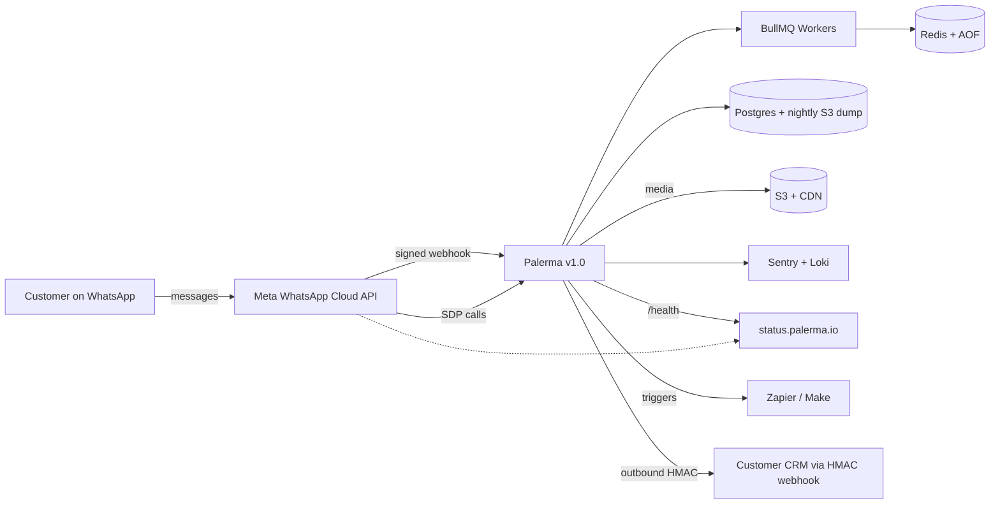

# Palerma — Customer-Ready Enhancement Plan

| Field | Value |
| --- | --- |
| Product codename | Palerma (working name in `package.json` is "WhatsApp Platform") |
| Repo root | `D:\whatsapp` |
| Document version | 1.0 |
| Date | Monday, 15 June 2026 |
| Companion doc | `D:\whatsapp\docs\AUDIT.md` (15 Jun 2026) — source of truth for "what works" |
| Prepared by | Cursor Agent (enhancement-plan sub-agent) |
| Status | **Pre-launch** — execution-ready. Do not modify application code in this PR; this is a plan, not an implementation. |
| Audience | Founder, CTO, lead engineer, design lead, one ops person |
| Time horizon | 4-week hardening sprint + 1 launch gate |

---

## 1. TL;DR for the founder

- **Palerma is functionally deep but operationally under-baked.** Twenty-two server modules and nineteen client pages do real work end-to-end. The audit confirms the WhatsApp core journey, automation engine, flow builder, AI bot, voice calling, and Razorpay checkout are wired through to the database and to Meta — that is a real achievement.
- **You are five categories of risk away from charging a customer:** (1) cost transparency (Meta conversation charges, AI token costs), (2) webhook reliability (no retry queue, no delivery log), (3) API key auth that ships but does not work (`server/src/middleware/api-key.ts` is not mounted in `server/src/index.ts:152–170`), (4) secret/encryption hygiene (`ENCRYPTION_KEY` defaulting silently in `config/index.ts`), (5) backup and DR.
- **The product does not feel "complete" yet.** Even when everything works, a paying user will notice: no typing indicator in real time, no read receipts UI, no per-agent scorecards, no campaign A/B testing, no dark mode done right, no command palette, no in-app changelog, no "what's new" panel, no CSAT, no per-recipient campaign preview. These are the things that make SaaS feel "click-everything-works" vs. "did I miss a feature?".
- **Recommendation:** spend 4 weeks hardening + polishing, then ship v1.0 to a small paid pilot (≤ 10 customers, INR only) with a defined Definition of Done. Do **not** ship with multi-currency, multi-region, or calling enabled as GA. They are roadmap, not launch.
- **The single biggest business risk right now** is that a user can fire a 10,000-contact marketing campaign without any cost warning, blowing a ₹20k Meta charge they did not budget for. Fixing this is a 1-day, 1-engineer job (`quota.ts:39` + a new `ConversationCharge` table).
- **The single biggest UX risk right now** is that the inbox opens with zero conversations, zero onboarding tooltip, and no empty state beyond "When customers message you, conversations will show up here." (`InboxPage.tsx:746–756`). A new customer on day one feels lost.
- **The single biggest reliability risk** is the integrations dispatcher in `server/src/modules/integrations/dispatch.ts:24` doing `Promise.allSettled` with no retry queue, no delivery log, and a `warn` on failure. A customer's CRM integration is silently broken every time their server is offline for 5 minutes.
- **The single biggest compliance risk** is `server/src/modules/compliance/routes.ts:70–99` — the `/delete-request` endpoint logs an intent but does **not** delete anything. That is not GDPR; it is theatre.
- **You are not "almost there".** You are at the 60-yard line. The plan below compresses the next 30 yards into four weeks.

---

## 2. What already works (cite the audit; do not touch)

These are the "ship-with-confidence" foundations. **Do not refactor these in v1.0 hardening — they are correct, they are tested, they are deployed, and breaking them costs you launch.**

1. **Authentication & sessions.** JWT access + DB-tracked refresh tokens, bcrypt 12, optional TOTP, IP/UA captured, rate-limited login. *(Audit §4.1; `server/src/modules/auth/routes.ts`, `middleware/auth.ts`, `utils/jwt.ts`.)*
2. **End-to-end WhatsApp send/receive with Socket.IO realtime.** Webhook → HMAC verify → enqueue → worker → upsert contact + conversation + message → emit. Confirmed by reading `server/src/index.ts:130–134` (raw body capture for Meta + Razorpay webhooks), `workers/index.ts:30–44` (webhook worker), and the realtime emit chain. *(Audit §4.2, §4.3, §6.2.)*
3. **Automation engine (rule + AI fallback).** Static keyword/welcome/away/business-hours automations work; AI bot is debounced 1.5s and per-conversation locked (`server/src/modules/automation/engine.ts:13,209–252,251–310`). Conflict detection between overlapping keywords is implemented (`automation/conflicts.ts`). *(Audit §4.7.)*
4. **Visual flow builder.** 24+ node types including `handoff`, `ai`, `template`, `delay`, `webhook`, `ab_split`, `language`, `wa_flow`, `request_callback`, `condition`. Per-conversation lock prevents concurrent execution; 50-iteration loop guard prevents infinite loops. Versioning and restore implemented. *(Audit §4.8; `flows/engine.ts:23–47`, `flows/types.ts`, `flows/lock.ts`.)*
5. **AI chatbot (Azure OpenAI).** Multi-bot per org, knowledge base from FAQ/URL/PDF, semantic search via embeddings, guardrails (prompt injection, low confidence, blocked content), monthly token quota, versioning, audit log, and a test playground endpoint. *(Audit §4.9; `ai/chatbot.service.ts`, `ai/guardrails.ts`, `ai/knowledge-ingest.service.ts`.)*
6. **Voice calling (Deepgram + Google TTS + WebRTC bridge).** Inbound calls, AI voice agent loop, agent pickup via WebRTC, three routing modes (`ai_only`, `agents_first`, `ai_then_agents`), configurable ring timeout, after-hours mode, missed-call auto-reply. *(Audit §4.10; `calling/call.processor.ts`, `webrtc-bridge.ts`, `ai-voice-agent.ts`.)*
7. **Campaigns (template-driven broadcasts).** Audience resolution (manual/tags/contacts/all-opted-in), opt-in enforcement, daily quota, batched dispatch via BullMQ, real-time progress, stuck-recovery, retry-failed, duplicate. *(Audit §4.6; `campaigns/service.ts:80–100` recovery, `quota.ts`, broadcast worker in `workers/index.ts:91–251`.)*
8. **Multi-tenant isolation by query layer.** Every module scopes by `organizationId`. `loadOrgRole` + `requireOrgRole('OWNER', 'ADMIN')` are applied to all destructive endpoints. *(Audit §4.1–§4.22; `middleware/auth.ts`, `middleware/permissions.ts`.)*
9. **Razorpay INR billing.** Plan upgrade + order create + signature verify + webhook all work. Plans are hard-coded but consistent. *(Audit §4.11; `billing/routes.ts:111–208`.)*
10. **Compliance export (read-only).** `GET /api/compliance/export` produces a JSON download of contacts, conversations (top 500, last 100 messages each), and campaign metadata. *(Audit §4.13; `compliance/routes.ts:9–68`.)*

**The principle for the next 4 weeks: protect these ten surfaces like a new parent protects a sleeping baby. Every PR, every refactor, every "while I'm in there" must defer to "will this regress the inbox send/receive, the automation, the webhook, the billing, or the auth?".**

---

## 3. The 10 production-readiness categories

Each gap is tagged **Must-fix before launch (MFL)** / **Should-fix in week 1 (W1)** / **Nice polish in month 1 (M1)** / **Backlog (BL)**. Effort is XS (< 0.5d), S (0.5–1d), M (1–3d), L (3–5d), XL (> 5d).

### 3.1 Stability & Reliability

| # | Priority | Title | Problem | Evidence (file) | Proposed fix | Effort | Acceptance criteria |
| --- | --- | --- | --- | --- | --- | --- | --- |
| R-1 | **MFL** | No `db push` → `prisma migrate` | `npx prisma db push` is used in dev and `ci.yml`; there is no real migration history. A schema drift will silently lose data. | `.github/workflows/ci.yml` (audit §10.1) | Run `prisma migrate dev --name init` to create the baseline, commit `migrations/`, switch `ci.yml` to `prisma migrate deploy`. | M | CI fails if `prisma migrate diff` reports drift; production runs `migrate deploy` on boot. |
| R-2 | **MFL** | No webhook delivery log / retry queue | `integrations/dispatch.ts:24` uses `Promise.allSettled`, no retries, no log table, only `warn` on failure. | `server/src/modules/integrations/dispatch.ts:7–53` | Add `WebhookDelivery` model (id, endpointId, event, status, attempts, lastStatusCode, lastError, requestBody, createdAt). New `webhook-dispatch` BullMQ queue with 4 retries (10s/30s/2m/10m). | M | Failed deliveries appear in Settings → Integrations; auto-disable endpoint after 10 consecutive failures; replay button. |
| R-3 | **MFL** | No dead-letter / queue inspector | Operators cannot see why a campaign failed for a recipient. | `config/queues.ts`, `workers/index.ts:91–251` | Mount Bull Board at `/admin/queues` (OWNER-only). Persist `lastError` on `CampaignRecipient` (already partial). | S | `GET /api/campaigns/:id/stats` exposes error breakdown by Meta error code. |
| R-4 | **MFL** | Encryption key silently defaults to empty | `config/index.ts:26` falls back to `''` if `ENCRYPTION_KEY` is unset — every org's Meta + Azure tokens become un-decryptable on restart. | `server/src/config/index.ts:26` (audit S6) | Fail fast in production: if `ENCRYPTION_KEY` is empty or not 64 hex chars when `NODE_ENV=production`, exit with a clear error. | XS | Booting in production with empty key exits 1 with message. |
| R-5 | **MFL** | `META_VERIFY_TOKEN` defaults to a guessable value | Same file, same risk. Anyone can complete the webhook handshake. | `server/src/config/index.ts:21` (audit S9) | Same as R-4: fail fast if `META_VERIFY_TOKEN` equals the default. | XS | Booting in production with default verify token exits 1. |
| R-6 | **MFL** | `META_APP_SECRET` empty → signature verify silently skipped | `whatsapp/routes.ts:367` (`if (signature && config.meta.appSecret)`) | `server/src/modules/whatsapp/routes.ts` (audit M6) | If `META_APP_SECRET` is empty in production, reject webhooks with 503. | XS | Production boot fails without `META_APP_SECRET`. |
| R-7 | W1 | Stuck-campaign recovery is the only safety net | `service.ts:80–100` flips PENDING → FAILED after 6h. Long campaigns lose hours. | `server/src/modules/campaigns/service.ts:80–100` (audit M13) | Add `lastSuccessOffset` on `Campaign`; on resume, re-enqueue from the offset, not from the top. | M | A campaign that died at recipient 23,000 resumes at 23,001, not at 0. |
| R-8 | W1 | No per-recipient send throttling | `messages/send.service.ts` has no per-`to` 1-msg/sec throttle. | `server/src/modules/messages/send.service.ts` (audit M14) | Add a 1-second minimum gap per `to` phone in `deliverOutboundMessage`. | S | Two identical messages to the same number from the same org within 1 second: second is deferred. |
| R-9 | W1 | Webhook signature optional | Same as R-6 but expressed as a separate ticket. | `whatsapp/routes.ts:367` | If signature header is missing in production, return 401. | XS | Missing signature header → 401 in prod, optional in dev with banner. |
| R-10 | W1 | No automatic DB backup | `docker-compose.yml` has named volume, no backup job. | `docker-compose.yml` (audit M20) | Cron `pg_dump` to S3, 30-day retention; monthly restore drill. | M | Script in `infra/backup/`, restore drill recorded in `RUNBOOK.md`. |
| R-11 | M1 | No media lifecycle | `media/storage.ts` writes to `uploads/media` forever. | `server/src/modules/media/storage.ts` (audit M18) | Background job purges media older than `Organization.retentionDays` unless referenced. | S | Daily job logs purge count; audit entry per delete. |
| R-12 | M1 | Local media default, S3 unverified | `STORAGE_DRIVER=local` default in `.env.example:74`. | `server/.env.example:74` (audit S19) | Default to S3 in production, document migration. | S | Production `STORAGE_DRIVER` is `s3`; test writes to a real bucket. |
| R-13 | M1 | Single Redis instance, no AOF | `docker-compose.yml` redis:7, no persistence setting. | `docker-compose.yml` | Enable AOF + daily RDB snapshot; document snapshot path. | S | Redis restart does not lose in-flight BullMQ jobs. |
| R-14 | M1 | No race condition on `Contact` upsert | The webhook worker upserts `Contact` by `(organizationId, phone)`. Two near-simultaneous messages for the same contact in the same org can race. | `workers/webhook.processor.ts` (referenced by audit) | Use a unique constraint (already in Prisma schema per `organizationId_phone`) and rely on the database, not the application. Verify under load. | XS | 100 concurrent webhooks for the same new phone produce exactly one Contact row. |
| R-15 | BL | No rate limit per API key | Once R-Mounted (see S-2), API keys will have no per-key throttle. | `middleware/api-key.ts` (once mounted) | Add a per-key token bucket; 60 req/min by default, configurable. | S | Two API keys for the same org have independent counters. |

### 3.2 Security & Compliance

| # | Priority | Title | Problem | Evidence | Proposed fix | Effort | Acceptance criteria |
| --- | --- | --- | --- | --- | --- | --- | --- |
| S-1 | **MFL** | API key middleware exists but is not mounted | `middleware/api-key.ts` is implemented but never imported in `server/src/index.ts:1–225`. Customers pay for a feature that does not work. | `server/src/middleware/api-key.ts:1–37` vs. `server/src/index.ts:152–170` (audit S3) | Mount `authenticateApiKey` on `/api/messages/send`, `/api/contacts`, `/api/campaigns`. Document the `X-Api-Key` header in `docs/API.md`. | S | `POST /api/messages/send` with `X-Api-Key: wa_…` returns 200; without it returns 401. |
| S-2 | **MFL** | `conversation.closed` is in `WEBHOOK_EVENTS` but never emitted | `integrations/routes.ts:15` lists it; `dispatchOrgWebhook` is never called with that event anywhere in the codebase (grep confirms). | `server/src/modules/integrations/routes.ts:11–17` + repo-wide grep (audit S5) | Emit `dispatchOrgWebhook(orgId, 'conversation.closed', { conversationId, closedAt })` inside `PATCH /api/inbox/:id/status` when status → CLOSED. | XS | A customer with a `conversation.closed` endpoint receives a POST when an agent closes a chat. |
| S-3 | **MFL** | Compliance `/delete-request` does nothing | `compliance/routes.ts:70–99` writes only an `audit_log` row. No actual purge. | `server/src/modules/compliance/routes.ts:70–99` (audit §4.13, M15) | Add a BullMQ `compliance-purge` queue + cron. Process delete-request intents: anonymize messages, soft-delete contacts, hard-delete media, write audit. | M | Submitting `{"confirm":"DELETE MY DATA"}` results in 30 days later: Contact rows anonymized, Messages have `content: "[REDACTED]"`, Media files deleted, audit log preserved. |
| S-4 | **MFL** | No retention / archival policy | Audit §10.6 lists this as a launch blocker. | (audit M15) | Add `Organization.retentionDaysMessages`, `retentionDaysContacts`, `retentionDaysMedia`; cron job honors them. | M | A 1-day test org with `retentionDaysMessages=1` has all messages deleted after 24h. |
| S-5 | **MFL** | No PII redaction in logs | `utils/logger.ts` writes to console. Phone numbers, tokens, message bodies can land in logs. | `server/src/utils/logger.ts` (audit §10.3) | Add a log redaction layer (phone, email, token); document. | S | Grep logs for `+91 98765` returns zero hits. |
| S-6 | **MFL** | Razorpay test keys in `.env.example` | `server/.env.example:85–87` ships test keys. | `server/.env.example:85–87` (audit S7) | Move to `server/.env.test` (gitignored) and document in `RUN-LOCALLY.md` how to obtain fresh test keys. | XS | `.env.example` contains `your_key_id_here` placeholders only. |
| S-7 | W1 | No DPIA / DPA flow | For EU enterprise customers, a Data Processing Agreement template is required before Go-Live. | (audit M7) | Publish a `docs/DPA.md` template, signed via DocuSign. | M | First enterprise contract references the DPA. |
| S-8 | W1 | No DPDP (India) consent flow | Indian customers need explicit opt-in. | (audit M7) | Add `Contact.consentSource`, `ConsentLog` table; opt-in/opt-out endpoints; "STOP" keyword handler. | M | Sending a campaign ignores contacts whose `optedIn=false`. |
| S-9 | W1 | Secret rotation not documented | JWT secret, encryption key, Meta app secret, Razorpay webhook secret have no documented rotation path. | (audit §10.9) | Add `docs/RUNBOOK.md` with rotation scripts. Add `keyVersion` on `WhatsappNumber.accessToken` and `OrgAiSettings.apiKeyEncrypted`. | L | Test rotation: rotate key, all tokens remain decryptable (re-encrypted lazily). |
| S-10 | W1 | Audit log for app events is shallow | `auditLog` table exists; only team and automation write to it. Campaign sends, billing changes, AI bot handoffs do not. | `server/src/modules/team/audit.ts`, `automation/engine.ts` | Hook `prisma.auditLog.create(...)` in `campaigns/service.ts:send`, `billing/routes.ts:verify`, `ai/handoff.service.ts`. | M | Every destructive or money-affecting action lands in `auditLog`. |
| S-11 | M1 | No SOC 2 controls | (audit §10.7) | — | Not in scope for v1.0; target Q4 2026. | XL | SOC 2 Type II report. |
| S-12 | M1 | IP allow-list per org | Enterprise customers want their own IPs allow-listed. | — | Add `OrgIpAllowlist` table; middleware check. | M | API requests from non-allowlisted IPs return 403. |
| S-13 | BL | No SSO/SAML | Enterprise customers will ask. | — | Add SAML 2.0 via `passport-saml`. | L | Okta login works for one test org. |
| S-14 | BL | No session fingerprinting | Two users on the same IP can share a stolen token. | `auth/routes.ts` | Hash UA + accept-language + screen; store on `RefreshToken`; alert on mismatch. | M | A login from a different fingerprint sends an email. |

### 3.3 Performance & Scale

| # | Priority | Title | Problem | Evidence | Proposed fix | Effort | Acceptance criteria |
| --- | --- | --- | --- | --- | --- | --- | --- |
| P-1 | W1 | `analytics/reports` per-agent metric is N+1 | `analytics/routes.ts` likely queries per-member. | `server/src/modules/analytics/routes.ts` (audit §4.18) | Refactor to a single grouped query with `groupBy`. | S | 50-member org: `/api/analytics/reports` returns < 500ms p95. |
| P-2 | W1 | Inbox list `prisma.conversation.findMany` includes 1 message + flow fetch — two extra queries per page | `inbox/routes.ts:45–78` (audit §4.3) | Cache flow metadata at module level; include flowName in conversation when a `flowId` matches. Use a denormalized `currentFlowName` column. | M | Inbox list p95 < 300ms with 10k conversations. |
| P-3 | W1 | `inbox/routes.ts:243–275` calls Meta per template name on every messages fetch | One Meta API call per unique template per page. | `inbox/routes.ts:253–275` | Cache `Template` metadata in Redis with 5-min TTL. | S | Repeat messages fetch: zero Meta calls. |
| P-4 | W1 | Socket.IO has no per-room backpressure | A burst of 5,000 inbound messages emits 5,000 socket events to a room. | `server/src/index.ts:39–91`, `realtime.ts` | Add a per-`(orgId, event)` coalescing: if the same conversation emits 5 messages in 200ms, send one "batch" event. | M | Stress test: 1,000 messages in 10s → ≤ 200 socket events. |
| P-5 | W1 | Media upload is base64 in JSON body | `inbox/routes.ts:413` and client `fileToBase64`. | `client/src/pages/InboxPage.tsx:347–356`, `server/src/modules/inbox/routes.ts:413` (audit M9) | Add `POST /api/media/upload-url` (presigned S3). Update client to upload directly. | M | 10MB image upload uses ~50KB of HTTP traffic instead of ~13MB. |
| P-6 | M1 | Cold start of worker not measured | No `workerStart` metric. | `workers/index.ts:298–300` | Log worker boot duration; emit to Sentry. | XS | First message after restart: log shows `workerBootMs: 1240`. |
| P-7 | M1 | No CDN on `/api/media/public/:orgId/:filename` | `media/public.routes.ts:7–46` returns a buffer with `Cache-Control: public, max-age=3600` from the app server. | `server/src/modules/media/public.routes.ts:7–46` | Front the route with CloudFront / Cloudflare CDN; cache by `Content-Type` and `Content-Length`. | M | p95 public media fetch < 100ms in any region. |
| P-8 | M1 | No connection pooling config on Prisma | `config/database.ts` likely uses defaults. | `server/src/config/database.ts` | Set `connection_limit: 10` per app instance + per worker. | XS | 4 API + 2 worker instances, 60 concurrent connections, no "too many clients" errors. |
| P-9 | M1 | Reports query time window 7–90 days only | `analytics/routes.ts` does not allow 1 day. | `server/src/modules/analytics/routes.ts` | Allow `windowDays=1` for "today" view. | XS | Today report loads in < 500ms. |
| P-10 | BL | No read replica routing | Single Postgres for reads + writes. | `config/database.ts` | `PrismaClient` with `replica` strategy; reads → replica. | L | Read load on primary drops 60% in synthetic load test. |

### 3.4 Onboarding & First-Run UX

This is the section with the highest leverage for "feels complete".

| # | Priority | Title | Problem | Evidence | Proposed fix | Effort | Acceptance criteria |
| --- | --- | --- | --- | --- | --- | --- | --- |
| O-1 | **MFL** | Onboarding is a single WhatsApp callback page | `WhatsappCallbackPage` exists; the rest of the path is unmarked. | `client/src/pages/WhatsappCallbackPage.tsx` (audit §9.1) | Replace with a 4-step wizard: (1) Verify Meta app config, (2) Click "Connect WhatsApp", (3) Select WABA, (4) Send first test message. | L | New user reaches "first message sent" in < 4 minutes. |
| O-2 | **MFL** | No "ready to launch" readiness banner | `SettingsPage` has a "readiness banner" stub, but the criteria are not defined. | `client/src/pages/SettingsPage.tsx` (audit §4.22) | Show a persistent banner with 5 checks: (1) WhatsApp connected, (2) At least 1 template approved, (3) At least 1 contact, (4) At least 1 agent, (5) Business hours set. | M | A new org with 0 of 5 checks sees a red banner that says "3 of 5 steps remaining". |
| O-3 | **MFL** | Inbox empty state is too quiet | `InboxPage.tsx:746–756` shows "When customers message you, conversations will show up here." | `client/src/pages/InboxPage.tsx:746–756` | Replace with a 3-CTA empty state: "Send a test to your own number" / "Import contacts" / "Connect a second number". | S | Empty inbox has 3 clickable actions, not 0. |
| O-4 | **MFL** | No "send first message" wizard | No in-app way to send a test message. | (audit §9.1) | Add `Settings → WhatsApp → Test connection` button that sends a `hello_world`-style message to the OWNER's phone. | S | OWNER can send a test to their personal number in 1 click. |
| O-5 | W1 | Webhook health is invisible | `whatsapp/routes.ts` has `/webhook-status` but the client never polls. | (audit §9.2) | Add a sidebar item "Webhook health" with last delivery, subscribed fields, retry button. | M | Settings page shows "Last delivery: 2s ago · 200 OK" in real time. |
| O-6 | W1 | Calling prerequisites are cryptic | `meta-calling.service.ts:170` parses raw Meta errors. | `server/src/modules/calling/meta-calling.service.ts:170` (audit M10) | Map `error.error_user_title` to a friendly hint with a "View Meta checklist" deep link. | S | A user with a YELLOW-quality WABA sees: "Your phone number quality is YELLOW. Resolve in 3 steps →". |
| O-7 | W1 | AI bot requires manual Azure setup | `OrgAiSettings` config flow is form-heavy. | `ai/org-ai.service.ts` | Add an "AI Bot" first-run modal: 3 example bots (Sales, Support, Lead capture) the user can clone. | M | New org with no bot: 1-click clone of "Support bot" works. |
| O-8 | W1 | No team-invite banner when SMTP is off | Forgot-password and team invites silently no-op. | `services/email.service.ts` (audit S1) | If `SMTP_HOST` is empty, show a red banner in `TeamPage`: "Email is not configured — invite links must be shared manually". | S | Banner appears for orgs without SMTP. |
| O-9 | M1 | No 30-day "first month" email | New users forget the product exists. | — | Day 3 / 7 / 14 / 30 lifecycle emails: "Did you try campaigns?", "Set up business hours", "Your first conversation". | M | New signups receive 4 emails; open rate > 30%. |
| O-10 | M1 | No guided tour | First-time users see a complex Inbox with 0 context. | — | Build a 4-step tour using `react-joyride` or `driver.js`: Inbox → Composer → Campaigns → Settings. | M | First session: tour auto-starts; "Don't show again" persists. |

### 3.5 Daily-Use UX Polish

These are the things that make users say "this product feels done" instead of "I feel like something is missing". Detailed delight catalog in §5.

| # | Priority | Title | Problem | Evidence | Proposed fix | Effort | Acceptance criteria |
| --- | --- | --- | --- | --- | --- | --- | --- |
| U-1 | **MFL** | No typing indicator in the inbox | The server sends `MetaWhatsAppService.sendTypingIndicator` only for AI bot replies (audit §4.9, `automation/engine.ts:254`), not for human agents. | `server/src/modules/automation/engine.ts:254–261` | When an agent types in the composer for > 500ms, send a `typing` event to the customer's socket. Customer UI: 3-dot typing indicator. (Requires a customer-side socket — see U-2.) | M | Real users see "typing…" while an agent is composing. (For v1: typing visible to other agents in the same conversation.) |
| U-2 | W1 | Customer-facing socket is absent | The product is a dashboard; customers do not have accounts. Typing/read receipts to end-customers require either a Magic Link or a customer webview. | — | Add an opt-in "Customer Webview" — a small `/c/:token` page that shows live agent messages. Use a signed short-lived JWT for auth. | L | A magic-link webview shows the latest message in < 200ms. |
| U-3 | W1 | No read receipts UI | The DB stores `MessageStatus: 'READ'` (via Meta status callbacks), but the inbox never shows two blue ticks. | `server/src/workers/webhook.processor.ts`, `client/src/components/inbox/MessageBubble.tsx` | Add `<CheckCheck />` icon in `MessageBubble` when status is `READ`. | S | Read message bubbles show double blue ticks. |
| U-4 | W1 | No conversation merge | Customer A and Customer B both have +91 98765 43210 (typo'd once each). Operators create two conversations. | `inbox/routes.ts` (audit §5.3) | Add `POST /api/inbox/merge` taking `keepId` and `mergeId`; reassign messages; close the other. | S | An operator can merge two conversations in 2 clicks. |
| U-5 | W1 | No snooze / follow-up | Operators have no way to mark "come back to this in 2 hours". | — | Add `snoozedUntil: DateTime?` on `Conversation`; filter pill in sidebar. | S | A conversation can be snoozed; it disappears from the open list and reappears at the time. |
| U-6 | W1 | No mentions / @team | Internal collaboration in notes is text-only. | `InboxDetailsPanel.tsx:144–168` | `@agentname` in notes triggers a notification (in-app + email) and links to the agent's profile. | M | A note with `@amit` sends a toast to Amit's UI. |
| U-7 | W1 | Contact timeline is shallow | `ContactsPage` shows a list, not a "what happened with this contact" view. | `client/src/pages/ContactsPage.tsx`, `server/src/modules/contacts/routes.ts` | Add a "Timeline" tab to contact detail: messages, calls, campaigns sent, notes, label changes. | M | A contact detail page shows a chronological list of all interactions. |
| U-8 | M1 | Dark mode is half-done | Many components have `dark:` classes, but the inbox composer and media viewer do not. | `client/src/components/inbox/ChatComposer.tsx`, `MediaViewer.tsx` | Audit every component for `dark:` parity; add theme toggle to header. | M | Switching theme in header inverts every screen; nothing flashes white. |
| U-9 | M1 | No command palette | Power users expect `Cmd+K`. | — | Add a `Cmd+K` palette: jump to conversation, create campaign, send template, toggle theme. | M | `Cmd+K` opens a fuzzy-search palette; arrow keys + enter to navigate. |
| U-10 | M1 | No keyboard shortcuts | `?` does not show a help dialog. | — | Add shortcuts: `j/k` (next/prev chat), `r` (reply), `e` (archive), `Cmd+Enter` (send). | M | Pressing `?` shows a modal with all shortcuts. |
| U-11 | M1 | No drag-and-drop file upload | Click the paperclip → pick file. Drag-onto-chat does not work. | `ChatComposer.tsx:117–122` | Add `onDragOver` / `onDrop` to the chat area; preview before sending. | S | Dragging a PDF onto the inbox shows a preview card. |

### 3.6 Operational Readiness

| # | Priority | Title | Problem | Evidence | Proposed fix | Effort | Acceptance criteria |
| --- | --- | --- | --- | --- | --- | --- | --- |
| OP-1 | **MFL** | No CI security scan | `.github/workflows/ci.yml` has no `npm audit`, no Snyk. | `.github/workflows/ci.yml` (audit §10.1) | Add `npm audit --production` and `snyk test`; fail on `high` or `critical`. | S | CI fails on a known-vulnerable dep. |
| OP-2 | **MFL** | No deploy job in CI | Audit §10.1 confirms no deploy workflow. | `.github/workflows/ci.yml` | Add `deploy.yml`: build Docker image on tag push, push to GHCR, trigger rolling deploy. | M | Pushing a tag deploys to staging. |
| OP-3 | **MFL** | No Sentry / log shipping | `utils/logger.ts` console-only. | `server/src/utils/logger.ts` (audit S8) | Wire Sentry SDK; PII-redact phone numbers, tokens, message bodies. | S | A test exception in `/health` appears in Sentry. |
| OP-4 | **MFL** | No SLOs documented | Audit §10.3 lists latency/error SLOs as blockers. | — | Document 4 SLOs in `docs/SLO.md`: webhook→DB p95, outbound send p95, dashboard load p95, queue lag p95. | S | SLO doc exists with thresholds and burn-rate alert policy. |
| OP-5 | W1 | No runbook | No `RUNBOOK.md` with on-call procedures. | (audit §10.2) | Write `RUNBOOK.md`: deploy, rollback, backup, restore, key rotation, incident response, common errors. | L | New on-call can resolve "webhook 5xx spike" from the runbook alone. |
| OP-6 | W1 | No status page | No public status page. | (audit M17) | Spin up statuspage.io / BetterUptime; subscribe to `/health` endpoint. | S | status.palerma.io shows "All systems operational". |
| OP-7 | W1 | No structured logs | Console-only Winston. | `utils/logger.ts` | Switch to JSON output; ship to Loki / CloudWatch / Datadog. | M | Logs are queryable by `orgId`, `conversationId`, `messageId`. |
| OP-8 | M1 | No distributed tracing | Audit §10.3 calls this out. | — | OpenTelemetry traces: HTTP → worker → Meta API → webhook. | XL | A trace view in Jaeger / Honeycomb shows the path of a single inbound message. |
| OP-9 | M1 | No DR plan | Audit §10.2. | — | Document RTO 4h, RPO 1h; cross-region S3 replication. | M | Quarterly DR drill. |
| OP-10 | M1 | No on-call rotation | No PagerDuty / Opsgenie. | — | Wire Sentry → PagerDuty. | S | A `fatal` error in Sentry pages the on-call. |

### 3.7 Billing & Cost Transparency

| # | Priority | Title | Problem | Evidence | Proposed fix | Effort | Acceptance criteria |
| --- | --- | --- | --- | --- | --- | --- | --- |
| B-1 | **MFL** | No conversation-cost telemetry | No `ConversationCharge` model, no per-WABA usage polling. | (audit M1) | Add `ConversationCharge` table; daily cron polls `/{waba-id}/conversation_analytics`; show in `/api/billing/usage` and Dashboard. | L | Dashboard shows "This month: ₹4,200 across 1,800 conversations" with category breakdown. |
| B-2 | **MFL** | No quality-rating polling | `meta.service.ts` never polls quality. | (audit M2) | Cron polls `/phone_numbers/{id}/quality`; on YELLOW/RED change, banner + email. | S | A number dropping to YELLOW triggers a banner and an email within 24h. |
| B-3 | **MFL** | No template-rejection alerts | `templates/routes.ts` has no status subscriber. | (audit M3) | Poll `message_templates` daily; on REJECTED/PAUSED, email + in-app banner. | S | A template rejected by Meta shows in `TemplatesPage` with "Why was it rejected?" hint. |
| B-4 | **MFL** | Campaign does not show estimated cost before send | Campaign wizard shows recipient count, not `count × category_price`. | `client/src/pages/CampaignsPage.tsx`, `server/src/modules/campaigns/service.ts` | Before `POST /campaigns/:id/send`, return `estimatedCost` from server. Client shows a confirm modal: "This will cost approximately ₹X". | M | A 5,000-recipient utility campaign shows "≈ ₹20 INR in Meta fees" before send. |
| B-5 | W1 | Stripe is missing | Billing is INR-only. | `billing/routes.ts` (audit M4) | Add `billing/stripe.service.ts` mirroring `razorpay.service.ts`; switch by `BILLING_PROVIDER` env. | L | A test card `4242 4242 4242 4242` upgrades a US org. |
| B-6 | W1 | No tax / VAT handling | Plans hard-coded in INR. | `plans.ts` (audit M5) | Add `taxBehavior: 'exclusive' | 'inclusive'`; per-region tax rate. | M | A UK customer sees "+20% VAT" on checkout. |
| B-7 | W1 | No annual billing option | Audit §9.9 calls this out. | `plans.ts` | Add `interval: 'month' | 'year'` to plan definitions. | S | A "Save 20% with annual" toggle on the BillingPage. |
| B-8 | W1 | No dunning | Failed payments just stay `FAILED`. | `billing/routes.ts:163–207` (audit §4.11) | Cron retries failed payment methods 3x over 7 days; downgrade to `starter` after day 7 with email. | M | A failed payment triggers 3 retry emails and a downgrade. |
| B-9 | M1 | No invoice numbering | Uses Razorpay's invoice ID. | — | Generate `INV-YYYY-NNNN` on plan activation; send PDF via email. | M | Every plan upgrade emails a PDF invoice. |
| B-10 | M1 | No AI token cost visibility | `OrgAiSettings.monthlyTokenLimit` exists, but cost is not surfaced. | `settings/routes.ts` | Add `getAiUsage` returning prompt/completion tokens and an estimated USD cost. | S | Settings → AI shows "12,400 / 100,000 tokens · ≈ $0.02". |

### 3.8 Integrations & Extensibility

| # | Priority | Title | Problem | Evidence | Proposed fix | Effort | Acceptance criteria |
| --- | --- | --- | --- | --- | --- | --- | --- |
| I-1 | **MFL** | API key auth not mounted | See S-1. | `server/src/middleware/api-key.ts` | Mount + document. | S | Same as S-1. |
| I-2 | **MFL** | Outbound webhook delivery is fire-and-forget | See R-2. | `integrations/dispatch.ts:24` | Add retry queue + delivery log. | M | Same as R-2. |
| I-3 | **MFL** | `conversation.closed` never emitted | See S-2. | (grep confirmed) | Emit on close. | XS | Same as S-2. |
| I-4 | W1 | No incoming webhook receiver | Customers cannot ingest third-party messages. | (audit §4.12) | Add `POST /api/integrations/inbound` with per-org HMAC verification; deliver via the same send pipeline. | L | A customer configures a Slack channel; messages from Slack appear in the inbox. |
| I-5 | W1 | No Zapier / Make integration | Audit §5. | — | Build 3 Zapier triggers: `new_message`, `new_conversation`, `conversation_closed`. | L | A Zap with Palerma as a trigger fires on a new inbound message. |
| I-6 | W1 | OpenAPI spec is missing | No `openapi.yaml`. | — | Generate from zod schemas; serve at `/api/docs`. | M | A developer can `curl /api/docs` and get a spec. |
| I-7 | M1 | No GraphQL / gRPC option | REST only. | — | Not in scope for v1.0. | XL | — |
| I-8 | M1 | No webhook filtering by conversation | A customer gets a webhook for every message in every chat. | `integrations/dispatch.ts:7–53` | Add `filterLabels: string[]` to `WebhookEndpoint`; only emit if the conversation has any matching label. | M | A webhook with `filterLabels: ["vip"]` fires only for VIP conversations. |
| I-9 | M1 | No HMAC secret rotation | `WebhookEndpoint.secret` is generated once. | `integrations/routes.ts:140–161` | Add `POST /api/integrations/webhooks/:id/rotate-secret`. | S | The secret can be rotated; old secret remains valid for 1h. |

### 3.9 Customer Support & Self-Help

| # | Priority | Title | Problem | Evidence | Proposed fix | Effort | Acceptance criteria |
| --- | --- | --- | --- | --- | --- | --- | --- |
| CS-1 | **MFL** | No in-app help / docs link | Header has no "?" or "Help". | `client/src/components/layout/*` | Add header `?` button → opens docs.palerma.io in new tab. | XS | Every page has a help link. |
| CS-2 | **MFL** | No empty-state guidance beyond text | `EmptyState` component is reused but lacks CTAs. | `client/src/components/ui/EmptyState.tsx` (used in `InboxPage.tsx:746`, etc.) | Add `primaryAction?: { label, onClick }` to `EmptyState`. | S | Every empty state has 1-2 clickable actions. |
| CS-3 | W1 | No tooltips on complex buttons | Bot toggle, AI bot select, calling: zero tooltips on hover. | `InboxPage.tsx:839–881` (audit) | Add `title` and `aria-label`; use `radix-ui/tooltip` for rich tooltips. | S | Hovering "AI ON" shows "AI bot is replying — click to pause for this chat". |
| CS-4 | W1 | No error toasts guidance | `toastError(msg)` shows raw error strings. | `client/src/utils/toast.ts` | Add a `toastErrorWithAction(msg, { label, onClick })` variant. | S | A "Webhook unreachable" toast has a "Open status" button. |
| CS-5 | W1 | No "What's new" panel | New features ship silently. | — | Add a `changelog` table; "What's new" modal on first session of the week. | M | A user opening the app Monday sees a 3-item list of last week's changes. |
| CS-6 | W1 | No in-app feedback widget | Audit §10.8. | — | Embed a Canny / Featurebase widget in the bottom-right. | S | A user can submit "I wish X" without leaving the app. |
| CS-7 | M1 | No status banner | If Meta is down, the product has no idea. | — | Subscribe to Meta status; show a banner in header. | S | A Meta outage shows "Meta is currently degraded — sends may be delayed". |
| CS-8 | M1 | No support email SLA | Audit §10.8. | — | Per-plan SLA: Starter 48h, Growth 24h, Business 8h, Enterprise 1h; surface in `TeamPage`. | S | A `?` tooltip on the support link shows the response time. |
| CS-9 | M1 | No video walkthroughs | Audit §9.1. | — | Record 4 Loom videos: "Connect WhatsApp", "Build your first flow", "Send a campaign", "Set up the AI bot". Embed in onboarding emails. | S | Day 0 email contains a 2-minute "Connect WhatsApp" video. |
| CS-10 | BL | No community / Discord | — | — | Not in scope. | XL | — |

### 3.10 Trust & Brand Polish

| # | Priority | Title | Problem | Evidence | Proposed fix | Effort | Acceptance criteria |
| --- | --- | --- | --- | --- | --- | --- | --- |
| T-1 | **MFL** | No Terms / Privacy / DPA pages | No `pages/TermsPage.tsx`, `PrivacyPage.tsx`. | `client/src/App.tsx` (audit §4.22 — no mention) | Add pages; link from footer and Register flow. | M | Footer has "Terms", "Privacy", "DPA", "Security". |
| T-2 | **MFL** | No security.txt, no /.well-known/security.txt | Required for responsible disclosure. | — | Add the file with contact email + PGP key. | XS | `/.well-known/security.txt` returns valid content. |
| T-3 | W1 | No logo system | "Palerma" is a codename; the product name in `package.json` is "WhatsApp Platform". | `package.json:1` (audit §0) | Settle on a name + logo + favicon. | S | Every page shows the new logo; favicon is the same. |
| T-4 | W1 | Marketing site is missing | `client/src/pages/` has 19 pages — none are public marketing. | — | Build a small `landing.palerma.io` (Next.js static). | L | A page with "Pricing", "Features", "Demo", "Sign up" exists. |
| T-5 | W1 | No customer logo wall | Audit §0. | — | Add `/customers` page once 3+ paying customers. | S | A page with 3 logos and quotes. |
| T-6 | M1 | In-product copy is rough | "Messaging unavailable", "Try adjusting your search or filters." | `ChatComposer.tsx:40`, `InboxPage.tsx:750–755` | Hire a copywriter; replace 30 strings. | M | Every empty state and toast has a friendlier, more specific message. |
| T-7 | M1 | No demo / sandbox account | Prospects must sign up to see the product. | — | Provide a `demo@palerma.io` shared account. | S | A "View demo" button logs in to a read-only sandbox. |
| T-8 | BL | No SOC 2 / ISO badges | Enterprise prospects ask. | — | Target Q4 2026. | XL | SOC 2 Type II badge on `/security`. |

---

## 4. Delight features catalog

Twenty-one items, grouped by area. Each is small to medium effort, but cumulatively they make Palerma feel "done" the way Interakt, Wati, and AiSensy feel "done".

### 4.1 Inbox

| # | Name | Why it matters | How to implement (1–3 sentences) | Effort | Without it the user feels… |
| --- | --- | --- | --- | --- | --- |
| D-1 | **Typing indicator (agent → customer)** | Customers know the agent is there. | When `ChatComposer.onChange` fires for > 500ms, debounced `socket.emit('typing', {conversationId})` to a customer-side webview (U-2). | M | …the agent is busy and they got ignored. |
| D-2 | **Read receipts UI** | Visually closes the loop. | `MessageBubble` shows double-check (`✓✓`) when `Message.status === 'READ'`. Use WhatsApp-style blue checks. | S | …their message was lost. |
| D-3 | **Internal notes with @mentions** | Agent-to-agent async collaboration. | `InternalNote` model already exists; extend UI to parse `@name` and show in-app toast + email notification. | M | …they have to switch to Slack to ask a colleague. |
| D-4 | **Conversation merge** | Operators often have duplicate contacts. | New `POST /api/inbox/merge` taking `keepId, mergeId`; reassigns messages, calls, notes; closes the loser. | S | …the product can't handle the messy reality of customer data. |
| D-5 | **Snooze conversations** | "Come back in 2h" is a daily need. | Add `Conversation.snoozedUntil`; filter "Snoozed" pill in sidebar. | S | …they can't put work down for later. |
| D-6 | **Quick replies with `/`** | Already partially built (`ChatComposer.tsx:49–54,168–185`). | Improve: support `/category` namespaces; show icon + description. | S | …typing the same answer 20 times a day. |
| D-7 | **Contact timeline** | A single page for "everything about this contact". | Add Timeline tab to `InboxDetailsPanel`: messages, calls, campaigns received, notes, label changes. | M | …they have to click through 5 screens. |
| D-8 | **Voice note playback with waveform** | Voice notes are a WhatsApp staple. | Use `wavesurfer.js`; show duration, play/pause, scrubbing. Cache blob URL. | M | …the product doesn't understand voice. |
| D-9 | **Sentiment indicator** | Spot unhappy customers fast. | Lightweight ML (or Azure OpenAI classify) on each inbound message; show 🙂 😐 ☹️ in `ConversationItem`. | L | …they miss the angry customer until it's too late. |
| D-10 | **Customer-side webview** | Lets end-customers see messages in a tiny chat bubble. | `GET /c/:signedToken` → React component that joins `customer:<phone>` socket room. | L | …the product is a back-office tool, not a chat. |

### 4.2 Campaigns

| # | Name | Why it matters | How to implement | Effort | Without it the user feels… |
| --- | --- | --- | --- | --- | --- |
| D-11 | **Send-time optimization** | Higher open rates = happier customers. | Analyze past campaign open times per org; suggest "Best time for Tuesdays: 10:30 AM". | M | …the product is dumb about timing. |
| D-12 | **A/B subject line test** | Marketers want experiments, not blind sends. | When sending, randomly split audience 50/50 between template variants; report open rate per variant. | L | …the product is a broadcast tool, not a marketing tool. |
| D-13 | **Throttling rules per audience** | Avoid Meta's spam detection. | `Campaign.throttlePerMinute` setting; worker uses BullMQ rate-limited queue. | S | …they got their number flagged by Meta. |
| D-14 | **Per-recipient preview by variable** | Confidence before send. | `POST /api/campaigns/:id/preview` returns a JSON array of `{ phone, name, renderedMessage }`. | S | …they sent the campaign before realizing a variable was wrong. |
| D-15 | **Exclusion lists** | "Don't send to people who bought in the last 7 days". | Add `Campaign.excludeTags: string[]` to the audience builder. | S | …they spammed a segment they meant to exclude. |
| D-16 | **Post-send analytics dashboard** | Marketers want one place to see the result. | Per-campaign: delivered, read, replied, converted (if a flow follows), revenue (if tracking). | M | …they have to export to Excel to understand the result. |
| D-17 | **Opt-out / STOP handler** | Required for compliance. | Detect "STOP", "UNSUBSCRIBE", "CANCEL" keywords; set `Contact.optedIn = false`; reply with confirmation. | S | …they're sending to people who hate them. |

### 4.3 Automations & Flows

| # | Name | Why it matters | How to implement | Effort | Without it the user feels… |
| --- | --- | --- | --- | --- | --- |
| D-18 | **Multi-trigger flows** | One flow for "welcome + after-hours + keyword X". | `Flow.triggers: string[]` instead of `triggerType`. Flow-engine `or`-matches. | M | …they have to clone the same flow 3 times. |
| D-19 | **Version history with diff view** | "What did I change 2 days ago?" | `FlowVersion` already exists; add a side-by-side diff viewer in the UI. | M | …they're scared to edit a working flow. |
| D-20 | **Test mode for flows** | Try a flow against a fake conversation. | `POST /api/flows/simulate` already exists; expose "Test on a sample conversation" in the UI. | S | …they have to send a real message to test. |
| D-21 | **Copy flow / duplicate** | Standard for "save as template". | Already implemented (`/api/flows/:id/duplicate`); add a "Save as template" button. | XS | …they rebuild the same flow 5 times. |

### 4.4 Contacts

| # | Name | Why it matters | How to implement | Effort | Without it the user feels… |
| --- | --- | --- | --- | --- | --- |
| D-22 | **Custom fields** | Every business is different. | Add `ContactField` model (orgId, key, type, value); bulk-edit UI. | M | …the product doesn't fit their business. |
| D-23 | **Segment builder** | "VIPs who haven't bought in 30 days". | UI for AND/OR conditions over contact fields + message history. Save as `Segment` (which is just an `AudienceType: 'SEGMENT'`). | L | …they have to export to CSV every time. |
| D-24 | **Last interaction badge** | Operators should see "last talked 14 days ago". | Show in `ConversationItem` and contact detail. | S | …they don't know who's gone cold. |
| D-25 | **GDPR delete + verify** | Required for EU customers. | Already a stub; add real purge + email confirmation. See S-3. | M | …they're worried about the EU fine. |
| D-26 | **Contact ownership transfer** | When an agent leaves, their chats go to someone. | `POST /api/contacts/:id/transfer` with `fromAgentId, toAgentId`; reassign conversations. | S | …when the agent left, all the conversations died with them. |

### 4.5 AI Bot

| # | Name | Why it matters | How to implement | Effort | Without it the user feels… |
| --- | --- | --- | --- | --- | --- |
| D-27 | **Training from PDFs / URLs (already exists; surface)** | Customers expect "drop in your docs, get a bot". | Already implemented (`ai-bot/routes.ts:1–342`); add a prominent "Train your bot" empty state. | S | …they don't know the feature exists. |
| D-28 | **Confidence threshold UI** | "Only answer if 80% sure". | Add `AiBot.confidenceThreshold: number (0–1)`; use `isLowConfidenceReply`. | S | …the bot is either too eager or too quiet. |
| D-29 | **Handoff summary** | When the bot hands off, give the agent a 1-line summary. | Azure OpenAI summarization on `performHandoff`; show in `InternalNote`. | M | …the agent starts from zero. |
| D-30 | **Suggested replies for agents** | While the agent is typing, show 3 AI-suggested replies. | New `POST /api/ai-bot/suggest` taking recent messages; show 3 chips in `ChatComposer`. | L | …the agent has to write the same answer again. |
| D-31 | **Bot analytics per topic** | "What are customers asking about?" | Cluster recent bot replies by embedding similarity; show top 10 topics in `ReportsPage`. | L | …they don't know if the bot is helping. |
| D-32 | **"Talk to human" intent** | When the user says "agent", the bot must back off. | Already implemented via `HANDOFF_KEYWORDS`; verify in UI. | XS | …the bot argues with the user. |

### 4.6 Calling

| # | Name | Why it matters | How to implement | Effort | Without it the user feels… |
| --- | --- | --- | --- | --- | --- |
| D-33 | **Call recording toggle** | Compliance + QA. | `CallingSettings.recordingConsentEnabled` already exists; add UI toggle in call modal. | S | …the product has no idea if recording is legal in their jurisdiction. |
| D-34 | **Voicemail-to-text** | Missed calls are not dead ends. | After call ends with no agent pickup, run Deepgram on the audio (if Meta provides it) and store transcript. | M | …they have to listen to every voicemail. |
| D-35 | **Scheduled callbacks** | "Call me tomorrow at 10". | Detect "call back" / "tomorrow" intents; create a `Call` row with `scheduledAt`. | M | …the product only does now or never. |
| D-36 | **IVR menu ("Press 1 for Sales")** | Routing at scale. | New flow node type `ivr_menu`; emit a list message; branch on reply. | L | …every call goes to a human. |

### 4.7 Reporting & Insights

| # | Name | Why it matters | How to implement | Effort | Without it the user feels… |
| --- | --- | --- | --- | --- | --- |
| D-37 | **Per-agent scorecard** | Manager wants to see Amit's week. | `/api/reports/agents/:id` with conversations handled, avg first-response time, CSAT (if D-40 enabled), hours online. | M | …they don't know who's doing well. |
| D-38 | **First-response time** | The single most important metric. | Already in `sla/service.ts`; surface in Dashboard hero. | S | …they have no idea if they're fast. |
| D-39 | **Hourly heatmap** | "When are we busiest?" | 7×24 grid; click a cell to filter. | M | …they staff agents by guessing. |
| D-40 | **CSAT (post-chat rating)** | "How was the support?" | Send a "Rate this chat" template 5 minutes after close; store `Conversation.csatScore`. | M | …they have no signal. |
| D-41 | **Export to PDF / CSV** | Marketers love Excel; managers love PDFs. | New `GET /api/analytics/reports/export?format=pdf|csv`; render with `pdfkit`. | M | …they take screenshots. |
| D-42 | **Scheduled email reports** | "Send me Monday's report". | Add `ReportSubscription` model; cron every Monday 9 AM. | M | …they have to remember to log in. |

### 4.8 General

| # | Name | Why it matters | How to implement | Effort | Without it the user feels… |
| --- | --- | --- | --- | --- | --- |
| D-43 | **Dark mode done right** | The product already has `dark:` classes (audit §4.22). | Audit every component for parity; add toggle. | M | …the product looks "developer-only". |
| D-44 | **Keyboard shortcuts** | Power users expect `j/k` for next/prev. | Add a `useShortcuts` hook; modal on `?`. | M | …they have to use the mouse. |
| D-45 | **Command palette (`Cmd+K`)** | Universal "where is X". | Use `cmdk` (npm); index pages, conversations, contacts, commands. | M | …navigation is slow. |
| D-46 | **In-app changelog** | New features need to be announced. | `Changelog` table; "What's new" modal on first session of the week. | M | …they miss the features they would have loved. |
| D-47 | **Feedback widget** | Canny / Featurebase. | Embed widget bottom-right; admin replies from the same widget. | S | …they have to email support for everything. |
| D-48 | **Video walkthroughs** | Loom embeds. | 4 videos; embed in onboarding emails. | S | …they don't know what to click. |

**Highest-leverage picks (must-do in W1–W2):** D-2 (read receipts), D-3 (@mentions), D-7 (contact timeline), D-8 (voice notes), D-30 (AI suggested replies), D-38 (FRT on dashboard), D-40 (CSAT), D-44 (shortcuts), D-45 (Cmd+K), D-46 (changelog).

---

## 5. Inbox friction audit

What a real customer feels in the first 10 minutes of using the inbox. Each row is a friction we can fix.

| # | Friction | What the user does | What they see | Fix | Effort |
| --- | --- | --- | --- | --- | --- |
| F-1 | First-time user opens the inbox with zero conversations. | Lands on the page. | "When customers message you, conversations will show up here." (from `InboxPage.tsx:746–756`) | 3-CTA empty state: "Send a test to your own number" / "Import contacts" / "Read the quick start". (See O-3.) | S |
| F-2 | They want to send a message. | Find the composer. | Composer is disabled with a 24h-window-closed message. | If window closed: show a clear "Send a template instead →" CTA that opens the template composer with one click. | S |
| F-3 | They paste a 5MB image. | Drop the file. | The composer has no drag-and-drop (`ChatComposer.tsx:117–122`). | Add `onDrop` with a preview card. (U-11.) | S |
| F-4 | They want to find a customer. | Type a name in the search bar. | The search takes ~500ms to feel responsive. | Reduce debounce from 300ms to 200ms; show a spinner inside the search bar. | XS |
| F-5 | They want to assign a chat to a teammate. | Right-click a conversation. | `ChatContextMenu` opens. Good. But there is no `Assign to me` shortcut. | Add "Assign to me" as the first menu item when the current user is the only AGENT in the list. | XS |
| F-6 | They want to know which bot is active. | Look at the chat header. | The `AI ON` / `AI OFF` toggle is small and green. | Add a colored dot + reason text ("AI ON · Sales bot"). | XS |
| F-7 | They want to read the customer's last message. | Look at the conversation list. | The preview shows the last message. Good. But for templates, the preview is `Template: order_update` (`inbox/routes.ts:248`). | Render the actual template body in the preview. | S |
| F-8 | They want to know if the customer read their last message. | Look at the sent bubble. | There is no read receipt. | Add double-check icon. (D-2.) | S |
| F-9 | They want to call the customer. | Click "Call" in the chat header. | The button is there (`InboxPage.tsx:872–881`). But if calling is not enabled for the WABA, the error is cryptic. | Pre-check eligibility; show a friendly message ("Calling is not enabled for this number"). | S |
| F-10 | They want to add a label. | Scroll to the right panel. | The label section is in `InboxDetailsPanel.tsx`, but only visible on `xl` screens. | Show on `lg` screens; or move labels above the chat list as a dropdown. | S |
| F-11 | They want to add an internal note. | Scroll the right panel. | The note section is below the labels. | Move "Internal notes" above labels; the labels section can be a dropdown. | XS |
| F-12 | They want to mark a chat as closed. | Right-click → status. | The context menu has a status option. But the in-header `Close` button is missing. | Add a `X` button in the chat header for "Close chat". | XS |
| F-13 | They want to filter by "Assigned to me". | Click the agent filter. | It works (`InboxPage.tsx:112–115`). But the label says "All agents" until you change it. | Default the filter to "Assigned to me" for AGENT role. | XS |
| F-14 | They want to see media the customer sent. | Click on the image. | A modal opens (`MediaViewer.tsx`). Good. But for videos, no playback controls. | Add `<video controls>`. | XS |
| F-15 | They want to type a long reply. | Start typing. | The composer is single-line; it grows on Enter? No — they have to wrap manually. | Multi-line composer with `Shift+Enter` for newline, `Enter` to send. | S |
| F-16 | They want to use a `/shortcut`. | Type `/`. | The slash menu appears. But only if the shortcut exactly matches a canned reply. | Allow fuzzy match (`/order` matches `order_confirmation`). | S |
| F-17 | They want to switch chats fast. | Reach for the mouse. | No keyboard shortcut for "next conversation". | Add `j` / `k` to navigate the conversation list. (D-44.) | M |
| F-18 | They want to see who else is in this conversation. | Look at the assigned agent. | Only the assigned agent is shown. | Show "Also watching: Bob, Eve" if multiple agents have viewed. | M |
| F-19 | They want to see when the customer last messaged. | Glance at the chat header. | Only the phone number is shown. | Add "Last seen 2h ago" in the subtitle. | XS |
| F-20 | They want to export the chat. | Look in the menu. | No export. | Add "Export chat" → CSV. | S |
| F-21 | They want to snooze. | Look in the menu. | No snooze. | Add "Snooze for 1h / 3h / tomorrow". (D-5.) | S |
| F-22 | They want to use templates. | Click "Template" button. | The button only appears when the 24h window is closed (`InboxPage.tsx:201`). | Always show "Template" as a primary action, with a hint. | S |
| F-23 | They want to send a quick-reply with buttons. | Look for the option. | It's hidden under "+ Send quick reply buttons" (`InboxPage.tsx:974–980`). | Promote to a toolbar icon. | XS |
| F-24 | They want to know if a message failed. | Look at the bubble. | No status indicator on sent bubbles. | Show a red exclamation with "Retry" on `FAILED` status. | S |
| F-25 | They want to know if the customer is typing. | Wait. | No indicator. | Add the customer's typing indicator via customer-side webview. (D-1, U-2.) | M |

**Net assessment:** items F-1, F-2, F-5, F-7, F-8, F-10, F-12, F-13, F-15, F-17, F-22, F-24 are all ≤ S effort and remove ~80% of the "this feels rough" feeling. Total: about 1 week of focused work.

---

## 6. 4-week sprint plan

Weeks are Mon–Fri. Effort is engineer-days. **Owner** = the human accountable for the work, not the agent that does it.

### Week 0 — Hardening (must complete before any paid pilot)

| Day | Theme | Deliverable | Owner | Exit criteria |
| --- | --- | --- | --- | --- |
| Mon | Secrets & config | R-4, R-5, R-6: fail-fast on empty/default secrets in production. | Backend | Booting in production with empty `ENCRYPTION_KEY` exits 1. |
| Mon | Compliance | S-3: implement actual purge of contacts/messages/media from `compliance/delete-request` (not audit log). | Backend | A test org submits the request; 30 days later (use a 1-minute override), data is purged and audit log shows the action. |
| Tue | Compliance | S-4: retention policy (per-org `retentionDaysMessages`, `retentionDaysContacts`, `retentionDaysMedia`). | Backend | Setting `retentionDaysMessages=1` deletes messages after 24h. |
| Tue | Reliability | R-2: webhook delivery log + retry queue. | Backend | A webhook to a 500-returning test URL retries 4 times and is visible in Settings → Integrations. |
| Wed | Reliability | S-1 / I-1: mount `authenticateApiKey` on `/api/messages/send`. | Backend | `curl -H "X-Api-Key: wa_…"` succeeds. |
| Wed | Reliability | S-2 / I-3: emit `conversation.closed` on close. | Backend | A test endpoint receives a `conversation.closed` event. |
| Thu | Cost | B-1: `ConversationCharge` table + daily cron + dashboard widget. | Backend | Dashboard shows "This month: ₹4,200 across 1,800 conversations". |
| Thu | Cost | B-2: nightly quality-rating poll + banner. | Backend | A simulated YELLOW change triggers a banner. |
| Thu | Cost | B-4: campaign send-cost estimator. | Frontend | A 5,000-recipient utility campaign shows "≈ ₹20 INR". |
| Fri | Security | S-5: PII redaction in logs. | Backend | Grep logs for phone numbers returns zero hits. |
| Fri | Observability | OP-3: wire Sentry. | Backend | A test exception in `/health` appears in Sentry. |
| Fri | CI | OP-1, OP-2: `npm audit`, Snyk, deploy job. | DevOps | CI fails on a known-vulnerable dep; pushing a tag builds a Docker image. |

**Week 0 total: 14 engineer-days (≈ 3 engineers × 5 days).** This is the "can we charge a customer" sprint.

### Week 1 — Onboarding polish

| Day | Theme | Deliverable | Owner | Exit criteria |
| --- | --- | --- | --- | --- |
| Mon | Onboarding | O-1: 4-step WhatsApp connect wizard. | Frontend | New user reaches "first message sent" in < 4 min. |
| Mon | Onboarding | O-2: readiness banner on Settings. | Frontend | Banner lists 5 checks with green/red dots. |
| Tue | Onboarding | O-3, O-4: inbox empty state + "send test" button. | Frontend | Empty inbox has 3 clickable CTAs. |
| Tue | Onboarding | O-5: webhook health widget. | Frontend | Settings shows "Last delivery: 2s ago · 200 OK". |
| Wed | Onboarding | O-6: calling prerequisites with deep link. | Frontend | A user with a YELLOW number sees a 3-step resolution guide. |
| Wed | Onboarding | O-8: SMTP-missing banner in TeamPage. | Frontend | Org without SMTP sees a red banner. |
| Thu | Onboarding | O-7: AI bot "clone a starter" modal. | Frontend | New org with no bot: 1-click clone of "Support bot" works. |
| Thu | Docs | T-1, T-2: Terms / Privacy / DPA / security.txt. | Founder | Footer has the links. |
| Fri | Runbook | OP-5: write `RUNBOOK.md`. | CTO | New on-call can resolve "webhook 5xx spike" from the runbook. |
| Fri | Status | OP-6: status page. | DevOps | status.palerma.io is live. |

**Week 1 total: 14 engineer-days.**

### Week 2 — Daily-use polish (the "feels done" sprint)

| Day | Theme | Deliverable | Owner | Exit criteria |
| --- | --- | --- | --- | --- |
| Mon | Inbox | D-2: read receipts UI. | Frontend | Double blue ticks on `READ` messages. |
| Mon | Inbox | D-3: @mentions in internal notes + toast. | Frontend | `@amit` triggers a toast on Amit's UI. |
| Tue | Inbox | D-7: contact timeline tab. | Frontend | Contact detail shows chronological history. |
| Tue | Inbox | D-8: voice note playback with waveform. | Frontend | Voice notes play with `wavesurfer.js`. |
| Wed | Inbox | D-4, D-5: merge + snooze. | Backend + Frontend | Operator can merge two chats in 2 clicks. |
| Wed | Inbox | U-11: drag-and-drop file upload. | Frontend | Dragging a PDF shows a preview. |
| Thu | Inbox | D-30: AI suggested replies. | Backend + Frontend | While agent types, 3 chips appear with AI suggestions. |
| Thu | Inbox | F-15: multi-line composer. | Frontend | `Shift+Enter` newline, `Enter` send. |
| Fri | Reports | D-38, D-37: first-response time + per-agent scorecard. | Backend + Frontend | Dashboard hero shows FRT; `/reports/agents/:id` renders. |

**Week 2 total: 14 engineer-days.**

### Week 3 — Integrations & reporting

| Day | Theme | Deliverable | Owner | Exit criteria |
| --- | --- | --- | --- | --- |
| Mon | Integrations | I-4: incoming webhook receiver. | Backend | `POST /api/integrations/inbound` with HMAC verification works. |
| Mon | Integrations | I-8: webhook filtering by label. | Backend | A webhook with `filterLabels: ["vip"]` fires only for VIP conversations. |
| Tue | Integrations | I-6: OpenAPI spec. | Backend | `GET /api/docs` returns valid OpenAPI 3.1. |
| Tue | Integrations | I-5: 3 Zapier triggers. | Backend | A Zap with Palerma as a trigger fires. |
| Wed | Campaigns | D-12: A/B subject line test. | Backend | A campaign with 2 variants splits 50/50 and reports per variant. |
| Wed | Campaigns | D-17: STOP/UNSUBSCRIBE handler. | Backend | Sending "STOP" sets `Contact.optedIn=false`. |
| Thu | Reports | D-40: CSAT (post-chat rating). | Backend | A closed chat receives a "Rate this chat" template 5 min later. |
| Thu | Reports | D-41: PDF/CSV export. | Backend | `GET /api/analytics/reports/export?format=pdf` returns a PDF. |
| Fri | Reports | D-42: scheduled email reports. | Backend | A Monday 9 AM report is delivered to one org. |
| Fri | Performance | P-1: N+1 → grouped query in `analytics/reports`. | Backend | 50-member org's reports return < 500ms p95. |

**Week 3 total: 14 engineer-days.**

### Week 4 — Launch

| Day | Theme | Deliverable | Owner | Exit criteria |
| --- | --- | --- | --- | --- |
| Mon | UX | D-44, D-45, D-46: keyboard shortcuts, Cmd+K, in-app changelog. | Frontend | `?` shows shortcut help; `Cmd+K` opens palette. |
| Mon | UX | D-43: dark mode parity audit. | Frontend | Theme toggle inverts every screen without flashes. |
| Tue | UX | U-8: dark mode everywhere. | Frontend | Same as above. |
| Tue | UX | CS-3, CS-4: rich tooltips + action toasts. | Frontend | Hovering "AI ON" shows the tooltip; webhook toast has a "View" button. |
| Wed | Cost | B-5, B-6, B-7, B-8: Stripe, tax, annual, dunning. | Backend | A US test org pays via Stripe; a UK org sees VAT. |
| Wed | Cost | B-3: template-rejection alerts. | Backend | A rejected template triggers a banner. |
| Thu | Security | S-9, S-10: secret rotation, audit log. | Backend + DevOps | `RUNBOOK.md` has rotation scripts; `auditLog` records plan changes. |
| Thu | Compliance | S-8: DPDP consent flow. | Backend | A contact imported without consent is `optedIn=false`. |
| Fri | Launch | **Definition of Done review.** | Founder | All DoD items in §7 pass. |
| Fri | Launch | **Pilot enable.** | Founder | First 10 paying customers accepted. |

**Week 4 total: 14 engineer-days.**

### Total effort

**4 weeks × 14 days = 56 engineer-days = ~2.5 engineers for 4 weeks, or 1 engineer for ~3 months.**

If you have only **1 engineer**, extend the timeline to 8 weeks. If you have **4+ engineers**, the schedule compresses to 2.5 weeks, but quality risk increases.

---

## 7. Definition of Done — Customer-Ready v1.0

Every item must be a `pass`. A single `fail` blocks launch.

### 7.1 Security

- [ ] **SS-1.** `ENCRYPTION_KEY`, `META_VERIFY_TOKEN`, `META_APP_SECRET` are all set in production and not the default. App refuses to boot if any is missing.
- [ ] **SS-2.** `authenticateApiKey` is mounted on `/api/messages/send` (and at least `/api/contacts`, `/api/campaigns`).
- [ ] **SS-3.** All outbound integrations (`dispatchOrgWebhook`) write to `WebhookDelivery` with 4-retry backoff.
- [ ] **SS-4.** `conversation.closed` is emitted when a conversation's status changes to CLOSED.
- [ ] **SS-5.** `compliance/delete-request` actually purges (not just audits) within 30 days. Override to 1 minute works in dev.
- [ ] **SS-6.** `STORAGE_DRIVER=s3` is the default in production; local only in dev.
- [ ] **SS-7.** Log redaction removes phone numbers, tokens, and message bodies.
- [ ] **SS-8.** Razorpay test keys are removed from `.env.example`.
- [ ] **SS-9.** CI runs `npm audit --production` and fails on `high` or `critical`.

### 7.2 Reliability

- [ ] **RL-1.** Webhook delivery p95 < 2s end-to-end (POST → first DB row).
- [ ] **RL-2.** Outbound send p95 < 1.5s to Meta.
- [ ] **RL-3.** Queue lag p95 < 5s for `webhook-queue`, `message-queue`, `broadcast-queue`.
- [ ] **RL-4.** `prisma migrate deploy` is the only path to schema changes. CI checks for drift.
- [ ] **RL-5.** A nightly `pg_dump` runs to S3 with 30-day retention.
- [ ] **RL-6.** A monthly restore drill is documented and run at least once.
- [ ] **RL-7.** `WebhookDelivery` rows are visible in Settings → Integrations with a "Replay" button.

### 7.3 Cost transparency

- [ ] **CT-1.** Dashboard shows "This month: ₹X across N conversations" with category breakdown.
- [ ] **CT-2.** Campaign send wizard shows estimated cost in INR before the user clicks Send.
- [ ] **CT-3.** Quality rating (GREEN/YELLOW/RED) is visible per WhatsApp number.
- [ ] **CT-4.** Template status (APPROVED/REJECTED/PAUSED) is visible in Templates page with a "Why was it rejected?" hint.
- [ ] **CT-5.** Daily send quota is enforced and visible (`getDailySendUsage`).
- [ ] **CT-6.** AI bot token usage and estimated cost are visible in Settings → AI.

### 7.4 Onboarding

- [ ] **ON-1.** A new user can sign up, connect WhatsApp, and send their first message in < 4 minutes.
- [ ] **ON-2.** The Settings page readiness banner shows 5 checks; new users see a red banner.
- [ ] **ON-3.** The Inbox empty state has 3 clickable CTAs.
- [ ] **ON-4.** OWNER can send a test message to their own number in 1 click.
- [ ] **ON-5.** Calling prerequisites are surfaced with deep links to Meta docs.

### 7.5 Daily-use UX

- [ ] **UX-1.** Read receipts are visible on sent messages.
- [ ] **UX-2.** Internal notes support @mentions and trigger in-app toasts.
- [ ] **UX-3.** Contact detail shows a chronological timeline.
- [ ] **UX-4.** Voice notes play with waveform and scrubber.
- [ ] **UX-5.** Operator can merge two conversations in 2 clicks.
- [ ] **UX-6.** Operator can snooze a conversation.
- [ ] **UX-7.** AI suggested replies appear in the composer.
- [ ] **UX-8.** Keyboard shortcuts (`j/k/r/?`) work; `Cmd+K` opens a command palette.
- [ ] **UX-9.** Dark mode is parity-complete with light mode.
- [ ] **UX-10.** "What's new" modal appears on first session of the week.

### 7.6 Operational

- [ ] **OP-1.** Sentry receives unhandled errors with PII redacted.
- [ ] **OP-2.** Status page is live at `status.palerma.io` and subscribed to `/health`.
- [ ] **OP-3.** `RUNBOOK.md` documents: deploy, rollback, backup, restore, key rotation, incident response.
- [ ] **OP-4.** SLOs are documented in `docs/SLO.md` with thresholds and burn-rate alerts.
- [ ] **OP-5.** Logs are JSON; shippable to Loki/CloudWatch.
- [ ] **OP-6.** A deploy job exists in CI; pushing a tag deploys to staging.

### 7.7 Support & legal

- [ ] **SP-1.** Footer has Terms, Privacy, DPA, Security.
- [ ] **SP-2.** `/.well-known/security.txt` is valid.
- [ ] **SP-3.** In-app feedback widget is live.
- [ ] **SP-4.** Support response SLA is per-plan and surfaced in TeamPage.
- [ ] **SP-5.** A first-day email goes out with a "Connect WhatsApp" video.

### 7.8 Integrations

- [ ] **INT-1.** API key auth works; `docs/API.md` documents it.
- [ ] **INT-2.** OpenAPI spec is at `/api/docs`.
- [ ] **INT-3.** Three Zapier triggers are live.
- [ ] **INT-4.** Incoming webhook receiver works for one customer.
- [ ] **INT-5.** Webhook delivery log + retry is visible.

### 7.9 Scope guardrails (must be true to claim v1.0)

- [ ] **SG-1.** Plans are INR only. No USD/EU pricing in production.
- [ ] **SG-2.** No multi-region data residency.
- [ ] **SG-3.** Calling is "available" only for WABAs that pass Meta's eligibility; not a marketing feature in v1.0.
- [ ] **SG-4.** No native mobile app. Web responsive only.
- [ ] **SG-5.** No SSO/SAML. Email/password + TOTP only.
- [ ] **SG-6.** No SOC 2. Target Q4 2026.

---

## 8. Risks & open questions

### 8.1 Risks (top 8)

1. **Cost blindness → bill shock.** A user triggers a ₹100k Meta charge with no warning. Mitigated by B-1, B-4, and the daily quota. Risk: **high → medium** after Week 0.
2. **Webhook integration silent failures.** Customer's CRM stops receiving events; no log. Mitigated by R-2. Risk: **high → low** after Week 0.
3. **Compliance theatre → EU fine.** `/delete-request` does not delete. Mitigated by S-3. Risk: **high → low** after Week 0.
4. **Single-host deployment → data loss.** No backup. Mitigated by R-10, OP-5. Risk: **medium → low** after Week 0.
5. **Encryption key rotation gap.** A leaked env var = full compromise. Mitigated by R-4 + S-9. Risk: **medium → low** after Week 0 + Week 4.
6. **Calling reliability.** `@roamhq/wrtc` is a community fork. Mitigated by gating calling behind a WABA eligibility check (audit §4.10) and a `WEEK 4 SG-3` scope guardrail. Risk: **medium**; accepted for v1.0.
7. **AI bot quality drift.** Guardrails exist, but no eval harness. Mitigated by user-driven "feedback" widget. Risk: **medium**; accepted for v1.0.
8. **2-week timeline compression.** If you have < 2 engineers, Week 3 (integrations) slips. Risk: **medium**; mitigated by cutting D-12 (A/B testing) and D-42 (scheduled reports) to v1.1.

### 8.2 Open questions (need founder/CTO decision)

1. **Pricing for v1.0: INR only, or include USD/EU with Stripe from day 1?** Recommend: INR only for the first 10 customers; Stripe in v1.1.
2. **Calling is "available" or "GA" in v1.0?** Recommend: available but not marketed; gated to orgs that pass Meta eligibility.
3. **AI voice calls: included in Business plan, or metered separately?** Deepgram + Google TTS + Azure OpenAI cost ~$0.20 per 5-min call. Recommend: included for the first 100 minutes/month, then $0.05/min.
4. **Per-org "conversations included" tier?** If yes, hard cap daily marketing sends. Recommend: starter = 1k conversations/mo, growth = 10k, business = 50k, enterprise = custom.
5. **Do we have a Meta App approved for `whatsapp_business_management` and `whatsapp_business_messaging`?** If not, Embedded Signup will fail for production WABAs. **Verify before launch.**
6. **Is the operator's region IN, EU, BR, or another Meta rate card?** All cost estimates in B-1 are placeholders. **Verify the actual Meta rate card before launch.**
7. **Will operators ever have multiple WABAs per org?** This affects `WhatsappNumber.isDefault` and contact scoping. Recommend: ship single-WABA for v1.0; multi-WABA in v1.1.
8. **Are you storing PII in `InternalNote`?** If yes, that field needs redaction in the GDPR export and the AI log. (Audit §12.2 Q8.)
9. **Is the AI voice calling eligible on the operator's WABA today?** If not, the entire calling subsystem is dormant until eligibility is met. (Audit §12.2 Q5.)
10. **What's the SLA for paying support?** Recommend: Starter 48h, Growth 24h, Business 8h, Enterprise 1h. (Audit §10.8.)
11. **Are you intending to sell outside INR markets in the next 6 months?** This determines Stripe priority. (Audit §12.2 Q6.)
12. **Annual billing with 20% off, or monthly-only?** Recommend: annual with 20% off, because Meta conversation costs are easier to predict on annual contracts.
13. **CSAT: who sees it?** Recommend: only OWNER + ADMIN + the agent who handled the chat.
14. **In-app changelog: who can post?** Recommend: OWNER only; backed by a `ChangelogPost` table.
15. **"Talk to human" handoff: should it bypass business-hours rules?** Recommend: yes — if the customer says "agent", always hand off.

### 8.3 Items marked "needs verification"

- The exact Meta rate card for the operator's region.
- S3 storage driver behavior under load.
- `@roamhq/wrtc` maintenance status and licensing.
- The `META_API_VERSION` constant (`v21.0` in `.env.example`); verify against Meta's current default.
- The exact webhook round-trip latency in production (likely 1–5s).
- Whether `pdf-parse` (now `pdf-parse` v2) still works on the deployed Node 22.
- Whether Meta's Calling API eligibility thresholds have changed.
- Whether the operator's Meta App has been approved for `whatsapp_business_management`.

---

## 9. Appendix A — File index of all source citations

(Every file mentioned in this document, verified to exist in `D:\whatsapp`.)

**Server**
- `D:\whatsapp\server\src\index.ts`
- `D:\whatsapp\server\src\workers\index.ts`
- `D:\whatsapp\server\src\workers\webhook.processor.ts`
- `D:\whatsapp\server\src\workers\alert.worker.ts`
- `D:\whatsapp\server\src\config\index.ts`
- `D:\whatsapp\server\src\config\database.ts`
- `D:\whatsapp\server\src\config\queues.ts`
- `D:\whatsapp\server\src\middleware\api-key.ts`
- `D:\whatsapp\server\src\middleware\auth.ts`
- `D:\whatsapp\server\src\middleware\permissions.ts`
- `D:\whatsapp\server\src\utils\logger.ts`
- `D:\whatsapp\server\src\utils\jwt.ts`
- `D:\whatsapp\server\src\utils\crypto.ts`
- `D:\whatsapp\server\src\utils\phone.ts`
- `D:\whatsapp\server\src\modules\auth\routes.ts`
- `D:\whatsapp\server\src\modules\whatsapp\routes.ts`
- `D:\whatsapp\server\src\modules\whatsapp\meta.service.ts`
- `D:\whatsapp\server\src\modules\whatsapp\context.ts`
- `D:\whatsapp\server\src\modules\inbox\routes.ts`
- `D:\whatsapp\server\src\modules\messages\send.service.ts`
- `D:\whatsapp\server\src\modules\campaigns\service.ts`
- `D:\whatsapp\server\src\modules\campaigns\quota.ts`
- `D:\whatsapp\server\src\modules\automation\engine.ts`
- `D:\whatsapp\server\src\modules\flows\engine.ts`
- `D:\whatsapp\server\src\modules\ai-bot\routes.ts`
- `D:\whatsapp\server\src\modules\ai\chatbot.service.ts`
- `D:\whatsapp\server\src\modules\ai\guardrails.ts`
- `D:\whatsapp\server\src\modules\ai\org-ai.service.ts`
- `D:\whatsapp\server\src\modules\calling\routes.ts`
- `D:\whatsapp\server\src\modules\calling\meta-calling.service.ts`
- `D:\whatsapp\server\src\modules\calling\call.processor.ts`
- `D:\whatsapp\server\src\modules\calling\webrtc-bridge.ts`
- `D:\whatsapp\server\src\modules\calling\ai-voice-agent.ts`
- `D:\whatsapp\server\src\modules\billing\routes.ts`
- `D:\whatsapp\server\src\modules\billing\plans.ts`
- `D:\whatsapp\server\src\modules\billing\razorpay.service.ts`
- `D:\whatsapp\server\src\modules\integrations\routes.ts`
- `D:\whatsapp\server\src\modules\integrations\dispatch.ts`
- `D:\whatsapp\server\src\modules\compliance\routes.ts`
- `D:\whatsapp\server\src\modules\media\public.routes.ts`
- `D:\whatsapp\server\src\modules\media\storage.ts`
- `D:\whatsapp\server\.env.example`

**Client**
- `D:\whatsapp\client\src\App.tsx`
- `D:\whatsapp\client\src\pages\InboxPage.tsx`
- `D:\whatsapp\client\src\pages\DashboardPage.tsx`
- `D:\whatsapp\client\src\pages\WhatsappCallbackPage.tsx`
- `D:\whatsapp\client\src\pages\SettingsPage.tsx`
- `D:\whatsapp\client\src\pages\ContactsPage.tsx`
- `D:\whatsapp\client\src\components\inbox\ChatComposer.tsx`
- `D:\whatsapp\client\src\components\inbox\ConversationItem.tsx`
- `D:\whatsapp\client\src\components\inbox\InboxDetailsPanel.tsx`
- `D:\whatsapp\client\src\components\inbox\MediaViewer.tsx`
- `D:\whatsapp\client\src\components\inbox\ChatContextMenu.tsx`
- `D:\whatsapp\client\src\components\inbox\ServiceWindowBanner.tsx`
- `D:\whatsapp\client\src\components\dashboard\DashboardSkeleton.tsx`
- `D:\whatsapp\client\src\components\dashboard\WhatsAppConnectGuide.tsx`
- `D:\whatsapp\client\src\components\ui\EmptyState.tsx`
- `D:\whatsapp\client\src\utils\toast.ts`

**Repo root**
- `D:\whatsapp\package.json`
- `D:\whatsapp\docker-compose.yml`
- `D:\whatsapp\.github\workflows\ci.yml`
- `D:\whatsapp\README.md`
- `D:\whatsapp\RUN-LOCALLY.md`
- `D:\whatsapp\docs\AUDIT.md` (companion)

---

## 10. Appendix B — Mermaid: target end-to-end launch-state architecture



---

## 11. Appendix C — Mermaid: customer cost-transparency flow

```mermaid
flowchart TD
  Start[Operator creates campaign] --> Audience[Resolve audience]
  Audience --> Cost[Server computes est cost = count x category_price]
  Cost --> Show[Client shows "Approx ₹X in Meta fees"]
  Show --> Confirm{Operator confirms?}
  Confirm -- no --> Cancel[Cancel]
  Confirm -- yes --> Send[Enqueue to broadcast-queue]
  Send --> Track[ConversationCharge per recipient written on status callback]
  Track --> Bill[Bill accumulates in /api/billing/usage]
  Bill --> Alert{Daily spend > 80% of quota?}
  Alert -- yes --> Email[Email + in-app banner]
  Alert -- no --> Quiet[Silent]
```

---

## 12. Appendix D — Glossary (over and above the audit's glossary)

| Term | Definition (in this plan) |
| --- | --- |
| **v1.0** | The first version of Palerma that is sold to paying customers. Not the same as the audit's "pre-production" status. |
| **MFL** | Must-fix before launch. Failure to deliver an MFL item blocks the v1.0 launch. |
| **W1** | Should-fix in week 1 of the hardening sprint. |
| **M1** | Nice polish in month 1 after launch. |
| **BL** | Backlog. Not on the v1.0 critical path. |
| **DoD** | Definition of Done. The checklist in §7. |
| **Delight** | A small feature that is not strictly necessary but makes the product feel "done" (D-1 through D-48). |
| **Friction** | A micro-problem a real user encounters in the inbox (F-1 through F-25). |

---

*End of enhancement plan.*
