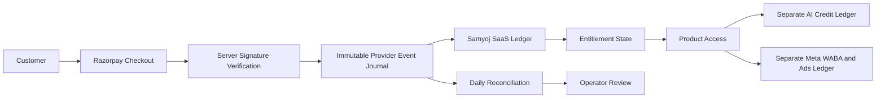
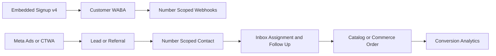

# Samyoj — Executive Gap Analysis and One-Month Production Roadmap

> **Document type:** Current-state product map, production-hardening plan, growth research, and go/no-go contract  
> **Audience:** Product, engineering, operations, platform administration, and leadership  
> **Repository evidence reviewed:** `server/`, `client/`, `admin/`, `docs/memory/`, Prisma migrations, tests, and existing audits  
> **Research review:** September 10, 2026  
> **Planning unit:** Week 1–Week 4; no fixed calendar dates  
> **Canonical status:** This is the detailed engineering archive. **Working plan is 15 days only:** [ROADMAP_CHECKLIST_HINGLISH_2026.md](./ROADMAP_CHECKLIST_HINGLISH_2026.md). This document does not replace code or the session-memory source of truth.

## 1. Executive decision summary

Samyoj has a substantial internal test-deploy foundation: multi-tenant WhatsApp workspaces, cookie-based tenant sessions, consent-gated campaigns, templates, Flows/forms infrastructure, AI chat/calling separation, manual billing, AI top-ups, and a platform-admin console.

It is **not customer-production ready** for 10–20 organizations. The remaining risk is primarily proof and recovery, not a lack of another large feature. The highest-risk gaps are:

1. durable webhook receipt and replay across the acknowledgement/crash boundary;
2. outbound idempotency, per-number fairness, and 1,000-recipient failure testing;
3. customer-host inbound proof, off-host backup/restore, and measured Postgres/Redis behavior;
4. authorization and number-scoped realtime/API review across all surfaces;
5. real operational observability, graceful shutdown, dead-letter/replay handling, and CI;
6. professional recurring billing and AI usage ledgers;
7. Embedded Signup v4 and Tech Provider approval-dependent onboarding;
8. clear containment of Content Studio stubs and live WebRTC transfer.

### Decision now

- **Internal testing deploy:** permitted with `bash start.sh`, including API, client, admin, Postgres, Redis, and ngrok-only inbound tunnel.
- **Customer production launch:** **No-go** until the release gates in §13 are met and the manual/external gates in §14 have evidence.
- **This one-month plan:** harden the existing product first, prove the operating envelope second, then sequence billing, Meta growth, Content Studio, and competitive quick wins.
- **Do not confuse this roadmap with implementation:** this document specifies work and gates. Product code changes require a separate approved implementation scope.

The user-provided “v7.4.9” is retained as a release label to reconcile, not as repository proof. Current server code reports version `1.0.0`; the release identity must be resolved before a customer release is named.

## 2. How to read this roadmap

Every capability uses one of these labels:

- **Implemented:** code path exists and local automated evidence supports the claim; production behavior may still need a live gate.
- **Partially implemented:** a meaningful path exists, but a material contract, surface, or failure mode is incomplete.
- **Blocked/external gate:** the remaining action depends on Meta, Razorpay, App Review, customer credentials, a provider account, or another external decision.
- **Live-unverified:** code and/or local tests exist, but customer-like host, phone, provider, load, restore, or real-device evidence is missing.
- **Stub/demo:** UI or backend scaffolding exists but does not safely provide the advertised production capability.
- **Deferred/not this month:** deliberately outside this four-week reliability and launch-preparation envelope.

### Source-of-truth rules

1. Current code and Prisma schema/migrations outrank old audit prose.
2. `docs/memory/README.md`, `STATUS_AND_FUTURE.md`, and dated session notes record decisions and shipped work; they do not prove customer production.
3. Official Meta and Razorpay documentation is authoritative for provider behavior and approval requirements.
4. Competitor pages are vendor self-reporting. They are useful for positioning, not proof that a competitor’s feature works in every plan or region.
5. A local unit test is not a live Meta, payment-settlement, customer-host, mobile-network, or multi-tenant capacity proof.
6. A manual gate remains manual. It cannot be marked complete because a roadmap sentence sounds confident.

## 3. One-month operating envelope

The first commercial operating envelope is intentionally bounded:

- **Tenants:** 10–20 customer organizations.
- **Messaging:** one organization can target approximately 1,000 eligible recipients in a campaign; several organizations may send concurrently.
- **Numbers:** multiple active WhatsApp numbers per organization; every contact, conversation, campaign, consent record, ticket, message, analytics result, and realtime payload must remain organization-plus-number scoped.
- **Inbound:** webhook bursts, duplicate deliveries, reordered statuses, multi-entry payloads, malformed payloads, and provider retries.
- **Outbound:** agent replies, templates, campaigns, retries, provider timeouts after request submission, duplicate clicks, quota exhaustion, 429/5xx responses, pause/cancel/restart races.
- **Infrastructure:** API restart, embedded worker restart, Redis loss/recovery, Postgres contention, migration locks, and backup restore.
- **AI:** chat tokens, prompt/completion tokens, embeddings, Sarvam STT/TTS units, calling minutes, Content Studio provider units, included allowances, top-ups, and failed/reversed deductions.
- **Payments:** Razorpay test-mode subscriptions and one controlled internal real-money smoke test only after ledger, webhook replay, reconciliation, refund, and support procedures are ready.
- **External prerequisites:** Meta Tech Provider/App Review, Embedded Signup v4 configuration, customer WABA payment method, real test accounts, public HTTPS callback, and provider credentials.

This envelope is a planning boundary, not a capacity claim. Capacity must be measured with a provider simulator and production-shaped data.

## 4. Current architecture and feature truth

### 4.1 Architecture

The current system is a monolithic TypeScript/Express API with:

- PostgreSQL through Prisma;
- Redis and BullMQ;
- embedded workers started by the API;
- React/Vite tenant client;
- separate React/Vite platform-admin app;
- Socket.IO realtime events;
- Meta WhatsApp Cloud API;
- Sarvam chat, calling, STT, and TTS;
- Azure embeddings;
- local media storage with a storage abstraction;
- Razorpay order-based/manual billing and one-time AI top-ups.

The standalone worker entry intentionally exits. PM2 runs the API; do not introduce a second `whatsapp-worker` process.

### 4.2 Current-state feature matrix

| Surface | Current status | Evidence / exact limitation |
|---|---|---|
| Tenant sessions | **Implemented; live-unverified** | HttpOnly `samyoj_access` / `samyoj_refresh`, CSRF, refresh rotation/reuse detection, Socket.IO cookie auth. Customer-host and cross-device proof remain. |
| Organization authorization | **Partially implemented** | Organization membership and role checks exist, but settings, Commerce, Catalog, Content Studio, approval, onboarding, API-key scope, and multi-organization selection need a complete mutation matrix review. |
| WhatsApp number isolation | **Implemented at application layer; live-unverified** | `whatsappNumberId` scoping, 409 on ambiguous missing header, soft disconnect, active ownership locks. No PostgreSQL RLS; nullable legacy references and orphan reports require audit. |
| Classic WhatsApp OAuth | **Implemented; live-unverified** | Signed state, token exchange, WABA/phone discovery, encrypted Meta tokens, webhook subscription. External customer onboarding is not proven. |
| Embedded Signup v4 | **Partially implemented; blocked/external gate** | Backend config/scaffold exists; client hook expects `payload.url` and does not launch the Meta SDK `FB.login`/`WA_EMBEDDED_SIGNUP` contract. |
| Webhooks | **Partially implemented; live-unverified** | HMAC validation, active-number routing, BullMQ processing, claims, duplicate handling, status reconciliation. API acknowledgement can precede durable replayable receipt persistence. |
| Inbox messaging | **Partially implemented; live-unverified** | Send/reply UI and CSW rules exist. Synchronous outbound paths and idempotency/failure-boundary proof remain; Socket.IO payload scope needs review. |
| Templates | **Implemented; live-unverified** | CRUD, validation, library catalog, clone flow, submission to the current WABA, and honest Meta approval copy. Real Graph clone/submission proof remains. |
| Campaigns | **Implemented in core; live-unverified at scale** | Consent snapshot, recipient claims, leases, reservations, repeat campaigns, pause/cancel state. Fair scheduling, 1,000-recipient throughput, provider timeout/crash idempotency, and per-number limits are unproven. |
| Automations | **Partially implemented** | Phase A/B reliability and CSW guards are in code; Phase C intentionally remains deferred. |
| WhatsApp Flows/forms | **Partially implemented; live-unverified** | Builder/assets/NFM handling and encrypted endpoint infrastructure exist. Full Meta Flow JSON/versioning/data contract and customer-facing E2E need proof. |
| Catalog/orders | **Partially implemented; live-unverified** | Catalog sync, inbound orders, referral metadata, and payment-status backend surface exist; customer API contracts and permission coverage need verification. |
| AI chat | **Implemented; live-unverified** | Chat `AiBot`, Sarvam model, Azure embeddings, training, limits, and usage surfaces exist. Provider outage, quota, and ledger completeness require gates. |
| AI calling | **Partially implemented; live-unverified** | Sarvam STT/TTS/voice model, bot split, summaries, barge-in code, and WebRTC direct-network path exist. TURN, strict NAT/mobile proof, and live transfer are not ready. |
| Platform admin | **Implemented first release; incomplete** | `admin/` and `/api/platform/*` have cookie/CSRF/TOTP/RBAC foundations, accounts, errors, outreach, library and billing configuration. Impersonation, full billing ledger, STT/TTS ledger and outreach delivery remain. |
| Content Studio | **Stub/demo risk** | Image/video/voice surfaces can produce successful zero-byte/demo assets; budget check and usage recording are not atomic. This must be integrated safely or visibly contained. |
| SaaS billing | **Implemented manual mode; target recurring billing absent** | Plan periods, entitlements, billing events, one-time AI top-ups, signatures and basic orders exist. Razorpay Subscriptions lifecycle, GST invoices, dunning, reconciliation, refunds ledger and cycle-end entitlement transitions are not shipped. |
| Media storage | **Partially implemented; live-unverified** | Local upload path and storage abstraction exist. Off-host object storage, retention, signed access, and disk-failure behavior are not proven. |
| Analytics/reports | **Partially implemented** | AI usage surfaces exist; `/reports` redirects to Billing Usage and does not yet provide a complete operational/revenue analytics product. |

## 5. Backend/database reliability assessment

### Strengths to preserve

- Number selection fails closed on missing/ambiguous number context.
- Composite organization/number uniqueness and foreign keys protect key contact/conversation paths.
- Connection ownership, active-number conflicts, soft disconnect, and reconnect behavior are serialized.
- Meta tokens are encrypted.
- Webhook HMAC and malformed-payload checks occur before normal processing.
- Webhook claims support stale-claim recovery and completion.
- Campaign consent requires `optedIn`, `consentSource`, `consentAt`, and no `optOutAt`.
- Campaign run versions, leases, provider-boundary timestamps, quota reservations, and ambiguous outcomes exist.
- Startup migration tooling is fail-closed for unexpected/destructive migrations.
- Local backup/restore scripts and migration-safe startup exist.

### Material backend gaps

#### Webhook durability

The current route can acknowledge Meta before queue insertion and processing. The later receipt metadata is not a complete replayable payload. A process crash in that gap can lose an acknowledged event without a reliable operator replay path.

Required outcome:

- persist the raw validated payload or an encrypted replayable equivalent before acknowledgement;
- assign an event id and correlation id;
- route every entry/change independently by its own phone-number context;
- make inbound side effects resumable by stage;
- expose oldest-event age, failed count, claim age, duplicate suppression, and replay state;
- provide an operator-safe replay command/API with audit records.

#### Tenancy and authorization

Application scoping is strong in core number paths but is not PostgreSQL RLS. The review must enumerate every read and mutation across Inbox, Contacts, Tags, Consent, Campaigns, Templates, Forms, Catalog, Orders, Tickets, AI, Content Studio, Settings, Reports, realtime, exports, and admin APIs.

Specific checks:

- no silent `organizations[0]` selection for multi-organization users;
- no socket event without organization and number context;
- no API key that bypasses human RBAC without explicit scope, expiry, revocation, and audit;
- no public media route that exposes tenant files by guessable identifiers;
- no nullable legacy number reference that can be used as an org-wide fallback;
- no settings mutation whose authorization is weaker than its read path.

#### Outbound and campaign safety

The campaign worker has important claim/lease mechanics, but global worker concurrency is not fair scheduling. A large tenant can occupy both slots. Coexistence throttling falls back to an in-memory bucket when Redis fails, which is not an aggregate limit across API processes.

Required outcome:

- deterministic idempotency keys from client request through provider call;
- a clear state machine for `PENDING`, `CLAIMED`, `PROVIDER_STARTED`, `SENT`, `DELIVERED`, `FAILED`, `AMBIGUOUS`, and `REPLAY_REQUIRED`;
- per-organization/per-number fair scheduling and rate limits;
- no quota oversubscription under concurrent sends;
- provider timeout-after-request tests that never silently resend without a dedupe decision;
- visible pause, cancel, dead-letter, and replay behavior.

#### Database, migrations, backups

The database is shared PostgreSQL and relies primarily on application enforcement. Current local backup/restore is useful but is not customer-host proof. Backups need off-host encrypted copies, retention, integrity verification, restore to an isolated database, measured RPO/RTO, and an operator runbook.

Add or verify:

- Prisma pool size, connection timeout, and statement timeout appropriate to the host;
- slow-query and lock monitoring;
- migration preflight, backup checkpoint, lock-duration measurement, and rollback/restore decision;
- orphan/nullable-number audit before any destructive migration;
- no raw `prisma migrate deploy` on a fresh install where the historical unique-number migration can delete duplicates.

#### Runtime recovery

Add graceful shutdown for HTTP, Prisma, Redis, BullMQ workers, and Socket.IO. Define behavior for uncaught exceptions and unhandled rejections. Redis loss must produce operator-visible queue health and a safe recovery path; realtime publish loss must not corrupt durable state.

## 6. Frontend and platform-admin assessment

### Current frontend risks

- Embedded Signup v4 client/server contract mismatch.
- One campaign send-confirmation test currently fails because the UI returns recipient validation before the intended consent/subscription guidance.
- Many pages turn secondary API failures into empty/partial states without durable error context.
- `/reports` redirects to Billing Usage; the old `ReportsPage.tsx` is effectively dead.
- `/onboarding` redirects to `/`; the existing onboarding page is unreachable.
- Leads are embedded in Contacts rather than a standalone route.
- Meta Flow builder is mostly deep-link/orphaned.
- stale client methods remain for rejected Meta manual-config APIs.
- “Full backup” copy can imply a restorable backup when the UI is only an export/status surface.
- image generation stub disclosure is weaker than video/voice disclosure.
- no page-level or mobile-browser E2E suite exists.

### Admin risks

- First-release admin separation is useful and must be preserved.
- Platform-admin RBAC/MFA/session tests exist, but the operator needs durable customer-health views for webhook lag, queue failures, payment events, campaign ambiguity, AI usage, and restore status.
- SMTP must remain honest: if `SMTP_HOST` is absent, delivery must not be represented as `SENT`.
- Impersonation and WhatsApp outreach remain outside this month unless separately approved; do not rebuild the admin first release.

## 7. Testing and evidence baseline

The second-pass verification on September 10, 2026 found:

- server: 168 test files and 1,077 tests passed in 58.52 seconds; Redis `ECONNREFUSED` warnings appeared during tests, so this is unit-suite evidence, not Redis integration or infrastructure proof;
- admin: 9 test files and 19 tests passed;
- client: 40 test files, 182/183 tests passed, with the campaign-send-confirmation failure still present;
- no complete browser/page-level E2E suite;
- no measured 10-tenant or 20-tenant/1,000-recipient throughput and fairness result;
- no customer-host inbound proof;
- no customer-host restore drill;
- no controlled real-money subscription lifecycle proof.

The historical “919 tests all green” statement is stale evidence and must not be copied into a go-live decision. The current server pass must not be described as Redis, Postgres, Meta, browser, or customer-production proof.

## 8. Four-week execution sequence

### Week 1 — Existing product production hardening

**Objective:** remove known correctness and honesty hazards before scale testing.

Backend/database:

1. Produce a current database isolation report: active/inactive numbers, nullable references, orphan rows, cross-org foreign-key checks, and unresolved reconciliation rows.
2. Complete the authorization matrix for all tenant and platform-admin reads/mutations.
3. Fix multi-organization selection; never silently select the first organization.
4. Review refresh-token hashing, API-key scopes/expiry/revocation, tenant TOTP storage, public media access, compliance export/purge, and Content Studio permissions.
5. Correct campaign `dailySendLimit` semantics so the named limit is actually enforced or clearly removed from the contract.
6. Add outbound idempotency at HTTP, database, worker, and provider-boundary layers.
7. Define the durable webhook receipt schema and replay contract.

Messaging:

1. Validate HMAC and persist the complete replayable event before acknowledging Meta, or document an equivalent transactional inbox pattern.
2. Route each webhook entry/change independently.
3. Make inbound contact/conversation/message/automation side effects resumable and idempotent.
4. Test duplicate reactions, duplicate messages, reordered statuses, and multi-number payloads.
5. Keep CSW, consent, opt-out, and template requirements fail-closed.

6. Add explicit provider deadlines (`AbortSignal`/request timeout) to Meta Graph send, upload, download, and status calls; a hung provider call must not hold a worker lease indefinitely.
7. Normalize phone identity before campaign recipient deduplication; raw string comparison must not allow `+91...` and `91...` to become two sends.
8. Make campaign quota ledgers number-aware where provider limits are number-aware, and reconcile configured `dailySendLimit` against actual enforcement.
9. Define queue/database atomicity for webhook, integration, compliance, and Content Studio jobs; every durable `PENDING`/`QUEUED` row needs an enqueue retry or reconciler.
10. Review API-key permissions separately from human RBAC. API keys require scopes, expiry, revocation, audit, and an explicit policy for IP restrictions.
11. Verify route-level permissions for settings, Content Studio, `/wa-forms`, onboarding, approvals, generation, Catalog, Commerce, and every tenant mutation; client-side navigation hiding is not authorization.

Frontend/admin:

1. Fix the ES v4 contract and show honest provider/configuration errors.
2. Fix the failing campaign error-copy test.
3. Remove or relabel misleading Full Backup language.
4. Replace silent secondary-failure-to-empty behavior with retryable, visible, scoped errors.
5. Ensure normal users never see Meta App ID, App Secret, `.env`, or developer override controls.
6. Add page-level smoke flows for login, connect, send, receive, template, campaign, form, order, settings, and admin actions.

**Week 1 gate:** every corrected invariant has a unit/API/integration test, and every unresolved live dependency is recorded in the evidence register.

### Week 2 — Scale, failure, and operational proof

**Objective:** prove the bounded operating envelope with reproducible infrastructure and a provider simulator.

Build the test harness:

- seeded 20-organization dataset;
- representative contacts, conversations, messages, consent, campaigns, two numbers per organization;
- Meta provider simulator for success, 429, 5xx, timeout-after-request, auth failure, malformed response, delayed status, duplicate status, and out-of-order status;
- ephemeral Postgres and Redis;
- deterministic API/worker restart checkpoints.

Execute:

1. one 1,000-recipient campaign;
2. ten organizations concurrently sending 1,000 recipients;
3. inbound bursts and duplicate/replayed payloads;
4. Redis outage/recovery;
5. Postgres contention, slow queries, deadlocks, and connection saturation;
6. API restart before/after provider call;
7. pause, cancel, resume, retry, dead-letter, and replay;
8. migration rehearsal against production-shaped data;
9. encrypted off-host backup, isolated restore, representative tenant verification, and measured RPO/RTO.

Add:

- queue waiting depth and oldest-job age;
- webhook processing lag;
- campaign fairness and partial-run metrics;
- provider error taxonomy;
- DB latency/pool/lock metrics;
- correlation IDs across HTTP, webhook, worker, provider, payment, and realtime logs;
- alerts for stuck jobs, oldest webhook over 60 seconds, repeated provider failures, ambiguous sends, failed payments, and failed backups.

**Week 2 gate:** all results are measured, not inferred from unit tests. Any failure becomes an explicit no-go or a bounded pilot condition.

### Week 3 — Professional billing and AI economics

**Objective:** design and prove money/usage behavior before selling recurring plans.

Razorpay lifecycle:

1. Create provider Plans for the approved Samyoj SKU/cadence.
2. Create a Subscription and pass its id to Checkout.
3. Verify checkout signature server-side.
4. Persist provider event ids and process subscription/invoice webhooks idempotently.
5. Model `created`, `authenticated`, `active`, `pending`, `halted`, `cancelled`, `completed`, renewal, retry, refund, and credit-note transitions.
6. Implement cycle-end cancellation, upgrade/downgrade policy, grace period, dunning, entitlement lock, and operator override.
7. Reconcile provider state daily against local ledger.
8. Issue GST-compliant invoice records with invoice number, date, supplier/customer identity, GSTIN where applicable, place of supply, SAC/HSN decision, tax breakup, currency, original invoice reference for credit notes, and payment status.

9. Maintain an explicit entitlement matrix: plan/add-on → feature → enforcement route/service → quota → lock behavior → admin override → audit event. Remove or wire dead `plan-guard` middleware; a defined guard that no route imports is not enforcement.
10. Distinguish operational AI usage from billable AI credits: reserve → provider call → commit or release, with idempotency, retry, failed-provider reversal, expiry, reconciliation, and customer/admin reporting.
11. Do not label an order receipt as a GST invoice. Until a real invoice model and tax approval exist, remove fabricated GST/SAC/invoice language from billing history.

Keep ledgers separate:

1. **Samyoj SaaS ledger:** plan, subscription, invoice, tax, payment, refund, credit note, provider event, entitlement period.
2. **AI credit ledger:** prompt/completion tokens, embeddings, Sarvam STT units, Sarvam TTS units, calling minutes, Content Studio units, provider cost, included allowance, top-up, reversal, expiry, and idempotency key.
3. **Meta WABA/Ads ledger:** Meta-delivered WhatsApp message fees and customer Ad Account spend. These are customer-side Meta charges and never become Samyoj plan revenue or AI usage.

The current one-time AI top-up path may remain available. Recurring AI add-ons are scaffolded but disabled; decide explicitly whether to revive, remove, or feature-flag them. Do not show a recurring SKU that returns HTTP `410`.

Payment tests:

- automate Razorpay test-mode checkout/signature/webhook replay;
- test duplicated, delayed, out-of-order, and unknown events;
- test failed payment, pending, halted, cancellation, refund, credit note, and entitlement rollback;
- rehearse customer support and reconciliation procedures;
- run one controlled real-money internal smoke test only after all preceding gates pass.

### Week 4 — Growth integrations and incomplete product surfaces

**Objective:** prepare the smallest high-value growth loop without turning this month into an Ads Manager or omnichannel rebuild.

Meta Tech Provider and Embedded Signup v4:

1. verify Tech Provider prerequisites, App Review state, allowed domains, redirect/origin configuration, business tokens, and customer WABA payment-method onboarding;
2. implement the browser SDK launcher with `FB.init`, `FB.login`, `config_id`, `response_type: 'code'`, `WA_EMBEDDED_SIGNUP` session messages, coexistence mode where approved, and a safe callback contract;
3. exchange the code server-side, discover WABA/phone ids, subscribe the WABA, register a phone where required, persist encrypted tokens, and handle reconnect/offboarding;
4. test new-number and existing-number paths with a real test business;
5. treat Meta approval and real customer-account onboarding as external/manual gates.

Ads/CTWA/Lead Ads:

1. receive Meta Page `leadgen` webhooks;
2. retrieve lead fields through Graph API using the correct Page token and permissions;
3. store source Page, ad, campaign, form, leadgen id, timestamp, consent, and dedupe key;
4. route leads into number-scoped Contacts/Leads with assignment, SLA, template/CSW rules, and opt-out handling;
5. attribute click-to-WhatsApp referral to conversation, contact, order, and revenue;
6. consider Conversions API feedback only after consent, event schema, and permissions are proven.

WhatsApp Forms/Flows and orders:

- align Flow JSON, data endpoint encryption, versioning, NFM handling, catalog/product ids, order/referral events, payment status, and notification contracts;
- add customer-facing routes only where the real Meta API contract and authorization are verified;
- do not start the deferred Phase C automation expansion.
- choose one supported Forms/Flows contract or explicitly version the legacy `/wa-forms` and newer `flows-assets` paths; test publish/review, encryption/signature, retries, duplicate submissions, number isolation, and simulation-versus-production parity;
- test automation behavior around pause, unpublish, in-flight jobs, STOP/opt-out, CSW closure, waiting nodes, keyword boundaries, frequency caps, conflicts, and duplicate webhooks.

Content Studio:

- preferred path: real image/video/voice providers, durable object storage, atomic credit reservation, usage event, approval, retention, and retry;
- safe fallback: visibly label every stub/demo surface, prevent zero-byte assets from appearing successful, prevent billing for demo generation, and keep it out of customer production claims;
- keep brand kit, copy, catalog descriptions, approvals, calendar, and media retention as a later product sequence unless the provider path is ready.

## 9. Billing and AI flow model

The critical invariant is that a payment event is not itself entitlement truth until it is verified, idempotently journaled, reconciled, and applied according to the subscription state machine.

## 10. Meta growth flow model

The first practical growth loop is attribution and follow-up, not cloning Meta Ads Manager. Meta permissions, App Review, Page tokens, WABA payment method, customer consent, and real test-account behavior remain external gates.

## 11. Competitive analysis

Research scope: WATI, Interakt, AiSensy, Respond.io, Meta Business Suite/Ads, and WhatsApp-native commerce tools. Vendor pages were reviewed as self-reported capability/pricing evidence; exact package, region, taxes, message fees, and add-ons must be reconfirmed before commercial decisions.

### What customers commonly expect

- fast WhatsApp onboarding with minimal technical configuration;
- reliable shared inbox, assignment, team permissions, and mobile usability;
- broadcast/campaign status that explains delivered, read, failed, skipped, and retry states;
- templates, forms, catalog/order flows, lead capture, CTWA attribution, and integrations;
- transparent separation of SaaS fee, AI usage, and Meta message charges;
- support, auditability, backup/recovery, and clear failure handling.

### Samyoj differentiators to protect

- WhatsApp-number workspace isolation instead of unsafe org-wide fallback;
- consent and CSW safety as first-class campaign rules;
- native Flows/forms and catalog/order foundations;
- separate chat and calling AI bots;
- Sarvam Indian-language voice potential with Azure embeddings;
- platform-admin audit/RBAC foundation;
- explicit separation of Samyoj billing, AI credits, and Meta WABA/Ads charges.

### Verified gaps to prioritize

1. onboarding/inbound proof and failure recovery;
2. CTWA and Lead Ads attribution;
3. Shopify/e-commerce and revenue-linked order analytics;
4. professional recurring billing and customer invoices;
5. mobile and omnichannel access only after WhatsApp reliability;
6. operator-grade recovery/support tooling.

### Competitive non-goals

- full Meta Ads Manager clone;
- broad Instagram/Messenger implementation during this hardening month;
- feature-count parity without reliability evidence;
- promising live WebRTC agent transfer while it remains a stub;
- shipping fake Content Studio outputs or recurring AI SKUs that cannot settle;
- combining Meta message charges with Samyoj subscription pricing.

## 12. Acceptance gates and measurable targets

### Definition of Ready

A work item is ready only when it has:

- an owner role and repository paths;
- a current-state evidence path;
- explicit tenant/number scope;
- a success and failure state;
- a test fixture or external/manual gate;
- rollback, replay, or operator handling where money/messages/data are involved;
- a decision on whether it is in this month or deferred.

### Definition of Done

The item has:

- code and schema contract reviewed;
- unit and integration coverage for the invariant;
- browser/API flow where users can trigger the behavior;
- failure and retry behavior tested;
- structured logs/metrics/alerts where operationally relevant;
- migration and backup implications reviewed;
- current evidence recorded in the gate ledger;
- no misleading UI or documentation claim.

### Initial release targets

- **Tenancy:** zero cross-org/cross-number reads or mutations in the tested matrix; missing number context with multiple active numbers always returns `409`.
- **Webhook acknowledgement:** p95 under 500 ms and p99 under 2 seconds with healthy dependencies, while preserving a replayable durable receipt.
- **Webhook durability:** 10,000 duplicate/replayed payloads create zero duplicate messages, contacts, conversations, or automation sends.
- **Webhook lag:** p95 under 30 seconds and p99 under 120 seconds; alert when oldest waiting work exceeds 60 seconds.
- **Campaign scale:** 10 organizations can each process 1,000 simulated eligible recipients with terminal outcomes within 10 minutes against a provider simulator.
- **Campaign fairness:** every organization begins within 60 seconds and no tenant waits more than 3× median tenant wait.
- **Provider ambiguity:** every timeout-after-request is either deduped, manually replayable, or visibly ambiguous; it is never silently duplicated.
- **Quota:** no oversubscription under 10 concurrent attempts.
- **Recovery:** API, Redis, and Postgres restart recovery resumes within 5 minutes with no lost acknowledged inbound event and no duplicate provider send.
- **Backup:** encrypted off-host artifact restores to an isolated database; initial target RPO ≤15 minutes and RTO ≤60 minutes.
- **Observability:** stuck jobs, webhook lag, dead letters, ambiguous sends, payment events, and failed backups alert within 5 minutes.

Targets are proposed release gates, not measured current performance.

### 10-tenant and 20-tenant workload contract

The phrase “1,000 broadcast” is ambiguous and must not be used as a capacity result by itself. The load plan must record:

- tenant count: 10 and 20 scenarios;
- active numbers per tenant and concurrent Socket.IO sessions;
- contacts, eligible recipients, campaigns, inbound events, outbound messages, and messages per second;
- provider rate limits, 429 budget, retry policy, and simulated provider latency;
- queue depth/oldest age, Redis memory, Postgres connections, lock time, slow queries, DB size, media volume, and API p95/p99;
- campaign completion, partial failure, pause/resume, abort, and restart semantics;
- duplicate sends, lost acknowledged events, dead letters, provider cost, and maximum acceptable data loss.

The 10-organization/1,000-recipient target is a first gate. The 20-organization profile is the operating-envelope gate; passing one does not imply passing the other.

## 13. Production go/no-go checklist

### Must pass before a customer pilot

- [ ] current database isolation/orphan audit has no unexplained critical row;
- [ ] authorization matrix passes for every tenant/admin mutation;
- [ ] durable webhook receipt/replay passes crash and duplicate tests;
- [ ] outbound idempotency and campaign fairness pass provider-simulator tests;
- [ ] client known failure is fixed and full server/client/admin verification has a conclusive result;
- [ ] queue lag, provider errors, DB health, payment events, and backups are observable;
- [ ] off-host backup restore has been tested on a customer-like host;
- [ ] migration rehearsal and rollback/restore decision are documented;
- [ ] new inbound phone reply increments the live webhook counters and appears in the correct number-scoped Inbox;
- [ ] customer-like connect, template, campaign, form, order, AI, and admin flows pass;
- [ ] support/operator runbooks exist for duplicate, stuck, failed, ambiguous, and replay-required states.
- [ ] no tenant route relies on client-only permission hiding; API-key and member-role matrices pass.
- [ ] provider request deadlines, queue/database reconciliation, phone-normalized deduplication, and number-scoped campaign quota checks pass.
- [ ] the 10-tenant and 20-tenant profiles have measured SLO, cost, and recovery evidence.
- [ ] billing UI does not call a payment receipt a GST invoice, and plan/add-on enforcement is tested at every paid surface.

### Pilot expansion

Canary at 2 organizations, then 5, then 10–20 only if the previous level remains within the targets. Stop expansion on any cross-tenant leak, lost acknowledged webhook, duplicate provider send, unreconciled payment, failed restore, or unobservable queue/provider failure.

## 14. Risk register and evidence register

| Risk / gate | Status | Evidence required |
|---|---|---|
| Customer-host inbound reply | **Live-unverified** | New phone reply after current deployment; correct `totalReceived`, queue, conversation, and number-scoped Inbox record. |
| Meta Tech Provider/App Review | **Blocked/external gate** | Meta approval state, business token, allowed domain, approved permissions, and customer-account E2E. |
| Embedded Signup v4 | **Partially implemented; live-unverified** | Browser SDK launch, session message, callback exchange, WABA subscription, number registration, reconnect, and offboarding. |
| Multi-entry/multi-number webhook routing | **Live-unverified** | Provider fixtures plus real payload evidence showing independent routing. |
| 1,000-recipient throughput/fairness | **Live-unverified** | Provider simulator report with latency, terminal states, duplicate count, and fairness. |
| Postgres pool/lock/slow-query behavior | **Live-unverified** | Production-shaped load report and thresholds. |
| Redis loss/recovery | **Live-unverified** | Restart/partition drill, queue recovery, and operator-visible state. |
| Off-host backup/restore | **Live-unverified** | Encrypted artifact, isolated restore transcript, representative data checks, measured RPO/RTO. |
| Razorpay subscriptions | **Deferred/not this month until Week 3 implementation is approved** | Test-mode lifecycle matrix, event journal, reconciliation, refund/credit note, then controlled real-money smoke test. |
| GST invoice compliance | **Blocked/external gate** | Tax/accounting decision, invoice fields, numbering, place of supply, GSTIN/SAC/HSN treatment, credit-note procedure. |
| Recurring AI add-ons | **Stub/demo / disabled** | Product decision and tests proving no disabled SKU is sellable; full lifecycle only if explicitly revived. |
| Content Studio generation | **Stub/demo** | Real provider/storage/atomic-ledger proof or visible non-billable demo containment. |
| WebRTC TURN and live transfer | **Stub/demo; Deferred/not this month** | TURN mobile/strict-NAT test; live transfer remains SAMYOJ-12 and must not be promised. |
| Full server suite | **Live-unverified** | Conclusive completion result or diagnosed bounded failure. |
| Email delivery | **Live-unverified** | Real SMTP mailbox test; without `SMTP_HOST`, status must remain `LOGGED`, not `SENT`. |

## 15. Not this month

Unless the user separately approves a scope change, this month does not include:

- Phase C automation expansion;
- live WebRTC human transfer;
- full Meta Ads Manager clone;
- broad Instagram/Messenger omnichannel build;
- target billing catalog launch before recurring lifecycle proof;
- unbounded Content Studio feature expansion;
- PostgreSQL RLS migration as a substitute for application authorization review;
- replacing the current AI engines or re-researching Train/FAQ architecture;
- customer-production launch based only on local tests.

## 16. Evidence and source register

### Repository evidence

- `server/src/modules/whatsapp/active-number.ts`
- `server/src/modules/whatsapp/save-connection.ts`
- `server/src/modules/whatsapp/routes.ts`
- `server/src/modules/whatsapp/webhook-dispatcher.ts`
- `server/src/workers/webhook.processor.ts`
- `server/src/workers/index.ts`
- `server/src/modules/campaigns/routes.ts`
- `server/src/modules/campaigns/service.ts`
- `server/src/modules/campaigns/quota.ts`
- `server/src/realtime.ts`
- `server/prisma/schema.prisma`
- `server/scripts/migrate-startup-safe.ts`
- `server/scripts/backup-database.ts`
- `server/scripts/restore-database.ts`
- `server/src/modules/billing/`
- `server/src/modules/content-studio/`
- `client/src/hooks/useWhatsAppConnectOAuth.ts`
- `client/src/App.tsx`
- `admin/src/App.tsx`
- `docs/memory/README.md`
- `docs/memory/STATUS_AND_FUTURE.md`
- `docs/audit/BACKEND.md`
- `docs/audit/FRONTEND.md`
- `docs/audit/BILLING_SYSTEM_REVIEW_2026-08-20.md`

### Official Meta sources

- [Embedded Signup](https://developers.facebook.com/docs/whatsapp/embedded-signup/)
- [Embedded Signup implementation](https://developers.facebook.com/docs/whatsapp/embedded-signup/implementation/)
- [Embedded Signup webhooks](https://developers.facebook.com/docs/whatsapp/embedded-signup/webhooks/)
- [Embedded Signup v4](https://developers.facebook.com/documentation/business-messaging/whatsapp/embedded-signup/version-4)
- [Tech Provider getting started](https://developers.facebook.com/documentation/business-messaging/whatsapp/solution-providers/get-started-for-tech-providers/)
- [Onboarding business app users](https://developers.facebook.com/documentation/business-messaging/whatsapp/embedded-signup/onboarding-business-app-users)
- [Click to WhatsApp ads](https://developers.facebook.com/docs/marketing-api/ad-creative/messaging-ads/click-to-whatsapp/)
- [Conversions API for business messaging](https://developers.facebook.com/docs/marketing-api/conversions-api/business-messaging/)
- [Lead Ads guide](https://developers.facebook.com/docs/marketing-api/guides/lead-ads/)
- [Lead Ads webhook quickstart](https://developers.facebook.com/docs/marketing-api/guides/lead-ads/quickstart/webhooks-integration/)
- [WhatsApp Flows](https://developers.facebook.com/documentation/business-messaging/whatsapp/flows)
- [Flows API](https://developers.facebook.com/documentation/business-messaging/whatsapp/flows/guides/flowsapi)
- [WhatsApp pricing updates](https://developers.facebook.com/docs/whatsapp/pricing/updates-to-pricing/)

Important commercial facts to verify against the live Meta account before launch:

- WhatsApp per-delivered-template-message pricing began July 1, 2025.
- Meta documentation indicates service-message pricing changes from October 1, 2026.
- India WABA INR migration is documented with a December 31, 2026 deadline.
- Tech Provider onboarding, business tokens, WABA subscriptions, payment method, permissions, and App Review are external gates.

### Official Razorpay and tax sources

- [Subscriptions integration guide](https://razorpay.com/docs/payments/subscriptions/integration-guide)
- [Create a subscription](https://razorpay.com/docs/api/payments/subscriptions/create-subscription)
- [Subscription webhooks](https://razorpay.com/docs/payments/subscriptions/subscribe-to-webhooks)
- [Payment retries](https://razorpay.com/docs/payments/subscriptions/payment-retries/)
- [Subscription states](https://razorpay.com/docs/payments/subscriptions/states/)
- [Subscription testing](https://razorpay.com/docs/payments/subscriptions/test/)
- [Supported payment methods](https://razorpay.com/docs/payments/subscriptions/supported-payment-methods)
- [Cancel subscription](https://razorpay.com/docs/api/payments/subscriptions/cancel-subscription/)
- [Update subscription](https://razorpay.com/docs/api/payments/subscriptions/update-subscription/)
- [Create invoice with customer id](https://razorpay.com/docs/api/payments/invoices/create-with-customer-id/)
- [Razorpay invoices](https://razorpay.com/docs/payments/invoices/create)
- [CBIC GST invoice rules](https://cbic-gst.gov.in/gst-invoice-rules.html)

### Competitor source register

Vendor pages were accessed/reviewed for comparative research; observations are self-reported and plan/region dependent:

- [WATI pricing](https://www.wati.io/en/pricing/)
- [WATI pricing structure](https://support.wati.io/en/articles/11462993-understanding-wati-s-pricing-structure)
- [WATI add-ons](https://support.wati.io/en/articles/11462992-understanding-wati-add-ons)
- [Interakt pricing](https://interakt.ai/pricing)
- [Interakt product](https://www.interakt.shop/)
- [AiSensy pricing](https://aisensy.com/pricing)
- [AiSensy WhatsApp](https://aisensy.com/whatsapp-business)
- [Respond.io pricing](https://respond.io/pricing)
- [Respond.io WhatsApp integration](https://respond.io/integrations/whatsapp)
- [Zoko WhatsApp AI](https://www.zoko.io/services/whatsapp-ai-chatbot-no-code-builder)

## 17. One-page next-action list

1. Freeze this roadmap as the canonical planning document and keep the status labels intact.
2. Create the Week 1 release-gate checklist from §12 and assign owners by role.
3. Fix the known client test and establish a conclusive full server-suite result.
4. Build the seeded Postgres/Redis/provider-simulator harness.
5. Run the number-isolation and authorization audit before load testing.
6. Design durable webhook receipt/replay and outbound idempotency before adding throughput.
7. Establish encrypted off-host backup and isolated restore evidence.
8. Instrument queue age, webhook lag, campaign ambiguity, provider failures, DB health, payment events, and backup status.
9. Keep billing in test mode until lifecycle, reconciliation, refunds, GST ownership, and support procedures are complete.
10. Implement or explicitly contain ES v4, Content Studio, and Forms/Orders with real provider contracts.
11. Run the 2 → 5 → 10–20 organization canary only after all customer-pilot gates pass.
12. Report met, unmet, and abandoned gates honestly; never convert a pending external/manual gate into “done.”

## 18. Second-pass completeness audit

This section records the independent recheck against the original product request, current code, current billing audit, session memory, and the roadmap itself. It is intentionally more specific than the executive summary so future reviews do not lose small but high-impact correctness items.

### Confirmed omissions added to this roadmap

#### Security and data integrity

- API keys need their own scope, expiry, revocation, and audit model; treating them as full-admin credentials is too broad.
- Tenant TOTP and refresh-token persistence require at-rest protection review even though session rotation and reuse detection exist.
- Unauthenticated/publicly cacheable media needs signed or authorized access and revocation.
- GDPR export/purge must cover calls, leads, tickets, orders, media, AI usage, webhook records, and audit policy, not only capped conversations/messages.
- Migration deployment must take a backup checkpoint and use the safe startup/reconciliation path; a deployment script that migrates before backup is a release risk.
- Horizontal replicas require leader/lease behavior for singleton maintenance, alert, retention, retry, telemetry, and platform workers.
- Redis-loss fallbacks must not allow aggregate provider-limit bypass across multiple API processes.

#### Provider and messaging correctness

- Every Meta Graph request needs a deadline and a classified timeout outcome.
- Retrying a provider POST after timeout/5xx requires an `AMBIGUOUS` or dedupe decision, not blind resend.
- Duplicate inbound detection must resume incomplete media/order/referral/automation side effects rather than skipping all work permanently.
- Database writes and queue insertion need an outbox/reconciler contract for every durable queued job.
- Campaign recipients must be normalized by phone identity.
- Campaign quota and reservations must match the WhatsApp-number limit boundary.
- Campaign fairness must be measured for both 10 and 20 tenants.

#### Billing and AI economics

- Current billing is a one-shot license/order flow, not recurring subscription billing.
- Current admin billing override UI/API has a contract risk: the UI can present plan/status concepts that the server does not mutate or accept uniformly; every override option requires an integration test and honest copy.
- Recurring AI add-ons remain disabled and must not appear as sellable SKUs.
- `plan-guard` being defined is not evidence of enforcement; the entitlement matrix must show every paid route.
- Content Studio limits, AI usage logs, top-up credits, generation ledgers, and provider costs need reserve/commit/release/reversal semantics.
- Fabricated GST/SAC/invoice labels must be removed until a real invoice/tax workflow exists.
- Billing configuration overrides require schema validation and safe fallback, not unchecked runtime catalog mutation.
- Refunds, credit notes, provider event ids, reconciliation, and entitlement rollback need durable records.

#### Customer and admin product journeys

The roadmap treats these as explicit end-to-end journeys, each with success, failure, retry, authorization, and evidence:

1. register → email verification → organization selection;
2. first WhatsApp connect → Meta permission/payment-method step → reconnect/disconnect;
3. first outbound message → CSW/template restriction → provider timeout/retry;
4. first new inbound reply → webhook receipt → number-scoped Inbox;
5. campaign create → consent preview → schedule → pause/cancel → partial failure → replay;
6. template create/clone/submit → Meta rejection → correction;
7. form submission → encrypted endpoint → duplicate/retry → automation;
8. catalog/order creation → status update → payment-status contract;
9. AI chat/call → quota exhaustion → usage report → reversal;
10. payment failure/expiry → dunning/lock → support recovery;
11. admin billing override → audit → entitlement result;
12. data export/purge → media and linked-record verification;
13. operator queue/webhook/dead-letter/reconciliation/restore drill;
14. mobile and narrow-screen versions of the critical customer and operator paths.

### Product surfaces requiring explicit containment or follow-up

- **Onboarding:** `/onboarding` is redirected away; `OnboardingGate` is effectively a no-op, status is not consistently number-scoped, failures can render blank, and arbitrary step ids can be persisted. Make it reachable only when the authoritative flow is ready, or clearly label it as incomplete.
- **Reports:** `/reports` redirects to Billing Usage. The analytics backend is richer than the customer surface; distinguish zero data from unavailable data and do not show hardcoded estimated AI cost as real usage.
- **Content Studio:** image/video/voice stubs can appear successful with zero-byte assets and usage charges; the UI needs polling, failure/retry states, prominent image disclosure, atomic accounting, signed media, provider/privacy/voice-consent rules, and a sharply bounded v1.
- **Forms/Flows:** legacy `/wa-forms` and newer `flows-assets`/Meta Flow Builder are competing contracts. Select, version, or explicitly contain the supported contract.
- **Admin billing:** operator controls must not imply recurring plans, UPI Autopay, live GST invoices, or plan-tier mutation when the backend only applies status/expiry overrides.
- **Error states:** every customer/admin surface needs distinct loading, empty, unavailable, unauthorized, stale, and failed states with scoped retry. Do not convert failed API calls to fake empty data or fallback voices.
- **Realtime/offline:** Inbox has localized reconnect behavior, but there is no global offline banner, mutation retry policy, stale/disconnected indicator, or consistent number-match rejection across all socket consumers.
- **Mobile/accessibility:** page-level mobile smoke tests, keyboard/focus checks, and automated accessibility checks are absent; responsive classes alone are not proof.

## 19. Evidence provenance, ownership, and follow-up

### Evidence ledger contract

Every major claim or gate must record:

| Field | Required value |
|---|---|
| Claim | One observable behavior, not a broad “works” statement |
| Status | One of the six labels in §2 |
| Source | Exact code/doc/test path and line range where practical |
| Source date | Commit/session/audit date |
| Environment | Local, test-deploy, customer-like host, Meta test account, Razorpay test mode, or real-money test |
| Command/result | Reproducible command and decisive output, or manual evidence |
| Owner | One accountable role/person |
| Reviewer | Independent reviewer for money/security/tenant gates |
| Revalidation | Expiry or trigger after which evidence must be rerun |
| Supersession | Newer source that invalidates older evidence |

The current repository evidence map must mark `docs/audit/FULL_REVIEW_2026-08-18.md` as unavailable in this workspace rather than citing it as a current artifact. Use current code, `docs/memory/`, `docs/audit/BILLING_SYSTEM_REVIEW_2026-08-20.md`, and available dated audits; classify older reports as current, stale, partially superseded, or reverified.

### RACI and follow-up

Each workstream needs one accountable owner, one reviewer, and one evidence artifact:

| Workstream | Accountable role | Reviewer / gate owner | Minimum artifact |
|---|---|---|---|
| Tenancy, auth, permissions | Backend/security lead | Independent security reviewer | route matrix + negative tests |
| Webhooks, Inbox, campaigns | Messaging/backend lead | Operations lead | replay/fairness/fault report |
| Database, migrations, backup | Infrastructure/DB lead | Recovery owner | backup/restore/RPO/RTO transcript |
| Frontend/customer journeys | Product/frontend lead | QA/accessibility reviewer | browser/mobile smoke report |
| Platform admin/support | Platform operations lead | Product/security reviewer | queue/dead-letter/reconciliation dashboard proof |
| SaaS billing/GST | Billing backend lead | Finance/tax approver | ledger, invoice, refund, reconciliation matrix |
| AI usage/add-ons | AI platform lead | Billing/product reviewer | reserve/commit/reversal ledger report |
| Meta Tech Provider/Ads | Meta integration owner | Meta/compliance owner | App Review and real-account E2E evidence |
| Content Studio | Content platform owner | Product/privacy reviewer | provider, media, policy, and credit contract |
| Competitive/quick wins | Product strategy owner | Founder/product approver | dated source-backed decision log |

Review cadence: one gate review at the end of each week, immediate escalation for tenant leakage, lost acknowledged webhook, duplicate provider send, unreconciled payment, failed restore, or fabricated customer-facing claim. A decision log must record build, defer, integrate, contain, or no-go for every major surface.

## 20. Prioritized quick wins after the recheck

These are small, high-leverage changes that reduce customer confusion or production risk without starting a new product phase:

1. Fix the known campaign confirmation error ordering and add a regression test.
2. Replace fabricated GST/SAC/invoice labels and misleading recurring/Autopay admin copy.
3. Add visible webhook replay/dead-letter operator status, even before the full replay tool.
4. Add explicit provider request timeouts and classify timeout-after-request as ambiguous.
5. Add a route-level permission matrix test for Content Studio, Forms, onboarding, settings, and admin billing.
6. Add Content Studio image stub disclosure, zero-byte success rejection, job polling, and non-billable demo status.
7. Add a customer/admin journey smoke checklist with evidence links.
8. Add 10-tenant and 20-tenant workload fixtures before claiming scale.
9. Add an evidence ledger and stale-audit map to every release review.
10. Add a global unavailable/stale/retry convention for failed secondary API calls.

## 21. Revised sequencing decision

The original four-week roadmap is retained as the planning envelope, but execution must be split into gates rather than treated as a promise that one team can ship every surface in one month:

1. **Launch-blocking reliability:** tenancy, permissions, webhook durability, outbound idempotency, campaign fairness, provider deadlines, database/backup/recovery, observability, CI, and customer-journey smoke tests.
2. **Internal pilot:** 2 → 5 organizations with live inbound, restore, failure drills, and measured cost/latency.
3. **Customer-production readiness:** 10 → 20 workload evidence, external Meta approval, payment/tax decisions, operational admin coverage, support runbooks, and all go/no-go gates.
4. **Post-pilot growth:** recurring billing implementation, Lead Ads, full Forms/Flows contract, Content Studio providers, revenue analytics, integrations, and mobile/omnichannel expansion.

Recurring billing, GST implementation, real-money payment testing, Lead Ads, and real Content Studio providers remain approval-dependent implementation work. This roadmap can specify them; it does not claim that they are shipped or authorize silently beginning them.
