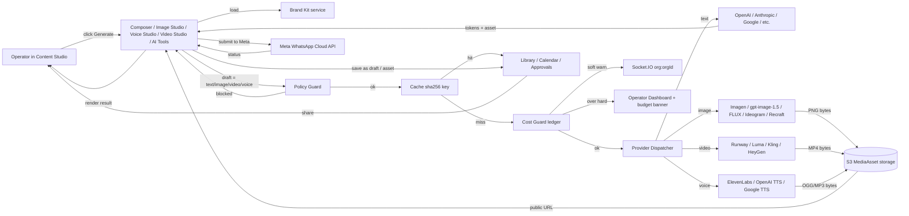
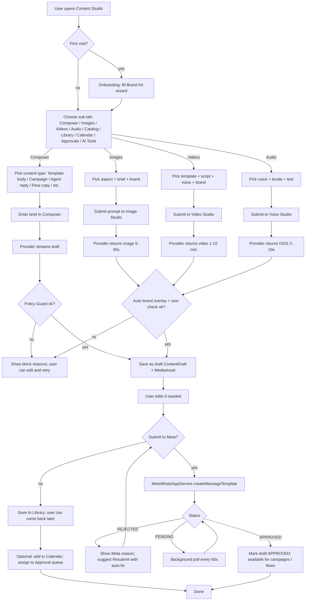
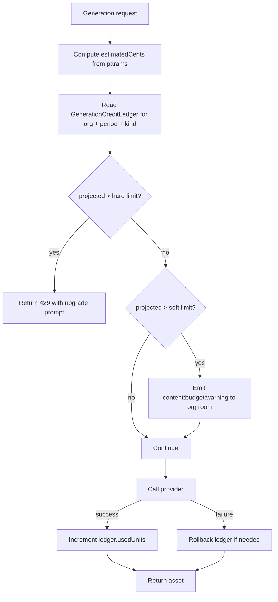

# Palerma — AI Content Studio (Research & Design Brief)

| Field | Value |
| --- | --- |
| Product | Palerma — WhatsApp Business API platform |
| Document type | Feature research & design deep-dive |
| Feature codename | **AI Content Studio** |
| Status | Draft v1.0 — for engineering & product review |
| Audience | Founders, PM, engineering leads, design, growth |
| Author | Cursor Agent |
| Date | Monday, 15 June 2026 |
| Companion docs | `docs/AUDIT.md` (platform audit), `docs/WHATSAPP_API_DOCUMENTATION.md` |

---

## 1. Executive summary — what this means for Palerma

- **Content Studio turns Palerma from a "send & receive WhatsApp" tool into a "plan, create, approve, send" content engine.** The competitor set has fragmented this workflow — Canva for images, Copy.ai for text, ElevenLabs for voice, Meta Business Manager for templates. Palerma can collapse all four into one authenticated, brand-aware, Meta-compliant surface.
- **The product surface lives at `D:\whatsapp\client\src\pages\ContentStudioPage.tsx` with a new `server/src/modules/content-studio/` module.** It reuses Palerma's existing AI plumbing (Azure OpenAI via `server/src/modules/ai/azure-openai.service.ts`, Deepgram STT, Google TTS) and adds three new generation capabilities: image, video, voice cloning — and one new compliance surface: Meta template alignment.
- **The biggest cost-risk is generative media.** Image, video and voice generation are roughly **10–100× more expensive per asset** than text. The audit's recurring theme of "no cost guardrail" becomes a hard blocker here — Content Studio must ship the org-level daily budget gate as part of Phase 1, not Phase 2.
- **Brand voice profile + multi-locale is the moat.** Most WhatsApp SaaS competitors (AiSensy, Wati, Interakt) offer one-shot AI template generation but no persistent brand-voice, no locale memory, no banned-words enforcement. Palerma can do this by treating `Organization.settings.brandKit` as a first-class entity that every prompt pulls from.
- **Meta template policy alignment is non-negotiable.** Per the audit §5, free-form AI text often fails Meta's MARKETING/UTILITY/AUTHENTICATION category review. Content Studio must round-trip AI drafts through `POST /{wabaId}/message_templates` and surface rejection reasons inline; the `MetaWhatsAppService` already exposes the needed APIs.
- **The 3-phase plan ships real value at each step.** Phase 1 (text only, 2 weeks) is the lowest-cost, highest-margin feature because it reuses Azure OpenAI already wired in. Phase 2 (images, 3 weeks) is where the product gets visually distinctive. Phase 3 (voice + video + catalog, 4–6 weeks) is where the moat is.
- **The S3 storage layer the audit calls "unverified" finally has a real reason to ship.** Generated image / video / voice bytes will not survive on local disk. Phase 2 must finalize `STORAGE_DRIVER=s3` end-to-end and migrate outbound media to presigned S3 URLs (audit item M8/M9).
- **Voice cloning is a legal minefield in India and the EU.** The plan is to ship brand-voice library voices + consent-captured uploads, not unrestricted instant cloning, until Indian DPDP and EU AI Act guidance stabilizes.
- **The cheapest defensible launch surface is "Brand Kit + AI Composer (text) + Image Studio (DALL-E / Imagen) + Library + Approvals".** Everything else is incremental on top.

---

## 2. Glossary

| Term | Definition in this document |
| --- | --- |
| **Content Studio** | The new in-product suite: Brand Kit, Composer, Image Studio, Video Studio, Voice Studio, Library, Calendar, Approvals, AI Tools. |
| **Brand Kit** | A persistent per-org profile (name, logo, colors, fonts, tone sliders, banned phrases, value props, locales) that every AI prompt references. |
| **Composer** | The generic "brief → draft → edit → save → attach" UI for any content type. |
| **Generation Job** | A `GenerationJob` Prisma row tracking a single provider call, its status, cost, and resulting asset. |
| **MediaAsset** | A `MediaAsset` Prisma row representing a stored image/video/voice/document in the org's library, with prompt, model, cost, URLs and meta. |
| **Template round-trip** | The act of submitting an AI draft to Meta as a `message_templates` entry, reading the `status` (APPROVED/REJECTED/PAUSED), and re-rendering the AI draft if REJECTED. |
| **Policy Guard** | The shared `policyGuard()` function that validates any text/image before it can become a template, image header, or voice message: banned-words, PII, claims, competitor names, category consistency. |
| **Generation credit** | A normalized unit (1 image, 1 second of video, 1 minute of voice, 1,000 text tokens) used for plan-tier allowance. |
| **Banned words** | Org-configured prohibited terms (e.g., "guaranteed", "cure", "best"). Enforced by Policy Guard on every text output. |
| **Mandatory phrases** | Required string fragments (e.g., "Reply STOP to opt out"). Enforced by Policy Guard. |
| **Brand voice** | A tone vector (formal↔casual, brief↔detailed, friendly↔professional, serious↔playful) used as system-prompt modifiers. |
| **Locale** | A target language + region (e.g., `en-IN`, `hi-IN`, `ta-IN`, `bn-IN`, `mr-IN`, `te-IN`). |
| **Transliteration-aware rewriting** | Localizing a message to, e.g., Hindi *while keeping the brand name in Latin script* — required for technical/SaaS brand names. |
| **Click-to-WhatsApp ad (CTWA)** | A Meta ad format that opens a WhatsApp conversation on tap; requires a 9:16 or 1:1 video/image creative and a pre-filled message. |
| **WhatsApp Flows** | Meta's structured interactive form payload; flows have JSON screens with `Form`/`TextInput`/etc. nodes. |
| **Carousel** | A multi-card interactive message (`type: "interactive", action: { type: "carousel" }`) — up to 10 product cards. |
| **Voice clone (Instant)** | A 30-second sample voice that approximates tone. Low fidelity, no consent trail beyond the upload. |
| **Voice clone (Professional)** | A 30+ minute clean sample voice with explicit consent contract, retention policy, and revocation. |
| **Per-template fee** | Meta's additional fee charged on certain utility/authentication templates in some regions (verify on Meta's pricing page). |
| **Stale generation cache** | An entry in the Generation Job log that, if prompt + model + params are identical, returns a cached asset rather than re-calling a provider. |
| **Burst guard** | A per-org per-minute concurrency limit on generation jobs (e.g., max 3 video jobs at a time per Growth plan). |
| **Generation credit ledger** | The new `GenerationCreditLedger` table that tracks (org, period, kind, units, used) for plan-tier enforcement. |

---

## 3. The Content Studio surface — UI map & feature list

The Content Studio lives in the left sidebar, between **Campaigns** and **Settings**. It is one entry point with ten sub-tabs. The icon is a paint-brush-with-spark, deliberately distinct from Templates' chat-bubble icon to avoid confusion.

### 3.1 Sidebar entry & sub-tabs

| Sub-tab | Purpose | Default view | Phase |
| --- | --- | --- | --- |
| **Brand Kit** | Persistent brand identity, tone, locales | Single-page form + live preview | 1 |
| **Composer** | Brief → AI draft → edit → save | Type picker, brief textarea, draft panel | 1 |
| **Templates** | AI-assisted WhatsApp template creation | List of drafts + Meta sync status | 1 |
| **Images** | Image Studio: prompt-to-image, regenerate, text-in-image, export | 4-up canvas, aspect presets | 2 |
| **Videos** | Video Studio: short-form MP4, brand overlay, voiceover | Script editor + timeline preview | 3 |
| **Audio** | Voice Studio: brand voice library, TTS, voice notes | Voice picker, textbox, waveform preview | 3 |
| **Catalog** | Product catalog + AI product descriptions | Grid + filter | 3 |
| **Calendar** | Scheduled drafts, sends, posts | Month/week/day timeline | 2 |
| **Approvals** | Internal review queue | Card list with status badges | 2 |
| **Library** | All assets, search, tags, folders | Grid with filters | 2 |
| **AI Tools** | Quick-action drawer | Buttons: Rewrite, Shorten, Translate, A/B, etc. | 1 |

### 3.2 Brand Kit (Phase 1)

A single-page form (route `/content-studio/brand-kit`) that all other Content Studio tools read from. Backed by `Organization.settings.brandKit` (JSON) with a typed schema and a `BrandKitVersion` row for history.

| Field | Type | Notes |
| --- | --- | --- |
| Brand name | string | Display name in templates |
| Logo (primary) | asset | PNG with transparency, ≥ 256×256 |
| Logo (monochrome) | asset | Used on dark headers |
| Color — primary | hex | Auto-applied to CTWA creatives |
| Color — secondary | hex | |
| Color — accent | hex | |
| Font — heading | enum | Auto-mapped to provider fonts |
| Font — body | enum | |
| Tone — formal ↔ casual | slider (0–100) | Default 60 (slightly casual) |
| Tone — brief ↔ detailed | slider (0–100) | Default 40 (brief) |
| Tone — friendly ↔ professional | slider (0–100) | Default 70 (professional) |
| Tone — serious ↔ playful | slider (0–100) | Default 30 (slightly serious) |
| Banned words | list of strings | Case-insensitive, exact-match + stemmed |
| Mandatory phrases | list of strings | At least one must appear in every outbound template |
| Sample messages — like | list of strings | 3–10 examples of on-brand voice |
| Sample messages — dislike | list of strings | 3–10 counter-examples |
| Target audience | freeform (200 chars) | One-paragraph ICP |
| Value propositions | list of strings (max 5) | What the brand sells & why |
| Locales | enum list | `en-IN`, `en-US`, `hi-IN`, `ta-IN`, `bn-IN`, `mr-IN`, `te-IN`, `gu-IN`, `kn-IN`, `ml-IN`, `pa-IN` |
| Default locale | enum | Falls back to `en-IN` |

**Live preview panel** renders a small WhatsApp-style message bubble using the brand's tone + color so the user sees what the AI will produce.

### 3.3 AI Composer (Phase 1)

A generic three-pane workspace.

- **Left pane — Type picker**: Template body / Campaign copy / Agent reply suggestion / FAQ answer / A/B variant set / Flow copy / List / Buttons / Email subject / Push notification.
- **Center pane — Brief**: freeform text + structured fields depending on type. Example for a campaign: `audience`, `goal`, `offer`, `CTA`, `length budget`, `locale(s)`, `template category (MARKETING/UTILITY/AUTHENTICATION)`.
- **Right pane — Draft panel**: a streaming AI response with "Regenerate", "Make 5 variants", "Localize to [locale]", "Tighten to 1 line", "Save as draft", "Submit to Meta", and "Send test to my number".

Drafts are auto-saved as `ContentDraft` rows. The Composer is also reachable as a modal from the Templates, Campaigns, and Flow Builder pages — "Draft with AI" buttons wire into the same engine.

### 3.4 Image Studio (Phase 2)

A canvas with:

- **Aspect-ratio presets** mapped to Meta specs: 1:1 (header), 9:16 (CTWA vertical), 16:9 (header wide), 4:5 (catalog card), 1.91:1 (link preview).
- **Brand Kit auto-fill** (logo overlay, primary color stripe at the bottom).
- **Prompt input** with "Use brief from Composer" and "Use a Catalog product" shortcuts.
- **Variant count slider** (1–4 images per call).
- **Text-in-image** mode: a small textbox overlays a sticker text box that the AI is told to render verbatim — recognizes the limits of DALL-E 3/Imagen text rendering.
- **Export targets**: `Template header (PNG/JPEG, ≤5 MB)`, `Click-to-WhatsApp ad creative (PNG/MP4)`, `Library (full-res PNG)`.

The Image Studio writes a `MediaAsset` (kind: IMAGE) for every variant and a `GenerationJob` per provider call.

### 3.5 Video Studio (Phase 3)

A short-form video editor.

- **Template library**: Product reveal (15s), Testimonial (30s), Explainers (30s), Offer/promo (15s), Behind-the-scenes (30s). Each template is a storyboard of 3–6 shots.
- **Script-to-video**: enter a 50–200-word script, pick a brand avatar (or none), pick background music (royalty-free library or uploaded), the system generates shots per scene.
- **Voiceover picker**: TTS in chosen locale (uses the brand's `Voice`).
- **Brand overlay**: auto-adds logo + tagline at end-frame.
- **Export**: MP4 H.264 ≤ 16 MB (Meta template header limit) or ≤ 30 MB (CTWA ad); 9:16 (1080×1920) or 1:1 (1080×1080).
- **Render jobs run in BullMQ `content-video` queue**; the UI shows progress (queued / rendering scene 3 of 5 / exporting / done) and is cancellable.

### 3.6 Voice Studio (Phase 3)

- **Brand voice library**: per org, voices uploaded with consent metadata. Two tiers supported in Phase 3:
  - **Standard voices** — ElevenLabs "Voice Library" voices (no clone required). Cheap, fast, 40+ languages.
  - **Custom voices** — Instant Clone (30s sample) or Professional Clone (30 min sample, requires explicit consent capture + DPA).
- **Voice message generator**: paste text → pick voice + locale + format (OGG opus for WhatsApp voice notes, MP3 for templates) → preview → save to library or attach to template.
- **Voice library folders**: per-product or per-campaign.

### 3.7 Catalog (Phase 3)

- **Meta Commerce catalog sync**: pull the org's Meta catalog (catalog id from WhatsApp Commerce settings) into a read-only mirror; product cards become attachable to templates/carousels.
- **AI product descriptions**: pick a product, "Generate description" produces short/long variants in any locale; one description per product per locale per generation, with manual edit + version.
- **Per-locale price formatting** (₹ / $ / €) and per-locale imagery options.

### 3.8 Calendar (Phase 2)

- **Month / week / day** view of all scheduled content: campaign sends, broadcast sends, scheduled template submits, draft reviews due, AI generation jobs in flight.
- **Drag-to-reschedule**; clicking an item opens the related Composer / Template / Campaign.
- **Holidays overlay** for India (configurable in Settings).

### 3.9 Approvals (Phase 2)

- **Card list** of items in `PENDING_REVIEW` status (template drafts, image banners, video ads).
- **Two-stage** approval: Supervisor → Admin. Configurable in `Organization.settings.approvals`.
- **Comments thread** per item, mention team members, resolve.
- **Version history**; "Compare v1 to v2" side-by-side.
- **Auto-decline** if banned-words or mandatory-phrase check fails.

### 3.10 Library (Phase 2)

- All `MediaAsset` rows, with search by prompt text, tags, locale, model, date, kind, size, status.
- **Bulk delete** (admin only) and **soft-archive** to keep audit trail.
- **Folders** with drag-drop; share folder with team.
- **Reuse** — "Use in template", "Use in campaign", "Use in flow".

### 3.11 AI Tools drawer (Phase 1)

A right-side drawer pinned to any text input across the app (Inbox, Composer, Template editor, Flow message node). Buttons:

- **Rewrite this** — keep meaning, vary tone.
- **Shorten** — trim to fit WhatsApp 1024-char limit.
- **Expand** — add detail.
- **Translate** — pick target locale; transliteration-aware.
- **Localize to Hindi / Tamil / Telugu / Bengali / Marathi** — explicit locale menu.
- **Make a button list** — convert a paragraph into a WhatsApp list (sections + rows).
- **Suggest 5 A/B variants**.
- **Generate FAQ from this PDF** — uploads a PDF, returns N Q&A pairs.
- **Generate policy-compliant template from a brief** — submits to Meta and reports back the status.
- **Make it on-brand** — pulls from Brand Kit, applies tone sliders, enforces banned words.

Each tool call writes a `GenerationJob` with `kind` and a UI surface that shows the cost estimate before sending.

---

## 4. Content type catalog

This is the long-form matrix of *what kinds of content* Content Studio will produce, the *provider set* for each, the *failure modes* the team should know, and the *Meta-specific alignment notes*.

### 4.1 Text content

| Subtype | Length | Locale support | Provider set | Notes |
| --- | --- | --- | --- | --- |
| **Template body** | ≤ 1024 chars (Meta limit) | All 11 locales | OpenAI GPT-4o, Claude Sonnet 4.5, Gemini 2.5 Pro, Mistral Large 3, Llama 3.3 70B | Must round-trip through Meta `message_templates` for approval. |
| **Template header text** | ≤ 60 chars | All locales | Same | Pre-header text on image/document templates. |
| **Template footer text** | ≤ 60 chars | All locales | Same | |
| **Button labels** | ≤ 20 chars | All locales | Same | For `quick_reply` and `URL` buttons. |
| **List sections / row titles** | section ≤ 24 chars, row ≤ 24 chars, description ≤ 72 chars | All locales | Same | "Make a button list" tool generates sectioned rows. |
| **Flow copy** (screen titles, form labels, helper text, validation messages) | Various | All locales | Same | Renders to JSON; copy lives in `Flow.nodes[].data.copy`. |
| **Campaign copy** | Variable, typically 1–3 sentences | All locales | Same | Used to fill template body when audience is segmented. |
| **Agent reply suggestion** | 1–3 sentences | All locales | Same | Generated from the conversation context; human reviews before send. |
| **FAQ answer** | 1–5 sentences | All locales | Same | Stored in `KnowledgeBaseItem` (existing). |
| **A/B variants** | 3–5 variants per request | All locales | Same | Generates N variants in one call. |
| **Email subject** (used in non-WhatsApp side-channel) | ≤ 80 chars | All locales | Same | |
| **Push notification** | ≤ 65 chars | All locales | Same | Truncated for display. |
| **Internal note** (for team) | Freeform | en-IN | Same | Not customer-facing, lower bar for tone. |

**Key provider trade-offs for Indian locales:**

- **OpenAI GPT-4o**: best English, solid Hindi, decent Bengali; weaker Tamil/Telugu. Strong JSON mode. Tool use is reliable.
- **Claude Sonnet 4.5**: best for brand-voice (long-form style matching), strong English + Hindi, weaker Tamil. 200K context, 64K max output.
- **Gemini 2.5 Pro**: 1M context, very strong on Indian languages (Google's dialect coverage is unmatched), good code-switching Hinglish.
- **Llama 3.3 70B** (self-hosted via Azure Foundry or Together): cheap, weak Indic languages — keep for internal use only.
- **Mistral Large 3**: solid French/European, weak Indic — fallback only.

Recommended Phase 1 default: GPT-4o for English, Gemini 2.5 Pro for all Indic locales, with Claude Sonnet 4.5 as a brand-voice quality option (slower, more expensive).

### 4.2 Image content

| Subtype | Aspect | Max size | Use case | Provider set | Notes |
| --- | --- | --- | --- | --- | --- |
| **Template header image** | 1:1 (Meta default) | ≤ 5 MB | Marketing/utility templates | DALL-E / gpt-image-1.5, Imagen 4 Standard, FLUX.1.1 Pro, Recraft v3 | Must be PNG/JPEG, ≥ 800×800 recommended. |
| **CTWA ad creative (image)** | 1:1 or 9:16 | ≤ 30 MB (Meta ad) | Click-to-WhatsApp ad images | Same as above + Ideogram 2.0 (better text-in-image) | |
| **Product card** | 1:1 or 4:5 | varies | Carousel / catalog | Recraft v3, Adobe Firefly 4, FLUX.1.1 Pro | Should be square or 4:5, transparent-bg option. |
| **Banner / strip** | 16:9 or 16:5 | ≤ 5 MB | Template header wide | DALL-E, Imagen 4 | |
| **Infographic** | 9:16 (story-style) | ≤ 5 MB | Template header | Recraft v3, Ideogram 2.0 | Needs text-in-image quality. |
| **Status image** | 9:16 | ≤ 16 MB | WhatsApp Status (broadcast) | Any | |
| **Catalog product image** | 1:1 | varies | Meta catalog | Recraft v3, Firefly 4 | Must be on transparent or white background. |
| **Brand logo** | n/a | n/a | Brand Kit | Uploaded by user | AI not used. |

**Key provider trade-offs:**

- **gpt-image-1.5** (the production-stable choice as of June 2026; gpt-image-1 deprecates Oct 2026, gpt-image-2 is the cutting-edge upgrade): native tool-use, supports image editing via base image, ~$0.034 (medium) to $0.133 (high) per 1024². Excellent instruction-following.
- **Imagen 4 Standard**: $0.04/image. Good prompt-following, weaker text-in-image. Has a **Fast** tier at $0.02.
- **FLUX.1.1 Pro** (Black Forest Labs): ~$0.04–$0.06 per image via Replicate/Fal. Best raw image quality, no native text-in-image, harder prompt adherence.
- **Ideogram 2.0**: best in class for text-in-image. ~$0.08 per image.
- **Recraft v3**: best brand-consistency tools (style guides, vector output). ~$0.08 per image.
- **Adobe Firefly 4**: enterprise-safe (trained on licensed + public-domain), $0.05–$0.10 per image.

**Recommended Phase 2 default**: Imagen 4 Standard for general banners, Ideogram 2.0 when text-in-image is critical, gpt-image-1.5 for variant generation.

### 4.3 Short-form video

| Subtype | Length | Aspect | Format | Provider set |
| --- | --- | --- | --- | --- |
| **CTWA ad video** | ≤ 30s, ≤ 16 MB | 9:16 or 1:1 | MP4 H.264, AAC audio | Runway Gen-4 Turbo, Luma Ray2, Kling 1.6, Pika 2.0 |
| **Template header video** | ≤ 16 MB, ≤ 30s | 16:9 or 1:1 | MP4 H.264 | Same as above |
| **Status video** | ≤ 30s | 9:16 | MP4 H.264 | Same |
| **Avatar explainer** | ≤ 60s | 16:9 or 9:16 | MP4 | HeyGen, Synthesia, D-ID |
| **Product reveal (talking)** | ≤ 30s | 1:1 or 9:16 | MP4 | HeyGen + Runway Gen-4 |

**Key provider trade-offs:**

- **Runway Gen-4 Turbo**: $0.05/sec ($1.50 for 30s). Best image-to-video consistency.
- **Runway Gen-4.5**: $0.12/sec ($3.60 for 30s). Premium quality, but limited to 10s per generation (so a 30s clip = 3 generations stitched).
- **Luma Ray2**: ~$0.32 per 5s clip → ~$1.92 per 30s. Strong on physics / motion.
- **Kling 1.6**: ~$0.084–$0.42/sec. Strong on character motion.
- **Pika 2.0**: ~$0.20–$0.50 per clip. Cheapest, lower fidelity.
- **HeyGen**: talking-avatar specialty, $0.10–$0.50 per minute of generated video. Multilingual.
- **Synthesia**: enterprise avatar library, $0.50+ per minute. SOC 2, EU data residency.

**Recommended Phase 3 default**: Luma Ray2 for CTWA ads (best $/quality), HeyGen for talking-avatar explainers.

### 4.4 Audio / voice

| Subtype | Format | Duration | Provider set |
| --- | --- | --- | --- |
| **WhatsApp voice note** | OGG opus | ≤ 16 MB, ≤ 30s typical | ElevenLabs Flash v2.5, OpenAI gpt-4o-mini-tts, Google Cloud TTS |
| **Template audio header** | OGG opus or MP3 | ≤ 16 MB | Same |
| **Broadcast voice** | MP3 | variable | Same |
| **AI agent voice (call)** | streaming PCM (16 kHz) | continuous | Existing: Google TTS, plus ElevenLabs for brand voice |
| **IVR-style menu** | MP3 / OGG | short | Same |

**Key provider trade-offs:**

- **ElevenLabs Multilingual v3**: $0.12 per 1K characters (~$0.18/1K for Hindi). Best prosody, voice cloning. 29+ languages including hi-IN, ta-IN, bn-IN, mr-IN, te-IN, gu-IN, kn-IN, ml-IN, pa-IN, ur-IN.
- **ElevenLabs Flash v2.5**: $0.06/1K characters. 2× faster, ~half the cost, slightly lower quality.
- **OpenAI gpt-4o-mini-tts**: $15/1M characters ($0.015/1K). Cheapest, decent quality, no cloning. 11 languages, no Indian locales in base model.
- **Google Cloud TTS** (already in Palerma for AI calling): Neural2 voices ~$16/1M ($0.016/1K); supports `en-IN-Neural2-A`, `hi-IN-Neural2-A`, `bn-IN`, `ta-IN`, `te-IN`, `mr-IN`, `gu-IN`, `kn-IN`, `ml-IN`, `pa-IN`. The Indian-locale story is strong.
- **Azure Neural TTS**: similar pricing to Google; slightly better prosody on English; Indic support improving.
- **Play.ht**, **Murf**, **Speechify**: consumer-grade, weaker API story.

**Recommended Phase 3 default**: ElevenLabs for English (best brand-voice matching via Instant Clone) and Google Cloud TTS for Indian locales (cheaper, more natural Indic prosody).

### 4.5 Speech-to-text (for transcribing uploaded voice notes / video)

Existing: Deepgram Nova-2 streaming (used for voice calls in `server/src/modules/calling/deepgram.stt.ts`).

| Provider | Per minute | Languages | Notes |
| --- | --- | --- | --- |
| **Deepgram Nova-3** (mono) | $0.0043–$0.0052 batch, $0.0077–$0.0092 streaming | 31 languages | Already integrated. |
| **Deepgram Flux** | $0.0065–$0.0078 streaming | English (mono / multi) | Optimized for turn-taking. |
| **OpenAI Whisper large-v3** | $0.006/min (via API) | 99 languages | Best raw WER; slower than Deepgram. |
| **AssemblyAI Universal** | ~$0.0125/min | 99 languages | Speaker diarization, sentiment. |
| **Azure Speech** | $1 audio hour = $1 (standard) | 100+ languages | Enterprise SLAs. |

**Phase 3 default**: Continue with Deepgram for English; add Whisper for low-resource Indic locales (Maithili, Santali, etc.) where Deepgram coverage is thin.

### 4.6 Document

For now, document handling is limited to:

- **PDF upload** as a knowledge source for the AI bot (existing `pdf-parse` integration in `server/src/modules/ai/knowledge-ingest.service.ts`).
- **PDF generation** — Phase 4 (out of scope for v1). If added: a template → PDF exporter for invoices, brochures, summaries. Use Carbone, React-PDF, or Puppeteer.

### 4.7 Structured interactive payloads

| Payload | JSON shape | AI tool that produces it |
| --- | --- | --- |
| **Button list (≤ 3 buttons)** | `type: "button", action: { buttons: [...] }` | "Make a button list" |
| **List message (≤ 10 rows, 10 sections)** | `type: "interactive", action: { sections: [...] }` | "Make a list" |
| **CTA URL button** | `type: "cta_url", action: { url, display_text }` | "Add a CTA" |
| **Flow payload** | `Flow.nodes` JSON with `Form`/`TextInput`/`Dropdown` nodes | "Build a flow" (Phase 2) |
| **Carousel** | Multi-card product picker | Phase 3 with Catalog |
| **Reply buttons (≤ 3)** | `type: "button", action: { buttons: [...] }` | "Add quick replies" |
| **Location request** | `type: "location"` | n/a (always manual) |
| **Contact card** | `type: "contacts"` | n/a |

Each is generated by a JSON-mode model call (`response_format: { type: "json_object" }`), then validated by a Zod schema. The Composer shows a visual preview of the buttons/list.

### 4.8 Carousel / catalog

Phase 3, gated on Catalog module.

- Generate product card images (Recraft v3 / FLUX.1.1 Pro) for products without images.
- AI product descriptions per product per locale.
- Generate a carousel template (one template + N product sections).
- Carousel previews in the Inbox simulator (we'd need to fake-render the carousel UI in a web preview since Meta's web client doesn't show carousels before send).

### 4.9 Translation & localization

- **General translation**: OpenAI GPT-4o or Gemini 2.5 Pro (both strong on Indic).
- **Marketing-grade translation** (preserves brand voice): Claude Sonnet 4.5.
- **Indic-specialist**: AI4Bharat's **IndicTrans2** (open-source, can be self-hosted on Azure); supports 22 Indic languages.
- **Bhashini / Navarasa-2.0** (Indian government): experimental, lower quality, free.
- **DeepL**: best European languages, no Indic support.
- **Google Cloud Translation v3** (or `gemini-2.0-flash` for translation tasks): $20/million characters. Most reliable Indic.
- **Azure Translator**: $10/million characters, similar quality.

**Localization considerations:**

- **Transliteration awareness** — keep brand names in Latin script even when localizing ("WhatsApp" stays "WhatsApp" in Hindi copy, not "व्हाट्सएप").
- **Length budget** — Indian languages often take more characters than English; check template char limits.
- **Script mixing** — Hinglish, Tanglish are common in practice; the model should be told explicitly whether to mix scripts.
- **Cultural sensitivity** — train the policy guard on Indian regulatory language (FSSAI, ASCI, RBI) and on religious/cultural sensitivity (no animal references during certain festivals, no color choices that have regional meaning).

### 4.10 Brand voice & tone profiles

A "Brand Kit" is essentially a system prompt modifier. Concretely, when the Composer calls the model:

```
[Brand voice]
Tone: 60% formal, 40% brief, 70% professional, 30% serious.
Banned: ["guaranteed", "best price", "100% safe", "cure"]
Mandatory: ["Reply STOP to opt out", "https://example.com/terms"]
Sample messages we like: [...]
Sample messages we dislike: [...]
Audience: [...]
Value props: [...]
Locale: hi-IN (Hindi, transliteration-aware: keep brand names in Latin)
[End Brand voice]
```

A more advanced system-prompt approach: store the Brand Kit as a vector and let the model retrieve only the most relevant pieces. For Phase 1, the entire Brand Kit is injected (it's only 2–5KB, well within context).

### 4.11 Asset library

The Library is essentially a Prisma `MediaAsset` table with a search UI. Phase 2 ships:

- Search by prompt text (Postgres full-text).
- Search by model used, by date range, by tag, by status.
- Soft-archive instead of hard delete (so audits work).
- Folders with team sharing.
- Pinning to top of folder.
- Bulk delete / bulk tag.
- "Use in…" actions (use in template, use in campaign, use in flow).

### 4.12 Content calendar

Phase 2 — read-only at first, write in Phase 3. Sources of events:

- Scheduled campaign sends (from `Campaign.scheduledAt`).
- Scheduled flow posts (from `Flow` schedule nodes).
- Drafts with `scheduledSubmitAt` (when a template draft is queued for Meta submission).
- Approval deadlines.
- AI generation jobs in flight.

The Calendar view is purely an aggregation; it does not own data. The Calendar updates in real time via the existing `Socket.IO` rooms (`org:<orgId>`).

### 4.13 Approval workflow

A simple state machine: `DRAFT → IN_REVIEW → APPROVED → PUBLISHED` (or `DRAFT → IN_REVIEW → REJECTED → DRAFT`). The Approvals tab is a queue of `IN_REVIEW` items. Reviewers are users with `role: SUPERVISOR` or `ADMIN` (configurable). Approval writes a row to `ApprovalLog` and emits a `content:approved` socket event.

---

## 5. Provider comparison (2025–2026, estimates)

> All prices are USD public list prices for direct API access. Verify on each provider's pricing page before committing. Regional pricing (data-zone, regional) typically carries a 10–15% premium.

### 5.1 Text generation

| Provider / Model | Input $/Mtok | Output $/Mtok | Latency (1k out) | JSON mode | Indian-language quality | Notes |
| --- | --- | --- | --- | --- | --- | --- |
| **OpenAI GPT-4o** (Azure or direct) | 2.50 | 10.00 | ~1.0 s | ✓ | Good (Hindi, Bengali) | Best instruction-following, tool use. |
| **OpenAI GPT-4.1** | 2.00 | 8.00 | ~1.2 s | ✓ | Good | 1M context; better long-doc reasoning. |
| **OpenAI GPT-4o-mini** | 0.15 | 0.60 | ~0.6 s | ✓ | OK | 30× cheaper, lower quality — keep for translations and A/B. |
| **Anthropic Claude Sonnet 4.5** | 3.00 | 15.00 | ~1.3 s | ✓ | Good (Hindi), weak Tamil | Best brand-voice matching. 200K ctx, 64K out. |
| **Anthropic Claude Haiku 4.5** | 1.00 | 5.00 | ~0.6 s | ✓ | OK | Cheapest Anthropic tier. |
| **Google Gemini 2.5 Pro** | 1.25 | 10.00 | ~1.0 s | ✓ | Excellent (all major Indic) | Best Indian-language quality. |
| **Google Gemini 2.0 Flash** | 0.10 | 0.40 | ~0.5 s | ✓ | Very good | Cost-effective translation workhorse. |
| **Mistral Large 3** | 0.50 | 1.50 | ~0.8 s | ✓ | Weak Indic | Cheapest Euro-hosted option. |
| **Llama 3.3 70B** (Together / Azure) | ~0.59 | ~0.79 | ~1.0 s | partial | Weak | Self-hostable for data-residency. |
| **GPT-5** (when available) | 1.25 | 10.00 | ~0.9 s | ✓ | Excellent | Likely a Phase 2 upgrade. |

### 5.2 Image generation

| Provider / Model | $ / image (1024²) | Aspect control | Text-in-image | Brand consistency | Notes |
| --- | --- | --- | --- | --- | --- |
| **gpt-image-1.5 low** | 0.009 | ✓ 1:1, 2:3, 3:2 | OK | via prompt | Cheapest OpenAI option. |
| **gpt-image-1.5 medium** | 0.034 | ✓ | Good | via prompt | Default Phase 2. |
| **gpt-image-1.5 high** | 0.133 | ✓ | Good | via prompt | Print-quality. |
| **gpt-image-2 1K** | 0.006 (low ref) | ✓ + ultrawide | Excellent (best in class) | via prompt | Newest, no warm-yellow cast. |
| **DALL-E 3** | 0.040 / 0.080 | ✓ | Good | via prompt | Deprecating May 2026 — don't build on. |
| **Imagen 4 Fast** | 0.020 | ✓ | OK | via prompt | Cheapest Google tier. |
| **Imagen 4 Standard** | 0.040 | ✓ | OK | via prompt | Default Phase 2 Google. |
| **Imagen 4 Ultra** | 0.060 | ✓ | Good | via prompt | Premium. |
| **FLUX.1.1 Pro** (Replicate) | 0.04–0.06 | ✓ | Weak | via prompt | Best raw quality. |
| **Ideogram 2.0** | 0.08 | ✓ | Best in class | via prompt | Use when text-in-image is critical. |
| **Recraft v3** | 0.08 | ✓ | Good | style guides (best) | Best brand-consistency tools. |
| **Adobe Firefly 4** | 0.05–0.10 | ✓ | Good | style kits | Enterprise-safe IP story. |
| **Midjourney v7** | ~0.10 via API | ✓ | Good | via --sref | Best aesthetics, weaker programmatic. |
| **Stable Diffusion 3.5 / SDXL** | 0.025–0.08 | ✓ | Weak | via LoRA | Open-source, can self-host. |

### 5.3 Video generation

| Provider / Model | $ / second | 9:16 / 1:1 | ≤30s output | Talking-avatar | Notes |
| --- | --- | --- | --- | --- | --- |
| **Runway Gen-4 Turbo** | 0.05 | ✓ | ✓ (10s/gen, stitch) | — | Best image-to-video. |
| **Runway Gen-4.5** | 0.12 | ✓ | ✓ (10s/gen cap) | — | Premium, premium quality. |
| **Luma Ray2** | ~0.32 (5s clip) | ✓ | ✓ | — | Strong motion, best $/quality. |
| **Kling 1.6** | 0.084–0.42 | ✓ | ✓ | partial | Strong character motion. |
| **Pika 2.0** | 0.20–0.50 / clip | ✓ | ✓ | — | Cheapest, lower fidelity. |
| **Vidu** | 0.10–0.30 | ✓ | ✓ | — | Strong on stylization. |
| **Sora** (OpenAI) | TBD | TBD | TBD | — | Verify availability. |
| **HeyGen** | 0.10–0.50 / min | ✓ | ✓ (≤60 min) | ✓ (best) | Talking-avatar specialty. |
| **Synthesia** | 0.50+ / min | ✓ | ✓ | ✓ | Enterprise, EU data residency. |
| **D-ID** | 0.20+ / min | ✓ | ✓ | ✓ | Cheaper avatar alternative. |

### 5.4 Voice / TTS

| Provider | $ / 1K chars | Indian languages | Voice cloning | Latency | Output formats |
| --- | --- | --- | --- | --- | --- |
| **ElevenLabs Multilingual v3** | 0.12 | 11 (hi, ta, bn, mr, te, gu, kn, ml, pa, ur, or) | Instant + Pro | ~250 ms | MP3, WAV, OGG opus |
| **ElevenLabs Flash v2.5** | 0.06 | 11 | Instant + Pro | ~120 ms | Same |
| **OpenAI gpt-4o-mini-tts** | 0.015 | 11 (no strong Indic base) | No | ~200 ms | MP3, Opus, WAV, PCM |
| **OpenAI tts-1** | 0.015 | limited | No | ~250 ms | Same |
| **Google Cloud TTS Neural2** | 0.016 | All major Indic | No | ~200 ms | MP3, OGG, WAV |
| **Google Cloud TTS WaveNet** | 0.016 | Most Indic | No | ~250 ms | Same |
| **Google Cloud TTS Studio** | 0.160 (premium) | All Indic + studio voices | No | ~200 ms | Same |
| **Azure Neural TTS** | 0.016 | 14 Indic locales | Custom Neural Voice (paid) | ~250 ms | MP3, OGG, WAV |
| **Amazon Polly Neural** | 0.016 | Hindi, Tamil, Bengali, Marathi, Telugu, Gujarati, Kannada, Malayalam | Neural voices | ~300 ms | MP3, OGG, PCM |
| **Play.ht** | 0.012–0.040 | 140+ languages | Instant + Pro | ~200 ms | MP3, WAV, OGG |
| **Murf** | 0.020–0.060 | Most Indic | Pro | ~300 ms | MP3, WAV |
| **Speechify** | 0.020 | limited | No | ~200 ms | MP3, OGG |

### 5.5 Speech-to-text

| Provider | $ / minute | Indian locales | Streaming | Notes |
| --- | --- | --- | --- | --- |
| **Deepgram Nova-3 mono** | 0.0043–0.0052 (batch), 0.0077 (streaming) | All major Indic | ✓ | Best price/quality; already integrated. |
| **Deepgram Nova-3 multilingual** | 0.0058 (batch), 0.0092 (streaming) | All major Indic | ✓ | Auto-detects. |
| **Whisper large-v3** (OpenAI) | 0.006 | 99 langs | No (batch) | Best WER; slower. |
| **AssemblyAI Universal** | 0.0125 | 99 langs | ✓ | Diarization, sentiment. |
| **Azure Speech** | 0.0167 (standard) | 100+ | ✓ | Enterprise SLAs. |
| **Google Cloud STT** | 0.016 | 125+ | ✓ | Telephony, video models. |

### 5.6 Translation

| Provider | $ / M chars | Indian locales | Notes |
| --- | --- | --- | --- |
| **Google Cloud Translation v3** | 20 (Advanced) | All major Indic | Reliable. |
| **Azure Translator** | 10 | All major Indic | Cheaper. |
| **DeepL** | 25 (Pro) | No | Best European. |
| **GPT-4o / Claude / Gemini** | ~5–25 (token-based) | All major Indic | Best for marketing copy where voice matters. |
| **IndicTrans2 (AI4Bharat, open-source)** | self-host cost | 22 Indic | Cheapest at scale, requires devops. |
| **Bhashini / Navarasa-2.0** | free | 22 Indic | Government, lower quality, low rate limits. |

### 5.7 Moderation & safety

| Provider | Cost | Notes |
| --- | --- | --- |
| **OpenAI Moderation API** | free (for OAI customers) | Sexual, hate, violence categories. |
| **Google Cloud Content Safety** | $1 per 1,000 images (Likelihood scores) | Adult, violence, medical, etc. |
| **Meta's WhatsApp template policy** | free to query, costs revenue if rejected | Operates separately from generic moderation — must be implemented in-house. |
| **Palerma's own Policy Guard** | tokens (cheap) | The in-house checker for banned-words, claims, PII, competitor names. |

---

## 6. Backend architecture

### 6.1 Module layout

```
server/src/modules/content-studio/
├── routes.ts                 # Fastify-style consolidated route registration
├── brand-kit/
│   ├── routes.ts             # GET/PUT /api/content-studio/brand-kit
│   ├── service.ts            # CRUD + history
│   └── schema.ts             # Zod
├── composer/
│   ├── routes.ts             # POST /api/content-studio/composer/generate, /drafts, /drafts/:id
│   ├── service.ts            # Orchestrator (provider dispatch + safety + persist)
│   ├── prompts.ts            # System-prompt builder pulling from Brand Kit
│   ├── draft.service.ts      # ContentDraft CRUD
│   └── meta-alignment.ts     # Round-trip through message_templates API
├── images/
│   ├── routes.ts             # POST /api/content-studio/images/generate
│   ├── service.ts            # Provider dispatcher
│   ├── providers/
│   │   ├── openai.ts
│   │   ├── imagen.ts
│   │   ├── flux.ts
│   │   ├── ideogram.ts
│   │   └── recraft.ts
│   ├── text-in-image.ts      # Specialized prompt for text-in-image quality
│   └── meta-spec.ts          # PNG/JPEG, ≤5MB, 1:1 (and 9:16 for CTWA) validation
├── videos/
│   ├── routes.ts             # POST /api/content-studio/videos/generate, GET /:jobId
│   ├── service.ts
│   ├── providers/
│   │   ├── runway.ts
│   │   ├── luma.ts
│   │   ├── kling.ts
│   │   └── heygen.ts
│   └── compositor.ts         # Brand overlay (logo + tagline at end-frame)
├── voices/
│   ├── routes.ts             # POST /api/content-studio/voices/generate, POST /clone
│   ├── service.ts
│   ├── providers/
│   │   ├── elevenlabs.ts
│   │   ├── openai-tts.ts
│   │   └── google-tts.ts
│   └── consent.ts            # Consent capture, audit, revoke
├── catalog/
│   ├── routes.ts             # GET /api/content-studio/catalog, POST /products/:id/description
│   ├── service.ts
│   ├── meta-commerce.ts      # Sync from Meta Commerce catalog
│   └── ai-describe.ts        # AI product description generator
├── library/
│   ├── routes.ts             # GET /api/content-studio/library, PATCH /:id, DELETE /:id
│   └── service.ts
├── calendar/
│   ├── routes.ts             # GET /api/content-studio/calendar?from=&to=
│   └── service.ts
├── approvals/
│   ├── routes.ts             # GET queue, PATCH /:id/approve, /:id/reject
│   └── service.ts
├── tools/
│   ├── routes.ts             # POST /api/content-studio/tools/rewrite, /shorten, /translate, etc.
│   └── service.ts
├── shared/
│   ├── policy-guard.ts       # The single policy guard for text + image
│   ├── provider-dispatch.ts  # Common BullMQ dispatch + retry + cost log
│   ├── cost-calculator.ts    # Per-provider cost math
│   ├── cache.ts              # Idempotency check (org, type, prompt, model, params)
│   └── types.ts
├── jobs/
│   ├── content.worker.ts     # BullMQ worker for the 'content' queue
│   └── content.queue.ts      # Queue definition
└── routes.ts                 # Wires it all up; mounts at /api/content-studio
```

### 6.2 New Prisma models

```prisma
model BrandKit {
  id                  String   @id @default(uuid())
  organizationId      String   @map("organization_id") @unique
  companyName         String   @map("company_name")
  logoPrimaryAssetId  String?  @map("logo_primary_asset_id")
  logoMonoAssetId     String?  @map("logo_mono_asset_id")
  colorPrimary        String?  @map("color_primary")
  colorSecondary      String?  @map("color_secondary")
  colorAccent         String?  @map("color_accent")
  fontHeading         String?  @map("font_heading")
  fontBody            String?  @map("font_body")
  toneFormal          Int      @default(60) @map("tone_formal")
  toneBrief           Int      @default(40) @map("tone_brief")
  toneFriendly        Int      @default(70) @map("tone_friendly")
  tonePlayful         Int      @default(30) @map("tone_playful")
  bannedWords         String[] @default([]) @map("banned_words")
  mandatoryPhrases    String[] @default([]) @map("mandatory_phrases")
  sampleLike          String[] @default([]) @map("sample_like")
  sampleDislike       String[] @default([]) @map("sample_dislike")
  audience            String?
  valueProps          String[] @default([]) @map("value_props")
  defaultLocale       String   @default("en-IN") @map("default_locale")
  locales             String[] @default(["en-IN"]) @map("locales")
  schemaVersion       Int      @default(1) @map("schema_version")
  createdAt           DateTime @default(now()) @map("created_at")
  updatedAt           DateTime @updatedAt @map("updated_at")
  organization        Organization @relation(fields: [organizationId], references: [id], onDelete: Cascade)
  @@map("brand_kits")
}

enum MediaAssetKind {
  IMAGE
  VIDEO
  AUDIO
  DOCUMENT
  LOGO
}

enum MediaAssetStatus {
  DRAFT
  IN_REVIEW
  APPROVED
  PUBLISHED
  ARCHIVED
}

model MediaAsset {
  id              String   @id @default(uuid())
  organizationId  String   @map("organization_id")
  kind            MediaAssetKind
  status          MediaAssetStatus @default(DRAFT)
  provider        String?  // 'openai', 'google', 'elevenlabs', etc.
  modelUsed       String?  @map("model_used")
  prompt          String?
  negativePrompt  String?  @map("negative_prompt")
  params          Json?    // size, aspect, voice_id, etc.
  storageDriver   String   @map("storage_driver")
  storagePath      String   @map("storage_path")  // S3 key or local relative path
  publicUrl       String?  @map("public_url")
  cdnUrl          String?  @map("cdn_url")
  mimeType        String   @map("mime_type")
  sizeBytes       Int      @map("size_bytes")
  durationMs      Int?     @map("duration_ms")    // for audio/video
  widthPx         Int?     @map("width_px")       // for image/video
  heightPx        Int?     @map("height_px")
  locale          String?  // intended locale
  brandKitId      String?  @map("brand_kit_id")
  costCents       Int      @default(0) @map("cost_cents")
  meta            Json?    // provider response details
  tags            String[] @default([])
  folder          String?
  createdById     String?  @map("created_by_id")
  createdAt       DateTime @default(now()) @map("created_at")
  updatedAt       DateTime @updatedAt @map("updated_at")

  organization    Organization @relation(fields: [organizationId], references: [id], onDelete: Cascade)
  jobs            GenerationJob[]
  attachments     ContentDraftAttachment[]

  @@index([organizationId, kind, status])
  @@index([organizationId, createdAt])
  @@index([organizationId, tags])
  @@map("media_assets")
}

enum GenerationJobKind {
  TEXT
  IMAGE
  VIDEO
  VOICE
  STT
  TRANSLATION
  CATALOG_DESCRIPTION
  FAQ_GENERATION
  POLICY_TEMPLATE
}

enum GenerationJobStatus {
  QUEUED
  RUNNING
  SUCCEEDED
  FAILED
  CANCELLED
  BLOCKED_BY_POLICY
  BUDGET_EXCEEDED
}

model GenerationJob {
  id              String   @id @default(uuid())
  organizationId  String   @map("organization_id")
  kind            GenerationJobKind
  status          GenerationJobStatus @default(QUEUED)
  provider        String?  // chosen provider
  modelUsed       String?  @map("model_used")
  prompt          String?
  params          Json?
  resultAssetId   String?  @map("result_asset_id")
  costCents       Int      @default(0) @map("cost_cents")
  errorMessage    String?  @map("error_message")
  attempts        Int      @default(0)
  durationMs      Int?     @map("duration_ms")
  triggeredBy     String?  @map("triggered_by")  // 'user:<id>' or 'system:<job-name>'
  meta            Json?
  createdAt       DateTime @default(now()) @map("created_at")
  updatedAt       DateTime @updatedAt @map("updated_at")

  organization    Organization @relation(fields: [organizationId], references: [id], onDelete: Cascade)
  resultAsset     MediaAsset? @relation(fields: [resultAssetId], references: [id])

  @@index([organizationId, createdAt])
  @@index([organizationId, kind, status])
  @@map("generation_jobs")
}

enum ContentDraftKind {
  TEMPLATE_BODY
  TEMPLATE_HEADER
  TEMPLATE_FOOTER
  BUTTON_LABEL
  LIST_SECTION
  LIST_ROW
  FLOW_COPY
  CAMPAIGN_COPY
  AGENT_REPLY
  FAQ
  AB_VARIANT
  EMAIL_SUBJECT
  PUSH_NOTIFICATION
  PRODUCT_DESCRIPTION
  AD_COPY
}

enum ContentDraftStatus {
  DRAFT
  IN_REVIEW
  APPROVED
  PUBLISHED
  REJECTED
  BLOCKED
  ARCHIVED
}

model ContentDraft {
  id                String   @id @default(uuid())
  organizationId    String   @map("organization_id")
  kind              ContentDraftKind
  status            ContentDraftStatus @default(DRAFT)
  body              String
  locale            String   @default("en-IN")
  templateCategory  String?  @map("template_category")   // MARKETING / UTILITY / AUTHENTICATION
  metaTemplateName  String?  @map("meta_template_name")  // set when submitted to Meta
  metaTemplateStatus String? @map("meta_template_status")
  metaRejectionReason String? @map("meta_rejection_reason")
  brandKitId        String?  @map("brand_kit_id")
  parentDraftId     String?  @map("parent_draft_id")  // for variants
  version           Int      @default(1)
  approvedById      String?  @map("approved_by_id")
  approvedAt        DateTime? @map("approved_at")
  createdById       String?  @map("created_by_id")
  createdAt         DateTime @default(now()) @map("created_at")
  updatedAt         DateTime @updatedAt @map("updated_at")

  organization      Organization @relation(fields: [organizationId], references: [id], onDelete: Cascade)
  attachments       ContentDraftAttachment[]

  @@index([organizationId, status, kind])
  @@index([organizationId, createdAt])
  @@map("content_drafts")
}

model ContentDraftAttachment {
  draftId    String @map("draft_id")
  assetId    String @map("asset_id")
  role       String // 'header_image', 'header_video', 'header_audio', 'preview'
  draft      ContentDraft @relation(fields: [draftId], references: [id], onDelete: Cascade)
  asset      MediaAsset    @relation(fields: [assetId], references: [id], onDelete: Cascade)
  @@id([draftId, assetId])
  @@map("content_draft_attachments")
}

enum GenerationCreditKind {
  TEXT_TOKENS
  IMAGES
  VIDEO_SECONDS
  VOICE_MINUTES
  STT_MINUTES
}

model GenerationCreditLedger {
  id                String   @id @default(uuid())
  organizationId    String   @map("organization_id")
  periodStart       DateTime @map("period_start")  // start of the day / month
  periodEnd         DateTime @map("period_end")
  kind              GenerationCreditKind
  usedUnits         BigInt   @default(0) @map("used_units")
  softLimitUnits    BigInt   @default(0) @map("soft_limit_units")
  hardLimitUnits    BigInt   @default(0) @map("hard_limit_units")
  updatedAt         DateTime @updatedAt @map("updated_at")

  organization      Organization @relation(fields: [organizationId], references: [id], onDelete: Cascade)

  @@unique([organizationId, periodStart, kind])
  @@index([organizationId, kind])
  @@map("generation_credit_ledger")
}

model ApprovalLog {
  id              String   @id @default(uuid())
  organizationId  String   @map("organization_id")
  resourceKind    String   @map("resource_kind")  // 'content_draft', 'media_asset', 'template'
  resourceId      String   @map("resource_id")
  action          String   // 'submitted', 'approved', 'rejected', 'comment'
  actorId         String?  @map("actor_id")
  comment         String?
  createdAt       DateTime @default(now()) @map("created_at")

  organization    Organization @relation(fields: [organizationId], references: [id], onDelete: Cascade)

  @@index([organizationId, resourceKind, resourceId])
  @@index([organizationId, createdAt])
  @@map("approval_logs")
}
```

### 6.3 BullMQ queues

Three new queues are added to `server/src/config/queues.ts`:

- `content` — text and translation jobs (fast, 1s SLAs)
- `content-image` — image generation (5–30s SLAs)
- `content-video` — video generation (1–10 min SLAs, cancellable)
- `content-voice` — voice generation (2–10s SLAs, with clone calls taking 30s+)

Per-job retry: 3 attempts with exponential backoff (10s / 30s / 2m). Video jobs are retryable only if they fail before render starts; once render starts, the user has to re-submit (and pay again).

### 6.4 Storage

- All `MediaAsset` files go through the existing `media/storage-adapter.ts`. **Phase 2 forces `STORAGE_DRIVER=s3` for the org before allowing image generation** (the local driver is unverified and ephemeral). This finally resolves audit items M8 and M9.
- Asset URLs are public-S3 URLs with a 30-day signed-URL refresh; Meta needs the public URL for the header to render in WhatsApp.
- A 90-day TTL is added to generated assets that are not attached to any template within 90 days (audit item M18).
- Per-org storage quota (default 10 GB on Growth, 100 GB on Business, 1 TB on Enterprise) with a cron that warns at 80% and hard-fails at 100%.

### 6.5 Cost guardrail (mandatory for Phase 1, not Phase 2)

```ts
// server/src/modules/content-studio/shared/cost-guard.ts
export async function assertBudget(organizationId: string, kind: GenerationJobKind, estimatedCents: number) {
  const ledger = await prisma.generationCreditLedger.findFirst({
    where: { organizationId, kind: ledgerKindFor(kind), periodStart: startOfDay() }
  });
  if (!ledger) return; // first call of the day
  const projected = Number(ledger.usedUnits) + estimatedCents;
  if (projected > Number(ledger.hardLimitUnits)) {
    throw new AppError(429, 'Daily generation budget exceeded. Upgrade your plan or wait until tomorrow.');
  }
  if (projected > Number(ledger.softLimitUnits)) {
    // soft-warn: emit socket event 'content:budget:warning'
    emitToOrg(organizationId, 'content:budget:warning', { kind, projected, softLimit: ledger.softLimitUnits });
  }
}
```

Per-org daily defaults (configurable per plan):

| Plan | Text tokens | Images | Video seconds | Voice minutes | STT minutes |
| --- | --- | --- | --- | --- | --- |
| Starter | 100,000 | 10 | 30 | 5 | 10 |
| Growth | 500,000 | 100 | 300 | 50 | 120 |
| Business | 5,000,000 | 1,000 | 1,800 | 300 | 600 |
| Enterprise | custom | custom | custom | custom | custom |

The soft limit is 80% of hard; the warn event appears in the InboxPage banner; the hard limit returns 429 to the API.

### 6.6 Policy Guard

A single function, `policyGuard(input: { kind, text?, imageUrl? })` returns `{ safe: boolean, reasons: string[] }`. It runs in three places: (a) every AI text output before save, (b) every text draft before template submission, (c) every image output before save.

The guard checks:

- **Banned words** — case-insensitive, word-boundary match, with stemming (e.g., "guarantee" catches "guaranteed", "guaranteeing").
- **Mandatory phrases** — for outbound templates, at least one mandatory phrase must appear (e.g., "Reply STOP to opt out").
- **PII patterns** — phone numbers, email addresses, PAN, Aadhaar, GSTIN, UPI IDs, IFSC, credit-card patterns. Auto-redact and warn.
- **Absolute claims** — "best", "#1", "100% guaranteed", "cure", "risk-free" by default; org-configurable.
- **Competitor mentions** — org-configured list of competitor brand names; warn + require confirmation.
- **Medical / legal / financial claims** — any text containing "diagnose", "treat", "prescribe", "legal advice", "investment advice" gets a disclaimer auto-append.
- **Meta template category consistency** — if the draft is submitted as MARKETING, the body must contain a clear opt-out; if UTILITY, it must be transactional in tone.
- **Image content safety** — calls Google Cloud Content Safety API on every image (Likelihood scores for adult, violence, medical, racy, hate); high-likelihood images are blocked.
- **Trademark / logo detection** — first-party logo detection is out of scope for v1; for v1, a simple denylist of well-known brand logos is checked via reverse image search (skip for v1 — too expensive per image).

### 6.7 Meta alignment

Every text draft that becomes a template must round-trip through Meta:

```
1. Composer (or AI Tool) → generate draft (kind=TEMPLATE_BODY)
2. policyGuard(draft) → if blocked, status=BLOCKED
3. User clicks "Submit to Meta"
4. service.meta-alignment.submit(draft)
   a. Build createMessageTemplate payload (existing modules/templates/builder.ts)
   b. MetaWhatsAppService.createMessageTemplate(wabaId, accessToken, payload)
   c. On success: draft.metaTemplateName = response.name; draft.status = IN_REVIEW
   d. Background poll: every 60s check MetaWhatsAppService.getMessageTemplate(...)
   e. On APPROVED: draft.status = APPROVED, asset linked
   f. On REJECTED: draft.status = REJECTED, draft.metaRejectionReason = Meta's reason
5. UI shows status + a "Resubmit with fix" button
```

Image/video assets used as template headers are uploaded via the existing `MetaWhatsAppService.uploadTemplateMedia` (already used by `templates/routes.ts`). For CTWA ads, the asset URL is exported and the user is given a downloadable MP4/PNG to upload to Meta Ads Manager (we don't automate ad creation in v1).

### 6.8 Caching

For every generation request, compute a cache key:

```ts
const cacheKey = sha256(JSON.stringify({
  orgId, kind, prompt, provider, model, params
}));
```

If a `GenerationJob` with `status: SUCCEEDED` and the same key exists in the last 7 days, return the cached `MediaAsset` without calling the provider. Skip the cache if the user explicitly clicks "Force regenerate".

### 6.9 Provider dispatch

A `ProviderDispatcher` abstract base class. Each provider has a concrete implementation:

```ts
abstract class ProviderDispatcher<TParams, TAsset> {
  abstract provider: string;     // 'openai', 'google', etc.
  abstract kind: GenerationJobKind;
  abstract generate(params: TParams, ctx: ProviderContext): Promise<TAsset>;
  abstract costCents(params: TParams): number;        // estimate
  abstract supports(params: TParams): boolean;         // does this provider support these params?
}
```

The orchestrator picks the cheapest provider that `supports()` the request and falls back to a backup list. Per-org provider preference can be set in `Organization.settings.contentStudio.providerPriority`.

---

## 7. Cost model

### 7.1 Per-content-type unit costs (estimates)

| Content type | Provider default | Unit | Cost per unit | 1 typical asset | Notes |
| --- | --- | --- | --- | --- | --- |
| **Template body** (text) | GPT-4o | 500 tokens (~0.5k in + 0.5k out) | $2.50 in / $10.00 out per M | ~$0.006 | Cents-level. |
| **A/B variant set (5 variants)** | GPT-4o | 5 × 500 tokens | as above | ~$0.030 | |
| **Campaign copy** | Claude Sonnet 4.5 | 1k in / 0.5k out | $3.00 / $15.00 per M | ~$0.011 | Higher quality. |
| **Translation (5,000 words)** | Gemini 2.0 Flash | ~7M tokens total | $0.10 in / $0.40 out per M | ~$0.50–$2.00 | |
| **Image (template header)** | Imagen 4 Standard | 1 image 1024² | $0.04 / image | $0.04 | |
| **Image variant set (4)** | Imagen 4 Standard | 4 × $0.04 | — | $0.16 | |
| **CTWA banner** | Ideogram 2.0 | 1 image | $0.08 | $0.08 | Better text-in-image. |
| **Product card** | Recraft v3 | 1 image | $0.08 | $0.08 | |
| **Video (CTWA, 15s)** | Luma Ray2 | 15s | ~$0.96 | ~$1.00 | |
| **Video (CTWA, 30s)** | Luma Ray2 | 30s | ~$1.92 | ~$2.00 | |
| **Avatar explainer (30s)** | HeyGen | 30s | ~$0.10 | ~$0.10 | Cheaper than cinematic. |
| **Voice (60s OGG)** | ElevenLabs Flash v2.5 | ~750 chars Hindi, 1k chars English | $0.06 / 1k | $0.05–$0.10 | |
| **Voice clone (Instant, 30s sample)** | ElevenLabs | one-time | included in $22/mo Creator plan | $0 (amortized) | |
| **Voice clone (Pro, 30 min sample)** | ElevenLabs | one-time | included in $99/mo Pro plan | $0 (amortized) | |
| **STT (60 min of uploaded voice notes)** | Deepgram Nova-3 | 60 min | $0.0043/min | $0.26 | |
| **Catalog description (per product)** | GPT-4o-mini | 200 tokens | $0.15 / $0.60 per M | ~$0.0002 | Negligible. |
| **FAQ generation (per PDF)** | GPT-4o + embeddings | 1 PDF, 5 Q&A pairs | ~$0.10 | ~$0.10 | Plus embedding cost. |

### 7.2 Estimated per-active-business monthly cost

An "active business" is a tenant that has generated content at least once in the month.

| Tier | Profile | Est. monthly cost |
| --- | --- | --- |
| **Small** (1–2 templates, no media, occasional translation) | 5k text tokens, 0 images, 0 video, 0 voice | **~$0.50** |
| **Medium** (weekly campaigns, 50 images/mo, 2 voice notes, some translation) | 200k text tokens, 50 images, 5 min voice, 20k translated chars | **~$5.00** |
| **Large** (daily campaigns, 1k images/mo, 10 video clips, 100 voice notes, full translation) | 1M text tokens, 1k images, 5 min video, 100 min voice, 1M translated chars | **~$30.00** |

The infrastructure overhead (DB writes, S3 storage, queue jobs) adds ~$0.20–$1.00 per month per tenant at these volumes.

### 7.3 Plan-tier proposal

| Plan | Monthly fee (existing) | Text tokens | Image credits | Video credits (seconds) | Voice minutes | STT minutes |
| --- | --- | --- | --- | --- | --- | --- |
| **Starter** | Free | 100,000 | 10 | 30 | 5 | 10 |
| **Growth** | ₹3,999 (~$48) | 500,000 | 100 | 300 | 50 | 120 |
| **Business** | ₹11,999 (~$144) | 5,000,000 | 1,000 | 1,800 | 300 | 600 |
| **Enterprise** | Custom | Custom | Custom | Custom | Custom | Custom |

**Definition of "credits"**: 1 image credit = 1 image (any size/model); 1 video credit = 1 second of generated video; 1 voice minute = 60 seconds of generated audio; 1 STT minute = 60 seconds of transcribed audio; text is metered in tokens (1k in + 1k out ≈ $0.01 at GPT-4o rates, $0.018 at Claude Sonnet 4.5).

**Overage**: Soft-cap the user; show a "Buy credits" link in the Content Studio top bar. Charge 1.2× the listed provider rate (a 20% margin covers payment processing + support).

**Why not a flat fee**: Generative AI costs are highly skewed — a single 30s video costs more than 1,000 template drafts. Flat-fee plans would either bankrupt us on power users or scare off light users.

---

## 8. Competitive landscape (2025–2026)

How other WhatsApp SaaS platforms handle content creation. Sources: vendor marketing pages, comparison reviews, customer reviews on G2/Capterra.

| Platform | Built-in AI copy | AI image | AI voice | AI video | Catalog | Brand kit | Locale memory | Verdict |
| --- | --- | --- | --- | --- | --- | --- | --- | --- |
| **AiSensy** (IN) | ✓ AI Template Generator, AI Flow Builder | ✓ AI Ad Creative Generator | ✗ | ✗ | ✓ via Meta | ✗ | partial | Marketing/ads-led; weakest brand discipline. |
| **Wati** (IN/global) | ✓ KnowBot (FAQ-trained chatbot) | ✗ (Canva integration) | ✗ | ✗ | ✓ via Meta | ✗ | partial | Support-led; layered AI on OpenAI/Claude. |
| **Interakt** (IN, Jio Haptik) | ✓ via Haptik (enterprise) | ✗ | ✗ | ✗ | ✓ via Meta | ✗ | partial | CRM-led; AI is enterprise-priced. |
| **Respond.io** (global) | ✗ | ✗ | ✗ | ✗ | ✓ via Meta | ✗ | n/a | Inbox/CRM-led; no AI in v1. |
| **Bird** (formerly MessageBird) | ✓ AI Pro | ✓ | ✓ | partial | ✓ | partial | ✓ | Enterprise; complex; deep. |
| **Gupshup** (IN/global) | ✓ ACE LLM, AI Co-pilot | ✓ | ✓ | ✓ | ✓ | partial | partial | Bot-led; deep but pricey. |
| **Yellow.ai** (IN/global) | ✓ DynamicNLP, AI agents | partial | ✓ | partial | ✓ | partial | ✓ | Enterprise; document-heavy. |
| **Twilio** (Content Template Builder) | ✗ | ✗ | ✗ | ✗ | ✓ | ✗ | n/a | API-only; no native AI content. |
| **Palerma (proposed)** | ✓ (text + image + voice + video, Brand Kit, Meta round-trip) | ✓ | ✓ | ✓ | ✓ | ✓ | ✓ | All-in-one. |

**Key takeaway**: No competitor offers the combination of (Brand Kit + multi-locale + AI image + AI voice + AI video + Meta round-trip + approval workflow) in a single product. Wati + Canva + Copy.ai is the typical "Frankenstack" customers cobble together. Palerma's Content Studio is a real differentiation opportunity.

---

## 9. Risks & gotchas (be honest)

### 9.1 Image text rendering

Most generators fail at clean logos and non-Latin scripts. DALL-E 3 and gpt-image-1.5 are best-in-class; Imagen 4 and FLUX struggle with Hindi/Devanagari text. Mitigations:

- For logo-in-banner needs, layer the user's real logo as a post-render overlay in the browser (Fabric.js canvas) rather than asking the model to render it.
- For text in image, use Ideogram 2.0 or Recraft v3, or render text via HTML2Canvas post-processing.
- The Composer must warn the user: "Text-in-image quality is best for short, English, sans-serif. For other cases, use a logo overlay."

### 9.2 Voice cloning legal exposure

Voice cloning is regulated in several jurisdictions:

- **India (DPDP + IT Rules 2021)**: explicit consent required for biometric data, retention policy required, grievance officer required for AI-generated voice.
- **EU AI Act**: voice synthesis falls under "limited risk" with transparency obligations (the recipient must be informed it's AI-generated).
- **USA**: state-by-state; Tennessee's ELVIS Act, California's SB-1001.

Mitigations:

- Ship **Standard voices** (ElevenLabs Voice Library, Google Neural2) first — no clone, no legal risk.
- When shipping Instant Clone, require a checkbox: "I confirm I have consent from the speaker. I am the speaker, or I have written permission to clone this voice."
- When shipping Professional Clone, require a DPA-style consent form upload (PDF) before the voice can be saved.
- Add a "this is an AI-generated voice" disclosure that is prepended to every voice message (configurable per locale).
- Log every clone with `voiceConsentLog` table; allow org admins to revoke.

### 9.3 Video cost overruns

One user can burn $500 in an afternoon by iterating on 10 video generations. Mitigations:

- Phase 3 must ship the per-org daily video budget *before* the feature is enabled for any plan.
- Default the video UI to "1 generation" with a clear "this will cost $X" preview; require a confirm for >$10 jobs.
- Hard cap video at 30s per clip; longer content is not in scope for v1.
- Email org admin when a single user exceeds $50 of video spend in a day.

### 9.4 Output safety

The model can produce medical, legal, or financial claims. Mitigations:

- `policyGuard()` runs on every text/image output.
- High-risk text (medical/legal/financial) gets an auto-appended disclaimer ("This is general information and not medical advice. Please consult a qualified professional.").
- The Composer shows a yellow "this draft contains restricted claims" warning and a "Send anyway" option, logged in `ApprovalLog`.
- For images: Google Cloud Content Safety API on every image. High-likelihood adult/violence/medical images are blocked from being saved as `MediaAsset`.

### 9.5 Meta template policy mismatch

Free-form AI text often fails Meta's MARKETING/UTILITY/AUTHENTICATION category review. Meta rejects ~30% of first-time template submissions, and rejection reasons are vague. Mitigations:

- The Composer has a "Pre-flight check" button that simulates Meta's heuristics (e.g., "this looks like UTILITY, you marked it as MARKETING — adjust category").
- The "Submit to Meta" flow walks the user through the template-review best-practices checklist: opt-out present, no URL shorteners, no explicit health claims, no deceptive language, no third-party brand logos.
- The Resubmit flow supports "Resubmit with auto-fix": on REJECTED, re-prompt the model with Meta's reason appended, regenerate, and re-submit.

### 9.6 Indic language quality

Most TTS models are English-first; Hindi/Tamil quality is uneven. Mitigations:

- Default to Google Cloud TTS (Neural2 or WaveNet) for Indian locales — Google's Indic prosody is the best in the industry.
- Avoid ElevenLabs for Indic in v1 except for brand-voice matching (where ElevenLabs's emotional range matters more than pronunciation).
- Have a "Report poor audio quality" link on every audio asset; aggregate complaints to inform provider selection.

### 9.7 Data privacy

Orgs may not want their brand copy in a third-party model. Mitigations:

- For Azure OpenAI customers: data is not used for training by default (Azure OpenAI's "opt-out" is on by default for new deployments).
- For non-Azure providers: provide a "Zero-Retention Mode" toggle per org that pins the org to providers with zero data retention (Azure OpenAI, OpenAI Enterprise, Google Cloud with no-log endpoint).
- Brand Kit prompts and conversation data should never be sent to providers without an enterprise contract; document the data-flow per provider in the Settings → AI panel.

### 9.8 Latency

- **Text**: 1–5s typical. The Composer streams responses, so user-perceived latency is <1s.
- **Image**: 5–30s. UI must show a "Generating…" spinner with cancel button. Default to 1 image per call; user must explicitly request variants.
- **Video**: 1–10 min. UI must show a "Queued → rendering scene 2 of 5 → exporting → done" progress with cancel button. Default to 5s draft render; user can then "render full 30s" with a click.
- **Voice**: 2–10s. Streaming preview available with ElevenLabs Flash; otherwise show a spinner.

### 9.9 Rate-limit propagation

Every provider has a rate limit; we need to handle 429s with backoff and a user-friendly "Provider is busy, try again in 30s" message. The `ProviderDispatcher` must implement:

- Per-provider rate-limit tracking (token bucket per provider per org).
- Automatic fallback to a backup provider when the primary is rate-limited.
- Visible "Provider status" indicator in the Composer (e.g., a green/yellow/red dot next to "Image model").

---

## 10. Three-phase rollout

### Phase 1 — Text, Brand Kit, Composer, AI Tools (2 weeks)

**Goal**: Ship the foundation. Reuse Azure OpenAI. Zero new providers.

**Deliverables**:

- New `server/src/modules/content-studio/` module with `brand-kit/`, `composer/`, `tools/`, `shared/`.
- New Prisma models: `BrandKit`, `ContentDraft`, `GenerationJob`, `GenerationCreditLedger`, `ApprovalLog`.
- New BullMQ queue: `content`.
- New routes mounted at `/api/content-studio/*`.
- New client page `ContentStudioPage.tsx` with Brand Kit, Composer, Templates, AI Tools tabs.
- "Draft with AI" button in `TemplatesPage` and `CampaignsPage` composers.
- Cost guardrail: per-org daily text-token budget; 429 on overage.
- Policy Guard: banned-words, mandatory-phrases, PII redaction, claim disclaimers.
- Meta round-trip: Composer → `POST /message_templates` → poll for status → show in UI.
- Cache: identical (org, kind, prompt, model, params) → reuse.
- Cost calculator: per-call preview ("this will cost $0.01").
- Permissions: `OWNER` and `ADMIN` can edit Brand Kit; `AGENT` can only view + use.
- Audit log entries for Brand Kit changes, drafts, submissions, approvals.
- Localized prompts: en-IN, hi-IN, ta-IN, bn-IN, mr-IN, te-IN.

**Exit criteria**:

- An OWNER can fill in Brand Kit, generate a 5-variant A/B set, save drafts, submit one to Meta, see APPROVED status, and use it in a campaign.
- An AGENT can use the AI Tools drawer to rewrite a canned reply in Tamil.
- A 50k-token daily budget on a Growth plan triggers a 429 after the 50k is exceeded.
- Banned word "guarantee" in Brand Kit causes Policy Guard to block a draft that uses the word.

**KPIs**:

- 30% of MAU tenants create a Brand Kit within 2 weeks of launch.
- Median time from Composer brief to saved draft: <30s.
- 80% of submitted templates are APPROVED on first try (vs industry baseline 70%).
- <0.1% of generated drafts fail Policy Guard for PII.

**Engineering effort**: 2 senior engineers × 2 weeks = 4 person-weeks. Plus 0.5 d for design.

### Phase 2 — Image Studio, Library, Calendar, Approvals (3 weeks)

**Goal**: Make the product visually distinctive. Add image generation and content operations.

**Deliverables**:

- New `content-studio/images/` module with OpenAI gpt-image-1.5, Google Imagen 4 Standard, Ideogram 2.0, FLUX.1.1 Pro as providers.
- New `content-studio/library/` and `content-studio/calendar/` and `content-studio/approvals/` modules.
- New Prisma model: `MediaAsset`.
- New BullMQ queue: `content-image`.
- New Image Studio page with canvas, aspect presets, text-in-image mode, brand overlay.
- Variant count slider (1–4).
- Export to template header / CTWA ad creative / Library.
- Library with search, tags, folders, bulk actions.
- Calendar with month/week/day views, drag-to-reschedule.
- Approvals queue with 2-stage approval, comments, version history.
- Force `STORAGE_DRIVER=s3` for orgs that generate images (finally resolves audit items M8/M9).
- Asset storage quota: 10 GB on Growth, 100 GB on Business, 1 TB on Enterprise.
- 90-day TTL on unattached assets.
- Meta round-trip: image header via `MetaWhatsAppService.uploadTemplateMedia` (already exists).
- Cost guardrail: per-org daily image budget; "Buy credits" link.

**Exit criteria**:

- A user can generate 4 variants of a banner with their brand colors, select one, attach it to a marketing template, and submit to Meta.
- An image with a banned brand mention (e.g., competitor logo detected via Google Vision API) is blocked.
- An image over 5 MB is auto-resized before template submission.
- A draft can move from DRAFT → IN_REVIEW → APPROVED via the Approvals queue.

**KPIs**:

- 25% of MAU tenants generate at least one image in the first month.
- Median time from prompt to saved MediaAsset: <25s.
- <2% Policy Guard failure on image content safety.
- Library average per active tenant: ≥5 assets.

**Engineering effort**: 2 senior engineers × 3 weeks = 6 person-weeks. Plus 1 d for design.

### Phase 3 — Voice Studio, Video Studio, Catalog (4–6 weeks)

**Goal**: Land the moat. Voice cloning + video generation + Meta catalog.

**Deliverables**:

- New `content-studio/voices/` module with ElevenLabs, OpenAI TTS, Google Cloud TTS as providers.
- New `content-studio/videos/` module with Luma Ray2, Runway Gen-4 Turbo, HeyGen as providers.
- New `content-studio/catalog/` module with Meta Commerce sync.
- New BullMQ queues: `content-voice`, `content-video`.
- Voice Studio: brand voice library, Standard voices (no clone), Instant Clone (with consent), voice message generation, voice note export to OGG opus.
- Video Studio: 4 templates (ad creative / product reveal / testimonial / explainer), script-to-video, voiceover pick, brand overlay, music library.
- Catalog: Meta Commerce catalog sync, AI product descriptions, AI product card images.
- Voice consent capture: checkbox + DPA upload for Pro clones.
- Voice clone revocation flow.
- "This is an AI-generated voice" disclosure (configurable per locale).
- Video cost preview: explicit $X confirmation for jobs >$10.
- Voice fallback for Indian locales: default to Google Cloud TTS, not ElevenLabs.

**Exit criteria**:

- A user can clone a brand voice (with consent), generate a 30s Hindi voice message, attach it to a template, and submit to Meta.
- A user can generate a 15s 9:16 CTWA ad video with a script, brand overlay, and voiceover, and download the MP4.
- A Meta catalog with 50 products can be synced and used in a carousel template.
- A user can generate product descriptions in 5 Indic locales for 50 products in <10 min.

**KPIs**:

- 15% of MAU tenants use Voice Studio within 2 months of launch.
- 10% use Video Studio within 3 months.
- Median video generation time: <3 min for 15s, <8 min for 30s.
- 95% of voice clones complete consent capture (no orphan clones).

**Engineering effort**: 3 senior engineers × 5 weeks = 15 person-weeks. Plus 2 d for design. Plus S3 cost: ~$50/mo extra at launch (1 TB across all tenants).

---

## 11. Mermaid diagrams

### 11.1 System view — Content Studio pipeline



### 11.2 Content creation user flow



### 11.3 Cost guardrail flow



---

## 12. Open questions for the founders

1. **What's the regional pricing strategy?** All cost numbers in this doc are USD; do we want USD/EUR/INR parallel display, or just INR with a USD bill for non-IN tenants?
2. **Who owns Meta's template policy alignment UX?** It's a high-touch, high-stakes area. Is it PM-led or eng-led?
3. **Should Instant Voice Clone be free with a Starter plan, or paywalled to Growth+?** Cloning has compliance cost; making it free risks abuse.
4. **CTWA ad automation — Phase 3 or Phase 4?** Automating the Meta Ads Manager upload (vs downloading the MP4 and uploading manually) is a 2-week addition but adds Meta API complexity.
5. **Brand Kit versioning UI — do we need it in v1?** It's listed in the schema but not in the Phase 1 UI; can defer.
6. **What about agent reply suggestions during voice calls?** The existing AI voice agent uses Google TTS; should it also use the brand voice when one is set? (Phase 3.5?)
7. **Multi-WABA orgs — do we generate per-WABA content or per-org?** The schema is per-org; multi-WABA would need a per-WABA override.
8. **Should we support generating "templated" content in the user's own PDF/PPTX style?** Out of scope for v1, but a common enterprise ask.
9. **DPDP / GDPR / EU AI Act compliance** — do we need a separate "Data Protection" module, or does Policy Guard cover it?
10. **Image moderation cost** — Google Cloud Content Safety is $1/1k images. At 1k images/day across all tenants, that's $30/mo. Acceptable, or do we want a cheaper first-party filter?
11. **Do we want to ship a "My AI Templates" marketplace** where customers can share successful templates? Out of scope for v1, but worth a v2 conversation.
12. **Localization of the *Content Studio UI itself*** — should the platform be available in Hindi, Tamil, etc. for non-English-speaking tenants? The audit notes i18n is missing (L10). The Content Studio is a good time to add i18next.
13. **Self-hostable Content Studio for enterprise tenants** — is that a roadmap item, or always multi-tenant SaaS?

---

## 13. Appendix

### 13.1 Glossary of Acronyms

- **CTWA** — Click-to-WhatsApp Ads.
- **DPDP** — Digital Personal Data Protection Act (India, 2023).
- **DALL-E** / **FLUX** / **Imagen** / **Recraft** / **Ideogram** / **Firefly** — image generation models.
- **gpt-image-1.5** / **gpt-image-2** — OpenAI's image generation models (gpt-image-1 deprecates Oct 2026).
- **Gen-4 Turbo** / **Gen-4.5** — Runway's video generation models.
- **Luma Ray2** — Luma AI's video model.
- **HeyGen** / **Synthesia** — talking-avatar video generators.
- **Kling 1.6** — Kuaishou's video model.
- **Pika 2.0** — Pika Labs's video model.
- **Multilingual v3** / **Flash v2.5** — ElevenLabs's TTS models.
- **Nova-3** — Deepgram's STT model.
- **Neural2** / **WaveNet** — Google Cloud TTS model families.
- **BullMQ** — Redis-backed Node.js job queue.
- **DPA** — Data Processing Agreement.
- **WABA** — WhatsApp Business Account.
- **FCM** — Firebase Cloud Messaging (for push notifications, not in scope here).
- **OTA** — One-Time Approval (Meta template approval).

### 13.2 References & further reading

- Palerma audit: `docs/AUDIT.md`
- Palerma API documentation: `docs/WHATSAPP_API_DOCUMENTATION.md`
- Meta WhatsApp pricing: https://developers.facebook.com/docs/whatsapp/pricing/ (verify region)
- OpenAI API pricing: https://openai.com/api/pricing/
- Anthropic Claude pricing: https://www.anthropic.com/pricing
- Google Cloud Vertex AI pricing: https://cloud.google.com/vertex-ai/generative-ai/pricing
- ElevenLabs pricing: https://elevenlabs.io/pricing
- Deepgram pricing: https://deepgram.com/pricing
- Runway API pricing: https://docs.dev.runwayml.com/guides/pricing/
- Luma pricing: https://lumalabs.ai/
- IndicTrans2 paper: https://arxiv.org/abs/2305.16307
- WhatsApp Business Policy: https://www.whatsapp.com/legal/business-policy
- WhatsApp Commerce Policy: https://www.whatsapp.com/legal/commerce-policy

### 13.3 Open data points to verify before production

- Live Azure OpenAI pricing for the operator's region (e.g., `eastus`, `westus3`, `southindia`).
- Live Meta Cloud API conversation-based pricing for the operator's region (IN vs EU vs BR vs US).
- ElevenLabs Indian-locale voice quality (a 1-week bake-off with Google TTS and Azure Neural).
- Meta's current policy on voice-message template headers (do they accept OGG opus? do they require MP3? verify in the template media spec).
- Meta's current image header max size and aspect-ratio constraints (verify against `POST /{wabaId}/message_templates` schema).
- IndicTrans2 self-host requirements vs ROI at our scale (probably not worth it for v1; revisit at >1M translations/month).
- DALL-E 3 / gpt-image-1.5 deprecation timeline (gpt-image-1 deprecates Oct 2026, gpt-image-2 is the upgrade path).

*End of document.*
