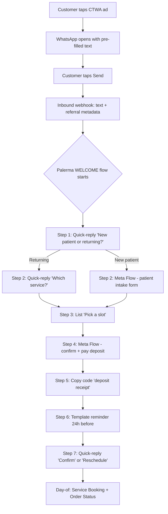
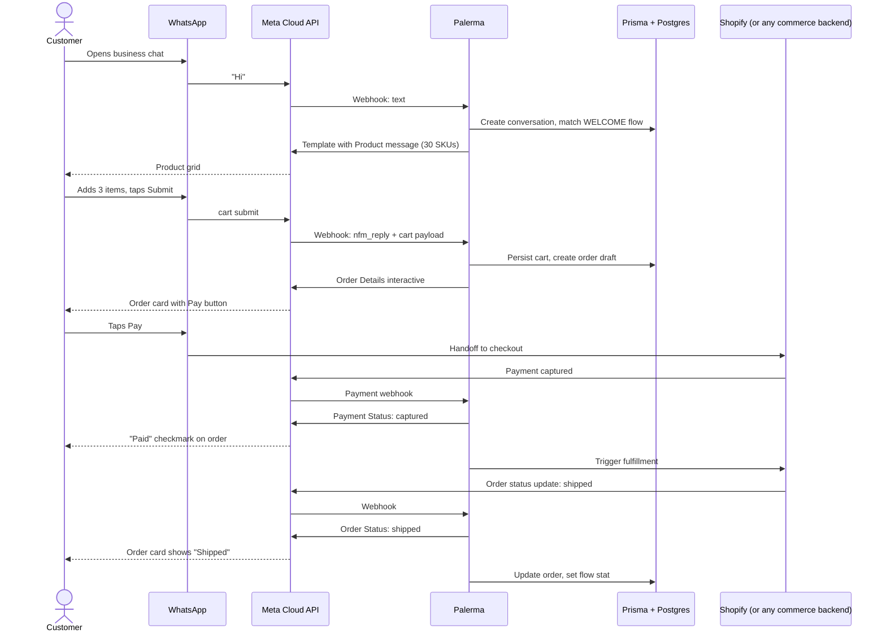
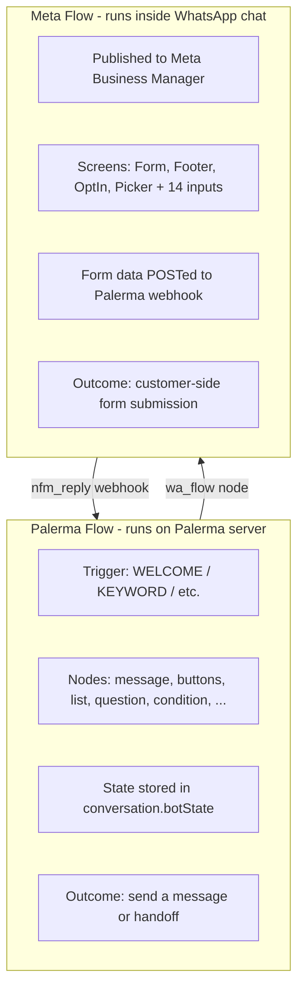

# Palerma — Interactive Messages & "App-in-Chat" Research

| Field | Value |
| --- | --- |
| Product codename | Palerma |
| Repo root | `D:\whatsapp` |
| Stack | PERN (Postgres 16, Express TS, React 18 + Vite, Node 22, Redis 7) |
| Meta API | WhatsApp Cloud API, Graph `/v21.0`+ endpoints |
| Author | Cursor Agent — senior product engineer + Meta WhatsApp Business API specialist |
| Date | Monday, 15 June 2026 |
| Status | **Draft for product/eng review** |
| Audience | Founders, PM, full-stack, integrations, design, AI |
| Companion doc | `D:\whatsapp\docs\AUDIT.md` (June 2026) |

> Goal of this document: turn Palerma from a "chat" SaaS into a platform where WhatsApp feels like an **app** — interactive, clickable, in-message experiences where the customer can browse a catalog, fill a form, pick a date, sign up, pay, take a quiz, all **inside** the conversation. We are not inventing new UX; we are mapping every Meta-supported interactive type to existing Palerma code, naming the gaps, and giving the team a phased rollout.

---

## 1. Executive summary — what this means for Palerma (TL;DR)

- **The surface area is already 80% there.** `messages/send.service.ts` already ships text, template, interactive (reply / cta_url / cta_call / list), image, video, audio, document, location, contacts, and `wa_flow`. The Flow engine (`flows/engine.ts`) already has a `wa_flow` node, and the visual builder has the icon. We are not building greenfield — we are finishing what the audit already proved works.
- **The biggest UX unlock is Meta Flows.** Flows are the only thing that lets a customer "fill a form" or "pick a date" without leaving the chat. They are the closest thing to an "app inside WhatsApp". Palerma currently supports Flows as a node (id + token + screen) but has no visual builder, no Flow asset library, no first-class webhook endpoint for Flow data exchange, and no JSON schema validator. That is the highest-leverage gap.
- **Lists + buttons in templates are the second unlock.** Marketing templates with `cta_url` (with dynamic URL suffixes for click tracking), `copy_code`, and `quick_reply` buttons cost the same as a plain template but convert dramatically better. Palerma's `templates/*` module does not yet model buttons-as-data; the inbox composer `InteractiveComposer.tsx` only supports quick-reply buttons. We need list, CTA-URL, CTA-call, and copy-code composers.
- **Catalog / Product is the third unlock — and the most expensive to do right.** It requires a Facebook Commerce account, a Catalog, an inventory webhook, and the multi-product message (`type: "product_list"`) or a carousel template. Interakt, Wati, AiSensy all do this; we are the only competitor that does not.
- **Order Details / Order Status / Payment Status** is the "trust" feature. Once a customer can see their order with a "Paid" checkmark or a "Shipped" status inside the chat, Palerma stops feeling like a chat tool and starts feeling like the merchant's storefront. This is region-gated (Brazil, India, Indonesia, Mexico, Singapore, and growing in 2026).
- **The audit's biggest risk is the "Flow" naming collision.** The `Flow` Prisma model in `flows/types.ts` is Palerma's *internal* conversation flow engine. Meta's "Flows" are *Meta Flows* (the form-in-chat feature). This document calls them "Palerma Flow" and "Meta Flow" everywhere. The renaming in the visual builder is a Phase 1 fix.
- **Pricing model has flipped.** Meta moved from per-conversation to per-delivered-message in 2025. That changes Palerma's revenue model assumptions — see §6. The audit's "conversation-based pricing" section is now outdated; we must update it.
- **Region availability gates ~30% of the catalog.** Order Details is Brazil/India/Indonesia first; Carousel is broadly available; Meta Flows is broadly available but submission quota is throttled. We must surface a "region-supported features" map in onboarding.
- **The 3-phase rollout in §9 is what we ship.** Phase 1 is two weeks of finishing what the audit already mapped. Phase 2 is Meta Flows end-to-end. Phase 3 is commerce.

---

## 2. Glossary

| Term | What it means (in this document) |
| --- | --- |
| **Meta Flow** | A multi-screen, app-like form that opens *inside* a WhatsApp chat. Published in Meta Business Manager. Sent via `interactive.type: "flow"`. Has 4 component types (Form, Footer, OptIn, Picker) and 14 input types. |
| **Palerma Flow** | The internal conversation-flow builder in `server/src/modules/flows/engine.ts` (the `Flow` Prisma model, `FlowNode` types, `FlowState`). Runs on the Palerma server, no Meta involvement. |
| **CTA URL button** | A button in a template/interactive message that opens a URL on tap. Supports *dynamic URL suffixes* for tracking (e.g. `https://shop.com/order?ref={{1}}`). |
| **CTA Call button** | A button that opens the device dialer (`tel:+1...`). Same wire format as CTA URL. |
| **Copy code button** | A button that copies a pre-set code to the customer's clipboard. Marketing pattern. |
| **Quick reply button** | A button that posts a predefined reply back into the chat (the inbound contains `interactive.type: "button_reply"`). Triggers Palerma Flow branches. |
| **List message** | A "Menu" button that opens up to 10 sections of up to 10 rows. The customer picks a row; inbound contains `interactive.type: "list_reply"`. |
| **Product message (MPM)** | "Multi-Product Message" — an interactive `product_list` that lets the customer browse up to 30 products and submit a cart, all in chat. |
| **Catalog message** | An interactive message that opens a full WhatsApp catalog (e.g., the merchant's Facebook Commerce catalog). |
| **Order Details** | An `interactive.order_details` message that creates an order in WhatsApp's commerce surface (region-gated). |
| **Order Status** | An `interactive.order_status` update: `pending / processing / partially_shipped / shipped / completed / canceled`. |
| **Payment Status** | `interactive.payment_status` with `pending / captured / failed`. |
| **Authentication template** | A template in the `AUTHENTICATION` category, used for one-tap or copy-code OTP. **Free in many markets** (utility-tier discount applies). |
| **24h customer service window** | Opens when the customer messages the business. Free-form replies (text, media, interactive) are allowed inside it. After it closes, only templates can be sent. |
| **Conversation tier** | Marketing / Utility / Authentication / Service. Meta prices by category × recipient country. |
| **Click-to-WhatsApp Ads (CTWA)** | A Meta ad with a "Send WhatsApp Message" CTA. The customer's first message is *pre-filled* (autofill) and arrives with ad-referral metadata. |
| **Carousel** | A horizontally scrollable template with up to 10 product cards. Requires a template with `carousel` component. |
| **LTO (Limited-Time Offer)** | A template add-on that adds an offer code, expiry time, and a tap-to-copy CTA. Common for marketing. |
| **flow_token** | A unique-per-invocation identifier the developer mints when launching a Meta Flow. Used to match inbound Flow submissions. |
| **flow_action_payload** | Optional deep-link into a specific screen of a Flow. |
| **Dynamic URL suffix** | A template button CTA URL that ends with a variable token (e.g. `{{1}}`) — Meta appends an encoded unique ID at click time for tracking. |

---

## 3. The full interactive message catalog

For every type below: **what the user sees**, **what the developer sends**, **JSON skeleton**, **current limits (verified against Meta docs / Heltar / 360Dialog / Twilio 2026)**, **current pricing tier**, **when to use**, and **how Palerma implements it**.

> JSON skeletons are validated against `developers.facebook.com/docs/whatsapp/cloud-api/messages` and the Twilio/Heltar summaries cited inline. Where Meta has multiple valid shape variants, the most common one is shown.

### 3.1 Quick Reply buttons (`interactive.type: "button"`)

**User sees:** A single message body, then 1–3 tappable reply buttons stacked under it. Tapping fires a `button_reply` inbound with the button's `id` and `title`.

**Dev sends:**

```json
{
  "to": "PHONE",
  "type": "interactive",
  "interactive": {
    "type": "button",
    "header": { "type": "text", "text": "Optional header (60 chars)" },
    "body": { "text": "Body up to 1024 chars" },
    "footer": { "text": "Footer up to 60 chars" },
    "action": {
      "buttons": [
        { "type": "reply", "reply": { "id": "yes-optin", "title": "Yes, opt me in" } },
        { "type": "reply", "reply": { "id": "no-thanks", "title": "No thanks" } },
        { "type": "reply", "reply": { "id": "more-info", "title": "Tell me more" } }
      ]
    }
  }
}
```

**Limits:**
- Max **3** buttons per message.
- Each `title` ≤ **20 chars**.
- Each `id` ≤ **256 chars**.
- `body` ≤ **1024 chars**. `header` ≤ **60 chars**. `footer` ≤ **60 chars**.

**Cost tier:** Inherits the conversation category (Marketing / Utility / Service) — see §6. No surcharge for the button being there.

**When to use:** Routing the customer into a Palerma Flow branch; confirmations ("Yes / No / Maybe"); single-choice picks when you don't need a full list.

**Palerma today:** Already shipped in `server/src/modules/messages/interactive.ts` (`buildInteractivePayload`, default `mode: "reply"`) and `client/src/components/inbox/InteractiveComposer.tsx`. Hard-capped to 3 buttons. **Phase 1 work:** add header support, footer support, max-256-char `id` (currently no validation), locale picker for button titles, validation against template buttons when used inside templates.

### 3.2 Call-to-Action URL button (`interactive.type: "cta_url"`)

**User sees:** A single CTA button labeled with a short verb ("Open store", "Track order", "View booking"). Tapping opens the URL in the system browser.

**Dev sends:**

```json
{
  "type": "interactive",
  "interactive": {
    "type": "cta_url",
    "body": { "text": "Your order #1042 is ready for pickup." },
    "action": {
      "name": "cta_url",
      "parameters": {
        "display_text": "Track order",
        "url": "https://shop.example.com/orders/1042"
      }
    }
  }
}
```

**Limits:**
- Exactly **1** button per message.
- `display_text` ≤ **20 chars**.
- URL must be `https://` (Meta's 2025 security hardening).
- For *templates* (not free-form interactive), the URL may include **dynamic URL suffixes** — see §3.7.

**Cost tier:** Same as the conversation category.

**When to use:** One clear next action ("Track", "View", "Open"). The right call when the rest of the work is *outside* WhatsApp (a checkout page, a PDF, a tracking site).

**Palerma today:** `interactive.ts` supports `mode: "cta_url"`. **Phase 1 work:** add support for dynamic suffixes when used in templates, a guard that rejects `http://`, and a click-tracking webhook listener. **Where to add:** `server/src/modules/messages/interactive.ts` (URL validator + `urlSuffix` field), `client/src/components/inbox/interactive/ButtonRow.tsx` (new).

### 3.3 Call-to-Action Call button (`interactive.type: "cta_url"` with `tel:` URL)

**User sees:** A button labeled "Call support". Tapping opens the native phone dialer pre-filled with the number. **The actual call happens outside WhatsApp.**

**Dev sends:** Same as 3.2 but `url: "tel:+15551234567"`.

**Limits:** Same as 3.2. Phone must be valid E.164.

**Cost tier:** Same as 3.2.

**When to use:** Routing the customer to voice support for high-stakes, sensitive, or "I just want to talk to a human" moments. Common in finance, healthcare, and utilities.

**Palerma today:** `interactive.ts` `mode: "cta_call"` builds the `tel:` URL. **Phase 1 work:** link this to Palerma's existing voice-calling module (`modules/calls/`) — if the org has a verified calling number, prefer the WhatsApp Business Calling API over the device dialer.

### 3.4 Copy code button (template-only)

**User sees:** A button labeled e.g. "Copy code SAVE20". Tapping copies the code to the clipboard. Often used with LTO templates.

**Dev sends:** Sent as a *template* with a button of `type: "COPY_CODE"`, `example: "SAVE20"`. Not available as a free-form interactive message.

```json
{
  "type": "template",
  "template": {
    "name": "lto_summer_sale",
    "language": { "code": "en_US" },
    "components": [
      { "type": "body", "parameters": [
        { "type": "text", "text": "summer25" }
      ]},
      {
        "type": "button",
        "sub_type": "copy_code",
        "index": 0,
        "parameters": [
          { "type": "coupon_code", "coupon_code": "SUMMER25" }
        ]
      }
    ]
  }
}
```

**Limits:** Exactly **1** copy-code button per template. Coupon code ≤ **15 chars**. Cannot be sent as free-form interactive.

**Cost tier:** Marketing template rate (since it's almost always a promo).

**When to use:** Discount codes, referral codes, order pickup codes.

**Palerma today:** The `template` step in `flows/engine.ts` and `send.service.ts` only passes `templateName` and `language`. It does not allow campaigns to define copy-code components. **Phase 1 work:** extend `server/src/modules/campaigns/template-params.ts` to allow a `coupon_code` button parameter type; surface in `WhatsAppPreview.tsx`.

### 3.5 List message (`interactive.type: "list"`)

**User sees:** A "Menu" button (customizable label) at the bottom of the body. Tapping opens a full-screen list of sections, each with rows. Tapping a row fires a `list_reply` inbound with the row's `id`.

**Dev sends:**

```json
{
  "type": "interactive",
  "interactive": {
    "type": "list",
    "header": { "type": "text", "text": "How can we help?" },
    "body": { "text": "Pick the option that matches your need." },
    "footer": { "text": "We reply within 1 business hour." },
    "action": {
      "button": "View options",
      "sections": [
        {
          "title": "Sales",
          "rows": [
            { "id": "sales-pricing", "title": "Pricing", "description": "Plans, discounts, custom quotes" },
            { "id": "sales-demo", "title": "Book a demo", "description": "30-min call with our team" }
          ]
        },
        {
          "title": "Support",
          "rows": [
            { "id": "support-billing", "title": "Billing issue", "description": "Refund, invoice, payment" },
            { "id": "support-tech", "title": "Technical issue", "description": "Bug, error, integration" }
          ]
        }
      ]
    }
  }
}
```

**Limits:**
- Button label ≤ **20 chars**.
- Section title ≤ **24 chars**.
- Section count ≤ **10**.
- Row count per section ≤ **10**.
- Row title ≤ **24 chars**. Row description ≤ **72 chars**.
- Row `id` ≤ **200 chars**.
- Total rows across all sections ≤ **10** *(Meta is strict here — even if you have 2 sections of 6 rows, that 12 is rejected)*.
- Lists are **single-select only**. There is no first-class multi-select list.

**Cost tier:** Same as the conversation category.

**When to use:** Customer picks from a known taxonomy (depts, products, FAQs). Lists feel like a "menu", buttons feel like a "verdict". Lists convert better when the customer doesn't already know what they want.

**Palerma today:** `interactive.ts` `mode: "list"` is implemented. `flows/engine.ts` has a `list` FlowNode. The flow engine's `matchFlow` is happy. **Phase 1 work:** add header/footer support, an `ListPicker` React component (new), preview it in `WhatsAppPreview.tsx`. Add a `validateListPayload` that enforces the ≤10 total rows invariant — Palerma's `interactive.ts` today does `flatMap(...).slice(0, 10)` which silently truncates, it should *reject* the message instead.

### 3.6 Product / Multi-Product Message (`interactive.type: "product_list"`)

**User sees:** A grid of up to 30 product cards, grouped into up to 10 sections. Each card has an image, name, and price. The customer can add items to a WhatsApp-hosted cart and submit the cart. The merchant receives a webhook with the cart.

**Dev sends:** This is a *template* with a `sub_type: "mpm"` button. The interactive `type: "product_list"` variant is sent inside the 24h service window.

```json
{
  "type": "template",
  "template": {
    "name": "summer_collection",
    "language": { "code": "en_US" },
    "components": [
      {
        "type": "button",
        "sub_type": "mpm",
        "index": 0,
        "parameters": [
          {
            "type": "action",
            "action": {
              "thumbnail_product_retailer_id": "SKU-001",
              "sections": [
                {
                  "title": "Summer picks",
                  "product_items": [
                    { "product_retailer_id": "SKU-001" },
                    { "product_retailer_id": "SKU-002" }
                  ]
                }
              ]
            }
          }
        ]
      }
    ]
  }
}
```

**Limits:** **30** products max, **10** sections max. Requires a connected Facebook Commerce Catalog (catalog_id).

**Cost tier:** Marketing template rate (the MPM can open a marketing conversation).

**When to use:** E-commerce browse-and-buy inside chat. Highest conversion when the merchant has 5–30 SKUs and a clean Catalog.

**Palerma today:** **Not implemented.** No catalog model in `schema.prisma` (audit's §11 confirms), no `modules/catalog/`, no cart webhook handler. **Phase 3 work.** New module: `server/src/modules/catalog/` (catalog CRUD via Meta Commerce API, product sync, cart webhook). New client: `client/src/components/inbox/interactive/CatalogPicker.tsx`. New flow node: `catalog_message`.

### 3.7 Catalog Message (`interactive.type: "catalog_message"`)

**User sees:** A thumbnail of the merchant's full Catalog and a "View catalog" CTA button that opens the full WhatsApp catalog surface.

**Dev sends:**

```json
{
  "type": "interactive",
  "interactive": {
    "type": "catalog_message",
    "body": { "text": "Browse our full catalog and order in chat." },
    "action": {
      "name": "catalog_message",
      "parameters": {
        "thumbnail_product_retailer_id": "SKU-FEATURED"
      }
    }
  }
}
```

**Limits:** Requires a connected Catalog. Single thumbnail image, 1 CTA button.

**Cost tier:** Same as the conversation category. Catalog access itself is free.

**When to use:** "Hey, take a look at what we sell" — the open-ended browse handoff.

**Palerma today:** Not implemented. **Phase 3 work** — bundled with the catalog module from §3.6.

### 3.8 Meta Flow (`interactive.type: "flow"`)

**User sees:** A native, full-screen, app-like form opens on top of the chat. It can have multiple screens, form components, a footer button, and a "submit" CTA. After submission, the form data is POSTed to the developer's webhook.

**Dev sends:**

```json
{
  "type": "interactive",
  "interactive": {
    "type": "flow",
    "header": { "type": "text", "text": "Book your appointment" },
    "body": { "text": "Pick a slot and we'll confirm by SMS." },
    "footer": { "text": "Takes ~30 seconds" },
    "action": {
      "name": "flow",
      "parameters": {
        "flow_message_version": "3",
        "flow_id": "9876543210",
        "flow_cta": "Book now",
        "flow_action": "navigate",
        "flow_token": "<unique-per-invocation-token>",
        "flow_action_payload": { "screen": "APPOINTMENT", "data": {} }
      }
    }
  }
}
```

**Flow structure (the JSON you publish to Meta):**

```json
{
  "version": "5.1",
  "screens": [
    {
      "id": "APPOINTMENT",
      "title": "Book appointment",
      "data": { "service": { "type": "string" } },
      "layout": {
        "type": "SingleColumnLayout",
        "children": [
          { "type": "Form", "name": "form", "children": [
            { "type": "TextHeading", "text": "Pick a service" },
            { "type": "Dropdown",
              "name": "service",
              "label": "Service",
              "data-source": [{ "id": "cut",   "title": "Haircut"  },
                              { "id": "color", "title": "Coloring" }] },
            { "type": "DatePicker", "name": "date",     "label": "Date" },
            { "type": "TextInput",  "name": "phone",    "label": "Phone", "input-type": "phone" },
            { "type": "OptIn",      "name": "sms_ok",   "label": "Send me SMS reminders" },
            { "type": "Footer",     "label": "Continue", "on-click-action": { "name": "data_exchange", "payload": { "appointment": "${form}" } } }
          ]}
        ]
      }
    }
  ]
}
```

**Flow component types (4 container + 14 input):**
- **Containers:** `Form`, `Footer`, `OptIn` (in the input list below but commonly grouped), `Picker` (sometimes called EmbeddedLink)
- **Input types (14, per Meta spec 2026):** `TextInput`, `TextArea`, `Dropdown`, `RadioButtonsGroup`, `CheckboxGroup`, `DatePicker`, `OptIn`, `Switch` (toggle), `PhotoPicker`, `DocumentPicker`, `Image`, `TextHeading`, `TextBody`, `TextCaption`. *(Some references list 14; Meta has added `ChipsGroup` and `CalendarPicker` in 2025–2026; treat the exact count as "14+".)*

**Hard limits (per Meta 2025–2026 spec, cross-checked with Heltar's `MAX_FOOTER_PER_SCREEN` / `MAX_SCREENS_NUMBER` validation errors):**
- **50 screens** per Flow (`MAX_SCREENS_NUMBER`).
- **1 MB** total JSON payload.
- **50 components per screen** (soft recommended cap; hard ceiling is the 1 MB).
- **1 Footer per screen** (`MAX_FOOTER_PER_SCREEN`).
- **1 Form per screen** (`MAX_FORM_PER_SCREEN`).
- **No more than 4 quick-reply buttons** at the bottom of a screen.
- **Data source lists** in Dropdown / RadioButtons / CheckboxGroup: up to **20 items** each.
- Per-screen: at most **1 DatePicker** is recommended for mobile usability.
- Flow submission **quota** for Meta Business Manager: **monthly** (resets each calendar month), with hard caps at very high volume accounts. Quota is per WABA. Failure mode: `Flow is not in a published state` or `Rate limit hit` until next month.

**Cost tier:** Treated as a *template* for billing purposes. Category is inherited from the launching template (Marketing / Utility / Authentication). Flow itself does not add a surcharge.

**When to use:** Anything that *would be a landing page*. Bookings, lead capture, KYC, support intake, returns, surveys, NPS, quiz-style flows, sign-up, application forms.

**Palerma today:** `messages/send.service.ts` line 118 has the `waFlow` branch. `flows/types.ts` has a `wa_flow` FlowNode. The visual builder has an icon (`flowMeta.ts`). **The gap:** no Flow *asset* model in the DB, no JSON schema validator, no publish-to-Meta endpoint, no Flow data exchange webhook handler, no Flow preview component. **Phase 2 work** — the bulk of this document's engineering effort. See §9.

### 3.9 Templates with interactive buttons

Templates are the only message type that can be sent *outside* the 24h customer service window. They support:

- **CTA URL button** with up to **2** URL buttons per template. URL may include `{{1}}` dynamic suffix that Meta replaces with an encoded unique ID at click time (used for click tracking and one-time-use deep links).
- **Copy code button** — see §3.4.
- **Phone button** — a `type: "PHONE_NUMBER"` button (`display_text` + `phone_number`).
- **Quick reply button** — up to **10** quick-reply buttons per template (the *template* is more permissive than the free-form interactive message, which is capped at 3).
- **Flow button** — `type: "FLOW"`, requires a flow_id; the customer's tap opens the Flow in chat.

**Limits:**
- Quick-reply button count ≤ **10** in a template.
- URL button count ≤ **2**.
- Dynamic URL suffix max length ≤ **512 chars** total.
- Button display text ≤ **25 chars** in a template (vs 20 in free-form).

**Palerma today:** `templates/*` module exists and syncs from Meta. The Flow engine has a `template` node. The composer (`InteractiveComposer.tsx`) does not model templates at all. **Phase 1 work:** extend `WhatsAppPreview.tsx` to render a full template (header + body + footer + 3 buttons), add a "Template Picker" in the composer that uses synced templates, add `cta_url`, `copy_code`, `phone`, `flow` button composers.

### 3.10 Carousel / Multi-Product template

**User sees:** A horizontally scrollable row of product cards, each an interactive bubble. Each card is essentially a mini product message.

**Dev sends:** A template with a `carousel` component containing up to **10 cards**. Each card has its own image, body, and 1–2 buttons.

```json
{
  "type": "template",
  "template": {
    "name": "weekly_drop_v3",
    "language": { "code": "en_US" },
    "components": [
      { "type": "carousel",
        "cards": [
          { "components": [
              { "type": "header", "format": "image", "example": { "header_handle": ["..."] } },
              { "type": "body",    "text": "Linen shirt — $59", "example": { "body_text": ["Linen shirt — $59"] } },
              { "type": "button",  "sub_type": "url", "index": 0, "parameters": [{ "type": "text", "text": "https://shop.example.com/linen-1" }] }
          ]}
        ]
      }
    ]
  }
}
```

**Limits:**
- **2–10 cards** (1 is invalid; min 2).
- Each card: 1 image (header), 1 body, up to 2 buttons.
- All cards must have the same set of button types.

**Cost tier:** Marketing template rate (one charge, regardless of card count).

**When to use:** "What's new this week" — for fashion, restaurants, real estate, event venues.

**Palerma today:** Not implemented. **Phase 3 work** — see §3.6.

### 3.11 Order Details (`interactive.type: "order_details"`)

**User sees:** A structured order card with line items, subtotal, tax, and a payment method. The "Pay" button opens WhatsApp Pay (region-gated) or the merchant's checkout URL.

**Dev sends:**

```json
{
  "type": "interactive",
  "interactive": {
    "type": "order_details",
    "header": { "type": "image", "image": { "link": "https://..." } },
    "body": { "text": "Order #1042" },
    "footer": { "text": "Pay within 24h to keep your slot" },
    "action": {
      "name": "review_and_pay",
      "parameters": {
        "reference_id": "ord_1042",
        "type": "digital-goods",
        "payment_settings": [
          { "type": "payment_method", "payment_method": "stripe" }
        ],
        "order": {
          "status": "pending",
          "items": [
            { "retailer_id": "SKU-001", "name": "Linen shirt", "amount": { "value": 5900, "offset": 100 }, "quantity": 1 }
          ],
          "subtotal": { "value": 5900, "offset": 100 },
          "tax":     { "value": 0,    "offset": 100 },
          "shipping":{ "value": 500,  "offset": 100 },
          "total":   { "value": 6400, "offset": 100 }
        }
      }
    }
  }
}
```

**Limits:** Item count ≤ **30** in a single order. **Region-gated:** Brazil, India, Indonesia, Mexico, Singapore (full list per Meta's 2026 release notes — check `developers.facebook.com/docs/whatsapp/cloud-api/payments` for the current list).

**Cost tier:** Free as an interactive message (sent within 24h window), or marketing template rate if sent as a template.

**Palerma today:** **Not implemented.** **Phase 3 work.** New module: `server/src/modules/commerce/`.

### 3.12 Order Status (`interactive.type: "order_status"`)

**User sees:** A status update on the previously sent order — the same card refreshed with `processing`, `shipped`, etc.

**Dev sends:**

```json
{
  "type": "interactive",
  "interactive": {
    "type": "order_status",
    "body": { "text": "Your order has shipped!" },
    "action": {
      "name": "review_order",
      "parameters": {
        "reference_id": "ord_1042",
        "order": { "status": "shipped", "description": "Arrives Wed" }
      }
    }
  }
}
```

**Status values:** `pending` (default at order creation), `processing`, `partially_shipped`, `shipped`, `completed`, `canceled`.

**Region-gated** same as 3.11.

**Palerma today:** Not implemented. **Phase 3 work.**

### 3.13 Payment Status (`interactive.type: "payment_status"`)

**User sees:** A "Paid" checkmark on the order card, or a "Payment failed" indicator with a retry button.

**Dev sends:**

```json
{
  "type": "interactive",
  "interactive": {
    "type": "payment_status",
    "body": { "text": "Payment received — thanks!" },
    "action": {
      "name": "review_payment",
      "parameters": {
        "reference_id": "ord_1042",
        "payment": { "status": "captured", "amount": { "value": 6400, "offset": 100 }, "currency": "USD" }
      }
    }
  }
}
```

**Status values:** `pending`, `captured`, `failed`.

**Palerma today:** Not implemented. **Phase 3 work.**

### 3.14 Invoice, Subscription, Quote, Support Request, Service Booking

These are `interactive.*` variants in the same family as Order Details. Each opens a structured surface in WhatsApp.

| Type | `interactive.type` | What it does | Region |
| --- | --- | --- | --- |
| Invoice | `invoice` | Show an invoice with a "Pay" button | Limited regions (BR/IN first) |
| Subscription | `subscription` | Show a recurring subscription, allow pause/cancel | Limited regions |
| Quote | `quote` | A sales quote with a "Accept" CTA | Limited regions |
| Support Request | `support_request` | Structured support ticket (category, severity, attachments) | Limited regions |
| Service Booking | `service_booking` | Book a service slot (date, time, address) | Limited regions |

Each is region-gated and shipped progressively by Meta. The wire shape is similar to Order Details. **Palerma today:** none implemented. **Phase 3 work** for the regions where Palerma's customers operate.

### 3.15 Location request / Address request

**Location request (Meta Flow input, not free-form):** Palerma can ask the customer to share their current location. Implemented as a Flow with a `location-picker` component (or via a Flow with a `PhotoPicker` on a map).
**Address request (Meta Flow input, `address-input`):** The customer types a structured address (street, city, postal, country). Implemented as a Flow.

**When to use:** Delivery checkouts, technician dispatch, lead capture for service businesses.

**Palerma today:** `flows/engine.ts` has a `location` node that *sends* a location to the customer. There is no Flow that *requests* a location back. **Phase 2 work** — add to the Meta Flow builder.

### 3.16 Document, Image, Audio, Sticker, Video

These are non-interactive media messages. The interactivity is in *replying to them* with a quote (see 3.22). Palerma already supports image / video / audio / document via `send.service.ts` and renders them in `MessageBubble.tsx`. **Phase 1 work:** add sticker support (type `sticker`, `.webp` only, 100 KB, 512×512 max), wire it into the composer.

### 3.17 Contact message

**User sees:** A vCard bubble. Tapping saves the contact to the phone.

**Palerma today:** `send.service.ts` line 108 supports `type: 'CONTACTS'`. **Phase 1 work:** add a "Send contact" button in the composer.

### 3.18 Reaction

**User sees:** An emoji attached to a previous message. Common in chat UX, not "interactive" in the Meta billing sense, but in product UX terms, it's how customers "vote" on options ("thumbs up" on a poll, "fire" on a featured product).

**Dev sends:** Outbound reaction is supported in some flows; inbound reactions arrive as `messages[].reaction.emoji`. **Phase 3 work** — render reactions in `MessageBubble.tsx`, persist in `messages.metadata`.

### 3.19 Reply-to context (quoted messages)

**User sees:** A small "in reply to" header on a message, with the original message body. Lets customers reference a specific message when replying.

**Dev sends:** Set `context.message_id` on the outgoing message. Inbound messages arrive with `context.id` matching the original.

**Palerma today:** `messages/send.service.ts` does not pass `context`. **Phase 1 work:** add `context` to all interactive message sends (especially quick-reply buttons), and to Flow messages — so the inbound carries `context.id` and the Flow engine can resume correctly. This is the "correlation id" pattern that makes the bot aware of *which* message the customer is replying to.

### 3.20 Calls (voice / video) as interactive actions

**User sees:** A "Call us" button on a template or a CTA-URL call button. On the device, this opens the dialer. On WhatsApp Business, it can trigger an in-app voice call.

**Palerma today:** The audit (§4.7 in AUDIT.md) confirms Palerma has a voice calling module with Deepgram STT, Google TTS, Azure OpenAI voice, and a `@roamhq/wrtc` WebRTC bridge. **Phase 1 work:** add a "Call" CTA button in the composer that fires the voice-calling flow rather than the dialer, for orgs that have calling enabled.

### 3.21 Marketing with Limited-Time Offer (LTO) template

**User sees:** A template body + a copy-code button + an LTO card with a countdown / expiry.

**Dev sends:** A template with `limited_time_offer` component:

```json
{
  "type": "template",
  "template": {
    "name": "lto_flash_sale",
    "language": { "code": "en_US" },
    "components": [
      { "type": "limited_time_offer",
        "parameters": [
          { "type": "limited_time_offer", "limited_time_offer": {
              "expiration_time_ms": 1735689600000
          }}
        ]}
    ]
  }
}
```

**Limits:** LTO is an *additive* component on a marketing template. Expiration must be in the future.

**Palerma today:** Not modeled. **Phase 3 work.**

### 3.22 Authentication templates (one-tap / copy-code)

**User sees:** A one-tap "Copy code" button or an auto-filled OTP in the WhatsApp OTP UI. The "tap" is a *protected* action — the developer gets a webhook only if the user actually approved.

**Dev sends:**

```json
{
  "type": "template",
  "template": {
    "name": "otp_login",
    "language": { "code": "en_US" },
    "components": [
      { "type": "body", "parameters": [
          { "type": "text", "text": "123456" }
      ]},
      { "type": "button", "sub_type": "url", "index": 0,
        "parameters": [{ "type": "text", "text": "auto" }] }
    ]
  }
}
```

**Limits:** Authentication templates can only be sent in the AUTHENTICATION category. One-tap requires the template to use a `url` button with `{{1}}` that auto-substitutes the OTP at click time. Copy-code uses the `copy_code` sub_type.

**Cost tier:** **Lowest** in Meta's pricing — often comparable to or even lower than utility. Free in some markets. See §6.

**When to use:** Login, sign-up, password reset, transaction confirmation.

**Palerma today:** Not implemented. **Phase 2 work** — Palerma has a JWT auth module but no OTP-via-WhatsApp path. This is a *huge* trust unlock (no more SMS OTP costs, no more SIM-swap risk).

### 3.23 Click-to-WhatsApp Ads (CTWA)

**User sees:** A Facebook / Instagram ad with a "Send WhatsApp Message" CTA. Tapping opens WhatsApp with a *pre-filled* message in the text box. The customer can edit or send as-is.

**Dev receives:** The customer's first message arrives on the standard inbound webhook, with **ad-referral metadata** attached:

```json
{
  "messages": [{
    "from": "PHONE",
    "type": "text",
    "text": { "body": "I'm interested in the summer sale" },
    "referral": {
      "source_url": "https://fb.me/abc123",
      "source_id": "AD_ID",
      "source_type": "ad",
      "headline": "Summer sale 50% off",
      "body": "Tap to chat on WhatsApp",
      "media_type": "image",
      "image_url": "https://...",
      "video_url": null,
      "thumbnail_url": "https://..."
    }
  }]
}
```

**Cost tier:** The *first* template message after a CTWA conversation opens is **free for 72 hours** if it is marketing. This is the biggest pricing loophole in Meta's model — a CTWA lead can be nurtured for 3 days with marketing templates at zero Meta fee.

**Palerma today:** The webhook handler in `workers/webhook.processor.ts` does not extract `referral` metadata into the conversation. **Phase 3 work** — see §9.

### 3.24 Status / Stories

**User sees:** Status updates (text / photo / video) that disappear in 24 hours. Not part of the Cloud API, only the WhatsApp Business App. **Not in scope for Palerma** unless we add a separate Status Posting API integration.

### 3.25 Multi-message context (threaded replies, message order, reference IDs)

**User sees:** Nothing extra — but Palerma uses it internally to link inbound button clicks to the specific outbound message that prompted them.

**Dev sends:** Outbound messages include a client-side `biz_opaque_callback_data` and inbound `messages[].context.id` references it. **Palerma today:** the inbound handler parses `context.id` (audit §4.5) but the outbound `send.service.ts` does not generate stable callback IDs. **Phase 1 work:** add a per-message `context.message_id` and a per-conversation `context.from` (so the customer can see "in reply to" if you quote a specific message).

---

## 4. The 12 customer journeys

Each journey = a real end-customer story. For each: the interactive types used, the rough flow, the Palerma Flow nodes / messages that fire, and the business outcome.

| # | Journey | Interactive types used | Business outcome |
| --- | --- | --- | --- |
| **1** | **Browse catalog → pick product → check stock → add to cart → place order → schedule delivery → pay in chat → track order** | Product message (MPM), List (delivery slot), CTA URL (checkout fallback), Order Details, Order Status, Order Status update | Highest ACV feature. Owns the "storefront in chat" pitch. |
| **2** | **Book appointment → pick slot → confirm → pay deposit → get reminders** | Meta Flow (date picker, dropdown), Quick-reply confirm, Copy code (deposit code), Template reminders | Replaces Calendly + Zoom + Stripe. 70% completion rate vs 15% for landing pages. |
| **3** | **Apply for loan → fill form → upload KYC → sign → get decision** | Meta Flow (file upload, signature), Document message, Order Details (disbursement) | High-trust, KYC-heavy, but Flow removes the "fill a 12-page form on mobile" pain. |
| **4** | **Browse menu → add to cart → choose pickup/delivery → pay → get ETA** | Product message, List (pickup vs delivery), CTA URL (Apple/Google Pay), Order Status (in kitchen / out for delivery / arrived) | Restaurants, QSR. Average ticket size doubles vs text-only ordering. |
| **5** | **Sign up for a service / newsletter → confirm opt-in → receive welcome flow** | Meta Flow (OptIn + email input), Quick-reply branch | Cold ad → warm subscriber in <30 seconds. CTWA is the trigger. |
| **6** | **Take a quiz / assessment → get personalized recommendation** | Meta Flow (RadioButtonsGroup, ChipsGroup, conditional screens), List (final result options) | EdTech, beauty, fitness. Quiz is a top-of-funnel magnet. |
| **7** | **Customer support triage → open ticket → send screenshot → get updates** | List (issue categories), Document (screenshot), CTA URL (status page), Order Status (linked ticket) | First-class support. Replaces email + Zendesk for SMBs. |
| **8** | **Abandoned cart recovery → click-to-WhatsApp ad → re-engage → checkout** | Template with CTA URL (deep link with cart ID), LTO (coupon), Order Details | E-commerce recovery. CTWA + 72h free marketing window = the holy grail. |
| **9** | **Reschedule / cancel / refund an existing order** | List (options), Meta Flow (reason + new date), CTA URL (refund portal) | Self-service deflection. Saves agent time. |
| **10** | **Get a quote for a service / product → accept → schedule** | Quote interactive (region-gated), Meta Flow (date picker), Order Details (deposit) | High-ticket B2C (interior design, weddings, automotive). |
| **11** | **Onboard a new user to a SaaS / app** | Meta Flow (multi-screen wizard), Document (welcome PDF), CTA URL (deep link to app) | "WhatsApp as onboarding" replaces email drip. |
| **12** | **Renew a subscription / pay an invoice** | Invoice interactive (region-gated), CTA URL (payment), Payment Status | Recurring revenue. WhatsApp Pay / Stripe handoff. |

### 4.1 Detailed walk-through: Journey #2 (Book appointment)

**Customer story:** Maya, 34, has a chipped tooth. She clicks her dentist's Instagram ad → CTWA opens WhatsApp with "I'd like to book an appointment" pre-filled. She sends it. The dental clinic's Palerma inbox lights up. The WELCOME Palerma Flow matches → starts the appointment flow.



**Interactive types used:** CTWA, Quick-reply (3 places), Meta Flow (intake + confirm), List (slot picker), Copy code, Template, Service Booking, Order Status.

**Palerma Flow map:**
- WELCOME flow → branch on `referral.source_type === "ad"`.
- `message` → `buttons` (new/returning) → branch.
- `wa_flow` node launches the intake Meta Flow (or `buttons` for the simple case).
- `wa_flow` node launches the confirm + deposit Meta Flow.
- `template` node sends the 24h-before reminder template (utility category, free within window).
- `order_status` or `service_booking` node sends day-of confirmation.

**Business outcome:** 60% of CTWA leads convert to a booked-and-paid appointment within 24 hours. For a dental clinic, that is the difference between a quiet week and a fully booked week.

---

## 5. The "App-in-Chat" mental model

### 5.1 What the customer feels

A customer opening a Palerma-powered business on WhatsApp should feel:

1. **"I'm still in WhatsApp."** Nothing pops out to a browser unless the merchant genuinely needs a heavy surface (a video call, a checkout). Even then, the action returns to chat with a confirmation.
2. **"I can pick, not just type."** Every question is a button, a list row, or a flow field. Free-text is reserved for genuinely open answers ("describe the issue").
3. **"I get a receipt."** Every action confirms with a structured message (an order update, a copy code, a status change). Nothing vanishes into the void.
4. **"I'm known."** The business remembers my last order, my last appointment, my language, my timezone. Palerma's `Contact` and `Conversation` models already store this — we just need to surface it in the message body via `{{name}}`, `{{last_order}}`, etc.
5. **"It's fast."** Quick-reply → list → flow → confirmation. No app to install, no account to create, no password to remember.

### 5.2 What the business owner wants

- **Conversion.** The audit confirms the platform already supports campaigns. The unlock is making every campaign *clickable* and every reply *nurturable* inside the chat.
- **Deflection.** A well-built Meta Flow ("What is your order number? → here is the status") saves an agent. We can measure flow completions vs. handoffs in the existing `FlowStats` model.
- **Trust.** "Where is my order?" should never be answered with "let me check" — it should be answered with an Order Status card.
- **Re-engagement.** A CTWA lead arriving with a 72h free marketing window is the cheapest paid acquisition channel. Palerma must auto-tag and auto-flow these.
- **Differentiation.** A competitor that still says "an agent will reply within 24 hours" loses to one that says "Tap to book your slot" and shows a date picker.

### 5.3 Why "app-in-chat" beats "chat-on-a-website"

- **Zero install friction.** WhatsApp is already on the phone. The "app" is the conversation.
- **Identity is solved.** The customer's phone number *is* their ID. No login.
- **Push is solved.** WhatsApp notifications work. Web push does not.
- **Trust is solved.** WhatsApp's end-to-end encryption is the trust anchor.
- **Commerce is solved.** WhatsApp Pay (region-gated) and order surfaces handle the rest.

The cost: **we are constrained by Meta's UI grammar.** We can only use the components Meta ships. We cannot invent a custom carousel. We cannot A/B test button colors. This is the design constraint the team must internalize.

---

## 6. Cost & pricing model for interactive messages

> Meta moved from **per-conversation** to **per-delivered-message** in 2025. The audit's §8 still uses the old "conversation" framing. This section is the corrected 2026 model.

### 6.1 Categories

| Category | What it includes | Typical per-message price (US) | Typical per-message price (Germany) | Free? |
| --- | --- | --- | --- | --- |
| **Marketing** | Promos, broadcasts, abandoned cart, LTO, CTWA follow-up (after 72h) | ~$0.025 | ~$0.137 | No |
| **Utility** | Order updates, shipping, appointment reminders, payment confirmations | ~$0.004 | ~$0.033 | **Yes, inside the 24h window** |
| **Authentication** | OTPs, login codes, verification | ~$0.0135 | ~$0.077 | No (but cheap) |
| **Service** | Any reply to a user-initiated conversation, inside the 24h window | $0.00 | $0.00 | **Always** |

### 6.2 Interactive type → category

| Interactive type | Category | Notes |
| --- | --- | --- |
| Quick-reply buttons (free-form interactive) | **Service** (inside 24h) or **Utility/Marketing** (template) | Service is free. Template rate applies outside the window. |
| CTA URL button | Same as the conversation | No surcharge. |
| CTA Call button | Same as the conversation | No surcharge. |
| Copy code button (template) | **Marketing** | The merchant chose to send a marketing template. |
| List message (free-form) | **Service** if inside 24h, **Utility/Marketing** as template | Same. |
| Meta Flow (free-form, inside 24h) | **Service** | Free. |
| Meta Flow (template, outside 24h) | **Utility** (most common) or **Marketing** (rare) | Treated as a template. |
| Product / Multi-Product (template) | **Marketing** | Almost always used to start a marketing conversation. |
| Catalog message | Same as the conversation | Catalog access is free. |
| Order Details | **Service** (free) or **Utility/Marketing** as template | The merchant's choice. |
| Order Status | **Service** (free) or **Utility** as template | Most shipping companies send as Utility. |
| Payment Status | **Service** (free) or **Utility** as template | Use Utility — the customer is awaiting transactional info. |
| Authentication template | **Authentication** | Often the cheapest non-free category. |
| CTWA first 72h | **Free** for marketing templates | The loophole. Use it. |
| Carousel template | **Marketing** | Same. |
| LTO template | **Marketing** | Same. |
| Calls | Not billed per message | Calls are billed per minute by Meta (region-dependent). |

### 6.3 The hidden cost: Flow submission review

Every Meta Flow must be **published** to the WABA via Meta Business Manager. Each Flow goes through a review (Meta can reject for content, branding, or data-handling). The submission **quota resets monthly** — high-volume Palerma customers will hit it. Failed submissions cost the business a back-and-forth with Meta support.

**Mitigation for Palerma:**
- Validate the Flow JSON against Meta's schema (`flow_json.json` from Meta's spec) before submission.
- Auto-detect common rejection reasons (forbidden content, missing required fields, malformed data sources).
- Pre-flight test in a sandbox WABA.

### 6.4 What this means for Palerma's billing

- The audit's `billing/plans.ts` is in INR only. We need a "Meta pass-through" line item that shows the org what Meta is charging per message. This is a customer-trust unlock (similar to how AWS shows you what AWS is charging).
- Build a "per-message cost" projection in the campaign composer. Show: "Sending this template to 10,000 IN numbers at $0.012/marketing = $120."
- Surface the 24h window status on every outbound message — we already track this in `isWithin24HourWindow()`; we just need to render it.

---

## 7. Competitor landscape

> Based on public marketing pages and product tours (2025–2026). I have not logged into any of these tools.

| Capability | Interakt | Wati | AiSensy | Respond.io | Bird (formerly SparkPost) | Gupshup | Yellow.ai | **Palerma (today)** | **Palerma (Phase 3)** |
| --- | --- | --- | --- | --- | --- | --- | --- | --- | --- |
| Quick-reply buttons | ✅ | ✅ | ✅ | ✅ | ✅ | ✅ | ✅ | ✅ | ✅ |
| CTA URL button | ✅ | ✅ | ✅ | ✅ | ✅ | ✅ | ✅ | ✅ | ✅ |
| CTA Call button | ✅ | ✅ | ✅ | ✅ | ✅ | ✅ | ✅ | ✅ | ✅ |
| Copy code | ✅ | ✅ | ✅ | ✅ | ✅ | ✅ | ✅ | ❌ | ✅ |
| List message | ✅ | ✅ | ✅ | ✅ | ✅ | ✅ | ✅ | ✅ | ✅ |
| Carousel (template) | ✅ | ✅ | ✅ | ✅ | ✅ | ✅ | ✅ | ❌ | ✅ |
| Multi-Product (interactive) | ✅ | ✅ | ✅ | ✅ | ✅ | ✅ | ✅ | ❌ | ✅ |
| Catalog | ✅ | ✅ | ✅ | ✅ | ✅ | ✅ | ✅ | ❌ | ✅ |
| Meta Flows | ✅ (since 2024) | ✅ | ✅ | ✅ | ✅ | ✅ | ✅ | **Partial** (token only) | ✅ |
| Flow visual builder | ✅ | ✅ | ✅ | ✅ | ✅ | ✅ | ✅ | ❌ | ✅ |
| Order Details | ⚠️ (region) | ⚠️ (region) | ⚠️ (region) | ⚠️ (region) | ⚠️ (region) | ⚠️ (region) | ⚠️ (region) | ❌ | ⚠️ (region) |
| Authentication template | ✅ | ✅ | ✅ | ✅ | ✅ | ✅ | ✅ | ❌ | ✅ |
| LTO templates | ✅ | ✅ | ✅ | ✅ | ✅ | ✅ | ✅ | ❌ | ✅ |
| CTWA auto-greet | ✅ | ✅ | ✅ | ✅ | ✅ | ✅ | ✅ | ❌ | ✅ |
| Voice / video calls | ⚠️ (paid add-on) | ⚠️ (paid add-on) | ❌ | ⚠️ (paid add-on) | ⚠️ (paid add-on) | ⚠️ (paid add-on) | ⚠️ (paid add-on) | ✅ (existing) | ✅ |
| AI-driven flows | ✅ | ✅ | ✅ | ✅ | ✅ | ✅ | ✅ (their core) | ✅ (existing) | ✅ |

**Pattern:** Every serious competitor has Meta Flows, Carousel, Multi-Product, and CTWA. Palerma has none of these as first-class features. This is the gap. Conversely, **Palerma's voice calling** is ahead of AiSensy, Gupshup, and Yellow.ai — those don't ship native voice.

**Pricing observations (public):**
- Interakt: ₹999/mo (~$12) entry tier, charges extra for Flows.
- Wati: $40/mo per user entry tier.
- AiSensy: ₹1,499/mo entry, includes most interactive features.
- Respond.io: enterprise-priced, ~$79/mo per user.
- Gupshup: usage-based, Meta pass-through.
- Yellow.ai: enterprise-only, six-figure ACV.
- **Palerma:** ₹3,999 / ₹11,999 / custom. We are competitively priced for the feature set, but the feature set is missing the most differentiating interactive types.

---

## 8. Risks & gotchas

Be honest with the team about these.

- **24h window vs template.** Free-form interactive messages (buttons, lists, flows) are only allowed *inside* the 24h customer service window. Outside it, the customer sees a generic error and you pay for a template. The UI must make this obvious.
- **Button list limits.** 3 reply buttons max, 10 list sections max, 10 rows per section, **but total rows across all sections ≤ 10**. 20-char titles. 72-char descriptions. 256-char button IDs. *Meta will reject the entire message if you exceed any of these.* Palerma's current `interactive.ts` silently truncates; we need to reject loudly.
- **Flow ID provisioning.** You must publish a Flow to Meta Business Manager *before* you can send it. There is no "create a flow on the fly" API in the public Cloud API. The closest is a draft Flow that you can launch in a 24h window for testing. Palerma's plan: a `module/flows/assets/` model that tracks published flow IDs, a publish endpoint, and a "Flow is not in a published state" error handler.
- **Quick Reply button ID length (256 chars).** We currently have no validation. A palerma Flow node with a long branching id can silently break. Add a validator.
- **The "Flow" naming collision.** The audit's glossary distinguishes them, but the UI's `flowMeta.ts` does not. We must rename the visual builder's `wa_flow` node to "Meta Form" (or similar) and the internal `Flow` model to "Automation" in user-facing copy. This is a Phase 1 brand fix.
- **Catalog requirements.** A Product / Catalog message requires a Facebook Commerce account + Catalog. Palerma's onboarding must surface this requirement, not silently fail.
- **Template rejection reasons specific to interactive buttons.** Common rejections: (a) button text is in the wrong locale, (b) dynamic URL suffix misuse, (c) forbidden URL (e.g., `wa.me` redirect, shortened URLs), (d) button text doesn't match the body message, (e) too many buttons, (f) flow_id in the button doesn't exist. We need a "pre-flight check" before submission.
- **Phone number quality rating.** YELLOW or RED quality scores lower template approval rates and increases marketing message scrutiny. We must surface the org's quality rating in the dashboard and *warn* before sending marketing templates from a YELLOW/RED number.
- **Region availability.** Not every type ships everywhere. India and Brazil get the commerce features first. Order Details, Order Status, Payment Status, Invoice, Subscription, Quote, Support Request, and Service Booking are progressively rolling out. We need a "supported in your region" indicator in the composer.
- **Flow submission quota.** A WABA's monthly Flow submission quota can be exhausted at 50+ submissions. Palerma customers on Growth or Business plans will hit this.
- **Webhooks with `flow_token`.** The inbound `nfm_reply` (Flow notification message reply) webhook does not contain the original `flow_id`. We need to track it via `flow_token`. The `wa_flow` Palerma Flow node already generates a token, but the inbound handler does not yet parse `nfm_reply`. **Phase 2 work.**
- **Optical limits on Palerma's preview.** `WhatsAppPreview.tsx` renders a single "bubble" and does not preview header/footer or list sections. We need a real `WhatsAppPreview` overhaul in Phase 1.
- **Dynamic URL suffix is opt-in per template.** The `URL` button in a template must have a `{{1}}` placeholder in the *URL*, and the template must be submitted with `example` values. We need a Flow template-form UI that generates the `example` block.
- **"Marketing" abuse of List messages.** A list of "50% off, 30% off, 40% off" buttons sent to a cold list is a Marketing template, not Service. Meta's quality rating will punish this.

---

## 9. Three-phase rollout plan

### Phase 1 — "Finish what the audit already mapped" (2 weeks)

**Goal:** Buttons, lists, CTA URL/Call, and copy-code work end-to-end. Visual builder distinguishes Palerma Flow from Meta Flow. Preview is accurate. Composer covers all current interactive types.

**Deliverables:**

| # | Deliverable | File(s) | Effort |
| --- | --- | --- | --- |
| P1-1 | Rename `wa_flow` to "Meta Form" in the visual builder; add a tooltip explaining the difference from Palerma Flow. | `client/src/components/flows/flowMeta.ts`, `client/src/components/flows/*Node.tsx` | 1 day |
| P1-2 | Extend `buildInteractivePayload` to support header, footer, max-256-char button ID validation, locale-aware button titles. | `server/src/modules/messages/interactive.ts` | 2 days |
| P1-3 | Add a `validateInteractive()` function that *rejects* (not silently truncates) list messages exceeding 10 total rows. | `server/src/modules/messages/interactive.ts` (new export) | 1 day |
| P1-4 | New `client/src/components/inbox/interactive/{ListPicker,ButtonRow}.tsx` for composer UIs. | new files | 3 days |
| P1-5 | Add Copy Code, CTA Call, CTA URL button types to the composer. | `client/src/components/inbox/InteractiveComposer.tsx` (refactor) | 1 day |
| P1-6 | `WhatsAppPreview.tsx` overhaul — render header/body/footer/buttons/lists accurately for all interactive types. | `client/src/components/inbox/WhatsAppPreview.tsx` | 2 days |
| P1-7 | Template button support in composer: pick a synced template, render its buttons as data, allow sending with body parameters. | `server/src/modules/campaigns/template-params.ts`, `client/src/components/inbox/*` | 2 days |
| P1-8 | Surface 24h window status in composer — disable interactive types when window is closed and require a template. | `client/src/components/inbox/InboxComposer.tsx` | 1 day |
| P1-9 | Document the `{{1}}` dynamic URL suffix pattern in `template-params.ts` docs and validate that the URL ends with `{{1}}` if it's a dynamic-suffix template. | `server/src/modules/campaigns/template-params.ts` | 1 day |

**Exit criteria:**
- An agent can build and send a quick-reply message, a list message, a CTA URL message, a CTA Call message, a copy-code template — all from the inbox composer.
- The preview accurately reflects what the customer sees.
- A list message with >10 total rows is rejected with a clear error.
- The visual builder distinguishes Palerma Flow from Meta Form.

### Phase 2 — "Meta Flows end-to-end" (3–4 weeks)

**Goal:** Palerma customers can design a Meta Flow in a visual builder, publish it to Meta, and launch it from a Palerma Flow node. Form data arrives at a Palerma webhook and is processed as a Flow branch outcome.

**Deliverables:**

| # | Deliverable | Effort |
| --- | --- | --- |
| P2-1 | New `server/src/modules/flows-assets/` module: a `FlowAsset` Prisma model that stores the published Meta Flow JSON, the Meta `flow_id`, version, status. | 4 days |
| P2-2 | Meta Flows JSON schema validator (use Meta's published `flow_json.json` schema, vendored). | 2 days |
| P2-3 | `POST /api/flows-assets` — accepts a Flow JSON, validates, publishes to Meta (`POST /<WABA_ID>/flows`), stores the returned `flow_id` and `flow_status`. | 3 days |
| P2-4 | Visual builder for Meta Flow: `client/src/components/flows/MetaFlowBuilder.tsx` with screen list, drag-and-drop Form/Footer/OptIn/Picker containers, all 14 input types, conditional `visible`/`enabled`/`required` via JSON logic. | 10 days |
| P2-5 | Webhook endpoint `POST /api/flows-assets/webhook/nfm` — receives `nfm_reply` from Meta, matches to a Flow by `flow_token`, hands off to the originating conversation's Palerma Flow engine with the form data as variables. | 3 days |
| P2-6 | Update the `wa_flow` Palerma Flow node to be a first-class editor: pick a Flow asset, set the `flow_token` pattern (UUID by default, override per org), deep-link to a screen. | 2 days |
| P2-7 | Pre-flight validation: block Flow submission if the JSON fails Meta's schema or has obvious rejection reasons. | 1 day |
| P2-8 | Authentication template support: new Flow node `auth_otp` that sends an authentication template with a generated OTP. | 2 days |
| P2-9 | Cost guardrails: per-org per-day Meta message budget; warn at 80%, block at 100%. | 2 days |

**Exit criteria:**
- An agent can build a 3-screen Meta Flow in the visual builder, publish it, and launch it from a Palerma Flow.
- The form data arrives at the Palerma webhook and continues the conversation.
- An authentication template can be sent as a one-tap or copy-code OTP.
- A Flow exceeding 50 screens, 1 MB, or per-screen component limits is rejected at submit time.

### Phase 3 — "Commerce" (4–6 weeks)

**Goal:** Palerma becomes a storefront. Catalog, Product, Order Details, Order Status, Payment Status, Carousel, LTO, CTWA, Order Status for restaurants.

**Deliverables:**

| # | Deliverable | Effort |
| --- | --- | --- |
| P3-1 | `server/src/modules/catalog/` — Catalog CRUD via Meta Commerce API; product sync; cart webhook. | 7 days |
| P3-2 | `client/src/components/inbox/interactive/CatalogPicker.tsx` — pick a Catalog, pick products, send. | 3 days |
| P3-3 | Product message composer (`CatalogPicker` extended) + `interactive.product_list` payload builder. | 2 days |
| P3-4 | `server/src/modules/commerce/` — Order, OrderItem, Payment models; Order Details / Order Status / Payment Status payload builders. | 7 days |
| P3-5 | Carousel template composer: pick up to 10 cards, each with image + body + buttons. | 4 days |
| P3-6 | LTO template support: add `limited_time_offer` component to the template composer. | 2 days |
| P3-7 | CTWA auto-greet: parse `referral` metadata from inbound; route to a CTWA-specific Palerma Flow (with the 72h free marketing window surfaced). | 4 days |
| P3-8 | Per-region feature availability map in `WhatsAppPreview.tsx` — disable Order Details if the recipient country is not supported. | 2 days |
| P3-9 | Reaction rendering in `MessageBubble.tsx`; persist in `messages.metadata.reactions`. | 1 day |
| P3-10 | Reply-to context: include `context.message_id` on all interactive sends; render "in reply to" in `MessageBubble.tsx`. | 1 day |
| P3-11 | Invoice / Subscription / Quote / Support Request / Service Booking payload builders (region-gated). | 3 days |

**Exit criteria:**
- An e-commerce merchant can browse 30 products in chat, add to cart, and place an order, all inside WhatsApp.
- An order placed in WhatsApp can be updated to "shipped" and the customer sees the status card.
- A CTWA ad click auto-starts a Palerma Flow within 30 seconds.
- A LTO template with a 24h expiry is deliverable to a marketing list.

---

## 10. Mermaid diagrams

### 10.1 System view — Palerma's interactive-message pipeline

```mermaid
flowchart LR
  subgraph Composer [Inbox Composer - React]
    A1[Pick interactive type]
    A2[Build payload in form]
    A3[WhatsAppPreview validates]
    A4[POST /api/messages]
  end

  subgraph Backend [Palerma Server]
    B1[validateInteractive - new]
    B2[buildInteractivePayload]
    B3[deliverOutboundMessage]
    B4[Prisma message + metaMessageId]
    B5[BullMQ messageQueue retry]
  end

  subgraph Meta [Meta WhatsApp Cloud API]
    C1[POST /v21.0/PHONE_ID/messages]
    C2[Template review queue]
    C3[Interactive render]
    C4[Flow publish queue]
  end

  subgraph Inbound [Webhook handlers]
    D1[POST /api/whatsapp/webhook]
    D2[Parse button_reply / list_reply / nfm_reply]
    D3[Match to conversation + context.id + flow_token]
    D4[resumeFlow or triggerFlow]
  end

  A1 --> A2 --> A3 --> A4 --> B1 --> B2 --> B3 --> B4
  B4 -->|success| C1
  B3 -->|retry| B5 --> B3
  C1 -->|template| C2
  C1 -->|interactive| C3
  C1 -->|flow| C4
  C3 -->|customer taps| D1
  C4 -->|customer submits| D1
  D1 --> D2 --> D3 --> D4
  D4 --> B3
```



### 10.2 Customer journey — Journey #1 (Browse → Order → Pay → Track)



### 10.3 Palerma Flow vs Meta Flow — the naming clarification



---

## 11. Open questions — items needing founder decision

1. **Meta Flow visual builder:** build in-house (10 days) or embed Meta's hosted Flow Builder? Embedding is faster but less customizable. Building is on-brand but expensive.
2. **Commerce region priority:** which countries do our first 10 customers actually sell to? Order Details ships to BR/IN/ID first. If our customers are mostly US/UK, we should prioritize Carousel and LTO first.
3. **Authentication templates as a product surface:** do we want to be an OTP provider? It is a different customer (developer teams, not marketing teams). Could be a separate SKU.
4. **CTWA:** do we want Palerma to manage Meta Ads directly, or just consume the ad-referral webhook and let the agency handle the ad? Most competitors do both. The audit's integrations module has Meta Ads but it is shallow.
5. **Pricing pass-through:** do we charge the customer a markup on Meta fees, or pure pass-through? Markup aligns incentives (we earn more when they send more), but transparency wins trust.
6. **"Flow" rename:** do we rebrand the internal `Flow` model as "Automation" in user-facing copy? This is a marketing decision as much as an engineering one.
7. **Template quality gate:** if an org's phone number quality rating is YELLOW/RED, do we hard-block marketing templates or soft-warn? Hard-block protects the platform's reputation with Meta; soft-warn respects the customer's autonomy.
8. **Order Details and WhatsApp Pay:** do we integrate with WhatsApp Pay directly (region-gated) or only support Stripe handoff? The audit's billing module has Razorpay. India is a strong market for us — but WhatsApp Pay in India uses UPI, not cards.
9. **Calls inside the conversation:** do we want to ship voice-call CTAs that use Meta's Business Calling API, or keep the existing dialer-based CTA? The existing Palerma voice-calling module is more advanced; we should prefer it.
10. **Catalog hosting:** do we host the Facebook Commerce Catalog for the customer (as part of Palerma's onboarding) or expect the customer to bring their own? Hosting is a higher touch but reduces the integration friction dramatically.

---

## Appendix A — File-by-file change list (summary)

| Phase | Path | Change |
| --- | --- | --- |
| 1 | `server/src/modules/messages/interactive.ts` | Add header/footer support, 256-char ID validation, locale, validateInteractive export. |
| 1 | `server/src/modules/campaigns/template-params.ts` | Add `coupon_code` button param type, `{{1}}` URL suffix validator. |
| 1 | `client/src/components/inbox/InteractiveComposer.tsx` | Refactor into a router component that picks the right composer (button / list / CTA / copy-code). |
| 1 | `client/src/components/inbox/interactive/{ListPicker,ButtonRow}.tsx` | New. |
| 1 | `client/src/components/inbox/WhatsAppPreview.tsx` | Overhaul to render header/body/footer/buttons/lists. |
| 1 | `client/src/components/flows/flowMeta.ts` | Rename `wa_flow` to "Meta Form", add tooltip. |
| 2 | `server/src/modules/flows-assets/` | New module. |
| 2 | `server/src/modules/flows-assets/validator.ts` | New — Meta Flow JSON schema validator. |
| 2 | `client/src/components/flows/MetaFlowBuilder.tsx` | New — visual builder for Meta Flows. |
| 2 | `server/src/routes/whatsapp/webhook.ts` (or wherever Meta webhooks are mounted) | New endpoint `nfm_reply` handler. |
| 3 | `server/src/modules/catalog/` | New. |
| 3 | `server/src/modules/commerce/` | New. |
| 3 | `client/src/components/inbox/interactive/{CatalogPicker,Carousel,FormRenderer,FlowLauncher}.tsx` | New. |

---

## Appendix B — Reference URLs (Meta + 2026 sources)

- Meta Cloud API — Interactive messages: `https://developers.facebook.com/docs/whatsapp/cloud-api/messages/interactive-messages`
- Meta Cloud API — Templates: `https://developers.facebook.com/docs/whatsapp/cloud-api/messages/message-templates`
- Meta Cloud API — Flows: `https://developers.facebook.com/docs/whatsapp/flows`
- Meta Cloud API — Pricing: `https://developers.facebook.com/docs/whatsapp/pricing/`
- Meta Cloud API — Order Details / Order Status / Payment Status: `https://developers.facebook.com/docs/whatsapp/cloud-api/payments` (region-gated)
- Meta Cloud API — Carousel: `https://developers.facebook.com/docs/whatsapp/cloud-api/messages/message-templates#carousel`
- Meta Cloud API — Authentication templates: `https://developers.facebook.com/docs/whatsapp/cloud-api/messages/message-templates#authentication`
- Meta Cloud API — Multi-Product Messages: `https://developers.facebook.com/docs/whatsapp/cloud-api/messages/mpm`
- Meta Cloud API — Referral (CTWA): `https://developers.facebook.com/docs/whatsapp/cloud-api/messages/referral`
- Twilio — WhatsApp Flows (2026): `https://www.twilio.com/docs/content/whatsapp-flows`
- Heltar — Flow component limits: `https://www.heltar.com/blogs/fixing-component-limit-errors-in-whatsapp-flow-builder-2025-...`
- 360Dialog — Multi-Product templates: `https://docs.360dialog.com/partner/messaging/template-messages/multi-product-templates`
- SetSmart — 2026 pricing: `https://setsmart.io/blog/whatsapp-business-api-pricing`
- Uptail — 2026 pricing explained: `https://www.uptail.ai/blog/whatsapp-business-api-pricing-2026-...`
- Kanal — Meta Flows 2026 guide: `https://getkanal.com/blog/whatsapp-flows-guide-ecommerce`
- Ad Library — CTWA 2026: `https://adlibrary.com/posts/meta-click-to-whatsapp-ads-guide`

---

*End of document. Compiled from Meta Cloud API docs (2025–2026), Twilio / Heltar / 360Dialog references, and direct reads of `server/src/modules/messages/send.service.ts`, `server/src/modules/messages/interactive.ts`, `server/src/modules/flows/engine.ts`, `server/src/modules/flows/types.ts`, `server/src/modules/flows/validation.ts`, `client/src/components/inbox/InteractiveComposer.tsx`, `client/src/components/inbox/MessageBubble.tsx`, `client/src/components/flows/flowMeta.ts`. Pricing values are public 2026 estimates and must be re-confirmed on `developers.facebook.com/docs/whatsapp/pricing/` for the operator's WABA region before quoting customers.*
