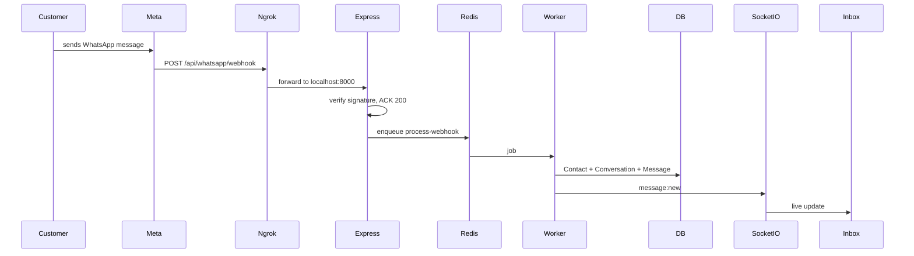

# WhatsApp Connect — Developer Guide & Incident Log

> **Audience:** Any developer who needs to run, debug, or extend the Meta WhatsApp **Connect** flow in Samyoj.  
> **Goal:** UI pe App ID/Secret → **Connect WhatsApp** → Meta allow → number connected. No silent DB seeding for day-to-day connect.

---

## 1. Happy path (expected flow)

```
User (logged in)
  → Settings → WhatsApp
  → Configure Meta app (App ID + App Secret)   [once per org]
  → Connect WhatsApp
  → Backend GET /api/whatsapp/connect-url?redirectUri=<origin>/settings/whatsapp/callback
  → Popup opens Meta OAuth
  → User allows
  → Meta redirects to: {origin}/settings/whatsapp/callback?code=...&state=...
  → Frontend POST /api/whatsapp/connect/callback { code, state }
  → Backend exchanges code (same redirect_uri + app secret)
  → Saves whatsappNumber + token
  → Popup posts success → Settings refreshes
```

**Critical rule:** The `redirect_uri` used when **opening** Meta OAuth must be **byte-identical** to the one used when **exchanging** the code.

---

## 2. Local URLs & Meta Console (developer only)

| Item | Local value |
|------|-------------|
| Frontend | `http://localhost:3000` |
| Backend | `http://localhost:8000` (Vite proxies `/api`) |
| OAuth callback | `http://localhost:3000/settings/whatsapp/callback` |

**Meta Developer Console → Facebook Login → Settings → Valid OAuth Redirect URIs** must include that exact callback URL.

Production example:

`https://your-domain.com/settings/whatsapp/callback`

End users do **not** touch Meta Console for redirect URIs — only the app owner / developer does.

---

## 3. What we faced (problems → cause → fix)

### P1 — Meta allow ke baad Samyoj pe wapas nahi aate

| | |
|--|--|
| **Symptom** | User stuck on Meta / Facebook after Allow |
| **Cause** | Redirect URI Codespace public URL vs `localhost` mismatch; ya ProtectedRoute ne `?code=` drop kar diya jab login redirect hua |
| **Fix** | Client hamesha `window.location.origin + /settings/whatsapp/callback` bheje; signed OAuth `state` me `redirectUri` store; callback route ProtectedRoute ke bahar / login `returnTo` preserve |
| **Do** | Connect URL banate waqt browser origin se redirectUri bhejo |
| **Don't** | Hardcode sirf `localhost` jab app Codespace/tunnel pe chal rahi ho |

**Files:** `connect-oauth-state.ts`, `meta.service.ts`, `ProtectedRoute.tsx`, `LoginPage.tsx`, `WhatsappCallbackPage.tsx`

---

### P2 — `Error validating client secret`

| | |
|--|--|
| **Symptom** | Connect fails after Meta allow; API 400/502 with client secret error |
| **Cause** | Org settings / `.env` me **galat App Secret** (dusre Meta app ka, ya typo) |
| **Fix** | Meta → App → Settings → Basic → App Secret copy; Settings UI + `server/.env` dono sync |
| **Do** | App ID aur Secret **same Meta app** se lo |
| **Don't** | Dusre project ka secret paste karna; secret chat/logs me permanent chhodna (rotate later) |

Server ab ye error ko clear message me map karta hai (`oauth-errors.ts`).

---

### P3 — `authorization code has been used` + popup stuck

| | |
|--|--|
| **Symptom** | Popup hang / error; kabhi pehle attempt pe already connected |
| **Cause** | React Strict Mode double-mount → same `code` do baar exchange; pehla success discard (`cancelled=true`), doosra Meta pe fail |
| **Fix** | Module-level `inflightExchanges` Map — ek code = ek shared Promise; “code used” ko success treat karo agar connect ho chuka |
| **Do** | OAuth exchange ko remount-safe rakho |
| **Don't** | Effect cleanup me in-flight success discard karo bina shared promise ke |

**File:** `client/src/pages/WhatsappCallbackPage.tsx`

---

### P4 — Connect bahut slow / stuck after success path

| | |
|--|--|
| **Symptom** | Token exchange OK but UI wait karti rehti |
| **Cause** | Webhook auto-subscribe Meta pe 404/timeout → request block |
| **Fix** | Webhook configure **fire-and-forget** (connect response pe wait mat karo) |
| **Do** | Connect ko fast path; webhook background |
| **Don't** | User-facing connect ko Meta webhook HTTP pe block karo |

**File:** `server/src/modules/whatsapp/routes.ts` (`saveWhatsappConnection`)

---

### P5 — Send message Meta `#131005`

| | |
|--|--|
| **Symptom** | Template/message fail; recipient not allowed |
| **Cause** | Test number allowlist / Meta-side block on that recipient |
| **Fix** | Verified test recipient use karo (e.g. working number in team allowlist) |
| **Do** | Meta → WhatsApp → API Setup → “To” list me recipient add |
| **Don't** | Assume har personal number test mode me kaam karega |

---

### P6 — “24h window closed” after sending template

| | |
|--|--|
| **Symptom** | Free-form / session reply fail after outbound template |
| **Cause** | WhatsApp rule: customer-service window **inbound** se khulti hai; sirf OUTBOUND template window nahi kholta |
| **Fix** | Expected behaviour — customer ko pehle message karna hoga / template hi use karo |
| **Do** | Docs/UI me ye rule clear rakho |
| **Don't** | Isse “our bug” samajh ke OAuth flow mat todo |

---

### P7 — Session lost when Meta opens full-page

| | |
|--|--|
| **Symptom** | After OAuth, user ko login dikhe; code lost feel |
| **Cause** | Full redirect ne SPA memory wipe; JWT missing |
| **Fix** | Prefer **popup** OAuth; `backupAuthBeforeOAuth` + `restoreAuthBackupIfNeeded`; login `returnTo` |
| **Do** | Popup pehle try; blocked ho to redirect + auth backup |
| **Don't** | Callback ko blind ProtectedRoute redirect without preserving query |

---

## 4. Architecture notes (important pieces)

| Piece | Role |
|-------|------|
| `GET /whatsapp/connect-url` | Issues Meta URL + signed `state` (org, user, redirectUri) |
| `POST /whatsapp/connect/callback` | Verifies state, exchanges code, saves number |
| `connect-oauth-state.ts` | HMAC-signed state; redirect URI allowlist |
| `oauth-errors.ts` | Meta OAuth errors → actionable AppError messages |
| `WhatsappCallbackPage` | Deduped exchange, popup postMessage, login returnTo |
| Org Meta settings | App ID/Secret encrypted per org (UI Configure) |

### Logging (debug tips)

**Browser console** — filter `[wa-oauth]` or collapsed `✖ [AUTH]`:

- Start / reuse exchange  
- Success / cancel / Meta reject  
- completeConnect failures  

**Server logs** — module `whatsapp`:

- `WhatsApp OAuth URL issued`  
- `WhatsApp OAuth callback started`  
- `token exchange failed` (with appId, redirectUri — **not** full secret/code)  
- `WhatsApp number connected via OAuth`  

---

## 5. Checklist — pehle ye verify karo

1. [ ] User logged in (JWT present)  
2. [ ] Settings → Meta App ID + Secret saved (`configured: true`)  
3. [ ] Meta Console Valid OAuth Redirect URI = exact frontend callback  
4. [ ] Frontend origin matches that URI (localhost vs Codespace)  
5. [ ] App Secret matches **that** App ID  
6. [ ] Popup allowed (or auth backup for full redirect)  
7. [ ] After connect, Settings shows phone number  

---

## 6. Common errors → what to do

| Message / symptom | Action |
|-------------------|--------|
| Error validating client secret | Fix App Secret in UI + `.env` |
| authorization code has been used | Refresh Settings; often already connected. Connect again if not |
| Connect session expired or invalid | Click Connect again (state TTL) |
| OAuth state does not match | Same user/org se Connect; don’t share popup across accounts |
| redirect_uri mismatch | Add exact callback to Meta Valid OAuth Redirect URIs |
| Meta credentials not configured | Configure Meta app in Settings first |
| No phone numbers found | WABA pe number add / permissions check |
| #131005 | Add recipient to Meta test allowlist |
| 24h window | Wait for inbound or use approved template |

---

## 7. What NOT to do

- ❌ Connect ke liye har baar DB me token seed karna (UI flow broken samajh ke)  
- ❌ `redirect_uri` exchange pe alag URL use karna vs authorize pe  
- ❌ React Strict Mode ignore karke double POST assume “Meta bug”  
- ❌ Webhook 404 ko connect failure banana  
- ❌ App Secret public repo / screenshots me commit  
- ❌ Production redirect URI miss karke sirf localhost Meta pe chhodna  

---

## 8. Manual test script (5 minutes)

1. Logout/login as org admin.  
2. Settings → WhatsApp → Configure Meta → save App ID/Secret.  
3. Connect WhatsApp → allow in popup.  
4. Popup closes; toast success; number listed.  
5. Disconnect → Connect again (second run).  
6. (Optional) DevTools → Network: one `connect/callback` success.  
7. Server log: `WhatsApp number connected via OAuth`.  

---

## 9. Key files (quick map)

```
server/src/modules/whatsapp/
  routes.ts                 # connect-url, callback, logging
  meta.service.ts           # OAuth URL + token exchange
  connect-oauth-state.ts    # signed state + redirect allowlist
  oauth-errors.ts           # user-facing OAuth error mapping
  org-meta.service.ts       # per-org App ID/Secret

client/src/
  pages/WhatsappCallbackPage.tsx
  pages/SettingsPage.tsx
  utils/whatsappOAuth.ts
  components/ProtectedRoute.tsx
  pages/LoginPage.tsx
```

---

## 10. Security notes

- OAuth `state` is signed and bound to org + user + redirectUri.  
- Never log full authorization codes or App Secrets.  
- If a secret was shared in chat/email, **rotate** it in Meta and update org settings + `.env`.  
- Webhooks still need a **public HTTPS** URL for inbound (ngrok / Codespace / prod); local-only verify can 404 — that must not block Connect.

---

## 11. Why inbound messages do not appear (root cause)

Outbound (Samyoj → customer) uses Meta Graph API with your access token — **works on localhost**.

Inbound (customer → Samyoj) is different:

```
Customer WhatsApp
  → Meta Cloud API
  → HTTPS POST to META_WEBHOOK_URL
  → Express /api/whatsapp/webhook
  → BullMQ webhook-queue
  → webhook.processor.ts (save Message + Conversation)
  → Socket.IO emit message:new
  → Inbox UI updates live
```

Meta **cannot** reach `http://localhost:8000`. Without a public HTTPS URL (ngrok / Cloudflare tunnel / production domain), replies never arrive — Inbox stays on “24-hour window closed” after you only sent a template.

This is **not** an OAuth bug and **not** a UI bug.

---

## 12. Webhook architecture



### Verification handshake (Meta → GET)

Meta calls:

`GET /api/whatsapp/webhook?hub.mode=subscribe&hub.verify_token=...&hub.challenge=...`

Server must:

1. Check `hub.mode === subscribe`
2. Match `hub.verify_token` to `META_VERIFY_TOKEN`
3. Return `hub.challenge` as **plain text** (HTTP 200)

Wrong token → 403. Missing params → 400.

### Health monitor

`GET /api/whatsapp/webhook/health` returns:

- `totalReceived` / `totalProcessed` / `totalErrors`
- `lastReceivedAt`, `lastError`, `lastFbTraceId`
- `queueDepth` (BullMQ waiting jobs)
- whether webhook URL / verify token / app secret are configured

Use this when debugging “messages not arriving”.

---

## 13. ngrok setup (local / Codespace)

### Prerequisites

1. ngrok account + auth token: `ngrok config add-authtoken <TOKEN>`
2. Reserve a **free static domain** in [ngrok Domains](https://dashboard.ngrok.com/cloud-edge/domains) (Meta prefers a stable URL)
3. Server listening on port 8000; Redis + Postgres up

### Commands

```bash
# Terminal A — API
cd server && npm run dev

# Terminal B — tunnel
cd server && npm run tunnel
# or: NGROK_DOMAIN=your-domain.ngrok-free.app npm run tunnel
```

Default domain in script: `samyoj-dev.ngrok-free.app` — replace with **your** reserved domain.

### Meta Console

WhatsApp → Configuration → Edit:

| Field | Value |
|-------|--------|
| Callback URL | `https://<your-domain>/api/whatsapp/webhook` |
| Verify token | same as `META_VERIFY_TOKEN` in `.env` |

Subscribe to at least: **messages**.

Also set in `.env`:

```
META_WEBHOOK_URL=https://<your-domain>/api/whatsapp/webhook
```

After Connect, app can auto-register this URL via existing webhook configure path when `META_WEBHOOK_URL` is set.

### Alternate: Cloudflare tunnel

Repo already has [`scripts/dev-tunnel.sh`](../scripts/dev-tunnel.sh) (cloudflared). Same idea: public HTTPS → `:8000`. Prefer one tunnel type; don’t mix conflicting `META_WEBHOOK_URL` values.

---

## 14. Automated webhook tests (POC)

```bash
cd server && npm run test:webhook
# against ngrok:
bash ../scripts/test-webhook.sh --ngrok
```

Covers:

1. Health endpoint  
2. Wrong verify token → 403  
3. Missing GET params → 400  
4. Simulated inbound text  
5. Simulated inbound image  
6. Non-WABA payload → 200 (no Meta retry loop)  
7. Empty JSON → 200  
8. Button reply  
9. Status update  
10. Health counters increment  
11. Correct verify token returns challenge  

**Do:** run this after any webhook/route change.  
**Don’t:** assume UI alone proves inbound — health + server logs must show `Inbound webhook received` / `Saved inbound message`.

---

## 15. Inbound logging cheat sheet

| Log / signal | Meaning |
|--------------|---------|
| `Webhook verification request received` | Meta probing GET |
| `Webhook verified successfully` | Handshake OK |
| `Inbound webhook received` | POST arrived at Express |
| `Webhook queued for processing` | BullMQ accepted job |
| `No active WhatsApp number for inbound webhook` | `phone_number_id` mismatch / not connected |
| `Processing inbound message` | Worker started |
| `Saved inbound message` | DB write OK → should appear in Inbox |
| `Duplicate inbound message skipped` | Meta retry; unique `metaMessageId` |
| Health `totalReceived: 0` | Meta never hit your URL (tunnel/Meta config) |

Browser: Inbox header shows Socket connection status (connected / connecting / disconnected).

---

## 16. Webhook do / don’t

| Do | Don’t |
|----|--------|
| Keep tunnel running while testing inbound | Expect replies on pure localhost |
| Match verify token exactly | Change token in Meta without updating `.env` |
| Use reserved ngrok domain when possible | Point Meta at an expired random ngrok URL |
| ACK 200 quickly; process async | Block Meta on heavy work before 200 |
| Treat duplicate `metaMessageId` as success | Crash worker on Meta retries |
| Check `/webhook/health` + Redis | Blame Inbox UI when queue/Redis is down |

---

## 17. Key files (webhook + tunnel)

```
scripts/ngrok-tunnel.sh
scripts/test-webhook.sh
scripts/dev-tunnel.sh              # cloudflared alternative

server/src/modules/whatsapp/routes.ts   # GET/POST webhook + /webhook/health
server/src/workers/webhook.processor.ts # inbound persist + emit
server/src/modules/calling/call.processor.ts  # processWebhookFields router
server/src/config/queues.ts             # webhook-queue

client/src/hooks/useSocket.ts
client/src/components/ui/ConnectionStatusIndicator.tsx
client/src/pages/InboxPage.tsx
```

---

*Updated: Connect OAuth hardening + inbound webhook ngrok path, structured webhook logs, health endpoint, duplicate-safe processor, Socket reconnect status, POC test script.*
