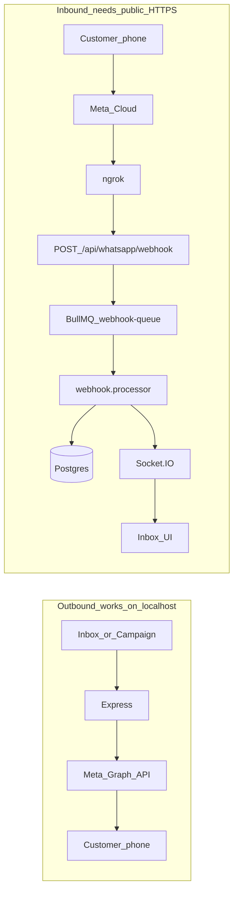

# WhatsApp Connect + Inbound Webhooks — Agent & Developer Handoff

> **Who this is for:** next human developer **or** next AI agent continuing Samyoj WhatsApp work.  
> **Read this first** before changing Connect OAuth, webhooks, ngrok, or Inbox inbound flow.  
> **Last verified:** 2026-07-31 — ngrok live, Meta webhook registered, inbound webhooks receiving (`totalReceived` growing).

---

## 0. TL;DR (30 seconds)

| Topic | Truth |
|-------|--------|
| Product goal | Settings → enter Meta App ID/Secret → **Connect WhatsApp** → Meta allow → number connected. Then Inbox shows **inbound** customer replies live. |
| Outbound (Samyoj → phone) | Works on localhost (Graph API + access token). |
| Inbound (phone → Samyoj) | Needs **public HTTPS** webhook. Localhost alone = **no Inbox replies**. |
| Connect OAuth bugs | Fixed in code (redirectUri, Strict Mode code reuse, signed state, non-blocking webhook on connect). |
| Inbound “not receiving” | Was **infra**, not Inbox UI: no public tunnel / wrong `META_WEBHOOK_URL` / Codespace port private. |
| Current tunnel | **ngrok** → `META_WEBHOOK_URL` in `server/.env` (ephemeral free URL; changes if ngrok restarts). |
| Diagnose | `cd server && npm run diagnose` then `npm run test:webhook` |

**Do not** re-seed WhatsApp tokens in DB for day-to-day Connect — use the UI Connect flow.

---

## 1. System map (two separate pipelines)



### Connect OAuth (separate from inbound)

```
Login → Settings → Meta App ID/Secret (org)
  → GET /api/whatsapp/connect-url?redirectUri={origin}/settings/whatsapp/callback
  → Meta OAuth popup
  → GET /settings/whatsapp/callback?code&state
  → POST /api/whatsapp/connect/callback {code,state}
  → exchange code with SAME redirect_uri + App Secret
  → save whatsappNumber + encrypted token
```

**Rule:** authorize `redirect_uri` === token-exchange `redirect_uri` (byte-identical).

---

## 2. Current runtime checklist (as of last session)

| Component | Expected | How to check |
|-----------|----------|--------------|
| API | `localhost:8000` | `curl -s http://localhost:8000/health` |
| Client | `localhost:3000` | browser |
| Postgres + Redis | Docker up | `docker compose up -d` |
| Tunnel | ngrok → `:8000` | `curl -s http://127.0.0.1:4040/api/tunnels` |
| Webhook env | matches ngrok public URL | `grep META_WEBHOOK_URL server/.env` |
| Meta registration | subscribed | `cd server && npm run setup-webhook` |
| Health | counters increment on real traffic | `GET /api/whatsapp/webhook/health` |

**Org test context (non-secret):**

- Meta App: Groweasy (`META_APP_ID` in `.env`)
- Test WA phone id: `META_PHONE_NUMBER_ID`
- Working recipient for send tests: `917489739171` (Rohit)
- Old recipient `919009785315` often blocked by Meta `#131005`

Secrets live only in `server/.env` / org encrypted settings — **never paste App Secret / tokens into docs or commits**.

---

## 3. Commands cheat sheet

```bash
# Infra
cd /workspaces/Samyoj && docker compose up -d

# First setup, then normal daily start/stop
bash setup.sh
bash start.sh
bash stop.sh

# Diagnostics
cd server && npm run diagnose
cd server && npm run test:webhook
# against current public URL:
WEBHOOK_URL="$(grep META_WEBHOOK_URL server/.env | cut -d= -f2-)" \
  HEALTH_URL="${WEBHOOK_URL%/webhook}/webhook/health" \
  bash scripts/test-webhook.sh
```

---

## 4. Incident log — everything we hit (symptom → cause → fix → do/don’t)

### A. Connect / OAuth

#### A1 — Stuck on Meta after Allow
- **Symptom:** Allow ke baad Samyoj callback nahi.
- **Cause:** Codespace URL vs `localhost` redirect mismatch; ProtectedRoute dropped `?code=`.
- **Fix:** Dynamic `redirectUri` from `window.location.origin`; signed OAuth state stores redirectUri; login `returnTo`; callback outside blind protect.
- **Files:** `server/src/modules/whatsapp/connect-oauth-state.ts`, `meta.service.ts`, `client/.../ProtectedRoute.tsx`, `LoginPage.tsx`, `WhatsappCallbackPage.tsx`
- **Do:** Always pass browser-origin callback. **Don’t:** Hardcode only localhost when UI is on another origin.

#### A2 — `Error validating client secret`
- **Cause:** Wrong App Secret for App ID (env vs org UI).
- **Fix:** Same Meta app’s secret in Settings UI + `.env`; mapped in `oauth-errors.ts`.
- **Don’t:** Mix secrets across Meta apps; leave secrets in chat forever (rotate).

#### A3 — `authorization code has been used` / popup stuck
- **Cause:** React Strict Mode double-mount → two exchanges; first success discarded.
- **Fix:** Module-level `inflightExchanges` Map; treat “code used” as success if already connected.
- **File:** `client/src/pages/WhatsappCallbackPage.tsx`
- **Don’t:** Cancel in-flight OAuth promise on remount without sharing the Promise.

#### A4 — Connect slow / looks stuck after OAuth
- **Cause:** Webhook auto-config blocked on Meta 404/timeout.
- **Fix:** Webhook configure fire-and-forget after connect (`saveWhatsappConnection`).
- **Don’t:** Block OAuth success on webhook registration.

#### A5 — Session lost on full-page Meta redirect
- **Fix:** Prefer popup OAuth; `backupAuthBeforeOAuth` / restore; `returnTo` on login.
- **Files:** `client/src/utils/whatsappOAuth.ts`, `authStorage` helpers

### B. Messaging / Inbox

#### B1 — Template sent but “24h window closed”
- **Cause:** Expected WhatsApp rule — session window opens on **INBOUND**, not outbound template alone.
- **Fix:** Education / UI banner; customer must message first (or keep using templates).
- **Don’t:** Treat as OAuth or webhook bug.

#### B2 — Send fails Meta `#131005`
- **Cause:** Recipient not in allowlist / Meta-side block.
- **Fix:** Use verified test recipient; add number in Meta “To” list.
- **Don’t:** Assume every personal number works in test mode.

#### B3 — Customer replies never show in Inbox (main pain)
- **Cause chain:**
  1. Meta POSTs to `META_WEBHOOK_URL`
  2. URL was Codespace **private** (HTTP 404) and/or ngrok not running and/or Cloudflare stopped
  3. Express never saw POST → no DB inbound → Inbox empty
- **Evidence:** Simulated `wamid.test_*` rows existed; real Meta traffic only appeared after public tunnel + `setup-webhook`. Browser opening webhook URL shows `Missing hub.mode...` — **normal** (not a bug).
- **Fix:** Run public tunnel (ngrok preferred with auth); set `META_WEBHOOK_URL`; `npm run setup-webhook`; keep tunnel alive.
- **Code hardening done:** richer GET/POST webhook logs, `/webhook/health`, duplicate `metaMessageId` skip (P2002), Socket reconnect + Inbox connection indicator.

#### B4 — “Image unavailable” on simulated image webhook
- **Cause:** Test payload had fake media id; download fails.
- **Not** proof inbound pipeline is broken.

### C. Tunnel tooling

| Tool | When | Notes |
|------|------|--------|
| **ngrok** (`scripts/dev-tunnel.sh`) | Local inbound webhook | Auto-updates `.env` + setup-webhook; free URL can change |
| **Codespace port Public** | Optional | Often hard to find in UI; CLI visibility flaky; tunnel is more reliable |

The current supported local workflow uses ngrok. Cloudflare is not part of the setup scripts.

---

## 5. Logging & how to debug fast

### Server (Winston / module logs)
| Signal | Meaning |
|--------|---------|
| `WhatsApp OAuth URL issued` | Connect started |
| `WhatsApp OAuth callback started` / `number connected` | Connect OK |
| `Webhook verified successfully` | Meta GET handshake OK |
| `Inbound webhook received` | Meta POST hit Express |
| `Saved inbound message` | DB + should appear in Inbox |
| `Duplicate inbound message skipped` | Meta retry; OK |
| `No active WhatsApp number for inbound webhook` | `phone_number_id` mismatch |
| Health `totalReceived: 0` | Tunnel/Meta URL wrong or Meta not subscribed |

### Client
- Console filter `[wa-oauth]` — Connect popup flow
- Console `[socket]` — live Inbox connection
- Inbox header connection dot — Socket status

### Health API
`GET /api/whatsapp/webhook/health` → `totalReceived`, `queueDepth`, `webhookUrl`, last error.

### Browser myth
Opening `https://<tunnel>/api/whatsapp/webhook` in Chrome →  
`Missing hub.mode, hub.verify_token, or hub.challenge`  
= **healthy GET handler**. Meta sends query params; browsers do not.

---

## 6. Key files (edit map)

```
docs/
  WHATSAPP_CONNECT_DEVELOPER_GUIDE.md   ← this handoff (source of truth)

scripts/
  ngrok-tunnel.sh          # compatibility wrapper
  test-webhook.sh          # npm run test:webhook
  diagnose-webhook.sh      # npm run diagnose
  dev-tunnel.sh            # ngrok + automatic webhook setup

server/
  .env                     # META_* (secrets — do not commit)
  package.json             # tunnel | test:webhook | diagnose | setup-webhook
  scripts/setup-webhook.ts
  src/modules/whatsapp/
    routes.ts              # connect-url, callback, GET/POST webhook, /webhook/health
    oauth-errors.ts        # user-facing Meta OAuth errors
    connect-oauth-state.ts # signed state + redirectUri
    meta.service.ts        # OAuth + webhook register helpers
    org-meta.service.ts    # per-org App ID/Secret
  src/workers/webhook.processor.ts   # inbound persist + emit
  src/modules/calling/call.processor.ts  # processWebhookFields router
  src/config/queues.ts
  src/realtime.ts

client/
  src/pages/WhatsappCallbackPage.tsx
  src/pages/SettingsPage.tsx
  src/pages/InboxPage.tsx
  src/utils/whatsappOAuth.ts
  src/hooks/useSocket.ts
  src/components/ui/ConnectionStatusIndicator.tsx
  src/components/ProtectedRoute.tsx
  src/pages/LoginPage.tsx
```

---

## 7. Runbook — “Inbox me reply nahi aa raha”

1. `npm run diagnose` — fix every FAIL first.  
2. Confirm ngrok is running (`.run/logs/tunnel.log` or local API `:4040`).  
3. Confirm `META_WEBHOOK_URL` matches the **current** public URL.  
4. `npm run setup-webhook` — Meta must subscribe to this URL.  
5. Watch logs while customer sends a message: need `Inbound webhook received` then `Saved inbound message`.  
6. If only `statusCount` (sent/delivered) and no `messages[]` — outbound status works; wait for real inbound text from phone.  
7. If Socket disconnected — Inbox may lag until reconnect (indicator in header).  
8. Redis down → queue fails; processor may inline-fallback but campaigns/queues degraded.

---

## 8. Do / Don’t (hard rules)

| Do | Don’t |
|----|--------|
| Use UI Connect flow | Silently seed tokens every time |
| Keep authorize & exchange `redirect_uri` identical | Change redirect only on one side |
| Keep tunnel up while testing inbound | Expect Meta to hit localhost |
| Let `start.sh` update `.env` + register each new tunnel URL | Point Meta at a dead tunnel URL |
| Use `diagnose` / `test:webhook` after webhook changes | Assume UI alone proves inbound |
| Rotate secrets shared in chat | Commit `.env` or paste App Secret in docs |
| Treat 24h window as product rule | “Fix” it by breaking webhook code |

---

## 9. Instructions for the next AI agent

When user says inbound/connect broken:

1. Read **this file** and `server/.env` `META_WEBHOOK_URL` (do not print secrets).  
2. Run `npm run diagnose` — prefer infra fixes over rewriting Inbox.  
3. Confirm Connect vs Inbound: Connect = OAuth files; Inbound = tunnel + webhook routes + processor.  
4. Do not remove Strict Mode dedupe, signed OAuth state, or fire-and-forget webhook-on-connect without a replacement.  
5. Use `start.sh` so tunnel URL updates before API startup; then prove with a phone message or `test:webhook`.  
6. Prefer smallest fix; keep logging structured (`source: 'webhook' | 'auth'`).  
7. Update **§2 Current runtime** in this doc when the live tunnel URL or approach changes.

---

## 10. Related docs

- [docs/WHATSAPP_API_DOCUMENTATION.md](./WHATSAPP_API_DOCUMENTATION.md) — Meta API surface  
- [docs/audit/README.md](./audit/README.md) — broader product audit index  
- [docs/API.md](./API.md) — HTTP API overview  

---

*Handoff compiled from Connect OAuth hardening + inbound webhook tunnel work, health/diagnose/test scripts, Socket status, and duplicate-safe processing.*
