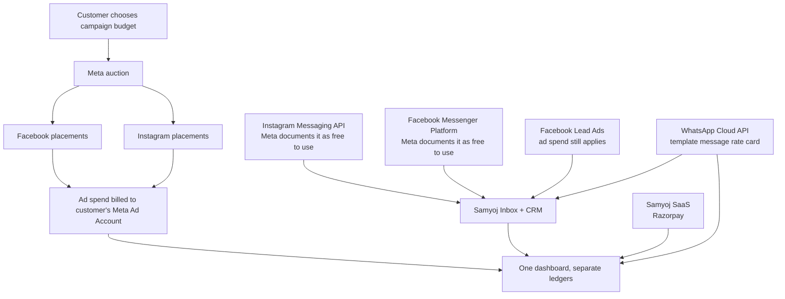
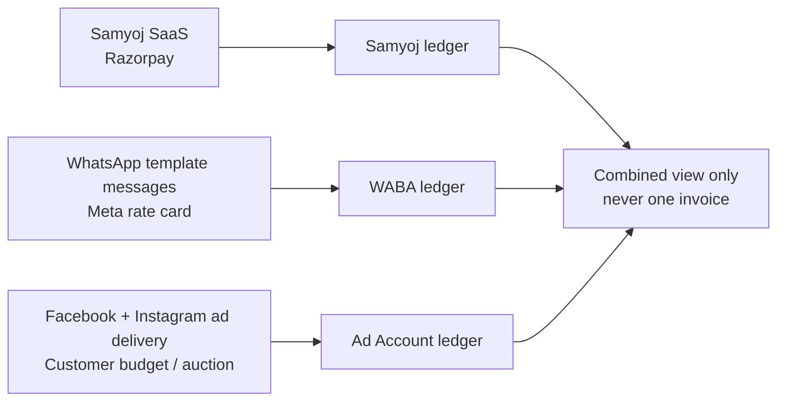

# Samyoj Meta Growth Loop — Cost model

**Date:** 2026-09-18  
**Rule:** No invented ₹ amount. Meta costs change by country, message type, campaign auction, account, and date. Use this as the truthful presentation model.

## The direct answer

There is no single fixed “Instagram cost” or “Facebook cost.”

| Surface | Meta platform/API cost | What the customer may pay |
|---|---|---|
| Instagram Messaging API | Meta documents Messenger Platform as **free to use**; no fixed per-message API fee is listed | Samyoj subscription, implementation/operations, and optional Instagram/Facebook advertising |
| Facebook Messenger Platform | Meta documents Messenger Platform as **free to use**; no fixed per-message API fee is listed | Samyoj subscription, implementation/operations, and optional advertising |
| Instagram/Facebook ads | No universal fixed price | Customer-selected Meta ad budget; actual delivery is auction-based and varies by audience, objective, competition, bid, and quality |
| Facebook Lead Ads | No separate fixed “lead API” price in the API plan | The customer pays the associated Meta advertising spend; Samyoj ingests the lead |
| WhatsApp Cloud API | **Not free in the same way:** Meta charges per delivered template message, by category, recipient country, and volume/rate card | WABA message fees plus Samyoj subscription |
| Samyoj | Not a Meta fee | Existing Samyoj SaaS plan / Razorpay ledger |

**Important:** “Free API” does not mean “free product.” App Review, Business Verification, hosting, encrypted token storage, webhook operations, support, and Samyoj SaaS are separate costs. Do not quote them as Meta per-message prices.

## What we can put on a slide

## Ad budget: why an exact cost is not honest

Meta says the advertiser chooses a budget and ads are selected through an auction. Therefore there is no permanent universal ₹/lead, ₹/click, or ₹/impression price that Samyoj can promise.

- A **daily budget** is an average spending target, not necessarily a hard spend on every calendar day.
- A **lifetime budget** controls the intended total for the campaign run.
- The actual result depends on audience, objective, competition, bid, estimated action rate, and ad quality.
- Instagram and Facebook placements can be part of the same Meta campaign; the placement does not create a separate fixed API subscription.

For a customer quote, ask for:

1. country and currency;
2. campaign objective: Lead Form, WhatsApp, Instagram DM, Messenger, traffic, or sales;
3. daily or lifetime ad budget;
4. expected lead/message volume;
5. whether the customer already has a Page, Professional Instagram account, Ad Account, and verified Business Portfolio.

Only then estimate media spend. Label the result as an **estimate**, never as a guaranteed Meta price.

## Ledger separation

## Sources

- [Messenger Platform overview](https://developers.facebook.com/docs/messenger-platform/overview/) — Messenger Platform is free to use; requirements and permissions.
- [Instagram send message](https://developers.facebook.com/docs/messenger-platform/instagram/features/send-message/) — Instagram Professional account and Page-linked messaging path.
- [Meta advertising preparation and cost](https://www.facebook.com/business/help/714656935225188) — advertiser chooses budget; auction-based delivery.
- [Meta ad auctions](https://www.facebook.com/business/help/430291176997542) — auction factors.
- [Daily budgets](https://www.facebook.com/business/help/190490051321426) and [lifetime budgets](https://www.facebook.com/business/help/1844835042445690).
- [WhatsApp pricing](https://developers.facebook.com/docs/whatsapp/pricing/updates-to-pricing/) — delivered template-message pricing by category, country, and rate card.

**Do not copy a static WhatsApp rate into this document.** Read Meta’s live rate card when implementing billing or preparing a customer quote.
