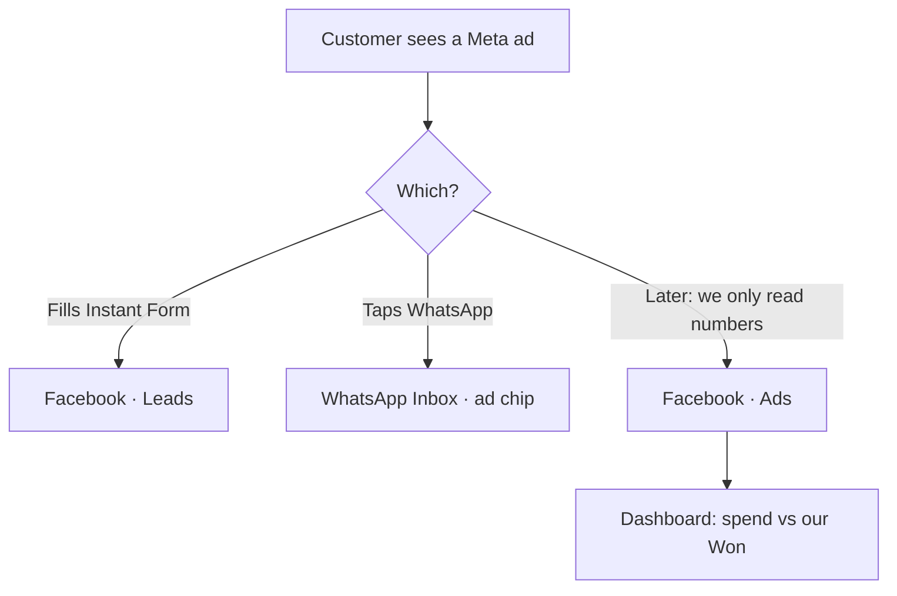

# Meta ecosystem — sidebar & UI (revised 2026-09-23)

**Status:** Working spec plus historical target. The sidebar and separate inbox routes are present in current code; see [META_ECOSYSTEM_AUDIT_REPORT_2026-09-24.md](META_ECOSYSTEM_AUDIT_REPORT_2026-09-24.md) for the recheck.
**Chosen:** **Separate inboxes.** One dropdown per platform.  
**Build order** is unchanged: [`META_ECOSYSTEM_V2_PLAN_2026-09-18.md`](META_ECOSYSTEM_V2_PLAN_2026-09-18.md). This file only decides **where the screen sits**.

The target below says Facebook/Instagram groups are hidden until their assets connect. Current code keeps the groups visible and uses connect/empty states instead. Treat that as an explicit UI decision to revisit, not as a hidden implementation gap.

---

## Decision

```text
Dashboard
WhatsApp ▾     Facebook ▾     Instagram ▾     platforms first
AI Bots        Contacts        Automations     shared, outside the dropdowns
Tickets        Team            Billing         Settings
Campaigns and Templates                        WhatsApp only
Calls                                          WhatsApp only
AI Bots keep both                              Message bot + Calling bot, one page
X                                              out
```

**Contacts stay outside.** A form lead often has no chat yet.  
**Automations stay outside.** The list is shared; each automation is still one channel.  
**Settings keeps connect.** Inbox and ads work do not live in Settings.  
**X is out.** Not Meta, no plan, no fourth group.

---

## Sidebar (target)

Color is the only new signal: a 3px mark on the group. WhatsApp green, Facebook blue, Instagram pink. Same chrome as today.

```text
Dashboard

WhatsApp
  Inbox
  Calls
  Templates
  Campaigns
  Orders                          hidden until commerce is on

Facebook                          hidden until Page connect
  Leads                           Instant Forms → pipeline
  Ads                             later: spend / CPL read-only
  Inbox                           Messenger, later
  Posts                           later

Instagram                         hidden until IG ships
  Inbox
  Comments
  Posts                           later

AI Bots                           Message bot + Calling bot, same page
Contacts                          people + full pipeline
Automations                       pick a channel when you create one

Tickets                           above Team; Contacts sits above this block
Team
Billing & Usage
Settings                          connect numbers / Page / IG
```

A platform with nothing shipped **does not appear**.

Mobile: **Inbox** (last platform opened) · **Contacts** · **Dashboard** · **More**.

---

## Where today’s screens go

| Today | Move |
|-------|------|
| Dashboard | Stay, first |
| Inbox | **WhatsApp → Inbox** |
| Calls | **WhatsApp → Calls** |
| Templates | **WhatsApp → Templates** |
| Campaigns | **WhatsApp → Campaigns** |
| AI Bots | Stay outside. **AI Bots keep both** (chat + calling). Calling copy: WhatsApp only. Do not split later until we have a reason. |
| Automations | Stay outside. Not under WhatsApp. |
| Contacts | Stay outside, above Tickets |
| Tickets, Team, Billing, Settings | Stay, bottom block |
| Orders | Under WhatsApp, still hidden |
| Content Studio | Do not revive globally. Later = **Posts** under that platform |

**Campaigns stay under WhatsApp.** There is no shared Campaigns item. Facebook ads are not a Samyoj campaign. Instagram posts are not a campaign.

---

## Ads — three different things (not one menu)

The word “ads” is three products. Mixing them is how CPL lies.

| What people say | What it is | Where it sits | When |
|-----------------|------------|---------------|------|
| “Lead ad / Instant Form” | Customer fills a form in **Ads Manager**. We catch the lead. | **Facebook → Leads** | Connect phase |
| “Click to WhatsApp ad” | They tap WhatsApp on an ad. Chat is already a WhatsApp thread. | Chip on **WhatsApp → Inbox**. No Ads item. | After Lead Ads |
| “Spend, CPL, impressions” | Meta Insights **read**. We do not create the ad. | **Ads sit under Facebook** (`Facebook → Ads`), with a small recap on Dashboard | Late (plan phase 5) |
| “₹ revenue from that ad” | Our Won amount next to Meta spend | Dashboard / later Reports. Two columns, not one ROI number. | After we store deal value (plan phase 6) |

**Create campaign / budget / creative:** never in Samyoj. Button is **Open Ads Manager**.  
**Do not** put Ads under WhatsApp. **Do not** put a fourth “Ads” group on the rail in v1.

Connect phase only ships **Facebook → Leads**. `Facebook → Ads` stays hidden until Insights is real.



---

## Automations: WhatsApp is not Instagram

**Confirm:** the same WhatsApp keyword / welcome / away / template automation **cannot** be turned on for Instagram. ManyChat copies a flow across channels and **deletes the trigger**, because the rules are different. We will not pretend they match.

| | WhatsApp (today) | Instagram (later) |
|--|------------------|-------------------|
| Who starts | Customer, or we send an approved template | Customer comments, DMs, or story-mentions |
| Outside the window | Approved **templates** (campaigns) | **No** WhatsApp templates. One private reply to a comment in 7 days, then stop until they reply |
| Comment “PRICE” | Not a WhatsApp product | One DM. That DM does **not** open 24h until they tap back |
| AI Message bot | Already on WhatsApp chat | Later, same **AI Bots** row can answer IG DMs in 24h, with human inbox required |
| AI Calling bot | WhatsApp calls only | Never Instagram |

So: **engine** (event → condition → action) is reused. **Trigger list and send path** are not.

**Menu:** Automations stay outside as one item. Create starts with **WhatsApp or Instagram**. The list shows a channel mark. We do not put a second Automations under WhatsApp, and we do not hide Instagram automations inside the WhatsApp list.

Until Instagram exists, every row is WhatsApp. The extra click is one dropdown. That is cheaper than moving the page twice.

---

## AI Bots

One rail item. Inside it, the two options stay: **Message bot** and **Calling bot**. Calling is WhatsApp-only; do not fork a second Calls bot under WhatsApp. If Instagram DMs get a bot later, it is still the Message bot, with a channel toggle — not a third nav item.

---

## Settings vs the dropdown

| Settings | Platform dropdown |
|----------|-------------------|
| Connect / disconnect WhatsApp number | Inbox, calls, templates, campaigns |
| Connect / disconnect Facebook Page | Leads, later Ads + Messenger |
| Connect Instagram (later) | Inbox, comments, posts |
| Profile, hours, password, export | — |

---

## What the user sees, phase by phase

### Phase 0 — no menu change

WhatsApp looks as it does today.

### Connect phase — first new group

```text
Facebook
  Leads          → current Pipeline, source Meta Ads
```

Settings → **Facebook Page**: same card as WhatsApp numbers. **Connect Page**. No App ID. Optional: also send a WhatsApp template if phone + consent exist.

**Pass:** Meta lead test → contact in this org. WhatsApp inbox still receives a reply.

### Next — CTWA

No new item. Chip on the WhatsApp thread: **WhatsApp ad**.

### Next — Messenger

`Facebook → Inbox` (Page DMs only). No WhatsApp template picker.

### Next — Instagram

`Instagram → Inbox` and `Comments`. Automations (already on the rail) gains Instagram as a channel choice.

### Later — Ads numbers

`Facebook → Ads` read-only tiles + Ads Manager link. Dashboard shows the same numbers next to our Won. Not an ads editor.

---

## What other products do (short)

Wati: separate WhatsApp / Instagram **lists**, campaigns stay WhatsApp.  
Respond.io: mixed threads; their users asked to undo it (Jan 2026).  
ManyChat: automations **per channel**.  
Chatwoot: each account is its own inbox; connect is Settings.  
Kommo: chats in one inbox, leads in another menu.  
Nobody ships Ads Manager as the inbox.

---

## Rejected

| Idea | Why |
|------|-----|
| One mixed Inbox | Wrong rules, wrong assignee |
| Campaigns on the main rail for all platforms | The button would lie |
| Automations under WhatsApp only | Instagram would have nowhere honest to go |
| Ads as a fourth platform | Spend belongs with the Page, not next to Dashboard |
| X | No plan |

---

## Locked (was “confirm”)

1. Contacts stay outside, above Tickets.  
2. Calls under WhatsApp. AI Bots outside; both bots stay on that page.  
3. Automations stay outside; each row is one channel.  
4. Ads sit under Facebook when Insights ships. Lead forms are **Leads**, not Ads.
