# Samyoj Meta Loop — visual for design seniors

**Name:** Samyoj Meta Loop  
**One line:** WhatsApp stays. Ads / Instagram / Messenger land in the **same Inbox + CRM**. We do not rebuild WhatsApp. We do not clone Ads Manager.

**How to show:** GitHub / Notion / [mermaid.live](https://mermaid.live) — one chart, one sentence, next.

Deep: [V2 plan](META_ECOSYSTEM_V2_PLAN_2026-09-18.md) · [Do / Don’t](META_ECOSYSTEM_DOS_AND_DONTS_2026-09-18.md)

---

## 1. Super flow — the whole product

**Say:** Meta brings the person. Samyoj owns chat + deal. Ads Manager stays in Meta.

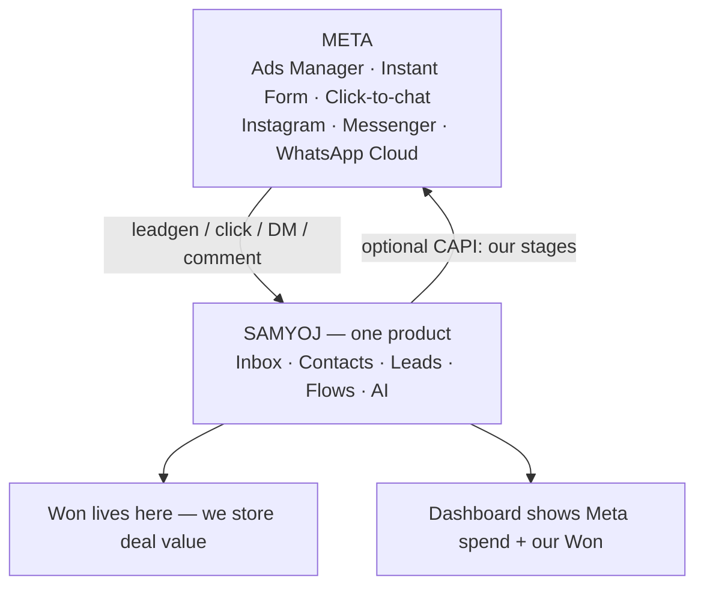

---

## 2. Today vs Loop

**Say:** Left is shipped. Right is what we add. Same CRM.

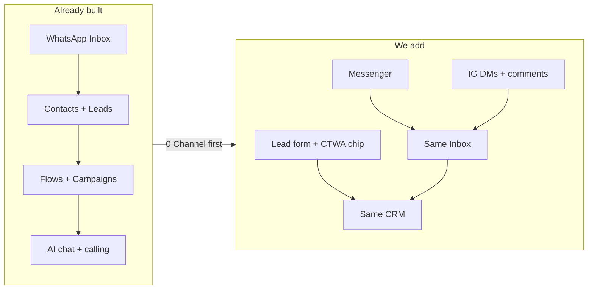

---

## 3. Two ads — never one CPL

**Say:** Form and click-to-chat are different. Design two entry chips, not one “Ads” blob.

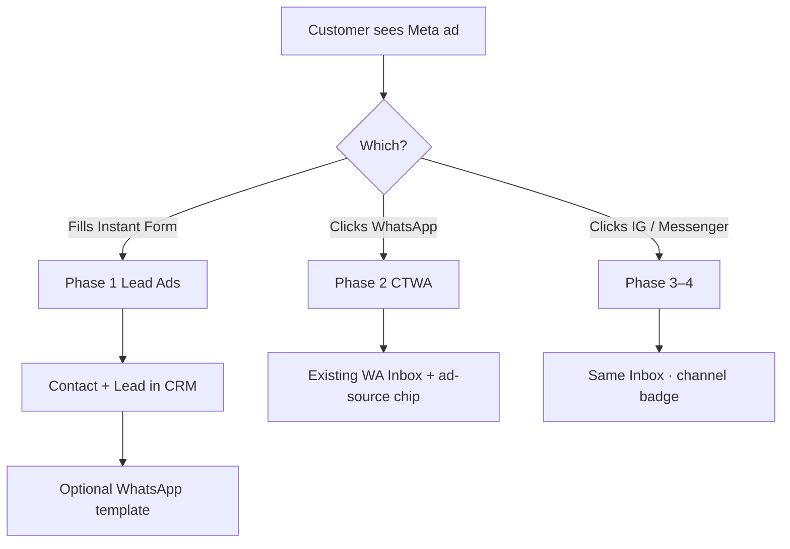

---

## 4. Inbox they will design

**Say:** One list. Filter by channel. Badge on every thread. Not three inboxes.

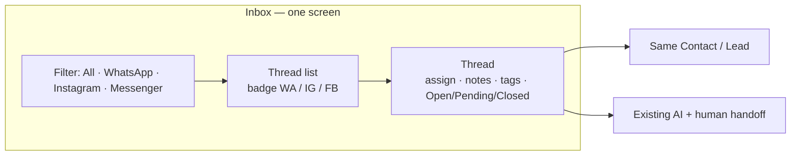

---

## 5. Phase 0 — Channel (unlocks everything)

**Say:** If we skip this, IG/FB will break WhatsApp number isolation. Designers wait; this is schema + router.

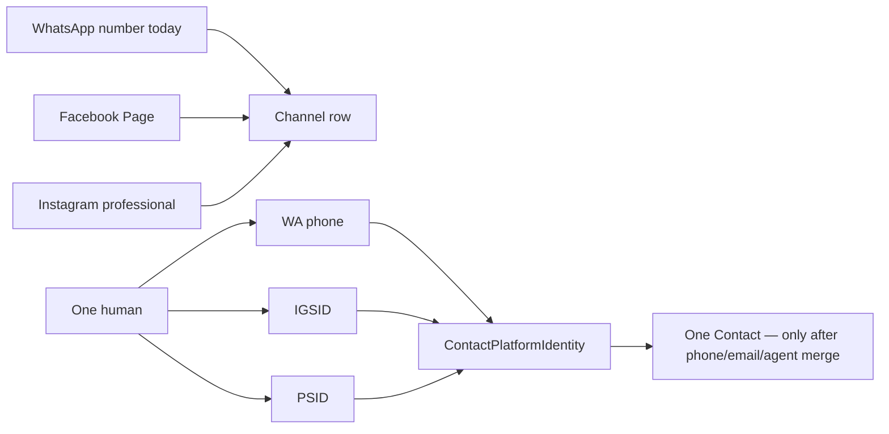

---

## 6. Phase 1 subflow — Lead Ads

**Say:** Customer still creates the form in Ads Manager. We catch the lead.

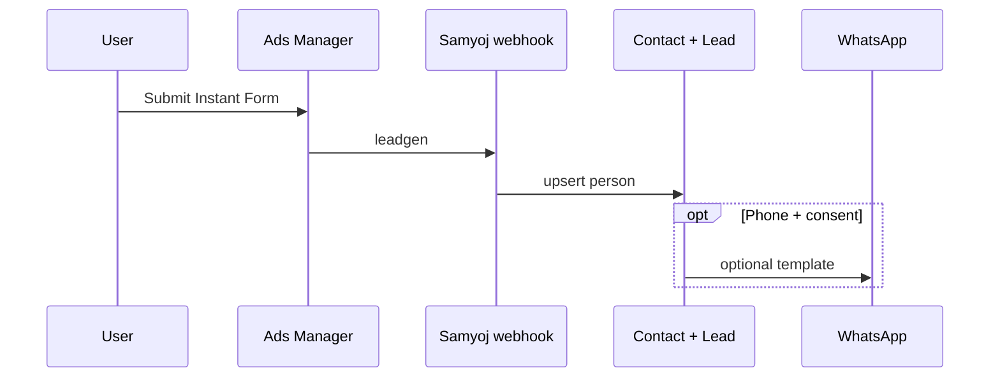

---

## 7. Phase 2 subflow — CTWA chip

**Say:** No new Graph product. Chip on the chat we already have.

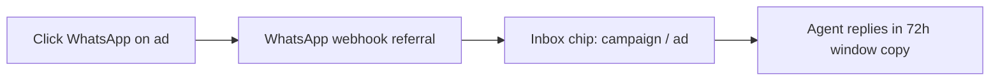

---

## 8. Phase 3–4 subflow — Messenger then Instagram

**Say:** Same Page token. Messenger first. Instagram DMs + one comment DM. Human always available on IG.

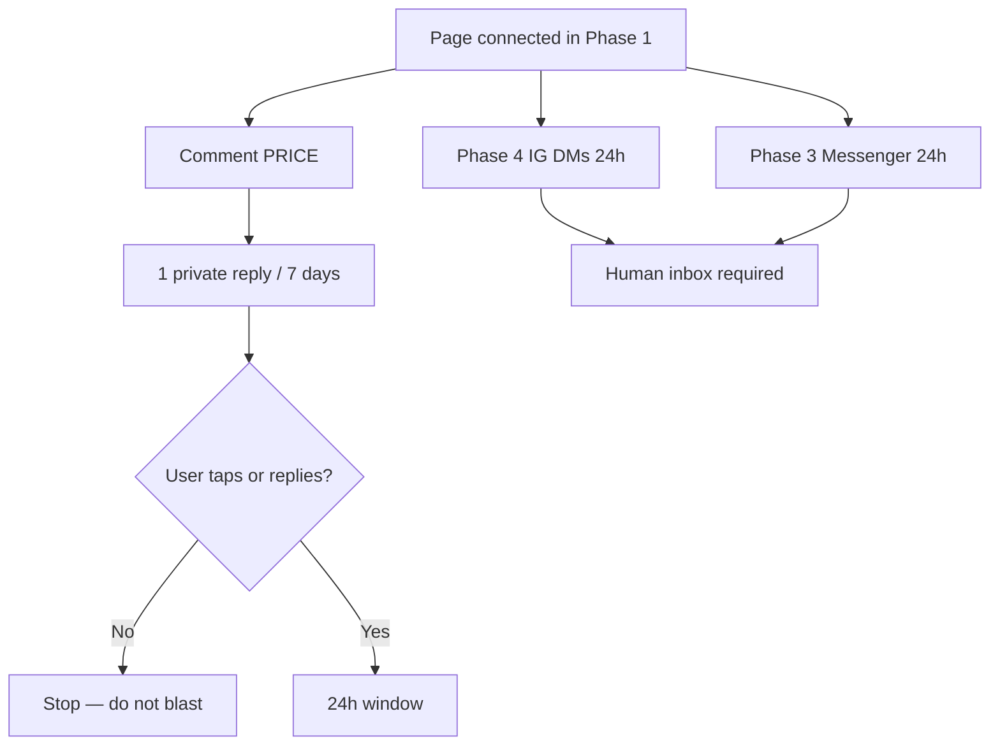

---

## 9. Build order — each box unlocks the next

**Say:** Do not design IG screens before Channel. Do not design Ads Manager.

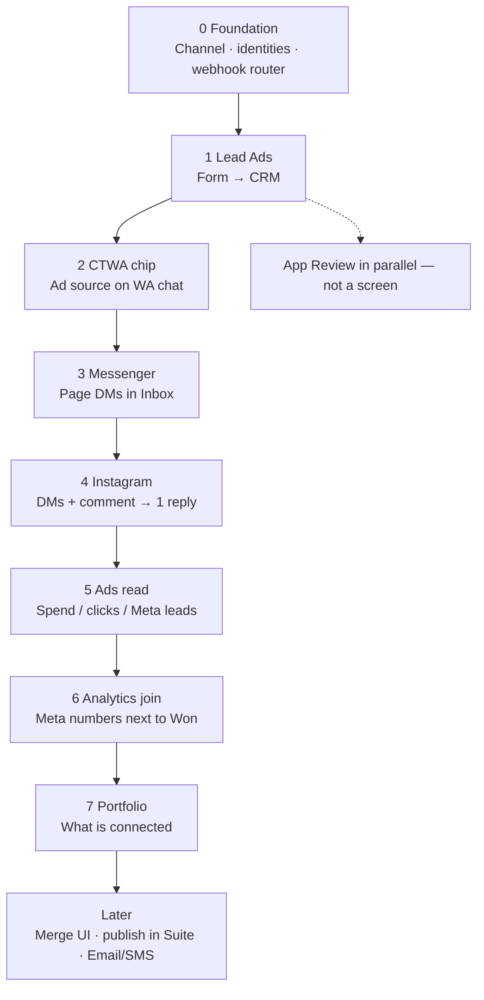

---

## 10. Screens by phase (design queue)

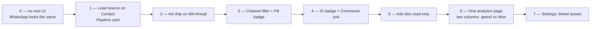

---

## 11. Doing vs not doing

**Say:** Green is Samyoj. Grey stays in Meta.

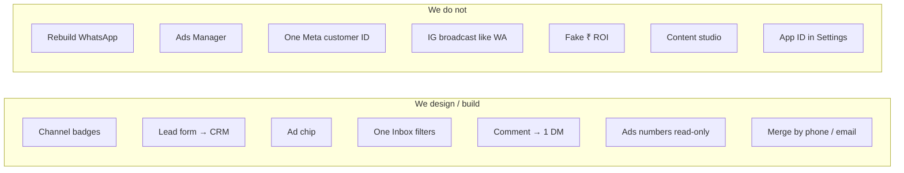

---

## 12. Three ledgers

**Say:** One dashboard may show all three. One price tag may not.

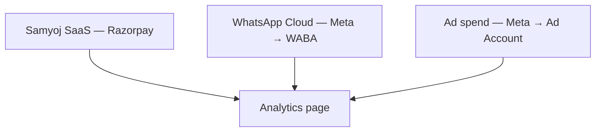

---

## Speaker crib

| # | Sentence |
|---|---------|
| 1 | Meta sends people. We close them. |
| 2 | WhatsApp stays. Loop wraps it. |
| 3 | Form and click-to-chat are two products. |
| 4 | One Inbox, channel filter, one Contact. |
| 5 | Channel first or IG breaks WhatsApp. |
| 6 | Ads Manager creates the form. We catch the lead. |
| 7 | Chip only — chat already exists. |
| 8 | Messenger then IG. One comment DM, then wait. |
| 9 | 0→1→2→3→4 then we only *read* ads. |
| 10 | Design queue matches build order. |
| 11 | CRM destination. Meta keeps ads + posts. |
| 12 | Three bills. |

**If asked “when IG?”** Phase 4 — after Channel, Lead Ads, CTWA chip, Messenger.  
**If asked “Diwali ₹ ROI?”** Spend vs Meta leads after Phase 5. Rupee sales only after we store deal value.
