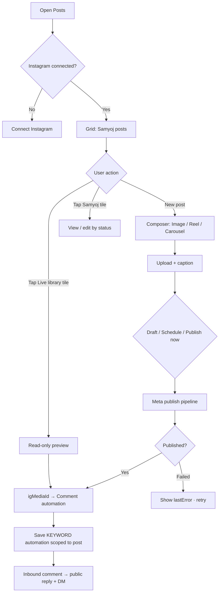

# Instagram Posts — product & UX flow (as built)

**Purpose:** Design reference for **Instagram → Posts** (`/instagram/posts`). Describes what the user sees, which actions exist, and how flows connect.  
**Audience:** Product, design, QA (not API reference).  
**As of:** 2026-09-28 · **Test-deploy build** (local / internal; not claimed customer production).  
**Code anchors:** `client/src/pages/InstagramPostsPage.tsx`, `server/src/modules/instagram/posts.*`, automations via `matchInstagramCommentReplies`.

---

## 1. Where the user enters

| Entry | Label | Notes |
|--------|--------|--------|
| Sidebar | **Channels → Instagram → Posts** | Same Instagram pink/chrome family as Inbox & Comments |
| Dashboard | **Posts** summary card / “Create Post” shortcuts | Links to `/instagram/posts` |
| Page title | **Posts** | Subtitle: professional account linked to Facebook Page |
| Cross-link | **Generate in AI Studio** | Goes to `/content-studio` (images only today; user brings asset back to Posts) |

**Not on this page:** WhatsApp Campaigns, Facebook organic posts, Ads creation, full Automations builder UI (only a **post-scoped** comment rule is embedded here).

---

## 2. Preconditions & roles

### 2.1 Instagram connected

- User must have an active **Instagram professional account** connected via existing **Facebook Page OAuth** (same connect as Inbox/Comments).
- If **not connected**, the page shows a single **Connect Instagram** card (or “Ask an admin” if the user cannot connect).

### 2.2 Who can do what

| Role | View grid & library | Create / edit / publish / upload | Comment automation on a post |
|------|---------------------|-----------------------------------|------------------------------|
| **OWNER, ADMIN, SUPERVISOR** | Yes | Yes | Yes |
| **Agent** (and other roles) | Yes | No (no New post, no save buttons) | No |

### 2.3 Meta mock mode (dev/demo)

- When **Meta mock** is on, sample posts appear in the grid with fake IDs.
- Sample posts **cannot** be published or save real automations (toast explains).

---

## 3. Page layout (information architecture)

Think **Instagram profile + composer**, not a spreadsheet.

```text
┌─────────────────────────────────────────────────────────────┐
│ Header: Posts + subtitle + [Generate in AI Studio] [New post]│
├─────────────────────────────────────────────────────────────┤
│ Short explainer (schedule window + comment/DM on posts)      │
├─────────────────────────────────────────────────────────────┤
│ Profile strip: avatar · @handle · stats (live / scheduled / drafts) │
├──────────────────────────────┬──────────────────────────────┤
│ LEFT (feed)                  │ RIGHT (phone-style panel)     │
│ · Status filter chips        │ · Opens when user picks a tile │
│ · 3-column post grid         │ · Composer OR live-post view   │
│ · “Already on Instagram” row │ · Comment automation block     │
└──────────────────────────────┴──────────────────────────────┘
```

**Visual language:** 3-column square grid (`.igp-grid`), gradient story-style avatar, status pills on tiles, right **phone** panel for focus (matches Comments/Inbox integration feel).

---

## 4. Post types we support (composer)

User picks **one type per new post** via tabs in the right panel:

| Type | User intent | Media input | Caption |
|------|-------------|-------------|---------|
| **Image** | Single feed photo | JPEG, PNG, WebP (max 8 MB) | Optional, max 2200 chars |
| **Reel** | Short video Reel | MP4 or MOV (max 100 MB) | Same |
| **Carousel** | 2–10 slides | Mix of images + videos per slide | Same |

**Cover thumbnail:** Grid and preview use first image slide, or video URL for Reels.

**Limits enforced in UI + API:**

- Caption ≤ **2200** characters; ≤ **30** hashtags.
- Schedule: **10 minutes** to **75 days** ahead (org time via datetime picker).
- Carousel: **minimum 2**, maximum **10** slides.

---

## 5. Status model (what appears on tiles)

| Status | User-facing label | Meaning | Editable in Samyoj? |
|--------|-------------------|---------|---------------------|
| **DRAFT** | Draft | Saved, not scheduled | Yes |
| **SCHEDULED** | Scheduled | Will publish at `scheduledAt` | Yes (until publish starts) |
| **PROCESSING** | Publishing | Samyoj is calling Meta | No |
| **PUBLISHED** | Published | Live on Instagram | No (automation only) |
| **FAILED** | Failed | Meta or processing error; `lastError` shown | Yes (retry via edit + publish) |
| **CANCELLED** | Cancelled | Was scheduled, user cancelled | Can remove |

**Filter chips (left):** All · Draft · Scheduled · Published · Failed (no separate Cancelled filter; cancelled posts may show under All).

**Scheduler behavior:** Samyoj runs an in-process job (~every 30s) that publishes **SCHEDULED** posts when `scheduledAt` passes (does not rely on Meta “future timestamp” alone).

---

## 6. Primary user flows

### Flow A — First visit, not connected

1. User opens **Posts**.
2. Sees explainer + empty/connect card.
3. Taps **Connect Instagram** → existing Meta OAuth (no App ID fields in UI).
4. Returns to Posts → grid loads Samyoj-managed posts + can refresh **Already on Instagram**.

---

### Flow B — Create & publish now (Image / Reel / Carousel)

1. **New post** (header) → right panel opens, type tabs default **Image**.
2. User selects **Image | Reel | Carousel**.
3. **Upload** via dashed square (or carousel **+** for extra slides).
4. Optional: **Use an image from AI Studio** (Image type only) → 4-column picker from library.
5. Writes **caption**; optional **Schedule** datetime (for Flow C instead).
6. Actions:
   - **Save draft** → `DRAFT`
   - **Schedule** → requires datetime → `SCHEDULED`
   - **Publish now** → save then immediate publish → `PROCESSING` → `PUBLISHED` or `FAILED`
7. On success, grid updates; if Meta returns `igMediaId`, **comment automation** section unlocks.

---

### Flow C — Schedule for later

1. Same as Flow B through media + caption.
2. User sets **Schedule** (datetime-local).
3. Taps **Schedule** (not Publish now).
4. Post appears in grid with **Scheduled** pill; profile stat **scheduled** increments.
5. At due time, background scheduler publishes (user does not need to stay on page).
6. Optional: **Cancel schedule** while `SCHEDULED` → `CANCELLED`, datetime cleared.

---

### Flow D — Edit or retry a draft / failed post

1. User taps tile in grid → panel loads caption, media, schedule.
2. Edits allowed for **DRAFT**, **SCHEDULED**, **FAILED**, **CANCELLED** (not **PUBLISHED** / **PROCESSING**).
3. **Save draft** / **Schedule** / **Publish now** as needed.
4. **Remove** (trash) — only for draft / failed / cancelled → deletes row in Samyoj (not “delete from Instagram” for published).

---

### Flow E — “Already on Instagram” (posts not created in Samyoj)

**User story:** “I posted from the Instagram app (or long ago). I still want comment keyword → public reply + DM on **that** post.”

1. Below the Samyoj grid, section **Already on Instagram** lists up to ~40 recent media from the connected account (thumbnails).
2. Tiles labeled **Live**; Samyoj posts with the same `igMediaId` are **hidden** here to avoid duplicates.
3. User taps a live tile → right panel shows preview + caption snippet (read-only).
4. **Comment automation** block (§7) — same as published Samyoj posts.
5. **Refresh** reloads library from Meta.

**No** create/edit/publish actions on these tiles — only automation setup.

---

### Flow F — Comment + DM automation (per post)

**Available when:** `igMediaId` is known (published Samyoj post, or **Already on Instagram** selection).

**User configures (in Posts panel, not full Automations page):**

| Field | Purpose |
|--------|---------|
| **Word** (e.g. `PRICE`) | Keyword in comment text (existing keyword matcher) |
| **Public reply** | Reply posted on the comment thread |
| **Private DM** | One private message after match (Instagram messaging rules apply) |

**Validation:** Word required; at least one of public reply **or** DM required.

**Save** → creates or updates an **Automation** with `triggerType: KEYWORD`, `config.platform: IG`, `config.igMediaId: <post>`.

**Runtime (already built, runs on inbound comments):**

1. Instagram comment webhook → `matchInstagramCommentReplies`.
2. Rules **scoped to `igMediaId`** beat account-wide IG keyword rules.
3. If match: optional public reply + optional private DM (same engine as Comments product).

**Not in this panel:** multi-step flows, business hours UI, enable/disable toggle (saved rule is enabled; manage elsewhere in Automations if needed).

---

## 7. Controls catalog (buttons & inputs)

### Header

| Control | Action |
|---------|--------|
| **Generate in AI Studio** | Navigate to Content Studio |
| **New post** | Open composer (Image default) |

### Left — filters & grid

| Control | Action |
|---------|--------|
| Filter chips | Filter Samyoj posts by status |
| Grid tile | Open post in right panel |
| **New post** tile (empty state) | Same as header New post |
| **Refresh** (Already on Instagram) | Reload Meta library |

### Right — composer (Samyoj posts)

| Control | Action |
|---------|--------|
| **Close** | Close panel |
| **Image / Reel / Carousel** tabs | Switch post type (new or editable draft) |
| Media drop zone / file input | Upload |
| Carousel **+** | Add slide |
| Slide **×** | Remove slide |
| **Use an image from AI Studio** | Pick library image (Image only) |
| Caption textarea | 2200 char counter |
| Schedule datetime | Optional |
| **Save draft** | |
| **Schedule** | Requires datetime |
| **Publish now** | |
| **Cancel schedule** | Scheduled only |
| **Remove** | Delete draft/failed/cancelled |

### Right — automation block

| Control | Action |
|---------|--------|
| Word / Public reply / DM fields | Configure rule |
| **Save comment reply** | Persist automation |

---

## 8. What happens behind the scenes (for design copy only)

- Media uploads go to org storage; Meta receives a **public HTTPS URL** (same constraint as DM attachments).
- Publish: Meta **container** → wait until processed → **media_publish** (Reels/carousels need extra polling).
- List API returns Samyoj rows only; library API is separate (`/instagram/posts/library`).
- OAuth scope **`instagram_content_publish`** is requested on connect (re-connect may be needed for older connections).

---

## 9. Built vs not built (scope honesty for design)

### Shipped in this build (design should include)

- Image, Reel, Carousel compose + upload  
- Draft / schedule / publish now / cancel schedule / remove draft  
- Status grid + filters + profile stats  
- AI Studio image pick (link out + import)  
- Per-post comment keyword + public reply + DM  
- Live Instagram library for automation on existing posts  
- Role gating (editors vs view-only)  
- Failed state with error message  

### In spec or roadmap — **not** in Posts UI today

| Item | Note |
|------|------|
| **Calendar** month/week view | Spec only |
| **Generate post inside Posts** | Phase 2 — AI generation stays in AI Studio |
| **First comment** on publish | Not implemented |
| **Edit/delete published post on IG** | Not in Samyoj |
| **Stories publishing** | Out of scope |
| **Analytics** (reach, saves, etc.) | Not on this page |
| **Facebook Page Posts** | Separate future surface |
| **In-app scope / reconnect banner** | May be needed if publish fails for missing permission (handle in Settings/connect flows) |

---

## 10. Suggested design deliverables (from this doc)

1. **Connected** vs **disconnected** states.  
2. **Grid + phone panel** responsive (mobile: panel as bottom sheet or full-screen — current code uses side panel on xl).  
3. Composer states per **Image / Reel / Carousel**.  
4. **Status pills** and **empty grid**.  
5. **Already on Instagram** row + **Live** badge.  
6. **Automation** subsection on published/live posts.  
7. **Error** and **Publishing** states.  
8. **View-only** role (no primary actions).  

---

## 11. Quick flow diagram (Mermaid)



---

*For engineering detail and Meta API, see `docs/product/INSTAGRAM_POSTS_BUILD_SPEC_2026-09-27.md`. This UX doc reflects **what is in the repo** as of the date above.*
