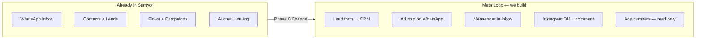
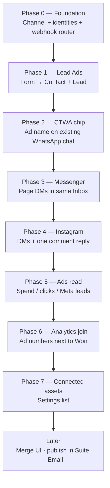
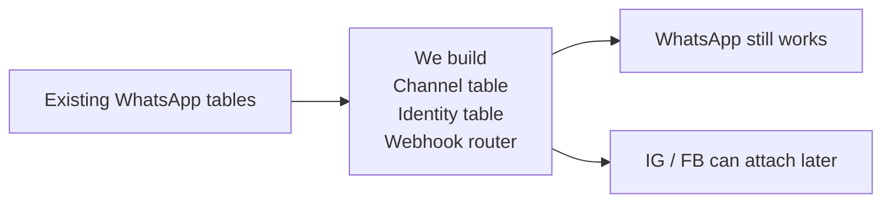
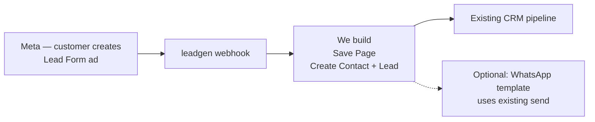
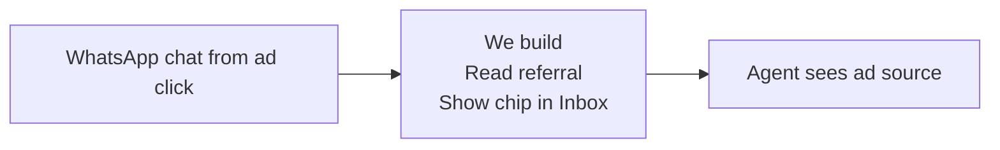
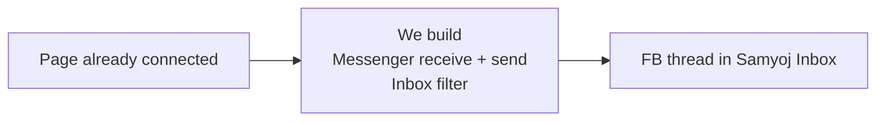
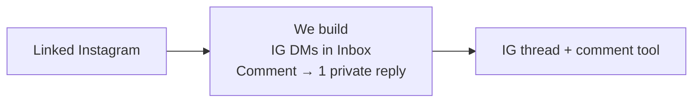
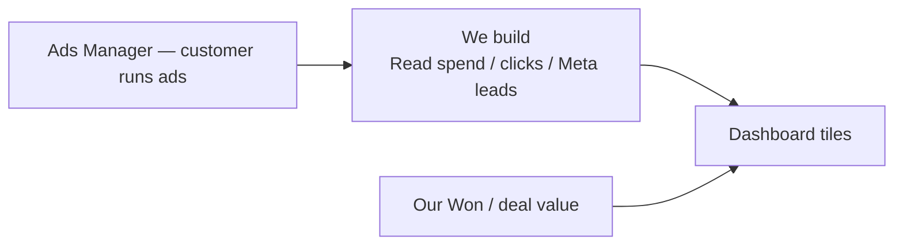
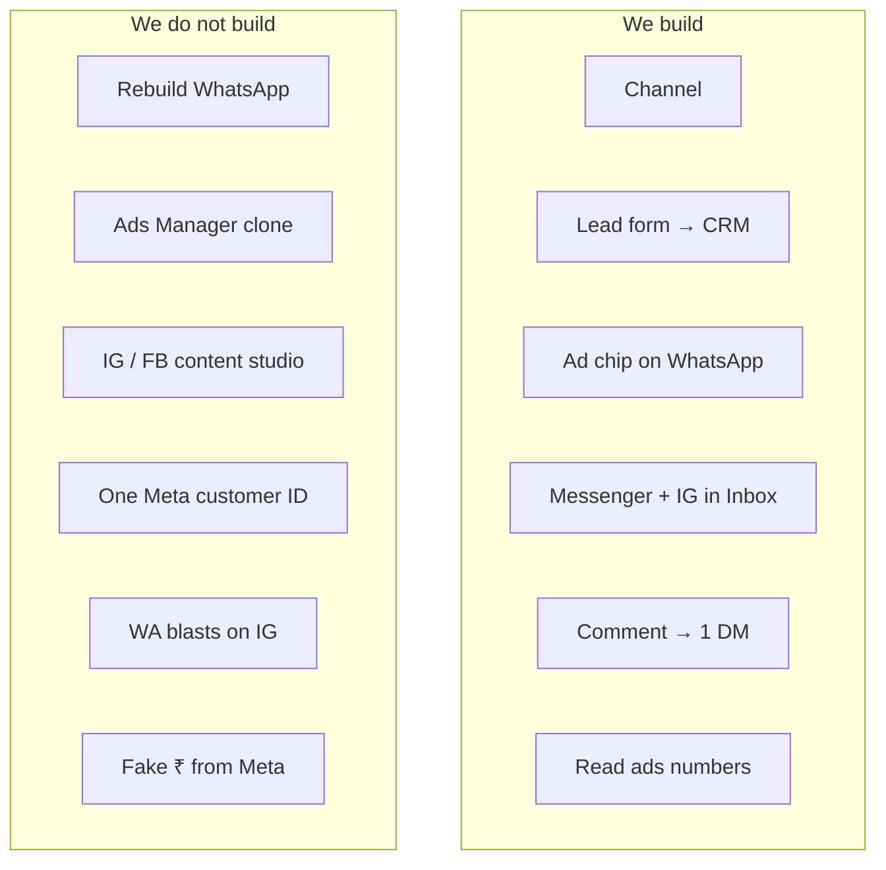
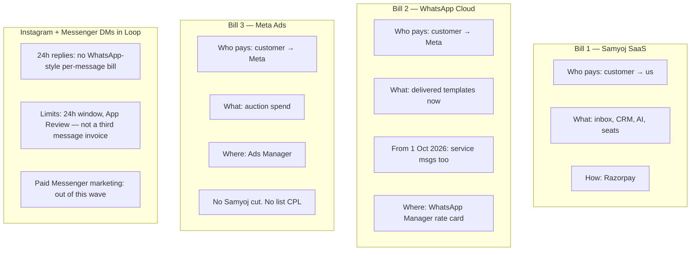

# Samyoj Meta Loop — phase charts for seniors

**Name:** **Samyoj Meta Loop**  
**One line:** WhatsApp is already live. We add Ads → CRM, then Facebook and Instagram into the **same Inbox**. We do not rebuild WhatsApp. We do not clone Ads Manager.

**How to present:** one chart, one sentence, stop. Paste Mermaid into Notion / GitHub / slides.

These charts are **our build**, not the customer’s day. Grey boxes stay in Meta. Green boxes are Samyoj tickets.

Plan: [`META_ECOSYSTEM_V2_PLAN_2026-09-18.md`](META_ECOSYSTEM_V2_PLAN_2026-09-18.md)  
Do / Don’t: [`META_ECOSYSTEM_DOS_AND_DONTS_2026-09-18.md`](META_ECOSYSTEM_DOS_AND_DONTS_2026-09-18.md)

---

## Chart 0 — Name and split

**Say:** Left is shipped. Right is the Loop. Same product.

---

## Chart 1 — Phase order (how they unlock each other)

**Say:** Each phase needs the one before it. Skip Channel → Inbox tenancy breaks. Skip Lead Ads → we connect the Page twice.

---

## Chart 2 — Phase 0 (we build this first)

**Purpose:** WhatsApp keeps working. Later channels can share Inbox without stealing the WhatsApp number.

**In:** today’s Contact / Conversation / Lead (all tied to WhatsApp number).  
**Out:** a Channel row per WhatsApp number; room for Page and Instagram later.

**Points in this phase**
- One Channel = one connected asset (this WhatsApp number, later this Page, later this IG)
- Webhook: WhatsApp stays; other Meta objects are no longer dropped
- **Not in this phase:** any Instagram screen

---

## Chart 3 — Phase 1 Lead Ads

**Purpose:** First new money loop. Smallest Ads work. Same Page is reused for Messenger.

**In:** Customer creates the Instant Form **in Ads Manager** (not us).  
**Out:** Contact + Lead in Samyoj. Optional WhatsApp template (that message is WhatsApp-billed).

**Points**
- We ingest. We do not draw the ad.
- Need phone or email on the form or the lead is incomplete
- **Not in this phase:** Ads Manager UI, spend dashboard

---

## Chart 4 — Phase 2 CTWA chip

**Purpose:** Agent already gets WhatsApp from ads. Show which ad. Almost no new Meta API.

**In:** existing WhatsApp inbound (referral already on the message).  
**Out:** chip on the thread.

**Points**
- Uses Inbox we already have
- **Not in this phase:** creating Click-to-WhatsApp ads inside Samyoj

---

## Chart 5 — Phase 3 Messenger

**Purpose:** Same Page as Lead Ads. Facebook chat in the same Inbox.

**In:** Page token from Phase 1.  
**Out:** channel filter = Facebook.

**Points**
- Reply window ~24 hours (not WhatsApp templates)
- **Not in this phase:** Facebook post composer, WA-style broadcasts on Messenger

---

## Chart 6 — Phase 4 Instagram

**Purpose:** Table-stakes vs Wati / Respond.io. DMs + comment “PRICE” → one private reply.

**In:** Instagram Professional linked to the same Page.  
**Out:** channel filter = Instagram.

**Points**
- One private reply per person / 7 days; then they must reply
- Human inbox required if AI answers
- **Not in this phase:** Reels publisher, Story stickers, blasting everyone who comments

---

## Chart 7 — Phase 5–6 Ads read + join

**Purpose:** Show performance. Ads still live in Ads Manager.

**In:** Ad Account the customer already has.  
**Out:** numbers on a Samyoj page. Won rupees only if we stored deal value.

**Points**
- CPL on this page = Meta’s “lead” action, not “qualified”
- Two columns: Meta numbers | our deals. Not one fake ROI
- **Not in this phase:** campaign editor

---

## Chart 8 — Doing vs not doing

**Say:** Green is tickets. Grey stays in Meta.

---

## Chart 9 — Three bills (real, not invented rupees)

**Say:** Three invoices. Dashboard may *show* all three. Samyoj plan price never includes the other two.

WhatsApp rates move; **do not quote a ₹/message in this slide.** Point to WhatsApp Manager. Ads auction has **no list price**. Instagram/Messenger **24h service DMs are not billed like WhatsApp templates** — Meta has no per-IG-DM rate card. Paid Messenger marketing is a **different product**; we are not building it in this wave.

| Channel | Customer pays Meta for messages? | Customer pays Meta for ads? | Pays Samyoj? |
|---------|----------------------------------|-----------------------------|--------------|
| WhatsApp | **Yes** — templates when delivered. Service messages billed from **1 Oct 2026** (Meta: 1,000 free service/month/number). Utility in-session also changes that date. | Only if they run Click-to-WhatsApp ads | Software |
| Instagram DMs / comments | **No per-DM rate card** on Graph Messaging. Rate *limits*, not a message invoice | If they run IG ads | Software |
| Messenger DMs | Same as IG for **24h service**. Paid Marketing Messages API = extra product, **not Phase 3** | If they run Messenger ads | Software |
| Lead Forms / other ads | n/a | **Yes — auction spend** on the Ad Account | Software |

**Sources (do not invent India ₹ here):**  
[WhatsApp pricing](https://developers.facebook.com/documentation/business-messaging/whatsapp/pricing) · [Marketing Messages on Messenger](https://developers.facebook.com/documentation/business-messaging/messenger-platform/marketing-messages-on-messenger) · Ads: customer’s Ads Manager, not Samyoj.

---

## Speaker crib

| Chart | Say this |
|-------|----------|
| 0 | WhatsApp stays. Loop is Ads + IG + Facebook into the same CRM. |
| 1 | 0 unlocks everything. 1’s Page unlocks Messenger. Inbox then gets Instagram. Then we only read ads. |
| 2 | Phase 0 is plumbing. No Instagram screen yet. |
| 3 | They make the form in Meta. We catch the lead. |
| 4 | Tiny WhatsApp UI. Agent sees the ad. |
| 5 | Facebook chat, same Inbox, 24h window. |
| 6 | Instagram chat + one comment reply. Not a publisher. |
| 7 | Show Meta’s numbers next to our Won. Two columns. |
| 8 | We are the destination. Meta keeps Ads Manager and Suite. |
| 9 | Three bills. IG/FB DMs are not a fourth WhatsApp-style invoice. |

**If asked “when Instagram?”** Phase 4 — after Channel, Lead Ads, chip, Messenger.  
**If asked “IG message cost?”** Not billed like WhatsApp templates. Ads on Instagram still cost ad spend.  
**If asked “ROI slide?”** Spend vs Meta leads after Phase 5. Rupee sales only after we store deal value.
