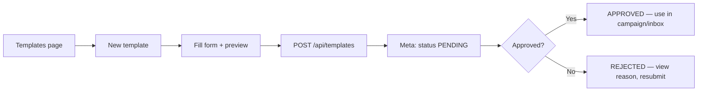

# Templates — Comprehensive Product, Technical & Gap Analysis

**Last updated:** 2026-08-12  
**Scope:** WhatsApp message templates in Samyoj — existing build, Meta alignment, competitor patterns, gaps, risks, and recommended work.  
**Audience:** Product, design, and engineering before a dedicated Templates page redesign.

---

## 1. Executive summary

WhatsApp **message templates** are pre-approved message formats required to contact customers **outside the 24-hour customer service window**. In Samyoj they power:

- **Campaigns** (bulk outreach)
- **Inbox** (agent-initiated template when window is closed)
- **Automations / Flows** (`template` node)
- **Public API / Zapier** integrations
- **Reports** (delivery analytics by template name)

**Architecture decision (important):** Meta is the **source of truth**. Samyoj has **no local `MessageTemplate` table**. Templates are listed, created, deleted, and validated live via `MetaWhatsAppService`. The app only stores **references** (`templateName`, `templateLanguage`, `templateParams`) on campaigns and message metadata.

**Overall maturity:** Core CRUD + library + test-send + usage analytics are **implemented and functional**. Gaps are mainly in **UX polish**, **real-time status**, **compliance guidance**, **AI-assisted creation**, and **operational reliability** (sync drift, rejection surfacing, cost visibility).

---

## 2. What templates are (Meta fundamentals)

### 2.1 When templates are required

| Scenario | Template required? |
|----------|-------------------|
| Customer messaged you within last 24h | No — free-form replies allowed |
| Business initiates conversation (campaign, cold outreach) | **Yes** |
| Reply after 24h window closed | **Yes** |
| Authentication OTP | **Yes** (AUTHENTICATION category) |

### 2.2 Template categories (Meta)

| Category | Typical use | Pricing tier (conversation-based) |
|----------|-------------|-----------------------------------|
| **UTILITY** | Order updates, shipping, account alerts | Lower |
| **MARKETING** | Promotions, offers, re-engagement | Higher |
| **AUTHENTICATION** | OTP, login codes | Lowest (region-dependent) |

Meta may **recategorize** templates. `allow_category_change: true` on create reduces instant rejection for miscategorization.

### 2.3 Template components (Meta)

| Component | Limits (typical) | Samyoj create support |
|-----------|------------------|----------------------|
| **HEADER** | TEXT (60 chars), IMAGE, VIDEO, DOCUMENT, LOCATION | TEXT, IMAGE, VIDEO, DOCUMENT ✅ |
| **BODY** | Required; variables `{{1}}`, `{{2}}`… | ✅ |
| **FOOTER** | 60 chars, no variables | ✅ |
| **BUTTONS** | QUICK_REPLY, URL, PHONE_NUMBER, COPY_CODE, OTP (auth) | ✅ (not FLOW, CATALOG, MPM, etc.) |

### 2.4 Template lifecycle (Meta statuses)

| Status | Can send? | Samyoj handling |
|--------|-----------|-----------------|
| `PENDING` | No | 30s poll on Templates page |
| `APPROVED` | Yes | Usable in campaigns/inbox |
| `REJECTED` | No | Resubmit flow (delete + recreate) |
| `PAUSED` / `DISABLED` | No | Resubmit; quality issue |
| `PENDING_DELETION` / `DELETED` | No | Removed from list on refresh |

Status updates arrive via webhooks: `message_template_status_update`, `message_template_quality_update`, `message_template_components_update`, `template_category_update`.

**Official references:**
- [Template fundamentals](https://developers.facebook.com/docs/whatsapp/business-management-api/message-templates/)
- [WABA message_templates API](https://developers.facebook.com/docs/graph-api/reference/whats-app-business-account/message_templates/)
- [Template message object](https://developers.facebook.com/docs/graph-api/reference/whats-app-business-hsm/)

---

## 3. Current Samyoj implementation

### 3.1 Data model

```
Meta WABA (source of truth)
    ↑ list / create / delete / get
MetaWhatsAppService  (server/src/modules/whatsapp/meta.service.ts)
    ↑
/api/templates       (server/src/modules/templates/routes.ts)
    ↑
templateApi          (client/src/services/api.ts)
    ↑
TemplatesPage + related UI

Local DB references only:
  Campaign.templateName, templateLanguage, templateParams
  Message.metadata (inbox/campaign sends)
  ContentDraft.metaTemplate* (schema exists; pipeline incomplete)
  Organization.settings.alerts.templateRejections / templateStatus
```

**No Prisma model for templates** — intentional; avoids sync drift at storage layer but shifts burden to live Meta calls.

### 3.2 Backend API

| Method | Path | Purpose |
|--------|------|---------|
| GET | `/api/templates` | List from Meta (`?all=true` paginates all) |
| GET | `/api/templates/library` | Meta `message_template_library` |
| GET | `/api/templates/:name` | Single template |
| GET | `/api/templates/:name/usage` | Campaign usage from local DB |
| POST | `/api/templates` | Create on Meta |
| POST | `/api/templates/from-library` | Create from Meta library template |
| POST | `/api/templates/upload-header` | Resumable upload → media handle |
| POST | `/api/templates/:name/test-send` | Send approved template to a phone |
| POST | `/api/templates/:name/resubmit` | Delete + recreate (REJECTED/PAUSED) |
| DELETE | `/api/templates/:name` | Delete on Meta |

**Auth:** `authenticate`, `requireOrg`, `resolveActiveWhatsappNumber` (multi-number via `X-WhatsApp-Number-Id`).

**Key files:**
- `server/src/modules/templates/routes.ts`
- `server/src/modules/templates/builder.ts` — create payload → Meta components
- `server/src/modules/templates/types.ts` — Zod validation
- `server/src/modules/templates/analytics.ts` — campaign usage aggregation
- `server/src/modules/campaigns/template-params.ts` — send-time component building
- `server/src/modules/campaigns/template-validation.ts` — pre-send approval checks

### 3.3 Frontend (`/templates`)

**Page:** `client/src/pages/TemplatesPage.tsx`

| Feature | Status | Notes |
|---------|--------|-------|
| Hero stats (total / approved / pending / rejected) | ✅ | `PageHero` |
| Search + status/category/language filters | ✅ | Dropdown filters |
| Group by name (multi-language variants) | ✅ | Expandable rows |
| Create template | ✅ | SlideOver + `TemplateCreateForm` |
| Meta template library | ✅ | `TemplateLibraryPanel` |
| View detail + preview | ✅ | `TemplateDetailPanel` |
| Test send | ✅ | Approved only |
| Duplicate | ✅ | Pre-fills create form |
| Resubmit | ✅ | REJECTED / PAUSED only |
| Delete | ✅ | Confirm dialog |
| Refresh | ✅ | Re-fetches from Meta |
| Pending auto-poll | ✅ | Every 30s when any PENDING |
| WhatsApp not connected gate | ✅ | Empty state → Settings |

**Components:**
- `TemplateTable.tsx` — desktop table
- `TemplateCard.tsx` — mobile cards
- `TemplateCreateForm.tsx` — full create/resubmit form + live preview
- `TemplateDetailPanel.tsx` — preview, usage, actions
- `TemplateLibraryPanel.tsx` — library browse + create from library
- `TemplateButtonEditor.tsx` — button types
- `templateUi.tsx` — category/language badges
- `templateForm.ts` / `templateUtils.ts` — form state, validation, grouping

### 3.4 Downstream consumers

| Feature | How templates are used |
|---------|------------------------|
| **Campaigns** | Wizard step 1 picks approved template; params filled; validated at send |
| **Inbox** | `TemplateComposer` when 24h window closed |
| **Flows** | `template` node sends by `templateName` (no template picker in flow builder UI) |
| **Reports** | `ReportsTemplateTable` — delivery metrics by template name |
| **Onboarding** | Readiness step “Add a message template” → `/templates` |
| **Public API** | `type: 'TEMPLATE'` requires `templateName` |
| **Content Studio** | `ContentDraft.metaTemplate*` fields planned; not end-to-end |

### 3.5 Webhooks & alerts

`webhook-dispatcher.ts` handles template events:

1. `emitToOrg('template:status', { templateId, templateName, event, reason })`
2. On REJECTED/PAUSED/DISABLED/FLAGGED → `appendOrgAlert('templateRejections', ...)`
3. Always → `appendOrgAlert('templateStatus', ...)`

**Gap:** `useSocket.ts` does **not** subscribe to `template:status` — UI relies on polling/manual refresh.

**Also:** `billing/usage.service.ts` → `pollTemplateRejections()` runs on alert worker interval.

---

## 4. User flows (as built today)

### 4.1 Create from scratch



### 4.2 Create from Meta library

1. Open **Template library**
2. Browse/filter Meta pre-built templates
3. **Use as reference** (pre-fills form) or **Create from library** (direct API)
4. Same approval flow as scratch create

### 4.3 Resubmit rejected template

1. Open detail panel
2. **Resubmit** → form pre-filled
3. Backend: `DELETE` existing name on Meta → `POST` new create
4. Status returns to PENDING

**Note:** Meta does not allow editing approved templates in place — duplicate/resubmit is correct.

### 4.4 Use in campaign

1. Campaigns → New campaign
2. Select **approved** template + language
3. Fill variables (body/header/media)
4. Audience + schedule → send
5. Worker validates template still APPROVED at send time

### 4.5 Use in inbox

1. Conversation with closed 24h window
2. Template tab / composer opens
3. Pick approved template, fill variables, send

---

## 5. Meta API alignment — what we support vs what Meta offers

### 5.1 Supported in Samyoj ✅

- Categories: MARKETING, UTILITY, AUTHENTICATION
- Header: TEXT, IMAGE, VIDEO, DOCUMENT + resumable upload
- Body variables `{{1}}`… with examples (required for approval)
- Footer, buttons: QUICK_REPLY, URL, PHONE_NUMBER, COPY_CODE
- AUTHENTICATION: OTP COPY_CODE / ONE_TAP
- Meta template library browse + create from library
- `allow_category_change` (via builder — verify in create payload)
- Template quality score display (`quality_score` → High/Medium/Low)
- Rejection reason normalization in UI

### 5.2 Meta features **not** implemented ❌

| Meta capability | Impact | Priority |
|-----------------|--------|----------|
| **Named parameters** (`{{customer_name}}` vs `{{1}}`) | Some Meta templates use `parameter_format: NAMED` | Medium |
| **LOCATION header** | Static location in header | Low |
| **Carousel / product templates** | E-commerce catalog messages | Medium (commerce roadmap) |
| **Limited-time offer** component | Promo templates | Low |
| **FLOW / CATALOG / MPM buttons** | Interactive commerce | Medium |
| **Template pacing / LIMIT_EXCEEDED** status UX | Template paused by Meta for quality | High |
| **Appeal workflow** (`APPEAL` status) | Rejected template appeal | Medium |
| **Edit template** (Meta now allows limited edits on some) | We only delete+recreate | Low |
| **Marketing Messages API** (MM API) | Separate send path for marketing | Future |
| **Per-template analytics from Meta** | We only have local campaign stats | Medium |

### 5.3 Variable & send-time rules (common production failures)

| Error | Cause | Samyoj mitigation today |
|-------|-------|-------------------------|
| Meta **#132000** | Variable count mismatch at send | `template-validation.ts` + campaign form |
| **#132001** | Template does not exist / wrong language | Live `getMessageTemplate` before campaign send |
| **#132015** | Template paused/disabled | Partial — status shown in list, not blocked proactively in all paths |
| Header media missing | Campaign/inbox send without `headerMediaUrl` | `templateNeedsHeaderMedia` in campaign preview |

---

## 6. Competitor analysis

Patterns from **WATI**, **Gallabox**, **Respond.io-class** platforms (public docs, 2025–2026):

| Capability | WATI / Gallabox pattern | Samyoj today | Gap |
|------------|-------------------------|--------------|-----|
| **Create in-platform only** | Strong warning: don’t create in WhatsApp Manager or sync breaks | Meta is source of truth; Manager edits possible but invisible until refresh | Need “sync” UX + warning banner |
| **Template library** | Pre-approved shortcuts + industry packs | Meta library ✅ | Could add Samyoj-curated packs (Hindi/English pairs) |
| **AI template assistant** | WATI AI Marketing Assistant — compliance + copy | Not on Templates page | Content Studio partial; high user value |
| **Category guidance** | Inline tips to avoid rejection | Basic validation warnings | Need rejection playbook in UI |
| **Quality monitoring post-approval** | Quality rating + education | Shows quality badge | No proactive alerts on YELLOW/RED template quality |
| **Filter by status** | Status chips / filters | Dropdown ✅ | Could use segmented control (like AI Bots) |
| **Test send before campaign** | Encouraged in flow | Test send in detail panel ✅ | Could prompt after create |
| **Multi-language grouping** | Often grouped by template name | Group view ✅ | Good |
| **Campaign analytics per template** | Campaign overview | Reports + per-template usage ✅ | Good |
| **Webhook lifecycle tracking** | localMessageId tracking | Webhooks for template status ✅; delivery via message webhooks | Good |
| **Don’t edit after submit** | Read-only while PENDING | ✅ | — |
| **Hindi + English separate templates** | Documented best practice for India | User creates manually | Starter packs would help |

**Samyoj differentiators to preserve:**
- Deep integration with **Inbox + Campaigns + Flows** in one workspace
- **Org multi-number** support via active WABA context
- **Campaign usage analytics** tied to template name locally

---

## 7. Frontend documentation (current UI copy & structure)

### 7.1 Page identity

- Route: `/templates`
- Nav: Main → Templates (`ClipboardList` icon)
- Title: **Message templates**
- Description: **Create and manage approved templates for campaigns and outreach.**

### 7.2 Summary hero metrics

| Metric | Meaning |
|--------|---------|
| Total | All templates returned from Meta |
| Approved | Status APPROVED |
| Pending | Awaiting Meta review |
| Rejected | Needs fix + resubmit |

### 7.3 Toolbar actions

- **Search templates…**
- Filters: status, category, language
- **Group** toggle (multi-language variants)
- **Refresh**
- **Template library**
- **New template**

### 7.4 List columns (desktop)

- Template name + preview snippet
- Category
- Language
- Status (+ quality if present)
- Rejection reason (if rejected)
- Actions: View, Duplicate

### 7.5 Create form sections

1. Name, category, language
2. Header format + media upload
3. Body + variable examples
4. Footer
5. Buttons (non-auth)
6. Live WhatsApp preview
7. Validation errors/warnings

### 7.6 Detail panel

- Full preview
- Status, quality, rejection reason
- Usage stats (campaigns using this template)
- **Test send** (approved)
- **Use in campaign** link
- Resubmit / Delete / Duplicate

### 7.7 Empty / gate states

| State | Message |
|-------|---------|
| WhatsApp not connected | Connect WhatsApp first → Settings |
| No templates | Create your first template |
| No filter matches | Clear filters |

---

## 8. Known gaps, bugs & breaking points

### 8.1 Product / UX gaps

| ID | Issue | Severity | Recommendation |
|----|-------|----------|----------------|
| T-UX-1 | No real-time status — `template:status` socket unused | Medium | Listen in `TemplatesPage`; toast + auto-refresh |
| T-UX-2 | No explicit **Sync from Meta** / drift warning | Medium | Banner if template edited outside Samyoj |
| T-UX-3 | Rejection help is raw Meta reason only | High | Map reasons → human fixes (playbook) |
| T-UX-4 | No AI assist for template copy/compliance | High | Integrate Content Studio / Sarvam draft |
| T-UX-5 | Filters use dropdowns not segmented pills | Low | Match AI Bots / Inbox patterns |
| T-UX-6 | Hero uses old `PageHero` / `inbox-shell` patterns | Medium | Redesign like AI Bots (separate workstream) |
| T-UX-7 | Template composer hidden until window closed in Inbox | Medium | Always visible with contextual hint |
| T-UX-8 | Flow builder: no template picker for `template` node | Medium | Reuse `TemplatePicker` |
| T-UX-9 | No “unused template” / stale badge | Low | Campaign usage + last-sent date |
| T-UX-10 | No bulk delete | Low | Multi-select for cleanup |
| T-UX-11 | No cost estimate before create/send | Medium | Link to conversation pricing by category |
| T-UX-12 | Hindi/English starter packs missing | Medium | Curated library presets for India |

### 8.2 Technical / reliability risks

| ID | Risk | Where | Mitigation |
|----|------|-------|------------|
| T-TECH-1 | Every inbox messages fetch may call Meta per template | `inbox/routes.ts` | Redis cache 5min TTL (ENHANCEMENT_PLAN P-3) |
| T-TECH-2 | `listAllMessageTemplates` max 10 pages × 100 | `meta.service.ts` | Warn if truncated; cursor UX |
| T-TECH-3 | Campaign references template deleted on Meta | `campaigns/service.ts` | Pre-flight validation + user message |
| T-TECH-4 | Resubmit = delete + create — race if pending | `templates/routes.ts` | Disable double-submit; loading state |
| T-TECH-5 | No template-specific RBAC | routes | Optional `manageTemplates` permission |
| T-TECH-6 | `ContentDraft.metaTemplate*` unused | schema | Wire Content Studio → create template |
| T-TECH-7 | AUTHENTICATION templates — limited UI testing | create form | Dedicated auth preview + test flow |
| T-TECH-8 | Header upload 16MB — client-side base64 memory | upload-header | Stream upload for large files |

### 8.3 Compliance & policy

| Topic | Samyoj today | Should add |
|-------|--------------|------------|
| Opt-in for marketing templates | Enforced at **campaign** level | Template-level reminder on MARKETING category |
| Category misclassification | `allow_category_change` | UI copy explaining categories |
| Template quality degradation | Webhook + poll | In-app banner on Templates page |
| GDPR / consent | Campaign opt-in | Link template create to consent docs |

---

## 9. Recommended enhancement roadmap

### Phase 1 — Quick wins (1–2 weeks)

1. **Socket `template:status` → live UI update** (remove reliance on 30s poll only)
2. **Rejection playbook** — map common Meta reasons to fix steps in detail panel
3. **Segmented status filter** on list toolbar (match AI Bots)
4. **Post-create CTA** — “Test send” + “Use in campaign” immediately after submit
5. **Inbox:** always show Template action with window-state hint

### Phase 2 — Reliability & ops (2–4 weeks)

1. **Template metadata Redis cache** for inbox thread enrichment
2. **Sync banner** — “Last synced X min ago” + manual refresh
3. **Template quality alerts** on page (from `templateRejections` org alerts)
4. **Unused template badge** (no campaign in 60 days)
5. **Flow builder template picker**

### Phase 3 — Differentiation (4–8 weeks)

1. **AI template assistant** — draft body, suggest category, reduce rejections
2. **Samyoj starter packs** — Hindi/English utility + marketing pairs for India
3. **Cost estimator** — category + audience size → approximate Meta conversation cost
4. **Carousel / catalog templates** (if commerce module ships)
5. **Content Studio → Meta template** pipeline (`ContentDraft.metaTemplate*`)

### Phase 4 — Enterprise

1. Template approval workflow (draft → reviewer → submit to Meta)
2. Per-team template libraries
3. Version history (local audit of submits, not Meta edit history)
4. DPA/compliance export including template usage log

---

## 10. Testing checklist (before Templates redesign ship)

- [ ] Create UTILITY template with body vars → PENDING → poll → APPROVED
- [ ] Create MARKETING with image header → upload → submit
- [ ] Create AUTHENTICATION OTP template → test send
- [ ] Reject template (intentionally bad content) → reason visible → resubmit
- [ ] Duplicate → new name → create
- [ ] Delete template used in draft campaign → campaign validation error
- [ ] Library → create from library
- [ ] Test send to own number
- [ ] Campaign send with matching variable count
- [ ] Campaign send with **wrong** variable count → clear error
- [ ] Inbox send when window closed
- [ ] Multi-language: two templates same name, group view
- [ ] Switch WhatsApp number (multi-WABA) → template list scoped correctly
- [ ] Webhook: simulate `message_template_status_update` → alert + socket

---

## 11. File index (implementation map)

### Frontend
- `client/src/pages/TemplatesPage.tsx`
- `client/src/components/templates/*`
- `client/src/utils/templateForm.ts`
- `client/src/utils/templateUtils.ts`
- `client/src/components/inbox/TemplateComposer.tsx`
- `client/src/components/inbox/TemplatePicker.tsx`
- `client/src/components/inbox/WhatsAppPreview.tsx`
- `client/src/components/campaigns/campaignPreviewUtils.ts`

### Backend
- `server/src/modules/templates/routes.ts`
- `server/src/modules/templates/builder.ts`
- `server/src/modules/templates/types.ts`
- `server/src/modules/templates/analytics.ts`
- `server/src/modules/whatsapp/meta.service.ts`
- `server/src/modules/whatsapp/webhook-dispatcher.ts`
- `server/src/modules/campaigns/template-params.ts`
- `server/src/modules/campaigns/template-validation.ts`

### Docs (related)
- `docs/WHATSAPP_API_DOCUMENTATION.md`
- `docs/AUDIT.md` (§4.15, template risks)
- `docs/ENHANCEMENT_PLAN.md` (B-3, P-3, F-7, F-22)
- `docs/audit/FEATURE_MATRIX.md` (templates section)
- `docs/IDEA_AI_CONTENT_STUDIO.md`
- `docs/ui-specs/CAMPAIGNS_FRONTEND_DOCUMENTATION.md` (template step in campaigns)

---

## 12. Open questions for product

1. Should Samyoj **block** creating templates in WhatsApp Manager (impossible) or only **warn** when drift detected?
2. Is **AI template generation** a Templates-page feature or Content Studio only?
3. Do we need **template approval inside team** before Meta submission?
4. Priority: **UI redesign** first vs **socket + rejection playbook** first?
5. India focus: ship **Hindi/English template packs** before carousel/commerce templates?

---

## 13. Conclusion

Samyoj’s template **engine is production-capable**: create, library, validate, send, campaign bind, webhook status, and usage analytics all exist. The next leap is **user clarity and reliability** — fewer rejections, faster status feedback, better guidance, and UI consistent with the rest of the platform (AI Bots / Campaigns polish).

**Recommended first implementation slice for redesign:**
1. New hero + list shell (soft cards, segmented filters)
2. Wire `template:status` socket
3. Rejection playbook in detail panel
4. Post-create test-send + campaign CTA

This document should be the single source of truth until a dedicated `TEMPLATES_FRONTEND_DOCUMENTATION.md` is split out after UI decisions are locked.
