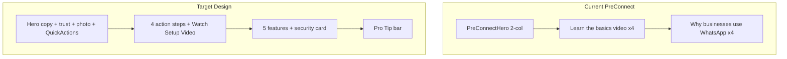

# Pre-Connect Dashboard Redesign Specification

**Scope:** Documentation for pixel-matching the PreConnect (WhatsApp-not-connected) dashboard mockup against the already-shipped UI.  
**Status:** Spec approved — UI implementation in progress / shipping in `client/src/components/dashboard/PreConnect*`.  
**Trigger in app:** [`DashboardPage.tsx`](../../client/src/pages/DashboardPage.tsx) when `!isConnected` → [`PreConnectDashboard`](../../client/src/components/dashboard/PreConnectDashboard.tsx).

---

## 1. Overview

The pre-connect dashboard is the first screen users see when they log in but have not connected a WhatsApp Business number. The redesign aims to:

- Match the shared mockup pixel-for-pixel (layout, copy, accents, assets).
- Enhance the existing PreConnect stack without inventing a new product theme.
- Keep working OAuth (`useWhatsAppConnectOAuth`) and `PreConnectVideoModal`.
- Keep the **app font** (Plus Jakarta stack in `index.css`) — match sizes/weights from the mock, do **not** switch to Inter.

---

## 2. Target Layout Structure (mockup)

Desktop information architecture (top → bottom):

```
┌─────────────────────────────────────────────────────────────────┐
│ HERO (3 columns)                                                │
│  Copy + CTAs + trust badges │ Woman + floating widgets │ Quick Actions │
├─────────────────────────────────────────────────────────────────┤
│ GET STARTED                                                     │
│  4 action step cards (dotted connectors) │ Watch Setup Video card │
├─────────────────────────────────────────────────────────────────┤
│ POWERFUL FEATURES                                               │
│  5 explore cards  +  1 larger security spotlight card           │
├─────────────────────────────────────────────────────────────────┤
│ PRO TIP bar (full width, light green) + Let's Get Started CTA   │
└─────────────────────────────────────────────────────────────────┘
```

### 2.1. Hero Section

- **Layout (desktop):** three regions — copy (left) | illustration (center) | Quick Actions card (right). Suggested grid: `lg:grid-cols-[1fr_minmax(240px,1fr)_minmax(240px,280px)]` (tune in implementation).
- **Greeting:** `Welcome to Samyoj, {firstName}! 👋` — wire from `useAuth().user.name` (`User.name` is required string in [`types/index.ts`](../../client/src/types/index.ts)).
- **Headline:** `Let's set up your WhatsApp Business and grow together` — only the phrase **grow together** uses green (`#25D366`); the rest is neutral-900.
- **Subhead:** `Automate, engage and convert — all in one place.`
- **Primary CTA:** Solid green button — Connect WhatsApp + WhatsApp glyph (keep OAuth).
- **Secondary CTA:** **Outlined** button (white fill, thin gray border) — Watch Setup Video + play icon. Opens `PreConnectVideoModal` (same as today).
- **Trust badges (under CTAs, horizontal):**
  1. Easy to Use — Beginner friendly (green accent icon)
  2. Secure & Reliable — Enterprise grade security (blue accent icon)
  3. 24/7 Support — We're always here (purple/indigo accent icon)
- **Center visual:** Photo of woman with laptop + floating widgets (message toast, Growth Overview chart at 0%, Engagement ring at 0%, paper plane). Not a clickable video tile in the hero (video lives in secondary CTA + middle video card).
- **Background:** Soft mint → pale lavender/pink gradient, decorative circles/dots; soft card shadow.

### 2.2. Quick Actions (hero right rail)

Nested white card titled Quick Actions (lightning icon):

| Row | Label | Accent | Route (proposed) |
|-----|-------|--------|------------------|
| 1 | Create New Campaign | Orange | `/campaigns` |
| 2 | Add New Contact | Green | `/contacts` |
| 3 | Create New Template | Purple | `/templates` |
| 4 | View Reports | Blue | `/reports` |

Footer: full-width mint / green-outline button — **Explore All Features** (grid icon). Destination TBD (e.g. scroll to features section or `/` features anchors).

### 2.3. Get Started in 4 Easy Steps

- **Title:** Get started in 4 easy steps
- **Four action cards** connected by light dotted lines + numbered badges (1–4):

| # | Title | Accent | CTA | Action |
|---|-------|--------|-----|--------|
| 1 | Connect WhatsApp | Green `#25D366` | Connect Now → | Same OAuth as hero |
| 2 | Set Up Your Profile | Purple `#8B5CF6` | Set Up Profile → | e.g. `/settings` |
| 3 | Create Your First Bot | Blue `#3B82F6` | Create Bot → | e.g. `/automations` or flows |
| 4 | Send Your First Campaign | Orange `#F97316` | Create Campaign → | `/campaigns` |

Each card: colored icon well, short description, solid accent CTA.

**Product decision (design wins for pixel match):** Replace today’s “Learn the basics” **video** grid with these **action** steps. Educational videos remain available via Watch Setup Video (hero secondary + side card) → `PreConnectVideoModal` / env URLs in `preconnectVideos.ts`.

### 2.4. Watch Setup Video (beside steps, not inside hero media)

- **Position:** Right of the four step cards on desktop; below steps on mobile.
- **Title:** Watch Setup Video
- **Body:** See how Samyoj can help you automate and grow your business in just 3 minutes.
- **Thumbnail:** Stylized UI preview + large green play control.
- **Footer:** Duration `03:12` (left) + Watch Now → (right, green link).

### 2.5. Powerful Features

- **Title:** Powerful features to grow your business
- **Subtitle:** Everything you need to connect, engage and convert your customers.
- **Grid:** **5 equal explore cards + 1 larger security spotlight** (not six identical cards).

| Card | Accent | Link |
|------|--------|------|
| Smart Automations | Green | Explore → |
| AI-Powered Bots | Purple | Explore → |
| Broadcast Campaigns | Blue | Explore → |
| Real-time Analytics | Orange | Explore → |
| Team Collaboration | Pink | Explore → |
| Security spotlight | Green shield/lock art | Learn more → |

Security card copy: **Your data is safe with us.** Enterprise-grade security with 99.9% uptime guarantee.

### 2.6. Pro Tip bar

- Full-width light green bar (`#E6F4EA`-style).
- Lightbulb + **Pro Tip:** Complete all 4 steps to unlock the full potential of Samyoj and take your business to the next level.
- Right: solid green **Let's Get Started →** (scroll to step 1 or trigger Connect).

---

## 3. Typography

### 3.1. Font families

- **Primary:** App Plus Jakarta stack (see `client/src/index.css`) — do not introduce Inter solely for this page.
- Fallbacks already defined by the app.

### 3.2. Font sizes and weights (target)

| Element | Font Size (Desktop) | Font Size (Mobile) | Font Weight | Color |
|---------|---------------------|--------------------|-------------|-------|
| Welcome text | 13.5px | 12.5px | 600 | `#6B7280` |
| Headline | 30px | 21px | 700 | `#111827` |
| Headline accent (“grow together”) | 30px | 21px | 700 | `#25D366` |
| Subheadline | 14px | 13px | 500 | `#6B7280` |
| Primary / Pro Tip CTA | 14px | 14px | 700 | `#FFFFFF` |
| Secondary CTA (outlined) | 14px | 13.5px | 600 | `#374151` |
| Section title | 18px | 16px | 700 | `#111827` |
| Card title | 15px | 13.5px | 700 | `#111827` |
| Card description | 12.5px | 12px | 500 | `#6B7280` |
| Step number badge | 12px | 11px | 700 | Accent-dependent |
| Pro Tip body | 14px | 13px | 500 | `#111827` |

---

## 4. Colors

### 4.1. Primary

| Name | Hex | Usage |
|------|-----|-------|
| WhatsApp Green | `#25D366` | Primary CTA, headline accent, links |
| Neutral 900 | `#111827` | Headlines |
| Neutral 700 | `#374151` | Secondary CTA text |
| Neutral 500 | `#6B7280` | Body / muted |
| Neutral 200 | `#E5E7EB` | Borders |
| Neutral 50 | `#F9FAFB` | Page backdrop |
| White | `#FFFFFF` | Cards |

### 4.2. Step CTA fills

| Step | Fill | Text |
|------|------|------|
| Connect WhatsApp | `#25D366` | `#FFFFFF` |
| Set Up Profile | `#8B5CF6` | `#FFFFFF` |
| Create Bot | `#3B82F6` | `#FFFFFF` |
| Send Campaign | `#F97316` | `#FFFFFF` |

### 4.3. Feature icon wells

| Feature | Icon background | Icon |
|---------|-----------------|------|
| Smart Automations | `#E0F2FE` / emerald soft | Green |
| AI-Powered Bots | `#DDD6FE` | `#7C3AED` |
| Broadcast Campaigns | `#DBEAFE` | `#2563EB` |
| Real-time Analytics | `#FEF3C7` | `#D97706` |
| Team Collaboration | `#FCE7F3` | `#DB2777` |
| Security card | illustration-led | Green |

---

## 5. Spacing and Layout

### 5.1. Margins and paddings

| Element | Desktop (px) | Mobile (px) |
|---------|--------------|-------------|
| Page padding (via PageShell) | ~24 | ~16 |
| Section gap | 32 | 24 |
| Card padding | 20–24 | 16 |
| Card gap (grid) | 12–20 | 8–12 |
| Button padding | 12 / 20 | 10 / 16 |

### 5.2. Border radius

| Element | Radius |
|---------|--------|
| Hero shell | ~16–24px |
| Cards | ~12–16px |
| Buttons | ~8–12px |
| Video thumbnail | ~12–16px |
| Step number badge | pill / ~12px |

### 5.3. Shadows

| Element | Shadow |
|---------|--------|
| Hero / major cards | `0 12px 40px rgba(15, 23, 42, 0.06)` or softer `0 4px 12px rgba(0,0,0,0.05)` |
| Play control | `0 8px 28px rgba(15, 23, 42, 0.22)` |

---

## 6. Assets (target + placeholders)

See **§13 Asset checklist** for paths and status. Hero center visual: **`/dashboard/preconnect-hero-photo.png`** (present). Keep `/dashboard/preconnect-hero.svg` only as an emergency fallback if the PNG fails to load.

### 6.1. Icons

Prefer Lucide + existing `WhatsAppGlyph` for CTAs; rebuild floating widgets as HTML/CSS/SVG if PNGs are not supplied.

---

## 7. Interactive Elements

### 7.1. Buttons

| Type | Background | Text | Hover |
|------|------------|------|-------|
| Primary CTA | `#25D366` | `#FFFFFF` | `#1EBE57` |
| Secondary CTA | `#FFFFFF` + gray border | `#374151` | light gray fill |
| Step CTAs | Accent solid | `#FFFFFF` | slight darken / 90% opacity |
| Explore All Features | Mint fill or green outline | Green | stronger border |
| Pro Tip CTA | `#25D366` | `#FFFFFF` | `#1EBE57` |

### 7.2. Links

Explore → / Watch Now → / Learn more → use `#25D366` (or card accent); underline on hover.

### 7.3. Video modal

Reuse [`PreConnectVideoModal.tsx`](../../client/src/components/dashboard/PreConnectVideoModal.tsx). Triggers: hero secondary CTA, Watch Setup Video card (thumbnail + Watch Now).

---

## 8. Responsive Considerations

| Breakpoint | Width | Layout |
|------------|-------|--------|
| Mobile | &lt; 640px | Single column: copy → illustration → Quick Actions → steps stack → video → features → Pro Tip |
| Tablet | 640–1024px | Steps 2×2; features 2–3 cols; QA below or beside copy |
| Desktop | &gt; 1024px | Full 3-col hero; 4 steps + video; 5+1 features |

---

## 9. Implementation Notes (when approved — not started)

### 9.1. Reuse as-is

- `useWhatsAppConnectOAuth({ returnPath: '/' })`
- `WhatsAppGlyph`, `AppButton`, `PageShell`
- `PreConnectVideoModal` + [`preconnectVideos.ts`](../../client/src/utils/preconnectVideos.ts)
- `IconWell` patterns for inspiration only

### 9.2. Components to refactor / add

| Work | File / new |
|------|------------|
| Orchestrator + Pro Tip + skeleton | `PreConnectDashboard.tsx` |
| 3-col hero, trust, illustration, embed QA | `PreConnectHero.tsx` (+ maybe `PreConnectQuickActions.tsx`) |
| Replace learn videos with 4 steps + video side card | Rewrite `PreConnectLearnCards.tsx` (or rename to `PreConnectSteps.tsx`) |
| Replace benefits with features + security | Rewrite `PreConnectBenefits.tsx` (or `PreConnectFeatures.tsx`) |
| Pro Tip bar | New `PreConnectProTip.tsx` or inline |

### 9.3. Do not confuse with connected dashboard

- [`DashboardQuickActions.tsx`](../../client/src/components/dashboard/DashboardQuickActions.tsx) — **connected only**; different IA (Inbox / Campaigns / Contacts / Automations tiles). PreConnect Quick Actions is a **new** list UI.
- [`GettingStartedCard.tsx`](../../client/src/components/dashboard/GettingStartedCard.tsx) — **connected only** checklist; not the mockup’s 4-step row.

### 9.4. Implementation order (after approval)

1. Refactor `PreConnectHero` (copy, trust, illustration, Quick Actions).
2. Replace learn cards with 4-step + video side card.
3. Replace benefits with features + security.
4. Add Pro Tip bar; update `PreConnectSkeleton`.
5. Pixel QA desktop → tablet → mobile.

---

## 10. Accessibility

- ARIA labels on Connect, video open, Quick Action rows.
- Contrast on accent CTAs (white on green/purple/blue/orange).
- Semantic sections and headings.
- Keyboard focus for all buttons/links; Escape closes video modal (already implemented).

---

## 11. Final Checklist (implementation)

- [ ] Copy matches mockup (greeting with name, headline green only on “grow together”, subheads).
- [ ] Hero is 3-column on desktop with trust badges + Quick Actions.
- [ ] Illustration uses final photo + floating widgets (not video play tile).
- [ ] Secondary CTA is outlined “Watch Setup Video”.
- [ ] Middle = 4 action steps + Watch Setup Video card.
- [ ] Features = 5 explore + 1 security spotlight.
- [ ] Pro Tip bar present.
- [ ] OAuth + video modal still work.
- [ ] Responsive + a11y pass.
- [x] Hero photo landed at `/dashboard/preconnect-hero-photo.png`.
- [ ] Remaining §13 assets (setup thumb, security art) or approved placeholders.

---

## 12. Design vs Existing Implementation (Gap Analysis)

### 12.1. Code map (what ships today)

When WhatsApp is **not** connected:

```
PageShell → PreConnectDashboard
  ├── PreConnectHero
  ├── PreConnectLearnCards
  └── PreConnectBenefits
```

| File | Role today |
|------|------------|
| [`PreConnectDashboard.tsx`](../../client/src/components/dashboard/PreConnectDashboard.tsx) | Vertical stack: Hero → Learn → Benefits (`space-y-5` / `7` / `8`) |
| [`PreConnectHero.tsx`](../../client/src/components/dashboard/PreConnectHero.tsx) | **2-col** hero: copy + Connect + text-style “Watch introductory video”; right = video/poster/`preconnect-hero.svg` play tile |
| [`PreConnectLearnCards.tsx`](../../client/src/components/dashboard/PreConnectLearnCards.tsx) | “Learn the basics” — 4 **video** cards (01–04) → modal |
| [`PreConnectBenefits.tsx`](../../client/src/components/dashboard/PreConnectBenefits.tsx) | “Why businesses use WhatsApp” — 4 benefit rows, **no** Explore links |
| [`PreConnectVideoModal.tsx`](../../client/src/components/dashboard/PreConnectVideoModal.tsx) | Shared modal — **keep** |
| [`DashboardQuickActions.tsx`](../../client/src/components/dashboard/DashboardQuickActions.tsx) | Connected dashboard only — **not** on PreConnect |
| [`GettingStartedCard.tsx`](../../client/src/components/dashboard/GettingStartedCard.tsx) | Connected checklist only |

**Missing entirely on PreConnect today:** personalized greeting, trust badges, girl + floating widgets, Quick Actions rail, 4 action-step row, steps-side video card, feature explore grid, security spotlight, Pro Tip bar.

### 12.2. Page / IA

| Aspect | Design mockup | Existing code | Severity |
|--------|---------------|---------------|----------|
| Sections | Hero+QA → 4 steps+video → Features+security → Pro Tip | Hero → Learn videos → Benefits | **Structural rebuild** |
| Density | Marketing onboarding landing | Compact educational empty state | High |
| Quick Actions | Inside hero right column | Only post-connect QA (different items) | High |
| Bottom CTA | Light-green Pro Tip bar | None | Medium |



### 12.3. Hero — copy and CTAs

| Element | Design | Existing `PreConnectHero` | Gap |
|---------|--------|---------------------------|-----|
| Greeting | `Welcome to Samyoj, {Name}! 👋` | `Welcome to Samyoj 👋` (no name) | Wire `useAuth().user.name` (first token / full name per product choice) |
| Headline | “…your WhatsApp Business and **grow together**” — green only on “grow together” | “Let's set up WhatsApp **Business and grow together**” — green from “Business…” | Rewrite + split span |
| Subhead | Automate, engage and convert — all in one place. | Learn, connect and start engaging with your customers. | Replace |
| Primary CTA | Connect WhatsApp + icon | Same intent + OAuth | Style polish only |
| Secondary CTA | Outlined **Watch Setup Video** | Text link **Watch introductory video** + green play chip + arrow | Restyle to outlined button; rename |
| Trust row | Easy / Secure / 24/7 | Missing | New |
| Right / center visual | Photo + floating widgets | Clickable video/SVG play | Asset + composition rewrite; video leaves hero media |
| Columns | Copy \| illustration \| Quick Actions | Copy \| media | Grid change |
| Hero bg | Soft mint/lavender gradient + dots | Flat white + tiny emerald diamond | Background treatment |

### 12.4. Quick Actions

| Design item | Existing equivalent | Gap |
|-------------|---------------------|-----|
| Create New Campaign | Connected QA → Campaigns | New PreConnect list row |
| Add New Contact | Connected QA → Contacts | New |
| Create New Template | Connected More → Templates | New |
| View Reports | Connected More → Reports | New |
| Explore All Features | “More / Explore all features” dashed tile | Mint full-width button |

PreConnect currently has **zero** in-page quick-action navigation.

### 12.5. Middle — steps vs learn cards

| | Design | Existing `PreConnectLearnCards` |
|--|--------|----------------------------------|
| Title | Get started in 4 easy steps | Learn the basics |
| Card type | **Action** steps + solid accent CTAs | **Educational video** cards (“Watch now”) |
| Step 1 | Connect WhatsApp → Connect Now | 01 What is WhatsApp Business API |
| Step 2 | Set Up Your Profile | 02 How it works |
| Step 3 | Create Your First Bot | 03 Key Benefits |
| Step 4 | Send Your First Campaign | 04 Next Steps |
| Connector | Numbered badges + dotted line | None |
| Side card | Watch Setup Video (03:12, Watch Now) | Video primarily in hero |

**Decision:** Design wins → rewrite learn grid into action onboarding; keep videos behind Watch Setup Video / env URLs.

### 12.6. Bottom — features vs benefits

| | Design | Existing `PreConnectBenefits` |
|--|--------|-------------------------------|
| Title | Powerful features… + subtitle | Why businesses use WhatsApp |
| Content | 5 explore + 1 security spotlight | 4 rows: Trusted / Engagement / Cost / Scale |
| Links | Explore → / Learn more → | None |
| Icons | Automations, Bots, Broadcast, Analytics, Team, lock/shield | WA glyph, MessageCircle, FileText, TrendingUp |

Full content and layout replace.

### 12.7. Pro Tip footer

Design only. New component under `PreConnectDashboard`.

### 12.8. Visual / token parity

| Token | Design | Existing | Gap |
|-------|--------|----------|-----|
| Primary green | `#25D366` | Already used | OK |
| Step accents | Solid green/purple/blue/orange CTAs | Soft tinted video cards | Stronger solid CTAs |
| Radius | ~12–16px | `rounded-2xl` / `1.75rem` / `2rem` | Tighten toward mock |
| Font | Mock looks Inter-like | Plus Jakarta | **Keep app font**; match size/weight |
| Motion | Floating widgets | Learn cards `hover:-translate-y-1` | Optional subtle float on widgets |

### 12.9. What already matches / can stay

- OAuth hook and Connect intent
- `WhatsAppGlyph`, `AppButton`, `PageShell`
- Video modal + `preconnectVideos.ts` env-driven URLs
- Overall green brand `#25D366`

### 12.10. Hold on code

**No PreConnect component edits until this specification is explicitly approved.** Skeleton and routes listed in §9 are planning only.

---

## 13. Asset Checklist

Place files under [`client/public/dashboard/`](../../client/public/dashboard/). Paths are conventions for implementation; files marked **Awaiting upload** are not in the repo yet.

| Asset | Target path | Format | Approx size | Status | Notes |
|-------|-------------|--------|-------------|--------|-------|
| Hero photo (woman + laptop) | `/dashboard/preconnect-hero-photo.png` | PNG | 1481×1062 | **Present** | Copied from `images which you have to add into the frontend /ChatGPT Image Aug 5, 2026, 12_04_16 AM.png`. Full composite (photo + floating widgets). Use as hero center visual; CSS object-fit/crop as needed. |
| Floating widgets (optional composite) | (baked into hero photo) | — | — | **Included in hero PNG** | Separate SVG not required unless we later animate widgets independently |
| Watch Setup Video thumbnail | `/dashboard/preconnect-setup-thumb.png` | PNG/JPG | ~460×280 | **Awaiting upload** | Play overlay can be CSS |
| Security card illustration | `/dashboard/preconnect-security.svg` | SVG/PNG | — | **Awaiting upload** | Shield + lock + leaves |
| Legacy hero SVG | `/dashboard/preconnect-hero.svg` | SVG | — | **Present** | Temporary fallback only; not final composition |
| Intro / learn video URLs | Env via `preconnectVideos.ts` | URL | — | **Configured in env** | Do not invent embeds |

### 13.1. Until assets arrive

- Document placeholders in PRs; do not ship stock photos without license.
- Prefer CSS/SVG for charts/toast if PNGs delayed.
- Duration `03:12` is mock copy — replace with real length when video is final.

### 13.2. Related existing folder

- [`client/public/dashboard/videos/README.md`](../../client/public/dashboard/videos/README.md) — local video hosting notes if used instead of YouTube/env URLs.
